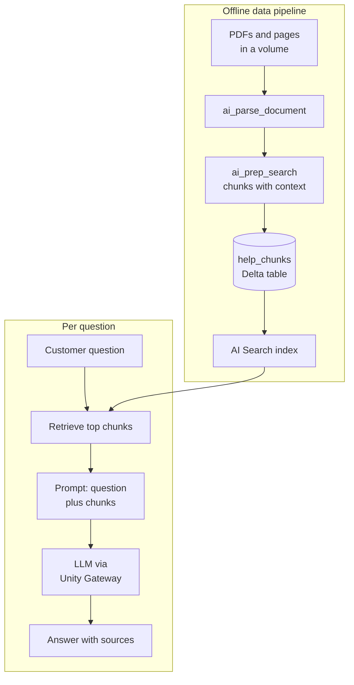

# Retrieval-Augmented Generation

Mastery: `INPUT[inlineSelect(option(new), option(learning), option(solid)):mastery]`

> [!story] Context
> [[AI Search|AI Search]] finds the passages that match a question. An LLM writes fluent answers but does not know your business. Retrieval-augmented generation (RAG) connects the two: retrieve the right passages, then ask the model to answer only from them.

> [!eli5] Summary
> RAG is an open-book exam for AI. Before the AI answers, the system looks up the relevant pages in your own documents and hands them over, so the answer is based on your facts instead of the AI's memory.

> [!analogy]- Analogy: a support rep with a binder
> | Support desk | RAG |
> |---|---|
> | Policy binder, split into tabbed sections | Chunked documents in a Delta table |
> | Index tabs by topic | AI Search index |
> | Flipping to the right pages | Retrieval |
> | Reading the pages aloud and answering | Generation by the LLM |
> | "Per section 4.2 of our policy..." | Citations |
> | Supervisor checking answers against the binder | Groundedness evaluation |

## Background

LLMs answer from patterns learned during training, so they know nothing about private or recent information and can produce confident, wrong answers ([[Hallucination|hallucinations]]). Retraining a model whenever a policy changes is impractical. RAG keeps knowledge outside the model, in documents that can be updated at any time, and supplies the relevant part with each question.

Databricks guidance recommends RAG when information changes often, such as support documents or internal knowledge bases, because the knowledge store can be updated without modifying the model. [[Fine-Tuning]] is for behavior and format, not knowledge.

## Overview

A RAG application has two pipelines:

| Pipeline | Steps | Databricks tools |
|---|---|---|
| **Data pipeline** (offline) | Ingest files, parse, chunk, embed, index | [[Lakeflow Connect]] (for example SharePoint), [[Volumes]], `ai_parse_document`, `ai_prep_search` (Beta), [[AI Search\|AI Search]] |
| **Serving chain** (per question) | Embed question, retrieve chunks, build prompt, call LLM, return answer with sources | AI Search, [[Foundation Model APIs]], [[Unity Gateway\|Unity Gateway]], [[Agent Bricks]] |
| **Quality loop** | Trace, evaluate, collect feedback, fix | [[MLflow]] tracing and judges ([[Agent Evaluation and Tracing]]) |

Chunking strategies described in the Databricks docs include fixed-size, paragraph-based, format-specific (Markdown or HTML headers), and semantic chunking. The docs note that naive fixed-size splitting rarely holds up in production.

## How it works



### Worked example: a support assistant over help docs

A 15-person online plant shop has 300 help center articles and a returns policy PDF.

**1. Parse and chunk in SQL** (files are in the `shop.support.docs` volume):

```sql
CREATE OR REPLACE TABLE shop.support.help_chunks AS
WITH parsed AS (
  SELECT path, ai_parse_document(content) AS doc
  FROM READ_FILES('/Volumes/shop/support/docs/', format => 'binaryFile')
)
SELECT path, chunk.*
FROM parsed
LATERAL VIEW explode(ai_prep_search(doc)) AS chunk;
```

`ai_prep_search` is in Beta, and its exact output columns are documented on its reference page. Add a primary key column if the output does not include one, and enable Change Data Feed on the table.

**2. Index** the table with a Delta Sync index (see [[AI Search]]).

**3. Answer questions** in Python:

```python
import os
from openai import OpenAI
from databricks.ai_search.client import AISearchClient

index = AISearchClient().get_index(endpoint_name="support-search",
                                   index_name="shop.support.help_chunks_index")
llm = OpenAI(api_key=os.environ["DATABRICKS_TOKEN"],
             base_url="https://<workspace-url>/serving-endpoints")

def answer(question: str) -> str:
    hits = index.similarity_search(query_text=question, columns=["path", "text"],
                                   num_results=4, query_type="hybrid")
    context = "\n\n".join(f"[{r[0]}]\n{r[1]}" for r in hits["result"]["data_array"])
    resp = llm.chat.completions.create(
        model="<chat-endpoint>",
        messages=[
            {"role": "system", "content": "Answer only from the context. Cite the [source]. "
                                          "If the context does not contain the answer, say you do not know."},
            {"role": "user", "content": f"Context:\n{context}\n\nQuestion: {question}"},
        ],
    )
    return resp.choices[0].message.content
```

The column names (`path`, `text`) must match the chunk table. To build the same assistant without writing the chain, use a Genie Agent or [[Agent Bricks]].

## Small-business considerations

> [!smallbiz] Small-business considerations
> - **RAG is the usual first GenAI project.** Support answers, staff handbooks, and product FAQs fit well.
> - **Clean documents first.** Outdated or contradictory articles produce outdated or contradictory answers.
> - **Require citations** and a "do not know" fallback in the system prompt.
> - **Build an evaluation set of 20 to 50 real questions** with expected answers before launch. See [[Agent Evaluation and Tracing]].
> - **Cost drivers:** document parsing (billed under AI Functions), embeddings, the AI Search endpoint, and LLM tokens per question. Longer retrieved context means more input tokens.

## Cloud differences

> [!azure]- Azure Databricks
> Same pattern. `ai_parse_document` is available only in some regions; check regional availability. SharePoint is a common source, ingested with Lakeflow Connect.

> [!aws]- Databricks on AWS
> Same pattern. Check regional availability for `ai_parse_document` and models.

> [!gcp]- Databricks on Google Cloud
> Same pattern, subject to regional availability of AI Functions and AI Search features.

## Advanced topics

> [!deepdive]- Advanced topics (301–401)
> - **Retrieval quality first.** Databricks' retrieval quality guide recommends `ai_parse_document` for PDFs and complex documents, since poor parsing of tables and layout hurts retrieval.
> - **Hybrid search and reranking** improve recall for product codes and names.
> - **Metadata filters** restrict retrieval, for example to the current policy version or the customer's region.
> - **Permissions.** The retriever runs with an identity. Make sure it can read only documents the end user is allowed to see.
> - **Evaluation.** The MLflow judges `RetrievalGroundedness` (is the answer supported by retrieved context) and `RetrievalRelevance` (is the context relevant to the request) target RAG failure modes.
> - **RAG and fine-tuning together.** Databricks notes that production systems can combine a fine-tuned model for tone and terminology with RAG for knowledge.

## Common misconceptions

> [!confusion] RAG does not eliminate hallucinations
> It reduces them by supplying facts, but the model can still misread or ignore the context. Evaluate groundedness.

> [!confusion] More retrieved chunks are not always better
> Extra irrelevant chunks dilute the prompt and raise token cost. Tune the number of results with evaluation.

> [!confusion] RAG is not fine-tuning
> RAG changes what the model reads at question time. Fine-tuning changes the model's weights.

## Recall

What does RAG stand for?::Retrieval-augmented generation.
What are the two pipelines in a RAG application?::An offline data pipeline (parse, chunk, embed, index) and a per-question serving chain (retrieve, prompt, generate).
When does Databricks recommend RAG over fine-tuning?::When the knowledge changes often, such as support docs, because documents can be updated without retraining.
Which SQL function parses PDFs for RAG?::`ai_parse_document`.
Which Beta SQL function turns parsed documents into context-rich chunks?::`ai_prep_search`.
Which MLflow judge checks whether an answer is supported by the retrieved context?::`RetrievalGroundedness`.
Why tell the model to say "I do not know"?::So it does not invent answers when the context lacks them.

## Next steps

> [!path] Learning path
> **Needs first:** [[AI Search]], [[Foundation Model APIs]], [[Generative AI and LLMs]]
> **Unlocks next:** [[Agent Bricks]], [[Mosaic AI Agent Framework]], [[Agent Evaluation and Tracing]]

> [!nextup] Next
> [[Agent Bricks]] covers the Databricks platform for building agents that retrieve, call tools, and act, with deployment and evaluation built in.

> [!sources]- Sources (last verified: 2026-10-25)
> - [Build an unstructured data pipeline for RAG (AWS)](https://docs.databricks.com/aws/en/generative-ai/tutorials/ai-cookbook/quality-data-pipeline-rag)
> - [AI Search retrieval quality guide (AWS)](https://docs.databricks.com/aws/en/ai-search/retrieval-quality)
> - [ai_prep_search function (AWS)](https://docs.databricks.com/aws/en/sql/language-manual/functions/ai_prep_search)
> - [ai_prep_search function (Azure Databricks)](https://learn.microsoft.com/en-us/azure/databricks/sql/language-manual/functions/ai_prep_search)
> - [Document Parsing (AWS)](https://docs.databricks.com/aws/en/generative-ai/agent-bricks/document-parsing)
> - [Downstream RAG use case with SharePoint (AWS)](https://docs.databricks.com/aws/en/ingestion/lakeflow-connect/sharepoint-rag)
> - [Transform unstructured data using AI Functions (AWS)](https://docs.databricks.com/aws/en/large-language-models/ai-functions)
> - [Built-in LLM judges (AWS)](https://docs.databricks.com/aws/en/mlflow3/genai/eval-monitor/concepts/judges)
> - [What is retrieval augmented generation (Databricks blog)](https://www.databricks.com/blog/what-is-retrieval-augmented-generation)
> - [RAG vs fine tuning (Databricks blog)](https://www.databricks.com/blog/rag-vs-fine-tuning)
