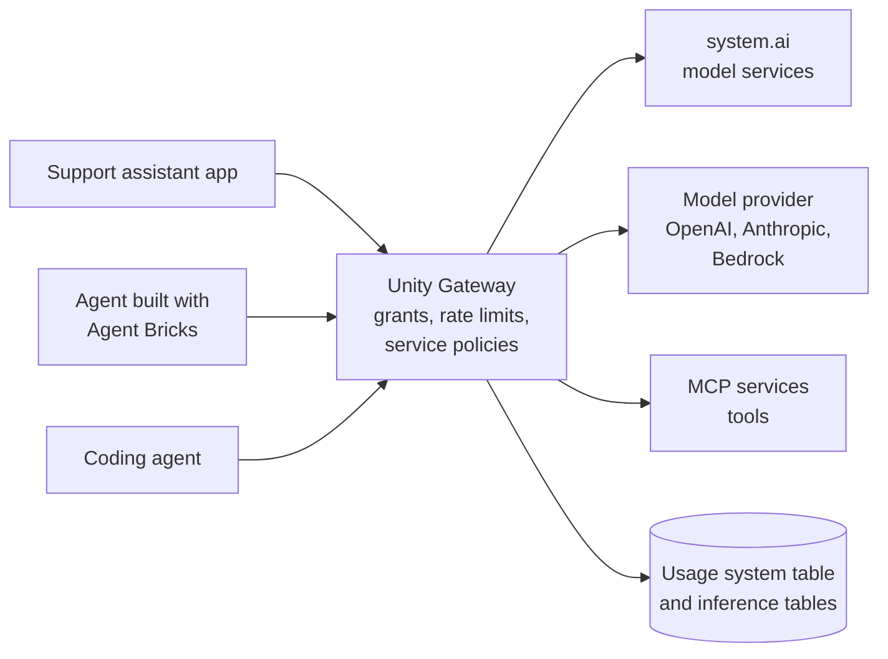

# Unity Gateway

Mastery: `INPUT[inlineSelect(option(new), option(learning), option(solid)):mastery]`

> [!story] Context
> [[Foundation Model APIs]] made LLMs easy to call. Once several apps, agents, and coding tools call several model providers, a business needs one place to decide who may call which model, how much they may spend, what gets logged, and what content is blocked. Unity Gateway is that place.

> [!eli5] Summary
> Unity Gateway is a single checkpoint that every AI request passes through. It checks who is asking, stops anyone from using too much, removes things like credit card numbers, and writes down every request, no matter which AI company's model answers it.

> [!renamed] Renamed: AI Gateway is now Unity Gateway
> Databricks announced on April 15, 2026 that **AI Gateway** (earlier **Mosaic AI Gateway**) is now **Unity Gateway**, as it became part of Unity Catalog. Some pages use the interim name **Unity AI Gateway**. Unity Gateway became generally available on August 4, 2026. Doc URLs still contain `ai-gateway`. Creating **external model** endpoints on Model Serving is now a legacy approach; external providers are reached through **model provider services** in Unity Gateway.

> [!analogy]- Analogy: a building's front desk
> | Front desk | Unity Gateway |
> |---|---|
> | Visitor list and badges | `EXECUTE` grants on model services in Unity Catalog |
> | "Maximum 3 visits per hour" | Rate limits (QPM or TPM) |
> | Bag check | Guardrails (service policies) |
> | Sign-in book | Usage tracking and inference tables |
> | Taxi stand that calls any company | Model providers (OpenAI, Anthropic, Google, Bedrock) |
> | Monthly visitor budget | Spend tracking and caps |

## Background

Without a gateway, every team stores its own API keys for outside providers, there is no shared view of spend, and there is no consistent way to block sensitive data in prompts. Databricks first added AI Gateway features to serving endpoints: rate limits, usage tracking, inference tables, and guardrails. In 2026 the gateway became a Unity Catalog capability, so models, model services, MCP servers, and skills are governed like tables.

## Overview

Databricks describes Unity Gateway as the layer that routes every model and MCP request, enforces rate limits and cost controls, applies service policies to implement guardrails, and records usage across model providers and coding agents.

| Concept | What it is |
|---|---|
| **Model service** | An endpoint that translates and routes inference requests to one or more models, with traffic splitting and fallbacks |
| **Model provider** | A connection to an external provider (for example OpenAI, Anthropic, Google, Amazon Bedrock, Azure AI Foundry) using centrally managed credentials |
| **MCP service** | An interface for agents to discover and call tools through the Model Context Protocol |
| **Skill** | Reusable instructions and files an agent loads |
| **Service policy** | A guardrail that checks requests and responses |
| **System model services** | Databricks-provided model services registered in `system.ai` |

Controls:

| Control | Detail |
|---|---|
| **Permissions** | Services are Unity Catalog securables. `EXECUTE` lets a caller invoke a service; `MANAGE` covers configuration and granting. ABAC grant policies by tag are in Beta. |
| **Rate limits** | Queries per minute (QPM) or tokens per minute (TPM), for all requests or per user |
| **Guardrails** | Built-in Sensitive Data Detection (Beta) blocks or redacts values such as Social Security numbers, credit card numbers, IBANs, and phone numbers. External service policies send content to a partner guardrail vendor. |
| **Usage tracking** | On by default for external providers; token counts, latency, and cost attribution in a system table |
| **Inference tables** | Full request and response payloads logged to Delta tables |
| **Spend controls** | Track and cap spend on external providers (Beta, enabled in the account console) |
| **Coding agents** | Route Claude Code, Codex CLI, Cursor, and Gemini CLI through model services; the `ug` CLI configures them |

## How it works



Call a model service with the OpenAI client, using the base URL in current Unity Gateway quickstarts:

```python
import os
from openai import OpenAI

client = OpenAI(
    api_key=os.environ["DATABRICKS_TOKEN"],
    base_url="https://<workspace-url>/ai-gateway/mlflow/v1",
)

resp = client.chat.completions.create(
    model="system.ai.<model-name>",   # a model service in Unity Catalog
    messages=[{"role": "user", "content": "Draft a polite reply: order 1182 ships Friday."}],
)
```

Request tags sent in a header are logged to the `request_tags` column of the usage system table and of inference tables, which supports cost attribution per app or team. Databricks recommends machine-to-machine OAuth tokens rather than personal access tokens in production.

To give an app access, grant `EXECUTE` on the model service to the app's service principal in Catalog Explorer or with SQL. The securable type for each kind of service (model service, model provider service, MCP service) is listed on the Unity Gateway concepts page.

## Small-business considerations

> [!smallbiz] Small-business considerations
> - **Turn it on before the second AI app:** One gateway means one place for keys, limits, and logs.
> - **Store outside provider keys once** as a model provider, instead of pasting them into apps.
> - **Set a per-user rate limit** on any endpoint exposed to staff, so one script cannot exhaust the budget.
> - **Enable inference tables** for customer-facing assistants, so you can review what was said.
> - **Cost:** usage is metered by the models behind the gateway. Track it with the usage system table and [[Budgets and Usage Dashboards]].

## Cloud differences

> [!azure]- Azure Databricks
> Azure OpenAI and Azure AI Foundry models can be configured as model providers. Microsoft documents Unity Gateway at `learn.microsoft.com/azure/databricks/ai-gateway/`.

> [!aws]- Databricks on AWS
> Amazon Bedrock can be configured as a model provider. Unity Gateway is **not supported on AWS GovCloud** ([[Databricks on AWS GovCloud]]). Regional limits apply elsewhere.

> [!gcp]- Databricks on Google Cloud
> Google Gemini models are available as hosted or provider-backed services. Feature availability by region is listed in the Google Cloud docs.

## Advanced topics

> [!deepdive]- Advanced topics (301–401)
> - **Fallbacks and traffic splits:** A model service can split traffic across models and fall back to another when one fails or is rate-limited.
> - **Smart Routing** (Beta) picks a model for coding tasks.
> - **MCP security:** Jailbreak screening for MCP tool calls is in Beta (October 21, 2026 release notes).
> - **Legacy endpoint-level gateway:** Older serving endpoints have AI Gateway settings (rate limits, inference tables, guardrails) configured per endpoint. New work should use Unity Gateway services.
> - **CLI:** The `ug` command is the primary Unity Gateway CLI; the older `ucode` command still works.
> - **ABAC:** Attribute-based grant policies on model, provider, MCP, and agent services let one tag-based rule govern many services. See [[Attribute-Based Access Control]].

## Common misconceptions

> [!confusion] A gateway does not make a model accurate
> Guardrails block unsafe or sensitive content. Answer quality needs retrieval and evaluation ([[Retrieval-Augmented Generation]], [[Agent Evaluation and Tracing]]).

> [!confusion] Unity Gateway is not only for Databricks-hosted models
> It also routes and governs calls to external providers and MCP tools.

## Recall

What is AI Gateway called since April 2026?::Unity Gateway.
When did Unity Gateway become generally available?::August 4, 2026.
What is a model provider in Unity Gateway?::A connection to an external model provider using centrally managed credentials.
Which privilege lets a caller invoke a Unity Gateway service?::`EXECUTE`.
What two rate-limit units does Unity Gateway support?::Queries per minute (QPM) and tokens per minute (TPM).
How are guardrails implemented in Unity Gateway?::As service policies, such as Sensitive Data Detection (Beta) or an external partner guardrail.
Which cloud environment does not support Unity Gateway?::AWS GovCloud.
What replaced creating external model endpoints on Model Serving?::Model provider services in Unity Gateway.

## Next steps

> [!path] Learning path
> **Needs first:** [[Foundation Model APIs]], [[Unity Catalog]], [[Privileges and Grants]]
> **Unlocks next:** [[AI Search]], [[Retrieval-Augmented Generation]], [[Agent Bricks]]

> [!nextup] Next
> [[AI Search]] covers Databricks AI Search, which finds documents by meaning: the retrieval half of RAG.

> [!sources]- Sources (last verified: 2026-10-25)
> - [Unity Gateway (AWS)](https://docs.databricks.com/aws/en/unity-gateway/)
> - [Unity Gateway concepts (GCP)](https://docs.databricks.com/gcp/en/unity-gateway/concepts)
> - [AI governance with Unity Gateway (Azure Databricks)](https://learn.microsoft.com/en-us/azure/databricks/ai-gateway/)
> - [AI governance guide (AWS)](https://docs.databricks.com/aws/en/ai-gateway/ai-governance)
> - [Unity Gateway release notes (AWS)](https://docs.databricks.com/aws/en/release-notes/unity-gateway/)
> - [Unity Gateway release notes (Azure Databricks)](https://learn.microsoft.com/en-us/azure/databricks/release-notes/unity-gateway/)
> - [Query external model providers (Azure Databricks)](https://learn.microsoft.com/en-us/azure/databricks/ai-gateway/query-model-provider-services)
> - [Query foundation and embedding models (AWS)](https://docs.databricks.com/aws/en/ai-gateway/query-model-services)
> - [Integrate with coding agents (GCP)](https://docs.databricks.com/gcp/en/ai-gateway/coding-agent-integration-model-services)
> - [AI Gateway for serving endpoints (AWS)](https://docs.databricks.com/aws/en/ai-gateway/overview-serving-endpoints)
> - [Tutorial: Create external model endpoints (legacy) (AWS)](https://docs.databricks.com/aws/en/machine-learning/foundation-models/external-models-tutorial)
> - [Unity Gateway: governance layer for agentic AI (Databricks blog)](https://www.databricks.com/blog/ai-gateway-governance-layer-agentic-ai)
