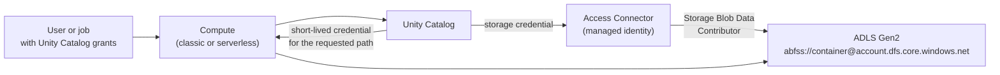

# ADLS and Access Connectors

Mastery: `INPUT[inlineSelect(option(new), option(learning), option(solid)):mastery]`

> [!story] Context
> [[Azure Private Link]] covers network paths to the control plane. This note covers how [[Unity Catalog]] authenticates to your data in [[Azure Data Lake Storage|ADLS Gen2]]: through an Access Connector for Azure Databricks and its [[Managed Identity|managed identity]].

> [!eli5] Summary
> An Access Connector is a special identity that Microsoft's cloud trusts. The company gives that identity permission to read and write a storage account, and Databricks uses it on behalf of approved users, so no passwords or keys are stored anywhere.

## Background

Older Azure Databricks setups reached ADLS with storage account keys, SAS tokens, or service principal secrets set in cluster configuration or mount points. Those secrets had to be rotated, and anyone on the cluster could use them.

Unity Catalog replaces this with [[Storage Credentials and External Locations|storage credentials]]. On Azure, the recommended storage credential is backed by an Azure managed identity held by an Access Connector. Managed identities have two advantages over service principals: no secrets to manage or rotate, and the ability to reach storage accounts protected by network rules.

## Overview

| Component | Azure resource or object | Role |
|---|---|---|
| **Access Connector for Azure Databricks** | `Microsoft.Databricks/accessConnectors` | A first-party Azure resource that connects managed identities to an Azure Databricks account |
| **Managed identity** | System-assigned (default) or user-assigned, or both | The Entra identity that Azure Storage authorizes |
| **Role assignment** | *Storage Blob Data Contributor* on the storage account or container | Grants data access to the identity |
| **Storage credential** | Unity Catalog securable | References the connector's resource ID (and, for user-assigned, the identity's resource ID) |
| **External location** | Unity Catalog securable | Combines a storage credential with an `abfss://` path |

Identity options:

| Identity type | How the storage credential identifies it | When to use |
|---|---|---|
| **System-assigned** | `access_connector_id` only | Default. Lifecycle tied to the connector |
| **User-assigned** | `access_connector_id` plus `managed_identity_id` | One identity reused across connectors, or identity managed separately from the connector |

## How it works



### 1. Create the Access Connector

```bash
az databricks access-connector create \
  --resource-group rg-data-prod \
  --name ac-dbw-prod \
  --location eastus2 \
  --identity-type SystemAssigned
```

`--identity-type` accepts `None`, `SystemAssigned`, `SystemAssigned,UserAssigned`, and `UserAssigned`. Keep the connector, storage account, metastore, and workspaces in the same region.

### 2. Grant the identity access to storage

The person assigning the role needs Owner or User Access Administrator on the storage account.

```bash
PRINCIPAL_ID=$(az databricks access-connector show -g rg-data-prod -n ac-dbw-prod \
  --query identity.principalId -o tsv)
STORAGE_ID=$(az storage account show -g rg-data-prod -n stcontosolake --query id -o tsv)

az role assignment create \
  --assignee-object-id "$PRINCIPAL_ID" --assignee-principal-type ServicePrincipal \
  --role "Storage Blob Data Contributor" \
  --scope "$STORAGE_ID"
```

### 3. Create the storage credential and external location

Creating a storage credential requires the `CREATE STORAGE CREDENTIAL` privilege on the metastore (or metastore admin). A non-account-admin user also needs the Contributor role on the Access Connector.

```bash
databricks storage-credentials create --json '{
  "name": "cred_contoso_lake",
  "azure_managed_identity": {
    "access_connector_id": "/subscriptions/<sub-id>/resourceGroups/rg-data-prod/providers/Microsoft.Databricks/accessConnectors/ac-dbw-prod"
  }
}'
```

```sql
CREATE EXTERNAL LOCATION IF NOT EXISTS lake_raw
  URL 'abfss://raw@stcontosolake.dfs.core.windows.net/'
  WITH (STORAGE CREDENTIAL cred_contoso_lake)
  COMMENT 'Raw landing zone';

GRANT READ FILES ON EXTERNAL LOCATION lake_raw TO `data-engineers`;
```

### Storage accounts behind a firewall

To restrict the storage account to selected networks:

1. In the storage account's **Networking** settings, set **Public network access** to **Enabled from selected virtual networks and IP addresses**.
2. Under **Resource instances**, add resource type `Microsoft.Databricks/accessConnectors` and select your Access Connector.
3. Decide on the **Allow Azure services on the trusted services list** exception. If it is enabled, any Access Connector in the same tenant as the storage account can access the account. Disable it and use the resource instance rule for least privilege.

```bash
az storage account network-rule add \
  --resource-group rg-data-prod --account-name stcontosolake \
  --resource-id "/subscriptions/<sub-id>/resourceGroups/rg-data-prod/providers/Microsoft.Databricks/accessConnectors/ac-dbw-prod" \
  --tenant-id <tenant-id>
```

For VNet-injected workspaces, also allow the workspace subnets (or use private endpoints). For serverless compute, add private endpoint rules for the storage account's `blob` and `dfs` sub-resources in a network connectivity configuration. See [[Serverless Network Security]].

## Small-business considerations

> [!smallbiz] Small-business considerations
> A minimal secure setup is one ADLS Gen2 account, one Access Connector with a system-assigned identity, one storage credential, and one external location per container (for example `raw` and `curated`). Grant the role at the storage account scope and Unity Catalog privileges to groups. Do not use account keys or SAS tokens in notebooks. A serverless workspace can also start with Databricks-managed default storage and add your own ADLS account later. Storage capacity and transactions are billed by Azure.

## Cloud differences

> [!azure]- Azure Databricks
> Storage credentials use an Access Connector's managed identity, granted *Storage Blob Data Contributor* on ADLS Gen2. Paths use `abfss://<container>@<account>.dfs.core.windows.net/`. Firewalled accounts allow the connector through a resource instance rule. The same connector can back service credentials for other Azure services.

> [!aws]- Databricks on AWS
> Storage credentials hold an IAM role ARN that Unity Catalog assumes, with a trust policy and external ID. Paths use `s3://`. See [[S3 Access via Unity Catalog]].

> [!gcp]- Databricks on Google Cloud
> Creating a storage credential generates a Google service account, which you grant roles on the GCS bucket. Paths use `gs://`. See [[GCS Access via Unity Catalog]].

## Advanced topics

> [!deepdive]- Advanced topics (301–401)
> - **Credential vending:** Unity Catalog issues short-lived, path-scoped credentials to compute, and to supported external engines through credential vending, so the managed identity itself is never exposed to users.
> - **Scope of the role:** Grant *Storage Blob Data Contributor* at the narrowest practical scope (container or storage account). One connector can serve several storage accounts, or you can use one connector per business unit to isolate blast radius.
> - **Service credentials:** An Access Connector can also back Unity Catalog service credentials, which let code authenticate to other Azure services without stored secrets.
> - **Workspace storage firewall:** Firewall support for the workspace storage account in the [[Managed Resource Group|managed resource group]] is a separate feature with its own requirements (Premium, secure cluster connectivity).
> - **Terraform:** The `azurerm_databricks_access_connector` resource supports the combined `SystemAssigned, UserAssigned` identity type from AzureRM provider 4.15.0.

## Common misconceptions

> [!confusion] The Access Connector is not a network component
> It is an identity holder. Network access to firewalled storage is a separate configuration: resource instance rules, subnet rules, or private endpoints.

> [!confusion] A storage credential does not grant users access
> Users need Unity Catalog privileges on the external location, table, or volume. The storage credential only lets Unity Catalog itself reach the storage.

## Recall

What Azure resource gives Unity Catalog a managed identity?::The Access Connector for Azure Databricks (`Microsoft.Databricks/accessConnectors`).
Which role does the Access Connector's identity need on ADLS Gen2?::Storage Blob Data Contributor.
What identity does an Access Connector use by default?::A system-assigned managed identity.
What extra field does a storage credential need for a user-assigned identity?::`managed_identity_id` (the identity's resource ID).
Which privilege is needed to create a storage credential?::`CREATE STORAGE CREDENTIAL` on the metastore.
How do you let an Access Connector through a storage firewall?::Add a resource instance rule for `Microsoft.Databricks/accessConnectors` with the connector selected.
What happens if the trusted services exception is enabled on the storage account?::Any Access Connector in the same tenant can access the account.
What is the ADLS Gen2 path scheme?::`abfss://<container>@<account>.dfs.core.windows.net/`.
Why prefer a managed identity over a service principal for storage?::No secrets to rotate, and it can reach storage protected by network rules.

## Next steps

> [!path] Learning path
> **Needs first:** [[Unity Catalog]], [[Storage Credentials and External Locations]], [[Azure Data Lake Storage]]
> **Unlocks next:** [[Managed vs External Tables]], [[Volumes]], [[Customer-Managed Keys on Azure]]

> [!nextup] Next
> [[Azure Key Vault Secret Scopes]] covers secrets that still need storing, such as passwords for external databases.

> [!sources]- Sources (last verified: 2026-10-25)
> - [Use Azure managed identities in Unity Catalog to access storage](https://learn.microsoft.com/en-us/azure/databricks/connect/unity-catalog/cloud-storage/azure-managed-identities)
> - [Connect to an ADLS Gen2 external location (Azure)](https://learn.microsoft.com/en-us/azure/databricks/connect/unity-catalog/cloud-storage/storage-credentials)
> - [Create service credentials (Azure)](https://learn.microsoft.com/en-us/azure/databricks/connect/unity-catalog/cloud-services/service-credentials)
> - [Unity Catalog credential vending (Azure)](https://learn.microsoft.com/en-us/azure/databricks/external-access/credential-vending)
> - [Phase 5: Design storage architecture (Azure)](https://learn.microsoft.com/en-us/azure/databricks/lakehouse-architecture/deployment-guide/storage)
> - [Create a storage credential (Databricks REST API)](https://docs.databricks.com/api/uc-credentials/v1/create-storage-credential)
> - [az databricks access-connector (Azure CLI reference)](https://learn.microsoft.com/en-us/cli/azure/databricks/access-connector?view=azure-cli-latest)
> - [Microsoft.Databricks/accessConnectors template reference](https://learn.microsoft.com/en-us/azure/templates/microsoft.databricks/accessconnectors)
> - [Azure Storage firewall rules and network access](https://learn.microsoft.com/en-us/azure/storage/common/storage-network-security)
> - [Configure private connectivity to Azure resources (serverless)](https://learn.microsoft.com/en-us/azure/databricks/security/network/serverless-network-security/serverless-private-link)
> - [Terraform AzureRM provider version history](https://learn.microsoft.com/en-us/azure/developer/terraform/provider-version-history-azurerm-4-0-0-to-current)
> - [Create a storage credential and external location for S3 (AWS)](https://docs.databricks.com/aws/en/connect/unity-catalog/cloud-storage/s3/s3-external-location-manual)
> - [Connect to a GCS external location (GCP)](https://docs.databricks.com/gcp/en/connect/unity-catalog/cloud-storage/external-locations-gcs)
