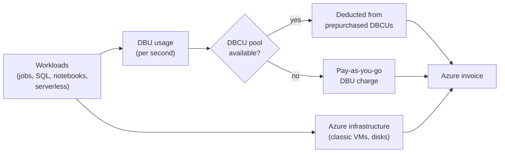

# Azure Billing and Commit Units

Mastery: `INPUT[inlineSelect(option(new), option(learning), option(solid)):mastery]`

> [!story] Context
> [[Power BI on Azure Databricks]] completes the integration notes. This note covers how Azure Databricks usage is metered and billed by Microsoft, how to prepay with Databricks commit units, and where to analyze costs.

> [!eli5] Summary
> Azure Databricks charges by usage, measured in units of computing work, and the charges appear on the company's Microsoft cloud bill. Companies that know they will use a lot can pay for one or three years upfront at a discount. Tags on each workspace and cluster show which team spent what.

## Background

On AWS and Google Cloud, Databricks can bill you directly or through the cloud marketplace. On Azure, as a [[First-Party Microsoft Service|first-party service]], usage is billed directly by Microsoft and governed by your Azure subscription terms. Databricks Units ([[DBUs]]) are the metering unit on every cloud; their rate depends on the workload type (for example jobs, all-purpose, SQL, serverless) and the cloud.

## Overview

### What appears on the Azure invoice

| Charge | Applies to | Notes |
|---|---|---|
| **DBUs** | All compute | Metered per second by workload type. Premium is the only tier for new workspaces |
| **VMs, disks, IPs, NAT gateway** | Classic compute | Billed by Azure as normal resources in the [[Managed Resource Group\|managed resource group]] or your VNet |
| **Serverless** | Serverless compute | The DBU rate includes the underlying VM cost |
| **Storage and networking** | Your ADLS, default storage, egress, private endpoints | Billed by Azure |

Current DBU rates by workload and region are on the [Azure Databricks pricing page](https://azure.microsoft.com/en-us/pricing/details/databricks/). Databricks' [pricing page](https://www.databricks.com/product/pricing) explains the DBU model across clouds and notes that the Azure Premium tier corresponds to the Enterprise tier on AWS and Google Cloud.

### Databricks commit units (prepurchase)

| Property | Value |
|---|---|
| Unit | Databricks commit unit (DBCU) |
| Term | One or three years |
| Where to buy | Azure portal, as a reservation product |
| What it discounts | DBU usage only. Compute, storage, and networking are charged separately |
| How it is consumed | A pool. Usage from any workload or tier is deducted at a ratio matching that workload's DBU list price |
| Assignment | None needed. No workspace redeployment or assignment |
| Multiple plans | The plan with the earliest expiration date is used first |
| Scope | Single resource group, single subscription, shared, or management group |
| Tracking | **Reservations** blade in the Azure portal shows utilization and remaining units. Reservation utilization alerts do not support prepurchase plans |

Databricks introduced DBU prepurchase for Azure Databricks in August 2019.

## How it works



### Size a prepurchase

1. Query 3 to 6 months of DBU usage by workload type from `system.billing.usage`.
2. Normalize each workload's DBUs to DBCUs using the ratios in Microsoft's prepurchase documentation.
3. Project usage over one or three years, including planned growth.
4. Buy a plan that covers the steady baseline and leave peaks on pay-as-you-go.

```sql
-- Monthly DBUs and list cost by workload type (SKU) for the last 6 months
SELECT
  date_trunc('month', u.usage_date)                   AS month,
  u.sku_name,
  SUM(u.usage_quantity)                               AS dbus,
  SUM(u.usage_quantity * lp.pricing.default)          AS list_cost
FROM system.billing.usage AS u
JOIN system.billing.list_prices AS lp
  ON  u.sku_name = lp.sku_name
  AND u.usage_start_time >= lp.price_start_time
  AND (lp.price_end_time IS NULL OR u.usage_start_time < lp.price_end_time)
WHERE u.usage_date >= add_months(current_date(), -6)
GROUP BY ALL
ORDER BY month, dbus DESC;
```

List prices in system tables do not reflect negotiated discounts or DBCU drawdown.

### Analyze costs in Azure

- In the Azure portal, open **Cost Management** > **Cost analysis**. Databricks-created resources carry the default tag `Vendor` = `Databricks`, plus `ClusterId`, `ClusterName`, and `Creator` on cluster VMs.
- Group by resource group to see classic VM and disk costs in each workspace's managed resource group.
- Add custom tags on workspaces, clusters, SQL warehouses, and pools for chargeback. See [[Tagging for Chargeback]].

### Analyze costs in Databricks

- `system.billing.usage` records DBU usage with `usage_metadata.cluster_id`, job and warehouse IDs, and `custom_tags`.
- The account console provides budgets and usage dashboards. See [[Budgets and Usage Dashboards]].

## Small-business considerations

> [!smallbiz] Small-business considerations
> - Start on **pay-as-you-go**. Do not buy DBCUs until you have several months of stable usage history to size against.
> - Tag every workspace and compute resource with a `team` or `project` tag from day one.
> - Set an Azure budget alert on the subscription and a Databricks budget in the account console.
> - Prefer serverless compute and auto-stop for SQL warehouses and clusters; idle classic clusters bill both DBUs and VMs.
>
> See [[Estimating Costs for a Small Business]] for a worked estimate.

## Cloud differences

> [!azure]- Azure Databricks
> Billed by Microsoft on the Azure invoice. Prepay with DBCUs for one or three years through Azure reservations. Costs appear in Azure Cost Management with Databricks default tags.

> [!aws]- Databricks on AWS
> Pay-as-you-go accounts can add AWS Marketplace as a payment method so charges appear in AWS Billing under the service name Databricks. Commitments are negotiated as Databricks contracts or AWS Marketplace private offers. EC2 and other AWS resources are billed separately by AWS. See [[AWS Marketplace and Billing]].

> [!gcp]- Databricks on Google Cloud
> Subscriptions run through Google Cloud Marketplace and are tied to a Google billing account by order number. Negotiated terms use a Google Marketplace private offer. Serverless charges appear in Google Cloud Billing under the service name Databricks. See [[Google Cloud Marketplace and Billing]].

## Advanced topics

> [!deepdive]- Advanced topics (301–401)
> - **Drawdown ratios.** Each DBU workload type deducts a different number of DBCUs, proportional to its list price. A shift from all-purpose to jobs or serverless compute changes how fast a plan is consumed.
> - **Cancellation and exchange.** Check the current terms in Microsoft's prepurchase documentation before buying. Do not assume a plan can be exchanged or refunded.
> - **VM discounts are separate.** DBCUs cover DBUs only. Discounts on classic cluster VMs come from Azure-side mechanisms such as Azure Reservations or Azure savings plan for compute, which follow Azure's own matching rules. Microsoft states that from July 1, 2026, Reserved VM Instances for select older VM series can no longer be purchased or renewed.
> - **Serverless.** Serverless DBU rates include compute, so VM discounts do not apply to serverless usage, but DBCU plans do.
> - **Tag limits.** Cluster tags are not propagated to VMs for clusters created from pools (only workspace and pool tags are). Tags apply only to future usage.

## Common misconceptions

> [!confusion] DBCUs do not cover the VM bill
> A DBCU plan discounts DBU charges only. Classic cluster VMs, disks, storage, and networking are billed by Azure at their own rates.

> [!confusion] "Azure Databricks" in Cost analysis is not only DBUs
> The total Databricks cost of a classic workload includes DBU meters and the Azure infrastructure in the managed resource group. Group and filter by tag and resource group to see both.

## Recall

Who bills Azure Databricks DBU usage?::Microsoft, on the Azure invoice.
What is a DBCU?::A Databricks commit unit, prepurchased through Azure for one or three years to discount DBU usage.
Does a DBCU plan discount VM costs?::No. It applies to DBU usage only.
Do you need to assign a DBCU plan to a workspace?::No. Eligible usage is deducted automatically.
How are different workloads deducted from a DBCU pool?::At a ratio matching each workload's DBU list price.
Where do you track DBCU utilization?::In the Azure portal's Reservations blade.
Which plan is consumed first when you hold several?::The one with the earliest expiration date.
Which system table records DBU usage?::`system.billing.usage`.
Which default tag identifies Databricks-created Azure resources?::`Vendor` = `Databricks`.

## Next steps

> [!path] Learning path
> **Needs first:** [[DBUs]], [[How Databricks Pricing Works]]
> **Unlocks next:** [[Budgets and Usage Dashboards]], [[Tagging for Chargeback]], [[Cost Optimization Checklist]]

> [!nextup] Next
> [[Azure Monitor and Diagnostic Logs]] covers sending Azure Databricks audit and diagnostic logs to Log Analytics, Storage, or Event Hubs.

> [!sources]- Sources (last verified: 2026-10-25)
> - [Optimize Azure Databricks costs with a prepurchase](https://learn.microsoft.com/en-us/azure/cost-management-billing/reservations/prepay-databricks-reserved-capacity)
> - [How an Azure Databricks prepurchase discount is applied](https://learn.microsoft.com/en-us/azure/cost-management-billing/reservations/reservation-discount-databricks)
> - [Reservation utilization alerts (Microsoft Cost Management)](https://learn.microsoft.com/en-us/azure/cost-management-billing/costs/reservation-utilization-alerts)
> - [New cost savings option for Azure Databricks with DBU pre-purchase (Databricks blog)](https://www.databricks.com/blog/2019/08/08/new-cost-savings-option-for-azure-databricks-with-dbu-pre-purchase.html)
> - [Databricks pricing](https://www.databricks.com/product/pricing)
> - [Azure Databricks pricing (Microsoft)](https://azure.microsoft.com/en-us/pricing/details/databricks/)
> - [Cost management tools on Databricks (Azure)](https://learn.microsoft.com/en-us/azure/databricks/admin/usage/)
> - [Monitor costs using system tables (Azure)](https://learn.microsoft.com/en-us/azure/databricks/admin/usage/system-tables)
> - [Billable usage system table reference (Azure)](https://learn.microsoft.com/en-us/azure/databricks/admin/system-tables/billing)
> - [Use tags to attribute and track usage (Azure)](https://learn.microsoft.com/en-us/azure/databricks/admin/account-settings/usage-detail-tags)
> - [Best practices for cost optimization (Azure Databricks)](https://learn.microsoft.com/en-us/azure/databricks/lakehouse-architecture/cost-optimization/best-practices)
> - [Transition guide for retired Azure Reserved VM Instances](https://learn.microsoft.com/en-us/azure/cost-management-billing/reservations/manage-legacy-vm-reservations-after-july-1-2026)
> - [Manage your subscription and billing (AWS)](https://docs.databricks.com/aws/en/admin/account-settings/account)
> - [Manage your subscription (GCP)](https://docs.databricks.com/gcp/en/admin/account-settings/account)
> - [Create a serverless workspace (AWS)](https://docs.databricks.com/aws/en/admin/workspace/serverless-workspaces)
