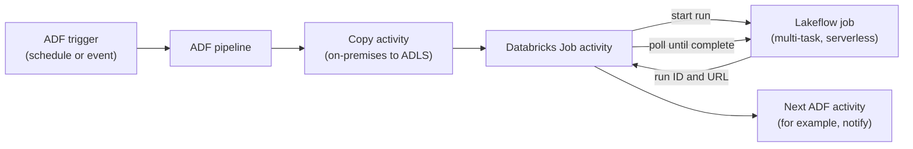

# Azure Data Factory with Databricks

Mastery: `INPUT[inlineSelect(option(new), option(learning), option(solid)):mastery]`

> [!story] Context
> [[Azure Key Vault Secret Scopes]] completes the security setup. Many Azure teams already orchestrate data movement with Azure Data Factory (ADF). This note covers how ADF pipelines run Azure Databricks work, and when [[Lakeflow Jobs]] alone is the better choice.

> [!eli5] Summary
> Azure Data Factory is Microsoft's tool for scheduling and moving data between systems. It can tell Databricks to run a job and wait for the result, so companies that already use it can add Databricks as one step in their existing schedules.

## Background

Azure Data Factory is Azure's managed data integration and [[Orchestration|orchestration]] service. Before Databricks had a mature built-in orchestrator, ADF was the common way to schedule Azure Databricks notebooks: one ADF activity per notebook, each starting its own job cluster.

[[Lakeflow Jobs]] (formerly Databricks Workflows) now provides multi-task orchestration, triggers, retries, and serverless compute inside Databricks. ADF added the **Databricks Job activity**, which runs an existing Lakeflow job instead of an individual notebook. Databricks recommends this activity as the way to orchestrate Databricks jobs from ADF.

## Overview

ADF activities that call Azure Databricks:

| Activity | Runs | Compute | Recommendation |
|---|---|---|---|
| **Databricks Job** (`DatabricksJob`) | An existing Lakeflow job, by job ID, with optional job parameters | The job's own compute, including serverless; no cluster in the linked service | Recommended |
| **Databricks Notebook** (`DatabricksNotebook`) | One notebook, by absolute path, with `baseParameters` | A new job cluster, an existing cluster, or an instance pool, set in the linked service | Legacy pattern; migrate to Job activity |
| **Databricks Jar** and **Databricks Python** | A JAR or Python file | As for Notebook | Legacy pattern |
| **Copy activity** with the Azure Databricks Delta Lake connector | Copies data to or from Delta tables | Azure Databricks compute | For moving data from ADF-supported sources |

Authentication for the Azure Databricks linked service:

| Method | Notes |
|---|---|
| ADF system-assigned managed identity | No token to store. Grant the identity access to the workspace |
| User-assigned managed identity | Supported for the Job activity |
| Personal access token | Supported. Prefer managed identity, which has no token to rotate |

## How it works



1. ADF starts the Lakeflow job through the linked service.
2. The activity receives the job run ID and run URL.
3. ADF polls until the run finishes, then marks the activity succeeded or failed.
4. In Databricks, the run appears in the job's run history, launched by an API request.

### Job activity definition

```json
{
  "name": "Run nightly lakehouse job",
  "type": "DatabricksJob",
  "linkedServiceName": {
    "referenceName": "ls_databricks_prod",
    "type": "LinkedServiceReference"
  },
  "typeProperties": {
    "jobID": "123456789012345",
    "jobParameters": {
      "run_date": "@formatDateTime(pipeline().TriggerTime, 'yyyy-MM-dd')"
    }
  }
}
```

Job parameters that you do not pass use the job's default values. On a self-hosted integration runtime, job parameters require version 5.52.0.0 or later.

### Notebook activity definition (legacy pattern)

```json
{
  "name": "Run silver notebook",
  "type": "DatabricksNotebook",
  "linkedServiceName": { "referenceName": "ls_databricks_prod", "type": "LinkedServiceReference" },
  "typeProperties": {
    "notebookPath": "/Workspace/Shared/pipelines/silver_orders",
    "baseParameters": { "run_date": "@pipeline().parameters.run_date" }
  }
}
```

`notebookPath` must be an absolute path that begins with `/`. Notebook parameters are read with widgets, and a notebook can return a value to ADF with `dbutils.notebook.exit()`.

## Small-business considerations

> [!smallbiz] Small-business considerations
> If you do not already use Azure Data Factory, do not add it for Databricks work. Lakeflow Jobs schedules multi-task workflows, [[Lakeflow Connect]] ingests from common sources, and both are managed in one place.
>
> Use ADF with the Databricks Job activity when:
> - ADF already orchestrates other systems and Databricks is one step, or
> - you need ADF's self-hosted integration runtime to copy data from on-premises servers.
>
> ADF bills separately for pipeline activity runs and data movement. See the Azure Data Factory pricing page.

## Cloud differences

> [!azure]- Azure Databricks
> ADF provides native Databricks Job, Notebook, Jar, and Python activities, a Delta Lake copy connector, and managed identity authentication. In Microsoft Fabric, Data Factory pipelines provide a single Azure Databricks activity that covers Notebook, Jar, Python, and Job types, including serverless jobs.

> [!aws]- Databricks on AWS
> There is no ADF. Use [[Lakeflow Jobs]], or orchestrate Databricks jobs from [[Apache Airflow]] with the Databricks provider, the Jobs REST API, or the Databricks CLI and SDKs.

> [!gcp]- Databricks on Google Cloud
> There is no ADF. Use [[Lakeflow Jobs]] or [[Apache Airflow]] (for example, in a managed Airflow service) with the Databricks provider or the Jobs REST API.

## Advanced topics

> [!deepdive]- Advanced topics (301–401)
> - **Cluster startup overhead:** The Notebook activity pattern launches a job cluster per activity, which adds startup time to every step. Moving the steps into one multi-task Lakeflow job, run by a single Job activity, shares compute across tasks and enables serverless.
> - **Where logic lives:** Put dependencies, retries, and branching in the Lakeflow job (see [[Tasks Triggers and Schedules]]). Keep ADF responsible for cross-system sequencing and on-premises copy. This keeps run history, lineage, and costs visible in Databricks [[System Tables|system tables]].
> - **Managed identity permissions:** For managed identity authentication from the Notebook activity, Microsoft's tutorial grants the identity the Contributor role on the Azure Databricks workspace resource. Prefer adding the identity as a workspace service principal with only the job permissions it needs.
> - **Limits:** A workspace allows up to 2,000 concurrent task runs, and a job can contain up to 1,000 tasks.
> - **Migration path:** Microsoft positions Data Factory in Microsoft Fabric as the successor to ADF. Its Azure Databricks activity runs the same job types. Plan new orchestration either in Lakeflow Jobs or in Fabric Data Factory, not in new ADF Notebook activities.

## Common misconceptions

> [!confusion] ADF does not run the Spark code
> ADF only starts and monitors work. The code runs on Databricks compute, which is billed by Databricks in DBUs.

> [!confusion] The Job activity is not the Notebook activity
> The Job activity runs an existing Lakeflow job with its own tasks and compute. The Notebook activity runs a single notebook with compute defined in the ADF linked service.

## Recall

Which ADF activity does Databricks recommend for orchestrating Databricks work?::The Databricks Job activity (`DatabricksJob`).
What does the Databricks Job activity run?::An existing Lakeflow job, by job ID, with optional job parameters.
Does the Job activity need a cluster in the linked service?::No. The job runs on its own compute, including serverless.
How does ADF track a Databricks job run?::It receives the run ID and URL, then polls until the run completes.
Which property names the notebook in a Notebook activity?::`notebookPath`, an absolute path beginning with `/`.
How does a notebook return a value to ADF?::With `dbutils.notebook.exit()`.
Which managed identity options does the Databricks linked service support?::The ADF system-assigned managed identity and user-assigned managed identities.
What orchestrators replace ADF on AWS and Google Cloud?::Lakeflow Jobs, or Apache Airflow with the Databricks provider.

## Next steps

> [!path] Learning path
> **Needs first:** [[Lakeflow Jobs]], [[Orchestration]]
> **Unlocks next:** [[Microsoft Fabric and OneLake vs Databricks]], [[Migrating ETL Tools]]

> [!nextup] Next
> [[Microsoft Fabric and OneLake vs Databricks]] compares Microsoft's SaaS analytics platform with Azure Databricks and describes how they integrate.

> [!sources]- Sources (last verified: 2026-10-25)
> - [Best Practices: Kicking off Databricks Workflows natively in Azure Data Factory (Databricks blog)](https://www.databricks.com/blog/best-practices-kicking-databricks-workflows-natively-azure-data-factory)
> - [Transform data with Databricks Job (Azure Data Factory)](https://learn.microsoft.com/en-us/azure/data-factory/transform-data-databricks-job)
> - [Transform data with Databricks Notebook (Azure Data Factory)](https://learn.microsoft.com/en-us/azure/data-factory/transform-data-databricks-notebook)
> - [Run a Databricks Notebook with the activity (Azure Data Factory)](https://learn.microsoft.com/en-us/azure/data-factory/transform-data-using-databricks-notebook)
> - [Compute environments (Azure Data Factory)](https://learn.microsoft.com/en-us/azure/data-factory/compute-linked-services)
> - [Copy data to and from Azure Databricks Delta Lake (Azure Data Factory)](https://learn.microsoft.com/en-us/azure/data-factory/connector-azure-databricks-delta-lake)
> - [Lakeflow Jobs (Azure Databricks)](https://learn.microsoft.com/en-us/azure/databricks/jobs/)
> - [Monitor Lakeflow Jobs (Azure Databricks)](https://learn.microsoft.com/en-us/azure/databricks/jobs/monitor)
> - [Orchestrate Lakeflow Jobs with Apache Airflow (Azure Databricks)](https://learn.microsoft.com/en-us/azure/databricks/jobs/how-to/use-airflow-with-jobs)
> - [Azure Databricks activity (Microsoft Fabric)](https://learn.microsoft.com/en-us/fabric/data-factory/azure-databricks-activity)
> - [Differences between Data Factory in Fabric and Azure](https://learn.microsoft.com/en-us/fabric/data-factory/compare-fabric-data-factory-and-azure-data-factory)
> - [Upgrade planning for Azure Data Factory to Fabric Data Factory](https://learn.microsoft.com/en-us/fabric/data-factory/upgrade-planning-azure-data-factory)
