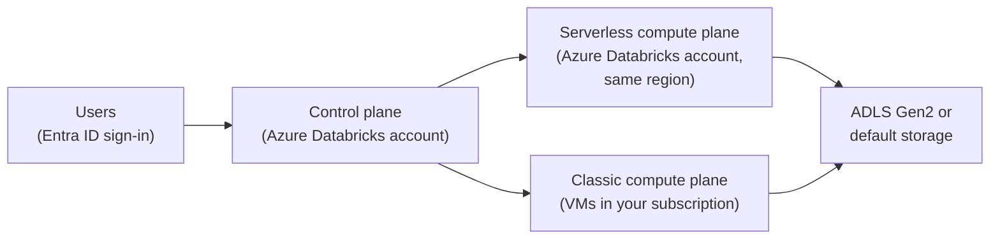

# Azure Databricks Overview

Mastery: `INPUT[inlineSelect(option(new), option(learning), option(solid)):mastery]`

> [!story] Context
> [[Chapter 11 - Azure Databricks|Chapter 11]] begins Part 2, which covers how Databricks runs on each cloud. On Microsoft Azure, Databricks is offered as Azure Databricks, a service that Microsoft sells, bills, and supports.

> [!eli5] Summary
> Azure Databricks is Databricks bought from Microsoft. It is created from the same website as Microsoft's other cloud services, people sign in with their existing work Microsoft accounts, and the cost appears on the company's normal Microsoft cloud bill.

> [!analogy]- Analogy: a concession inside a department store
> | Department store | Azure Databricks |
> |---|---|
> | A well-known restaurant brand | The Databricks platform, unchanged |
> | The store building | Azure |
> | Paying at the store's tills | Charges on the Azure invoice |
> | The store loyalty card | [[Microsoft Entra ID Integration\|Microsoft Entra ID]] sign-in |

## Background

Many organizations already standardize on Microsoft: Microsoft 365, Microsoft Entra ID (formerly Azure Active Directory) for sign-in, Power BI for reporting, and an Azure subscription for cloud spend. Adopting a separate data platform from another vendor normally adds a contract, a security review, a separate identity setup, and a second invoice.

Azure Databricks removes those steps. Databricks announced it in preview in November 2017 as a "first party" Microsoft service built through a year-long joint effort with Microsoft. It became generally available on **March 22, 2018**. The service appears in the Azure portal next to other Azure services. See [[First-Party Microsoft Service]].

## Overview

Azure Databricks is the same [[The Data Intelligence Platform|Data Intelligence Platform]] described in [[Chapter 06 - The Databricks Platform|chapter 06]]: [[Unity Catalog]], [[Lakeflow]], [[Databricks SQL]], [[Notebooks]], [[MLflow]], and the rest. SQL, Python, and the REST APIs behave the same. The Azure-specific parts are the integration points:

| Area | Azure implementation | Note |
|---|---|---|
| **Provisioning** | An Azure resource of type `Microsoft.Databricks/workspaces` | [[Creating an Azure Databricks Workspace]] |
| **Billing** | Microsoft bills usage under your Azure subscription terms; Databricks commit units can be prepurchased | [[Azure Billing and Commit Units]] |
| **Identity** | Microsoft Entra ID is built in | [[Microsoft Entra ID Integration]] |
| **Classic compute** | Azure VMs in a [[Managed Resource Group\|managed resource group]] or your own VNet | [[Managed Resource Group]], [[VNet Injection]] |
| **Network security** | NSGs, NAT gateway, Azure Private Link | [[Secure Cluster Connectivity]], [[Azure Private Link]] |
| **Storage access** | [[Azure Data Lake Storage\|ADLS Gen2]] through an Access Connector (`Microsoft.Databricks/accessConnectors`) | [[ADLS and Access Connectors]] |
| **Secrets and keys** | Azure Key Vault and Azure Key Vault Managed HSM | [[Azure Key Vault Secret Scopes]], [[Customer-Managed Keys on Azure]] |
| **Integrations** | Azure Data Factory, Microsoft Fabric, Power BI | [[Azure Data Factory with Databricks]], [[Microsoft Fabric and OneLake vs Databricks]], [[Power BI on Azure Databricks]] |
| **Logging** | Azure Monitor diagnostic settings, plus [[System Tables\|system tables]] | [[Azure Monitor and Diagnostic Logs]] |

Two 2026 changes apply to all new deployments:

- **Premium is the only tier.** New workspaces must be created on the Premium tier starting April 1, 2026. Remaining Standard tier workspaces were scheduled for automatic upgrade to Premium on October 1, 2026. Databricks' pricing page states that the Azure Premium tier corresponds to the Enterprise tier on AWS and Google Cloud.
- **Serverless workspaces.** A serverless workspace is preconfigured with [[Serverless Compute|serverless compute]] and Databricks-managed default storage. It has no classic compute in your subscription. Microsoft's portal guide recommends it for the simplest setup.

## How it works

Azure Databricks uses the standard [[Control Plane and Compute Plane|control plane and compute plane]] split.



| Component | Location |
|---|---|
| **Control plane** | Backend services, including the web application, run in the Azure Databricks account, not in your subscription. |
| **Classic compute plane** | Cluster VMs, disks, and network interfaces run in your Azure subscription, in a virtual network. |
| **Serverless compute plane** | Serverless SQL warehouses, notebooks, and jobs run in the Azure Databricks account, in the same region as the workspace. |

A workspace is managed like any other Azure resource:

```bash
# List Azure Databricks workspaces in a resource group
az databricks workspace list --resource-group rg-data-prod --output table
```

## Small-business considerations

> [!smallbiz] Small-business considerations
> For an organization that already uses Microsoft 365 and an Azure subscription, Azure Databricks requires no new vendor contract. Users sign in with existing accounts, charges appear on the Azure invoice, and Power BI connects directly.
>
> Start with a **serverless workspace** in the region where your data and users are. It requires no network design and runs no VMs in your subscription. Defer VNet injection, Private Link, and customer-managed keys until a contract or regulation requires them. Charges are metered in [[DBUs]] by workload type; see the [Azure Databricks pricing page](https://azure.microsoft.com/en-us/pricing/details/databricks/) for current rates.

## Cloud differences

> [!azure]- Azure Databricks
> Azure-only characteristics: sold and billed by Microsoft as a first-party service, built-in Entra ID, a locked [[Managed Resource Group|managed resource group]] for classic compute, Access Connectors for storage, Key Vault-backed secret scopes, and native integrations with Data Factory, Fabric, and Power BI. This chapter covers each one.

> [!aws]- Databricks on AWS
> Databricks is sold directly by Databricks or through AWS Marketplace, and workspaces are created in the Databricks account console. Databricks accesses your AWS account through a [[Cross-Account IAM Role|cross-account IAM role]] and a [[Workspace Storage Bucket|workspace S3 bucket]]. See [[Databricks on AWS Overview]].

> [!gcp]- Databricks on Google Cloud
> You subscribe through Google Cloud Marketplace and create workspaces in the Databricks account console. Databricks creates GCS buckets in your project and authenticates with [[Google Service Accounts|Google service accounts]]. See [[Databricks on Google Cloud Overview]].

## Advanced topics

> [!deepdive]- Advanced topics (301–401)
> - **Two management surfaces.** Azure resources (workspace, Access Connector, VNets, private endpoints) are managed with the Azure portal, Azure CLI, Bicep, ARM templates, or Terraform. Databricks account objects (metastores, account users, network connectivity configurations, budgets) are managed in the [[Account Console|account console]] at `accounts.azuredatabricks.net`.
> - **Classic workspaces on a Databricks-managed VNet.** Microsoft states that it plans to deprecate creating classic workspaces with an Azure Databricks-managed VNet. Plan new classic workspaces with [[VNet Injection]].
> - **Secure cluster connectivity.** Microsoft states that Azure Databricks plans to require [[Secure Cluster Connectivity|secure cluster connectivity]] for all classic workspaces, and that workspaces created with `enableNoPublicIp` set to `false` will no longer be supported.
> - **Unity Catalog by default.** Unity Catalog is automatically enabled for Azure Databricks workspaces created after November 9, 2023. Unity Catalog requires Premium, which is now the only tier.

## Common misconceptions

> [!confusion] Azure Databricks is not a Marketplace resale
> It is a first-party Azure service, created and billed like other Azure resources, not a third-party Azure Marketplace listing.

> [!confusion] Azure Databricks is not Microsoft Fabric
> Both are Microsoft-sold analytics platforms that use Spark and Delta Lake. They are separate products with separate engines, billing models, and governance, and they integrate with each other. See [[Microsoft Fabric and OneLake vs Databricks]].

> [!confusion] Platform features are not Azure-specific
> Unity Catalog, Lakeflow, Databricks SQL, and Mosaic AI work the same way on all three clouds. Only identity, networking, storage access, encryption keys, and billing differ.

## Recall

When did Azure Databricks become generally available?::March 22, 2018 (preview announced November 2017).
Who bills Azure Databricks usage?::Microsoft, under the customer's Azure subscription terms.
What Azure resource type is an Azure Databricks workspace?::`Microsoft.Databricks/workspaces`.
Which pricing tier must new Azure Databricks workspaces use from April 1, 2026?::Premium. The Standard tier is retired.
Which AWS and GCP tier corresponds to Azure Premium?::Enterprise.
Where do classic cluster VMs run on Azure?::In your Azure subscription, in a virtual network.
Where does serverless compute run on Azure Databricks?::In the Azure Databricks account, in the same region as the workspace.
What is a serverless workspace preconfigured with?::Serverless compute and default storage.

## Next steps

> [!path] Learning path
> **Needs first:** [[Accounts and Workspaces]], [[Control Plane and Compute Plane]]
> **Unlocks next:** [[First-Party Microsoft Service]], [[Creating an Azure Databricks Workspace]], [[Microsoft Entra ID Integration]]

> [!nextup] Next
> [[First-Party Microsoft Service]] covers what first-party status means for provisioning, billing, support, and identity.

> [!sources]- Sources (last verified: 2026-10-25)
> - [Introducing Azure Databricks (Databricks blog, November 2017)](https://www.databricks.com/blog/2017/11/15/introducing-azure-databricks.html)
> - [Databricks Delivers Microsoft Azure Databricks (press release)](https://www.databricks.com/company/newsroom/press-releases/databricks-delivers-microsoft-azure-databricks-addressing-customer-demand)
> - [High-level architecture (Azure Databricks)](https://learn.microsoft.com/en-us/azure/databricks/getting-started/high-level-architecture)
> - [End of life for Standard tier workspaces](https://learn.microsoft.com/en-us/azure/databricks/admin/account-settings/standard-tier)
> - [Create a serverless workspace (Azure)](https://learn.microsoft.com/en-us/azure/databricks/admin/workspace/serverless-workspaces)
> - [Deploy a workspace using the Azure portal](https://learn.microsoft.com/en-us/azure/databricks/admin/workspace/create-workspace)
> - [Enable secure cluster connectivity](https://learn.microsoft.com/en-us/azure/databricks/security/network/classic/secure-cluster-connectivity)
> - [Use Azure managed identities in Unity Catalog to access storage](https://learn.microsoft.com/en-us/azure/databricks/connect/unity-catalog/cloud-storage/azure-managed-identities)
> - [What is Unity Catalog? (Azure Databricks)](https://learn.microsoft.com/en-us/azure/databricks/data-governance/unity-catalog/)
> - [az databricks workspace (Azure CLI reference)](https://learn.microsoft.com/en-us/cli/azure/databricks/workspace?view=azure-cli-latest)
> - [Databricks pricing](https://www.databricks.com/product/pricing)
> - [Azure Databricks pricing (Microsoft)](https://azure.microsoft.com/en-us/pricing/details/databricks/)
