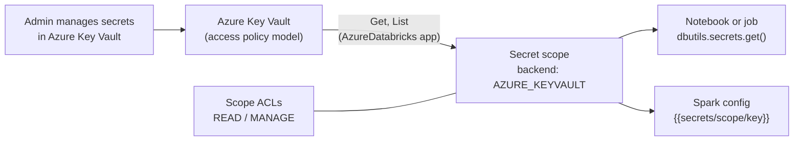

# Azure Key Vault Secret Scopes

Mastery: `INPUT[inlineSelect(option(new), option(learning), option(solid)):mastery]`

> [!story] Context
> [[ADLS and Access Connectors]] removes secrets from storage access. Some credentials remain, such as passwords for external databases or API keys for SaaS sources. On Azure, these can live in Azure Key Vault and be read from Databricks through a Key Vault-backed secret scope.

> [!eli5] Summary
> A secret scope is a locked drawer of passwords that code can use without anyone seeing them. With a Key Vault-backed scope, the drawer is the company's existing Microsoft password vault, and Databricks only reads from it.

## Background

[[Secrets Management|Secret scopes]] keep credentials out of notebook code. A scope has one of two backends:

| Backend | Storage | Write from Databricks | Available on |
|---|---|---|---|
| **Databricks-backed** (`DATABRICKS`) | Encrypted database owned and managed by Databricks | Yes | All clouds |
| **Azure Key Vault-backed** (`AZURE_KEYVAULT`) | An Azure Key Vault you own | No. Manage secrets in Azure | Azure only |

Organizations that already manage credentials in Key Vault, with its rotation, audit, and access processes, use Key Vault-backed scopes so that Databricks reads the same source of truth.

## Overview

| Property | Key Vault-backed scope |
|---|---|
| Interface | Read-only from Databricks. Add, update, and delete secrets in Azure Key Vault |
| Key Vault permission model | **Vault access policy** only. Azure RBAC permission model is not supported |
| Who can create | A user with the Key Vault Contributor, Contributor, or Owner role on the vault |
| What creation does | Grants **Get** and **List** permissions on the vault to the Azure Databricks application through a vault access policy |
| Access granularity | Databricks ACLs apply to the whole scope. Users with access to the scope can read every secret in the vault |
| ACL levels | `READ`, `WRITE`, `MANAGE` (Premium plan for per-principal ACLs) |
| Scope names | Case insensitive, unique per workspace, visible to all workspace users |

Because access is all-or-nothing per vault, create **one Key Vault per trust boundary** (for example, one vault per team or environment) when different groups need different secrets.

## How it works



### Create the scope in the UI

1. In the Azure portal, open the Key Vault and copy **Vault URI** (the DNS name) and **Resource ID** from **Settings** > **Properties**.
2. Go to `https://<workspace-url>#secrets/createScope`. The URL is case sensitive (`createScope` has an uppercase `S`).
3. Enter a scope name, choose the **Manage Principal** (**Creator** or **All workspace users**), paste the DNS name and resource ID, and select **Create**.
4. Verify with `databricks secrets list-scopes`.

### Create the scope as code

With [[Declarative Automation Bundles]] (formerly Databricks Asset Bundles; `secret_scope` resources require Databricks CLI 0.252.0 or later):

```yaml
resources:
  secret_scopes:
    kv_prod:
      name: kv-prod
      backend_type: AZURE_KEYVAULT
      keyvault_metadata:
        resource_id: /subscriptions/<sub-id>/resourceGroups/rg-security/providers/Microsoft.KeyVault/vaults/kv-contoso-prod
        dns_name: https://kv-contoso-prod.vault.azure.net/
      permissions:
        - group_name: data-engineers
          level: READ
```

With the Databricks CLI, `databricks secrets create-scope` accepts `--scope-backend-type AZURE_KEYVAULT` together with the vault's resource ID and DNS name. Check `databricks secrets create-scope --help` for the exact flags in your CLI version.

### Read a secret

```python
# Python notebook: value is redacted if printed
jdbc_password = dbutils.secrets.get(scope="kv-prod", key="erp-sql-password")

df = (spark.read.format("sqlserver")
      .option("host", "erp-sql.contoso.internal")
      .option("user", "svc_databricks")
      .option("password", jdbc_password)
      .option("database", "erp")
      .option("dbtable", "dbo.orders")
      .load())
```

In cluster Spark configuration or environment variables, reference a secret as `{{secrets/kv-prod/erp-sql-password}}`.

Grant access to a group:

```bash
databricks secrets put-acl kv-prod data-engineers READ
```

## Small-business considerations

> [!smallbiz] Small-business considerations
> If you do not already use Azure Key Vault, a Databricks-backed scope is simpler: you create and update secrets directly with the Databricks CLI. Choose a Key Vault-backed scope when your IT team already stores credentials in Key Vault and wants one place to rotate them. In either case, prefer identities without secrets where possible: Access Connectors for storage and Lakehouse Federation connections for databases. Key Vault operations are billed by Azure.

## Cloud differences

> [!azure]- Azure Databricks
> Supports both Databricks-backed and Azure Key Vault-backed scopes. Key Vault-backed scopes are read-only, require the vault access policy model, and grant the Azure Databricks application Get and List on the vault.

> [!aws]- Databricks on AWS
> Only Databricks-backed scopes exist. The secrets API, ACLs, `dbutils.secrets`, and limits are the same. See [[Secrets Management]].

> [!gcp]- Databricks on Google Cloud
> Only Databricks-backed scopes exist. Databricks recommends secret scopes for credentials such as Google service account keys used in Spark configuration.

## Advanced topics

> [!deepdive]- Advanced topics (301–401)
> - **RBAC vaults.** A vault using the Azure RBAC permission model cannot back a secret scope. Switch the vault to the vault access policy model before creating the scope, or use a separate vault for Databricks.
> - **Blast radius.** Every principal with `READ` on the scope can read every secret in the vault. Map vaults to access boundaries rather than putting all credentials in one vault.
> - **Creation permission is checked every time.** Creating a scope requires Key Vault Contributor, Contributor, or Owner on the vault even if the Azure Databricks service already has an access policy on it.
> - **Databricks-backed limits.** Databricks-backed scopes allow up to 1,000 secrets per scope and 128 KB per secret value.
> - **Alternatives.** Unity Catalog service credentials (backed by an Access Connector) let code call Azure services, including Key Vault, with a managed identity instead of a stored secret.

## Common misconceptions

> [!confusion] You cannot write to a Key Vault-backed scope from Databricks
> `databricks secrets put-secret` works only on Databricks-backed scopes. Manage Key Vault-backed secrets in Azure.

> [!confusion] Scope ACLs do not filter individual Key Vault secrets
> ACLs apply to the whole scope, and therefore to every secret in the backing vault.

## Recall

What are the two secret scope backends?::Databricks-backed (`DATABRICKS`) and Azure Key Vault-backed (`AZURE_KEYVAULT`).
Can you write secrets to a Key Vault-backed scope from Databricks?::No. It is read-only; manage secrets in Azure Key Vault.
Which Key Vault permission model do Key Vault-backed scopes support?::Vault access policy only; Azure RBAC is not supported.
Which roles allow creating a Key Vault-backed scope?::Key Vault Contributor, Contributor, or Owner on the vault.
What permissions does creating the scope grant the Azure Databricks application?::Get and List, through a vault access policy.
Why use one vault per trust boundary?::Scope ACLs apply to the whole vault, so anyone who can read the scope can read every secret in it.
What is the UI path to create a scope?::`https://<workspace-url>#secrets/createScope` (case sensitive).
How do you reference a secret in Spark configuration?::`{{secrets/<scope>/<key>}}`.

## Next steps

> [!path] Learning path
> **Needs first:** [[Secrets Management]], [[Microsoft Entra ID Integration]]
> **Unlocks next:** [[Azure Data Factory with Databricks]], [[Lakehouse Federation]]

> [!nextup] Next
> [[Azure Data Factory with Databricks]] covers orchestrating Databricks jobs from Azure Data Factory pipelines.

> [!sources]- Sources (last verified: 2026-10-25)
> - [Secret management (Azure Databricks)](https://learn.microsoft.com/en-us/azure/databricks/security/secrets/)
> - [secrets command group (Azure Databricks CLI)](https://learn.microsoft.com/en-us/azure/databricks/dev-tools/cli/reference/secrets-commands)
> - [Secrets CLI (legacy) (Azure Databricks)](https://learn.microsoft.com/en-us/azure/databricks/archive/dev-tools/cli/secrets-cli)
> - [Declarative Automation Bundles resources (Azure)](https://learn.microsoft.com/en-us/azure/databricks/dev-tools/bundles/resources)
> - [Create a new secret scope (Databricks REST API)](https://docs.databricks.com/api/workspace/secrets/createscope)
> - [Create service credentials (Azure)](https://learn.microsoft.com/en-us/azure/databricks/connect/unity-catalog/cloud-services/service-credentials)
> - [Grant permission to applications to access an Azure key vault using Azure RBAC](https://learn.microsoft.com/en-us/azure/key-vault/general/rbac-guide)
> - [Secret management (AWS)](https://docs.databricks.com/aws/en/security/secrets/)
> - [Secret management (GCP)](https://docs.databricks.com/gcp/en/security/secrets/)
> - [Connect to Google Cloud Storage (Databricks)](https://docs.databricks.com/aws/en/connect/storage/gcs)
