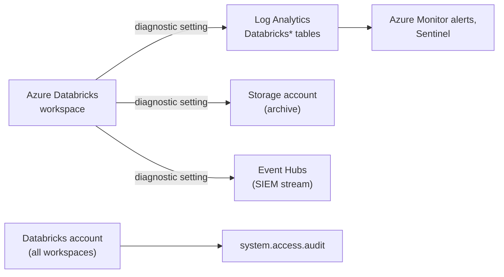

# Azure Monitor and Diagnostic Logs

Mastery: `INPUT[inlineSelect(option(new), option(learning), option(solid)):mastery]`

> [!story] Context
> [[Azure Billing and Commit Units]] covers what the platform costs. This note covers what happened on it: how Azure Databricks audit events reach Azure Monitor through diagnostic settings, and how that compares with the `system.access.audit` system table.

> [!eli5] Summary
> Azure Databricks keeps a record of who did what, such as starting a cluster or reading a secret. Diagnostic logging copies those records into Microsoft's monitoring tools, so the security team can search them and raise alerts alongside the rest of the company's Azure logs.

## Background

Security teams on Azure usually centralize logs in Azure Monitor (Log Analytics workspaces), often feeding Microsoft Sentinel or another [[SIEM]] through Event Hubs. Azure Databricks integrates with this through **diagnostic settings** on the workspace resource, the same mechanism used by other Azure services.

Databricks also provides the [[Audit Logs|audit log]] as a [[System Tables|system table]], `system.access.audit`, which covers more event types. Databricks recommends the system table for accessing audit logs.

## Overview

| Option | Destination | Coverage | Requirement |
|---|---|---|---|
| **Diagnostic settings** | Log Analytics workspace, storage account, Event Hubs (one of each type per setting) | Workspace-level events; no account-level events | Premium plan |
| **Audit log system table** (`system.access.audit`) | Unity Catalog table, queryable with SQL | Workspace and account-level events, including services not available in diagnostic logs | Unity Catalog; system schema enabled |

Services available only through the system table include account-level events, groups, and cluster policies. Unity Catalog events are logged at the account level (with `workspace_id` = `0`) and are not available through Azure diagnostic settings.

In Log Analytics, each category is written to its own table:

| Category (display name) | Log Analytics table |
|---|---|
| Databricks Accounts | `DatabricksAccounts` |
| Databricks Clusters | `DatabricksClusters` |
| Databricks DBFS | `DatabricksDBFS` |
| Databricks Jobs | `DatabricksJobs` |
| Databricks Notebook | `DatabricksNotebook` |
| Databricks Secrets | `DatabricksSecrets` |
| Databricks SQL Permissions | `DatabricksSQLPermissions` |
| Databricks Workspace | `DatabricksWorkspace` |

The full, current list is in the Azure Monitor "Supported log categories for Microsoft.Databricks/workspaces" reference. Some categories incur export costs.

## How it works



### Configure in the Azure portal

1. Sign in as an Owner, Contributor, or a user with a custom role that includes `Microsoft.Databricks/workspaces/assignWorkspaceAdmin/action`.
2. Open the Azure Databricks workspace resource.
3. Under **Monitoring**, select **Diagnostic settings** > **Turn on diagnostics** (or **Add diagnostic setting**).
4. Enter a name, select the log categories, and select destinations: **Send to Log Analytics workspace**, **Archive to a storage account**, or **Stream to an event hub**.
5. Select **Save**.

Destination requirements: the storage account must be a Standard account (Premium storage accounts are not supported as destinations), regional destinations must be in the same region as the workspace, and an Event Hubs destination needs an existing namespace and event hub with an access policy that has Manage, Send, and Listen rights.

### Configure with the Azure CLI

```bash
WS_ID=$(az databricks workspace show -g rg-databricks-prod -n dbw-contoso-prod-eus2 --query id -o tsv)
LAW_ID=$(az monitor log-analytics workspace show -g rg-monitoring -n law-security --query id -o tsv)

# List the category IDs this resource supports
az monitor diagnostic-settings categories list --resource "$WS_ID" -o table

# Create a setting; replace <category> with IDs from the list above
az monitor diagnostic-settings create \
  --name dbw-to-law \
  --resource "$WS_ID" \
  --workspace "$LAW_ID" \
  --logs '[{"category":"<category>","enabled":true}]'
```

If the command fails because the subscription is not registered for `microsoft.insights`, register the resource provider and retry.

### Query in Log Analytics

```kusto
// Cluster create and delete actions in the last 7 days
DatabricksClusters
| where TimeGenerated > ago(7d)
| where ActionName in ("create", "delete", "permanentDelete")
| project TimeGenerated, ActionName, Identity, RequestParams, Response
| order by TimeGenerated desc
```

### Query the system table

```sql
-- Secret reads across the account in the last 7 days
SELECT event_time, workspace_id, user_identity.email, action_name, request_params
FROM system.access.audit
WHERE service_name = 'secrets'
  AND action_name = 'getSecret'
  AND event_date >= current_date() - INTERVAL 7 DAYS
ORDER BY event_time DESC;
```

## Small-business considerations

> [!smallbiz] Small-business considerations
> Use the `system.access.audit` system table first. It needs no Azure setup, covers account-level events, and can be queried with SQL or shown in a dashboard. Add diagnostic settings only when a security team or auditor requires Databricks logs in Log Analytics or a SIEM. Log Analytics ingestion and retention are billed by Azure, so select only the categories you need.

## Cloud differences

> [!azure]- Azure Databricks
> Diagnostic settings on the workspace send audit logs to Log Analytics, Storage, or Event Hubs. Account-level events are not included; use `system.access.audit` for them.

> [!aws]- Databricks on AWS
> There is no Azure Monitor. Audit log delivery writes JSON files to an S3 bucket through a log delivery configuration (storage configuration, credentials configuration with an IAM role, then the log delivery API). Account-level events are delivered under `workspaceId=0`. The `system.access.audit` table is also available. See [[Audit Logs]].

> [!gcp]- Databricks on Google Cloud
> There is no Azure Monitor integration. Use the `system.access.audit` system table. See [[Audit Logs]].

## Advanced topics

> [!deepdive]- Advanced topics (301–401)
> - **Coverage gaps:** Diagnostic logs omit account-level events and several services. If an auditor needs a complete trail, use the system table, or ingest it into the SIEM from the system table.
> - **Retention:** Azure Databricks retains a copy of audit logs for up to one year for security and fraud analysis. Your own retention is set on the Log Analytics workspace, storage account lifecycle policy, or system table access pattern.
> - **Deprecated events:** The diagnostic log reference marks events tied to legacy MLflow Model Serving (end of life September 15, 2025) and some legacy Databricks SQL alert events as deprecated.
> - **Enhanced security monitoring:** With the [[Compliance Security Profile|compliance security profile]], additional security monitoring events (for example, from host-based monitoring agents on compute) appear in the audit log.
> - **Schema differences:** Column types differ between some Log Analytics tables (for example, `RequestParams` is a string in `DatabricksClusters` but dynamic in `DatabricksClusterLibraries`). Parse JSON fields explicitly in KQL.
> - **One destination per type:** A single diagnostic setting supports one destination of each type. Create several settings to send to multiple Log Analytics workspaces.

## Common misconceptions

> [!confusion] Diagnostic logs are not the complete audit log
> They are a subset. `system.access.audit` includes account-level events and services that diagnostic settings do not export.

> [!confusion] Diagnostic logs are not cluster logs
> Diagnostic settings export audit events (who did what). Spark driver and executor logs are configured through cluster log delivery, not Azure Monitor diagnostic settings.

## Recall

Which three destinations do Azure Databricks diagnostic settings support?::Log Analytics workspace, storage account, and Event Hubs.
Which plan do diagnostic logs require?::Premium.
Do Azure diagnostic logs include account-level events?::No. Use the `system.access.audit` system table.
Which audit source does Databricks recommend?::The audit log system table, `system.access.audit`.
Which Log Analytics table holds cluster audit events?::`DatabricksClusters`.
What permission lets a custom role configure diagnostic settings?::`Microsoft.Databricks/workspaces/assignWorkspaceAdmin/action` (or Owner or Contributor).
What `workspace_id` do account-level events such as Unity Catalog events have?::`0`.
How long does Azure Databricks retain its own copy of audit logs?::Up to one year, for security and fraud analysis.

## Next steps

> [!path] Learning path
> **Needs first:** [[Audit Logs]], [[System Tables]]
> **Unlocks next:** [[Compliance Security Profile]], [[Customer-Managed Keys on Azure]]

> [!nextup] Next
> [[Customer-Managed Keys on Azure]] covers encrypting Azure Databricks data with keys you control in Azure Key Vault.

> [!sources]- Sources (last verified: 2026-10-25)
> - [Configure diagnostic log delivery (Azure Databricks)](https://learn.microsoft.com/en-us/azure/databricks/admin/account-settings/audit-log-delivery)
> - [Diagnostic log reference (Azure Databricks)](https://learn.microsoft.com/en-us/azure/databricks/admin/account-settings/audit-logs)
> - [Audit log system table reference (Azure)](https://learn.microsoft.com/en-us/azure/databricks/admin/system-tables/audit-logs)
> - [Enhanced security monitoring (Azure)](https://learn.microsoft.com/en-us/azure/databricks/security/privacy/enhanced-security-monitoring)
> - [Phase 9: Design observability strategy (Azure)](https://learn.microsoft.com/en-us/azure/databricks/lakehouse-architecture/deployment-guide/observability)
> - [Supported log categories: Microsoft.Databricks/workspaces (Azure Monitor)](https://learn.microsoft.com/en-us/azure/azure-monitor/reference/supported-logs/microsoft-databricks-workspaces-logs)
> - [Azure Monitor tables for microsoft.databricks/workspaces](https://learn.microsoft.com/en-us/azure/azure-monitor/reference/tables/microsoft-databricks-workspaces)
> - [DatabricksClusters table reference (Azure Monitor)](https://learn.microsoft.com/en-us/azure/azure-monitor/reference/tables/databricksclusters)
> - [Diagnostic settings in Azure Monitor](https://learn.microsoft.com/en-us/azure/azure-monitor/platform/diagnostic-settings)
> - [az monitor diagnostic-settings (Azure CLI reference)](https://learn.microsoft.com/en-us/cli/azure/monitor/diagnostic-settings?view=azure-cli-latest)
> - [Configure audit log delivery (AWS)](https://docs.databricks.com/aws/en/admin/account-settings/audit-log-delivery)
