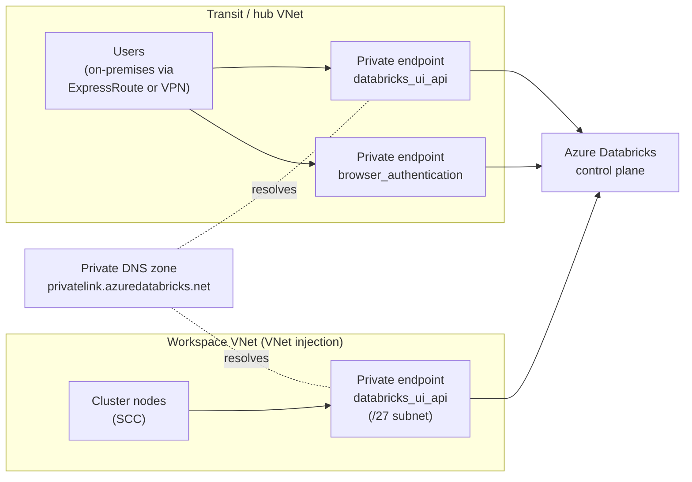

# Azure Private Link

Mastery: `INPUT[inlineSelect(option(new), option(learning), option(solid)):mastery]`

> [!story] Context
> [[Secure Cluster Connectivity]] removes public IPs from cluster nodes, but users and clusters still reach the control plane over public endpoints. Azure Private Link replaces those paths with private endpoints in your VNets.

> [!eli5] Summary
> Private Link gives Databricks a private address inside the company's own network. People and computers reach Databricks through that private address, so the traffic never travels over the public internet, and public access can be turned off entirely.

## Background

Without Private Link, the workspace URL (a hostname under `azuredatabricks.net`) resolves to public IP addresses. Users on the corporate network, clusters, and automation tools connect over the internet, protected by TLS, Entra ID, and optionally [[IP Access Lists|IP access lists]]. Regulated organizations often require that this traffic stay on private networks and that the workspace be unreachable from the internet.

## Overview

Azure Databricks supports three kinds of private connectivity:

| Type | Direction | Private endpoint sub-resource | Prerequisites |
|---|---|---|---|
| **Inbound (front-end)** | Users and clients to the workspace UI and REST API | `databricks_ui_api`, plus `browser_authentication` for web SSO | Premium plan; VNet injection for classic workspaces |
| **Classic compute (back-end)** | Classic clusters to the control plane (SCC relay and REST API) | `databricks_ui_api` | Premium plan, [[VNet Injection]], [[Secure Cluster Connectivity]], `requiredNsgRules` = `NoAzureDatabricksRules` |
| **Serverless to your resources** | Serverless compute to your storage and services | Private endpoint rules in a network connectivity configuration (NCC) | Premium plan; account admin. See [[Serverless Network Security]] |

Endpoint types:

| Sub-resource | Purpose | Scope |
|---|---|---|
| `databricks_ui_api` | Workspace web UI and REST API, for both inbound and classic compute traffic | Region-specific |
| `browser_authentication` | Handles Entra ID SSO callbacks for browser sign-in over Private Link. Does not affect REST API authentication | One per region and private DNS zone; serves every workspace that shares that DNS configuration |
| `general_access` | Workspace and account-level resources (such as the account console), REST API calls, browser SSO, custom URLs | Can serve workspaces in any region from one endpoint |

Two workspace settings determine which configurations are allowed:

| Setting | Values | Default |
|---|---|---|
| `publicNetworkAccess` | `Enabled`, `Disabled` | `Enabled` |
| `requiredNsgRules` | `AllRules`, `NoAzureDatabricksRules` (use with back-end Private Link) | `AllRules` |

The configuration with both front-end and back-end Private Link and no public access uses `publicNetworkAccess` = `Disabled` and `requiredNsgRules` = `NoAzureDatabricksRules`.

## How it works



### DNS

Private endpoints integrate with the private DNS zone `privatelink.azuredatabricks.net`. The zone contains:

- An **A record** for the workspace, pointing to the `databricks_ui_api` endpoint's private IP.
- A **`pl-auth.<region>`** record pointing to the `browser_authentication` endpoint. The record name must follow this format for web sign-in to complete.

Link the zone to every VNet whose clients must resolve the workspace privately, or use DNS forwarding in hub-and-spoke designs. With custom DNS, verify that both the workspace URL and the SSO authentication URLs resolve to private endpoint IPs.

### Web authentication workspace

Because one `browser_authentication` endpoint serves a whole region and DNS zone, Microsoft recommends hosting it on a dedicated **web auth workspace**:

1. Create a small VNet-injected Premium workspace in the region, with no workloads.
2. Set public network access to disabled on it.
3. Create only the `browser_authentication` private endpoint for it. Do not create a `databricks_ui_api` endpoint for this workspace.
4. Protect it from deletion with an Azure resource lock. If the web auth workspace is deleted, browser sign-in fails for all other workspaces in the region that use it.

### Create a back-end private endpoint

```bash
WS_ID=$(az databricks workspace show -g rg-databricks-prod -n dbw-contoso-prod-eus2 --query id -o tsv)

az network private-endpoint create \
  --resource-group rg-databricks-net \
  --name pe-dbw-prod-backend \
  --vnet-name vnet-dbw-prod \
  --subnet snet-private-endpoints \
  --private-connection-resource-id "$WS_ID" \
  --group-id databricks_ui_api \
  --connection-name dbw-prod-backend

az network private-dns zone create -g rg-databricks-net -n privatelink.azuredatabricks.net
az network private-endpoint dns-zone-group create \
  --resource-group rg-databricks-net \
  --endpoint-name pe-dbw-prod-backend \
  --name default \
  --private-dns-zone privatelink.azuredatabricks.net \
  --zone-name databricks
```

For an existing workspace, stop all clusters and SQL warehouses before changing Private Link settings; the update fails if compute is running.

## Small-business considerations

> [!smallbiz] Small-business considerations
> Private Link adds VNets, private endpoints, private DNS zones, and a dedicated web auth workspace to operate. Most small organizations do not need it. Use it when a customer contract, regulator, or security policy requires that the workspace be unreachable from the internet. Until then, Entra ID with conditional access and [[IP Access Lists|IP access lists]] restrict who can reach the workspace with much less infrastructure. Private endpoints are billed by Azure.

## Cloud differences

> [!azure]- Azure Databricks
> Uses Azure Private Link private endpoints with the sub-resources `databricks_ui_api`, `browser_authentication`, and `general_access`, the private DNS zone `privatelink.azuredatabricks.net`, and the workspace settings `publicNetworkAccess` and `requiredNsgRules`. Requires the Premium plan.

> [!aws]- Databricks on AWS
> [[AWS PrivateLink]] uses VPC endpoints for the workspace (REST API) and the SCC relay, registered with Databricks and referenced in the network configuration of a [[Customer-Managed VPC on AWS|customer-managed VPC]]. A private access settings object controls whether public access is allowed. Classic PrivateLink requires the Enterprise plan.

> [!gcp]- Databricks on Google Cloud
> [[Private Service Connect]] uses PSC endpoints for the workspace REST API and the SCC relay in a [[Customer-Managed VPC on Google Cloud|customer-managed VPC]], registered as VPC endpoints in the account console. Requires the Enterprise plan. Up to ten endpoints of each type per region per host project.

## Advanced topics

> [!deepdive]- Advanced topics (301–401)
> - **Endpoint sharing.** One set of `databricks_ui_api` endpoints in a VNet can serve all workspaces in that VNet and region. Workspaces in other regions need their own `databricks_ui_api` and `browser_authentication` endpoints. `general_access` endpoints are the exception and can serve workspaces in any region, which also makes them useful as a failover path in a [[Disaster Recovery|disaster recovery]] design.
> - **Subnet design.** Place private endpoints in a dedicated subnet (`/27` is the documented size for the workspace classic private endpoint subnet). If an NSG applies to private endpoints, allow port 3306 for the metastore.
> - **Setting changes.** Some documentation states that Private Link settings must be defined at workspace creation, while the classic compute guide describes updating an existing workspace with ARM or Terraform. Check the current guide for your scenario before planning an in-place change.
> - **Troubleshooting.** HTTP 401 errors during cluster startup usually indicate Private Link or IP access list restrictions. Check the workspace network access setting and the endpoint and DNS configuration.
> - **Serverless.** Front-end and back-end Private Link do not cover serverless compute's connections to your resources. Configure NCC private endpoint rules for storage (`blob` and `dfs` sub-resources) and other services, and approve each pending connection on the target resource.
> - **Performance-intensive services.** A separate Service Direct inbound endpoint type exists for performance-intensive services and serves only workspaces in its own region.

## Common misconceptions

> [!confusion] Back-end Private Link does not make the workspace private for users
> Back-end (classic compute) Private Link covers cluster-to-control-plane traffic. Users still connect over public endpoints unless you also configure inbound Private Link and disable public network access.

> [!confusion] `browser_authentication` is not per workspace
> There is one per region and private DNS zone, shared by all workspaces using that DNS configuration. That is why a dedicated web auth workspace is recommended.

## Recall

Which private endpoint sub-resource carries workspace UI and REST API traffic?::`databricks_ui_api`.
What does the `browser_authentication` endpoint do?::Handles Entra ID SSO callbacks for browser sign-in over Private Link.
How many `browser_authentication` endpoints can exist per region and private DNS zone?::One.
Which private DNS zone do Azure Databricks private endpoints use?::`privatelink.azuredatabricks.net`.
Which DNS record name does browser authentication require?::`pl-auth.<region>`.
What are the prerequisites for classic compute (back-end) Private Link?::Premium plan, VNet injection, secure cluster connectivity, and `requiredNsgRules` set to `NoAzureDatabricksRules`.
Which settings give a workspace with no public access and full Private Link?::`publicNetworkAccess` = `Disabled` and `requiredNsgRules` = `NoAzureDatabricksRules`.
Which endpoint type can serve workspaces in any region?::`general_access`.
What happens if the web auth workspace is deleted?::Browser sign-in fails for the other workspaces in that region that rely on it.
What is the AWS equivalent of Azure Private Link for Databricks?::AWS PrivateLink with registered VPC endpoints.

## Next steps

> [!path] Learning path
> **Needs first:** [[VNet Injection]], [[Secure Cluster Connectivity]], [[Network Security Overview]]
> **Unlocks next:** [[Serverless Network Security]], [[ADLS and Access Connectors]], [[Compliance Security Profile]]

> [!nextup] Next
> [[ADLS and Access Connectors]] covers how Unity Catalog reaches ADLS Gen2, including storage accounts behind firewalls.

> [!sources]- Sources (last verified: 2026-10-25)
> - [Private Link concepts (Azure Databricks)](https://learn.microsoft.com/en-us/azure/databricks/security/network/concepts/privatelink-concepts)
> - [Private Link concepts: workspace settings (Azure Databricks)](https://learn.microsoft.com/en-us/azure/databricks/security/network/concepts/private-link)
> - [Configure inbound Private Link for workspaces (Azure)](https://learn.microsoft.com/en-us/azure/databricks/security/network/front-end/front-end-private-connect)
> - [Configure classic compute plane private connectivity (Azure)](https://learn.microsoft.com/en-us/azure/databricks/security/network/classic/private-link-standard)
> - [Configure inbound Private Link for performance-intensive services (Azure)](https://learn.microsoft.com/en-us/azure/databricks/security/network/front-end/service-direct-privatelink)
> - [Configure private connectivity to Azure resources (serverless)](https://learn.microsoft.com/en-us/azure/databricks/security/network/serverless-network-security/serverless-private-link)
> - [Networking (Azure Databricks)](https://learn.microsoft.com/en-us/azure/databricks/security/network/)
> - [Phase 4: Design network architecture (Azure)](https://learn.microsoft.com/en-us/azure/databricks/lakehouse-architecture/deployment-guide/network)
> - [Private Link Resources - List (Azure Databricks REST API)](https://learn.microsoft.com/en-us/rest/api/databricks/private-link-resources/list?view=rest-databricks-2026-01-01)
> - [Azure Private Endpoint private DNS zone values](https://learn.microsoft.com/en-us/azure/private-link/private-endpoint-dns)
> - [Configure classic private connectivity to Databricks (AWS)](https://docs.databricks.com/aws/en/security/network/classic/privatelink)
> - [Enable Private Service Connect for your workspace (GCP)](https://docs.databricks.com/gcp/en/security/network/classic/private-service-connect)
