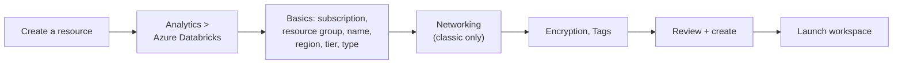

# Creating an Azure Databricks Workspace

Mastery: `INPUT[inlineSelect(option(new), option(learning), option(solid)):mastery]`

> [!story] Context
> [[First-Party Microsoft Service]] establishes that an Azure Databricks workspace is an Azure resource. You create it with Azure tools: the Azure portal, the Azure CLI, Bicep or ARM templates (Azure's infrastructure-as-code formats), PowerShell, or Terraform.

> [!eli5] Summary
> Creating a workspace means filling in a short form on Microsoft's cloud website: a name, a location, and the kind of workspace. After a few minutes you open the workspace and sign in with your normal work account.

> [!analogy]- Analogy: opening a branch office
> | Office | Azure |
> |---|---|
> | Company bank account | Azure subscription |
> | Folder for the lease and keys | Resource group |
> | City | [[Region]] |
> | Fully serviced office versus bringing your own desks | Serverless workspace versus classic workspace |

## Background

A [[Accounts and Workspaces|workspace]] is the environment where users run notebooks, jobs, SQL, and dashboards. On AWS and Google Cloud, workspaces are created from the Databricks account console. On Azure, a workspace is an Azure resource of type `Microsoft.Databricks/workspaces` in a subscription and resource group (a folder for related Azure resources) you choose. The subscription must not be an Azure Free Trial subscription.

## Overview

An Azure Databricks workspace is created as an Azure resource, and creating one requires six decisions:

| Decision | Options | Recommendation (2026) |
|---|---|---|
| **Subscription and resource group** | Any subscription you can deploy to | A dedicated resource group, for example `rg-databricks-prod` |
| **Workspace name** | Any valid Azure resource name | A descriptive name, for example `dbw-contoso-prod-eus2` |
| **Region** | Any region that offers Azure Databricks | The region of your data and users. Keep the workspace, storage, and [[Metastore\|metastore]] in one [[Region\|region]] |
| **Pricing tier** | Premium, or Trial (Premium with 14 days of free [[DBUs]]) | Premium. Standard is retired |
| **Workspace type** | Serverless, or classic (`Hybrid` compute mode) | Serverless unless you need classic clusters |
| **Networking (classic only)** | Databricks-managed [[VPC and VNet\|VNet]] or your own VNet ([[VNet Injection]]); [[Secure Cluster Connectivity\|secure cluster connectivity]] on or off | Your own VNet, with secure cluster connectivity on |

### Pricing tier

New workspaces must be created on the **Premium** tier starting **April 1, 2026**. Remaining Standard tier workspaces are upgraded to Premium automatically in a phased rollout that starts **October 1, 2026**. Premium includes all Standard features plus [[Unity Catalog]], access controls, audit logs, and the network security features covered in this chapter. Access control settings are disabled by default on workspaces upgraded from Standard; an admin must enable them. Notebooks, users, and cluster configurations are retained during an upgrade, but active clusters might be terminated.

### Workspace type

| Type | Compute | Storage | Customer-managed network |
|---|---|---|---|
| **Serverless** | [[Serverless Compute]] only | Default storage, a Databricks-managed [[Object Storage\|object store]] used for workspace data and the default catalog | Not supported |
| **Classic (Hybrid)** | Serverless plus classic clusters that run as VMs in your subscription | Workspace storage account in the [[Managed Resource Group\|managed resource group]], plus your own storage | Supported (VNet injection) |

Constraints:

- The compute mode is set at creation and cannot be changed afterward.
- Serverless workspaces do not support a custom VNet, custom managed resource group, or several other classic-only parameters.
- As of October 2026, default storage is not supported in `southcentralus`, `uksouth`, and `westus2`.
- Classic compute cannot access data stored in default storage.

## How it works

### Azure portal



1. In the Azure portal, select **Create a resource** > **Analytics** > **Azure Databricks**.
2. On **Basics**, select the subscription and resource group, enter the workspace name, and select the region and the **Premium** or **Trial** pricing tier.
3. Select the workspace type: serverless or classic. For a classic workspace, you can optionally name the managed resource group.
4. For a classic workspace, on **Networking**, choose whether to deploy into your own VNet. Keep the secure cluster connectivity (No Public IP) option set to **Yes**, which is the portal default. See [[VNet Injection]] and [[Secure Cluster Connectivity]].
5. Optionally configure [[Customer-Managed Keys on Azure|customer-managed keys]] on **Encryption** and add [[Tagging for Chargeback|tags]].
6. Select **Review + create**, then **Create**. When deployment completes, select **Launch workspace**.

### Azure CLI

The `az databricks` commands are part of the `databricks` extension for the Azure CLI.

```bash
az group create --name rg-databricks-prod --location eastus2

az databricks workspace create \
  --resource-group rg-databricks-prod \
  --name dbw-contoso-prod-eus2 \
  --location eastus2 \
  --sku premium
```

The command accepts `premium`, `standard`, or `trial` for `--sku`; only `premium` and `trial` are valid for new workspaces since April 1, 2026. The compute mode defaults to `Hybrid` (classic); `Serverless` creates a serverless workspace.

### Bicep (classic workspace)

```bicep
param workspaceName string = 'dbw-contoso-prod-eus2'
param location string = resourceGroup().location

var managedRgName = 'databricks-rg-${workspaceName}-${uniqueString(workspaceName, resourceGroup().id)}'

resource workspace 'Microsoft.Databricks/workspaces@2024-05-01' = {
  name: workspaceName
  location: location
  sku: {
    name: 'premium'
  }
  properties: {
    managedResourceGroupId: subscriptionResourceId('Microsoft.Resources/resourceGroups', managedRgName)
    parameters: {
      enableNoPublicIp: {
        value: true // secure cluster connectivity; default true from API version 2024-05-01
      }
    }
  }
}
```

Parameter shapes differ between API versions (newer preview versions add a `type` field to each parameter). Check the template reference for the version you deploy.

## Small-business considerations

> [!smallbiz] Small-business considerations
> A minimal first deployment:
> 1. One resource group and one **Premium serverless** workspace in the region where your data already lives, avoiding the regions without default storage.
> 2. Use the **Trial** tier to evaluate with 14 days of free Premium DBUs. Other Azure resources you create are still billed.
> 3. Assign two workspace admins and connect Power BI.
>
> Defer a separate development workspace, VNet injection, and Private Link until required. A workspace has no charge by itself; charges come from the compute it runs. See the [Azure Databricks pricing page](https://azure.microsoft.com/en-us/pricing/details/databricks/).

## Cloud differences

> [!azure]- Azure Databricks
> Workspaces are Azure resources, created with the Azure portal, `az databricks workspace create`, Bicep, ARM templates, PowerShell (`New-AzDatabricksWorkspace`), or Terraform. Account-level configuration (metastore, users, network connectivity configurations) is done in the account console at `accounts.azuredatabricks.net`.

> [!aws]- Databricks on AWS
> Workspaces are created in the Databricks account console or with the Account API or Terraform. Automated setup provisions the [[Cross-Account IAM Role|cross-account IAM role]], [[Workspace Storage Bucket|S3 bucket]], and policies for you; manual setup uses credential and storage configurations that you create. Serverless workspaces are also available. See [[Account Setup on AWS]].

> [!gcp]- Databricks on Google Cloud
> After subscribing through Google Cloud Marketplace, an account admin creates workspaces in the account console with a name, region, and Google Cloud project ID. Databricks creates two GCS buckets in the project. A least-privilege creation path and serverless workspaces are available. See [[Account Setup on Google Cloud]].

## Advanced topics

> [!deepdive]- Advanced topics (301–401)
> - **Network design is fixed early.** For classic workspaces, subnet CIDR ranges cannot be changed after deployment without the VNet update procedure. Microsoft plans to deprecate creating classic workspaces with a Databricks-managed VNet; use [[VNet Injection]] for new classic workspaces.
> - **`enableNoPublicIp`.** Defaults to `true` from API version 2024-05-01. Microsoft plans to require secure cluster connectivity for all classic workspaces, and workspaces created with the value `false` will no longer be supported.
> - **Managed resource group name.** ARM and Bicep examples generate it from the workspace name and a hash of the resource group ID, with the prefix `databricks-rg-`. Serverless workspaces do not support a custom managed resource group.
> - **Automation.** Deploy the Azure resource with Bicep or Terraform, then manage workspace contents with the Databricks [[Terraform Provider]] or [[Declarative Automation Bundles]].
> - **Region.** Treat the region as permanent. Changing it requires a new workspace and a migration of code and data. See [[Disaster Recovery]].

## Common misconceptions

> [!confusion] Creating a workspace does not start compute
> A new workspace has no running compute. Charges begin when a SQL warehouse, notebook, job, or cluster runs.

> [!confusion] The Trial tier is not Databricks Free Edition
> The **Trial** tier is a Premium workspace in your Azure subscription with 14 days of free DBUs. **Databricks Free Edition** is a separate no-cost offering with usage limits and no [[SLA]]. See [[Databricks Free Edition and Trials]].

## Recall

Which pricing tier must new Azure Databricks workspaces use from April 1, 2026?::Premium (or Trial, which is Premium with 14 days of free DBUs).
What happens to remaining Azure Standard tier workspaces starting October 1, 2026?::They are upgraded automatically to Premium in a phased rollout.
What is a serverless workspace preconfigured with?::Serverless compute and default storage.
Can a workspace's compute mode be changed after creation?::No.
Which Azure CLI command creates a workspace?::`az databricks workspace create`, from the `databricks` CLI extension.
What prefix do generated managed resource group names use?::`databricks-rg-`.
What is the default value of `enableNoPublicIp` from API version 2024-05-01?::`true`.
Which three regions did not support default storage as of October 2026?::`southcentralus`, `uksouth`, and `westus2`.

## Next steps

> [!path] Learning path
> **Needs first:** [[Azure Databricks Overview]], [[Accounts and Workspaces]]
> **Unlocks next:** [[Managed Resource Group]], [[VNet Injection]], [[Microsoft Entra ID Integration]]

> [!nextup] Next
> [[Managed Resource Group]] describes the second, locked resource group that a classic workspace creates in your subscription.

> [!sources]- Sources (last verified: 2026-10-25)
> - [Deploy a workspace using the Azure portal](https://learn.microsoft.com/en-us/azure/databricks/admin/workspace/create-workspace)
> - [Create a workspace (Azure Databricks)](https://learn.microsoft.com/en-us/azure/databricks/admin/workspace/)
> - [Create a serverless workspace (Azure)](https://learn.microsoft.com/en-us/azure/databricks/admin/workspace/serverless-workspaces)
> - [Default storage in Databricks (Azure)](https://learn.microsoft.com/en-us/azure/databricks/storage/default-storage)
> - [End of life for Standard tier workspaces](https://learn.microsoft.com/en-us/azure/databricks/admin/account-settings/standard-tier)
> - [Manage your subscription (Azure Databricks)](https://learn.microsoft.com/en-us/azure/databricks/admin/account-settings/account)
> - [Sign up for Azure Databricks for free](https://learn.microsoft.com/en-us/azure/databricks/getting-started/free-trial)
> - [Deploy a workspace with the Azure CLI](https://learn.microsoft.com/en-us/azure/databricks/admin/workspace/azure-cli)
> - [az databricks workspace (Azure CLI reference)](https://learn.microsoft.com/en-us/cli/azure/databricks/workspace?view=azure-cli-latest)
> - [Deploy a workspace with Bicep](https://learn.microsoft.com/en-us/azure/databricks/admin/workspace/bicep)
> - [Deploy a workspace with an ARM template](https://learn.microsoft.com/en-us/azure/databricks/admin/workspace/arm-template)
> - [Microsoft.Databricks/workspaces template reference](https://learn.microsoft.com/en-us/azure/templates/microsoft.databricks/workspaces)
> - [Enable secure cluster connectivity](https://learn.microsoft.com/en-us/azure/databricks/security/network/classic/secure-cluster-connectivity)
> - [Deploy Azure Databricks in your Azure virtual network (VNet injection)](https://learn.microsoft.com/en-us/azure/databricks/security/network/classic/vnet-inject)
> - [Create a workspace with manual AWS configurations](https://docs.databricks.com/aws/en/admin/workspace/create-uc-workspace)
> - [Create a classic workspace (GCP)](https://docs.databricks.com/gcp/en/admin/workspace/create-workspace)
> - [Azure Databricks pricing (Microsoft)](https://azure.microsoft.com/en-us/pricing/details/databricks/)
