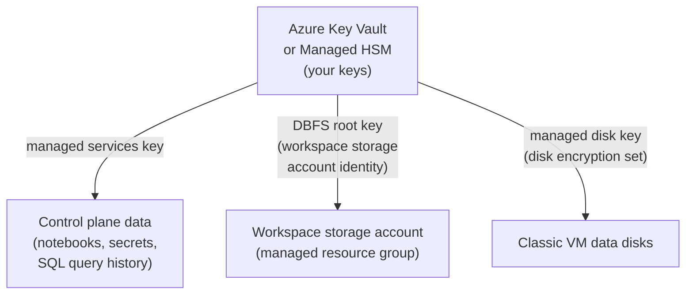

# Customer-Managed Keys on Azure

Mastery: `INPUT[inlineSelect(option(new), option(learning), option(solid)):mastery]`

> [!story] Context
> [[Azure Monitor and Diagnostic Logs]] covers visibility. This note, the last in the Azure chapter, covers control of encryption: Azure Databricks data is encrypted at rest by default with Microsoft- or Databricks-managed keys, and customer-managed keys (CMK) let you supply and revoke those keys yourself.

> [!eli5] Summary
> Everything Databricks stores is already scrambled so that stolen disks are useless. Customer-managed keys let the company hold the key to that scrambling in its own Microsoft key vault. If the company removes the key, Databricks can no longer read the data.

## Background

Regulated organizations often must show that they control the keys protecting their data, can rotate them, and can revoke access. Default [[Encryption at Rest|encryption at rest]] uses platform-managed keys, which satisfies many requirements but not those that call for customer control. Azure Databricks offers three separate CMK features, one for each place where data is stored.

## Overview

| Feature | Encrypts | Data examples | Applies to serverless | Key store |
|---|---|---|---|---|
| **Managed services** | Data in the Azure Databricks control plane | Notebook source, secrets, Databricks SQL queries and query history; on serverless workspaces also default storage (workspace catalog and root storage) | Yes | Key Vault or Managed HSM |
| **DBFS root (workspace storage)** | The workspace storage account in the [[Managed Resource Group\|managed resource group]] | DBFS root, job results, Databricks SQL results, notebook revisions | Not applicable (serverless storage is a managed service) | Key Vault or Managed HSM |
| **Managed disks** | Data disks of classic compute VMs | Temporary data on cluster nodes | No (serverless disks are short-lived) | Key Vault or Managed HSM |

Requirements common to all three:

| Requirement | Value |
|---|---|
| Plan | Premium |
| Tenant | Key Vault or Managed HSM in the same Microsoft Entra ID tenant as the workspace |
| Managed HSM | Purge protection enabled |
| Managed disks | Key Vault in the same region as the workspace |
| Serverless workspaces | Configure only the managed services key |

CMK for managed disks covers data disks only, not OS disks. Your own data in ADLS Gen2 is encrypted by the storage account's own encryption settings, configured in Azure Storage, not by these features.

## How it works



### Configure keys with Bicep

```bicep
resource workspace 'Microsoft.Databricks/workspaces@2024-05-01' = {
  name: 'dbw-contoso-prod-eus2'
  location: location
  sku: { name: 'premium' }
  properties: {
    managedResourceGroupId: managedRgId
    parameters: {
      prepareEncryption: { value: true } // managed identity for the workspace storage account (DBFS root CMK)
    }
    encryption: {
      entities: {
        managedServices: {
          keySource: 'Microsoft.Keyvault'
          keyVaultProperties: {
            keyVaultUri: 'https://kv-contoso-cmk.vault.azure.net/'
            keyName: 'dbw-managed-services'
            keyVersion: '<key-version>'
          }
        }
        managedDisk: {
          keySource: 'Microsoft.Keyvault'
          keyVaultProperties: {
            keyVaultUri: 'https://kv-contoso-cmk.vault.azure.net/'
            keyName: 'dbw-managed-disks'
            keyVersion: '<key-version>'
          }
          rotationToLatestKeyVersionEnabled: true
        }
      }
    }
  }
}
```

`prepareEncryption` and `managedDisk` encryption are not allowed in `Serverless` compute mode. Property shapes vary by API version; check the template reference.

### Grant the key permissions

| Feature | Identity that needs the key | Role (Azure RBAC on Key Vault or Managed HSM) |
|---|---|---|
| Managed services | The workspace and the workspace storage account's managed identity | Key Vault Crypto Service Encryption User |
| DBFS root | The workspace storage account's managed identity (created by `prepareEncryption`) | Key Vault Crypto Service Encryption User |
| Managed disks (Managed HSM) | The disk encryption set identity | Managed HSM Crypto Service Encryption User |

Example for a Managed HSM managed disk key:

```bash
az keyvault role assignment create \
  --hsm-name hsm-contoso \
  --role "Managed HSM Crypto Service Encryption User" \
  --assignee-object-id <disk-encryption-set-principal-id> \
  --scope /keys/dbw-managed-disks
```

### Rotation

- **Managed disks:** Set `rotationToLatestKeyVersionEnabled` to `true` so the disk encryption set uses the latest key version automatically (default `false`). Auto-rotation supports software keys and HSM RSA keys of 2048, 3072, or 4096 bits.
- **Managed services and DBFS root:** Update the workspace to a new key version or key. Check the feature's page for its rotation procedure.

## Small-business considerations

> [!smallbiz] Small-business considerations
> Most small organizations do not need customer-managed keys. Data is already encrypted at rest with platform-managed keys. Enable CMK only when a contract or regulation (for example, a [[HIPAA]] business associate agreement or a customer security review) explicitly requires customer control of keys. CMK adds operational risk: if the key is deleted or access is removed, the workspace cannot read its data. Key Vault and Managed HSM are billed by Azure.

## Cloud differences

> [!azure]- Azure Databricks
> Three features (managed services, DBFS root, managed disks) using Azure Key Vault or Azure Key Vault Managed HSM, configured on the workspace resource. Requires the Premium plan.

> [!aws]- Databricks on AWS
> Keys are AWS KMS keys registered in the account console as key configurations, with two use cases: managed services and workspace storage (which also covers EBS volumes). One KMS key can serve both, and it must be in the workspace's region. Managed services keys can be rotated; workspace storage keys cannot be replaced, though AWS automatic rotation still works. Serverless workspaces use only the managed services use case. See [[Customer-Managed Keys on AWS]].

> [!gcp]- Databricks on Google Cloud
> Keys are Cloud KMS symmetric keys in the workspace's region, registered in the account console under **Security** > **Encryption keys**. The workspace storage key also encrypts cluster persistent disks. Required roles are Cloud KMS CryptoKey Encrypter and Decrypter. See [[Customer-Managed Keys on Google Cloud]].

## Advanced topics

> [!deepdive]- Advanced topics (301–401)
> - **Revocation.** Disabling or deleting the key, or removing the role assignment, makes the protected data unreadable by Azure Databricks. Test revocation and restore in a non-production workspace first, and enable soft delete and purge protection on the vault.
> - **Ordering for DBFS root.** Workspace storage CMK uses a two-step pattern: deploy or update the workspace with `prepareEncryption` to create the storage account's managed identity, grant that identity access to the key, then enable the key on the workspace.
> - **HSM and FedRAMP.** HSM-backed keys for managed disks are not supported on workspaces with FedRAMP compliance; contact your account team.
> - **Serverless workspaces.** Only the managed services key applies; it also protects default storage, including workspace catalogs.
> - **Unity Catalog catalog-level keys.** On AWS and Google Cloud, Databricks also offers customer-managed keys at the Unity Catalog catalog level for catalogs on default storage (Enterprise tier). Check Azure release notes for availability on Azure.
> - **Compliance.** Customer-managed keys are commonly paired with the [[Compliance Security Profile|compliance security profile]], [[Azure Private Link]], and diagnostic logging in regulated deployments.

## Common misconceptions

> [!confusion] CMK does not encrypt your ADLS data
> The three Azure Databricks CMK features cover control plane data, the workspace storage account, and classic VM disks. Encryption of your own ADLS Gen2 accounts is configured on those storage accounts.

> [!confusion] One feature does not cover all three locations
> Managed services, DBFS root, and managed disks are configured separately, each with its own key reference.

## Recall

What are the three Azure Databricks customer-managed key features?::Managed services, DBFS root (workspace storage), and managed disks.
What does the managed services key encrypt?::Control plane data such as notebook source, secrets, and Databricks SQL queries and query history.
Which CMK feature applies to serverless workspaces?::Only managed services.
Does managed disk CMK cover OS disks?::No, only data disks.
Which key stores are supported?::Azure Key Vault and Azure Key Vault Managed HSM.
What must be enabled on a Managed HSM used for CMK?::Purge protection.
Which property enables automatic key version rotation for managed disks?::`rotationToLatestKeyVersionEnabled`.
Which workspace parameter prepares the workspace storage account for CMK?::`prepareEncryption`.
Which plan do Azure Databricks CMK features require?::Premium.

## Next steps

> [!path] Learning path
> **Needs first:** [[Encryption]], [[Managed Resource Group]], [[Control Plane and Compute Plane]]
> **Unlocks next:** [[Compliance Security Profile]], [[Customer-Managed Keys on AWS]], [[Customer-Managed Keys on Google Cloud]]

> [!nextup] Next
> [[Chapter 12 - Databricks on AWS]] covers the same platform on Amazon Web Services: cross-account roles, customer-managed VPCs, PrivateLink, and S3.

> [!sources]- Sources (last verified: 2026-10-25)
> - [Customer-managed keys for encryption (Azure Databricks)](https://learn.microsoft.com/en-us/azure/databricks/security/keys/customer-managed-keys)
> - [Data security and encryption (Azure Databricks)](https://learn.microsoft.com/en-us/azure/databricks/security/keys/)
> - [Customer-managed keys for managed services (Azure)](https://learn.microsoft.com/en-us/azure/databricks/security/keys/cmk-managed-services-azure/)
> - [Enable customer-managed keys for managed services (Azure)](https://learn.microsoft.com/en-us/azure/databricks/security/keys/cmk-managed-services-azure/customer-managed-key-managed-services-azure)
> - [Enable HSM customer-managed keys for managed services (Azure)](https://learn.microsoft.com/en-us/azure/databricks/security/keys/cmk-managed-services-azure/cmk-hsm-managed-services-azure)
> - [Customer-managed keys for DBFS root (Azure)](https://learn.microsoft.com/en-us/azure/databricks/security/keys/customer-managed-keys-dbfs/)
> - [Configure HSM customer-managed keys for DBFS using the Azure portal](https://learn.microsoft.com/en-us/azure/databricks/security/keys/customer-managed-keys-dbfs/cmk-hsm-dbfs-azure-portal)
> - [Configure customer-managed keys for Azure managed disks](https://learn.microsoft.com/en-us/azure/databricks/security/keys/cmk-managed-disks-azure/cmk-managed-disks-azure)
> - [Configure HSM customer-managed keys for Azure managed disks](https://learn.microsoft.com/en-us/azure/databricks/security/keys/cmk-managed-disks-azure/cmk-hsm-managed-disks-azure)
> - [Create a serverless workspace (Azure)](https://learn.microsoft.com/en-us/azure/databricks/admin/workspace/serverless-workspaces)
> - [Microsoft.Databricks/workspaces template reference](https://learn.microsoft.com/en-us/azure/templates/microsoft.databricks/workspaces)
> - [Services that support customer-managed keys in Azure](https://learn.microsoft.com/en-us/azure/security/fundamentals/encryption-customer-managed-keys-support)
> - [Configure customer-managed keys for encryption (AWS)](https://docs.databricks.com/aws/en/security/keys/configure-customer-managed-keys)
> - [Configure customer-managed keys for encryption (GCP)](https://docs.databricks.com/gcp/en/security/keys/configure-customer-managed-keys)
> - [Customer-managed keys for Unity Catalog (AWS)](https://docs.databricks.com/aws/en/security/keys/cmek-unity-catalog)
