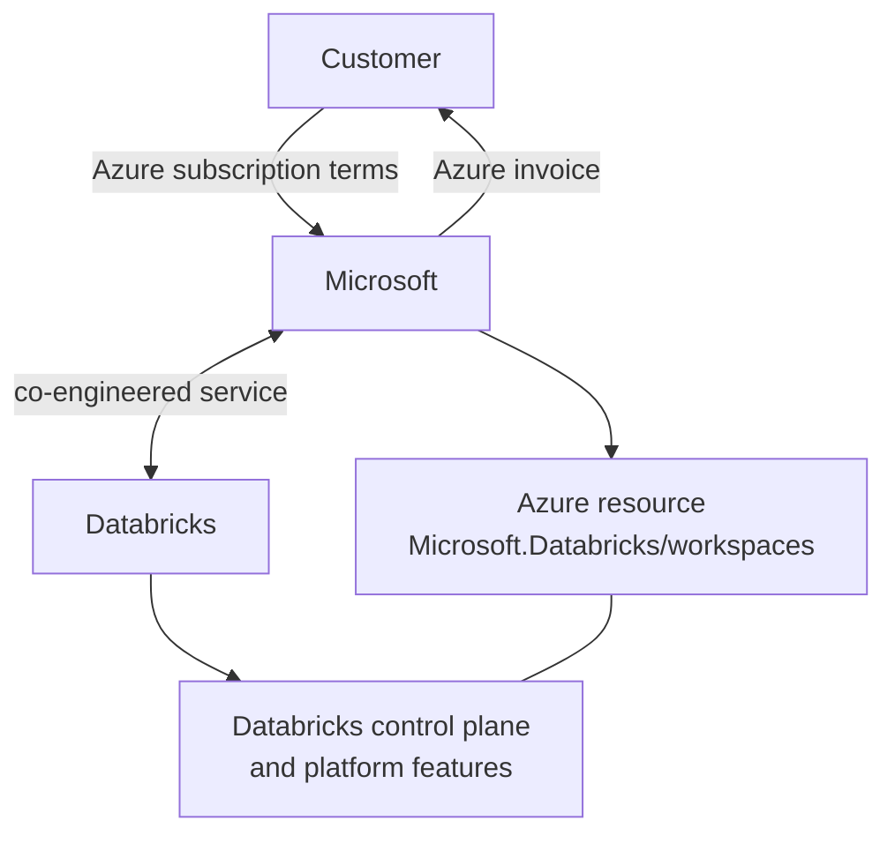

# First-Party Microsoft Service

Mastery: `INPUT[inlineSelect(option(new), option(learning), option(solid)):mastery]`

> [!story] Context
> The [[Azure Databricks Overview]] describes Azure Databricks as sold and run by Microsoft. This note defines what first-party status changes compared with Databricks on AWS and Google Cloud.

> [!eli5] Summary
> Most software on a cloud is made by another company and only sold through the cloud's store. Azure Databricks is treated as one of Microsoft's own services: it is created in Microsoft's cloud console, billed by Microsoft, and governed by the company's existing Microsoft agreement.

> [!analogy]- Analogy: store brand versus third-party brand
> | Retail | Cloud |
> |---|---|
> | Third-party brand sold in a store; the maker handles warranty | Marketplace listing (Databricks on AWS or Google Cloud) |
> | Store brand co-developed with a supplier; the store handles sales and returns | First-party service (Azure Databricks) |

## Background

Procurement, security review, and vendor onboarding add time to any new software purchase. Azure Databricks avoids a separate vendor relationship: usage is billed by Microsoft and governed by the customer's Azure subscription terms.

Databricks' November 2017 launch post stated that Microsoft would offer Azure Databricks as an integrated Azure service, a "first party" Microsoft service developed through a year-long joint effort. Databricks' Azure product page continues to describe it as a first-party offering developed jointly by the two companies.

## Overview

| Aspect | Azure Databricks (first-party) | Databricks on AWS and Google Cloud |
|---|---|---|
| **Provisioning** | Azure portal, Azure CLI, Bicep, ARM templates, PowerShell, or Terraform, as an Azure resource | Databricks account console, Account API, or Terraform |
| **Billing** | Microsoft, under your Azure subscription terms | Databricks directly, or through the cloud marketplace |
| **Commitments** | Databricks commit units (DBCU) prepurchased through Azure | Databricks contracts or marketplace private offers |
| **Support** | Support tickets as described on the Azure Databricks Resources page | Databricks support |
| **Identity** | Microsoft Entra ID built in | Any identity provider through SSO and SCIM |

### Billing

DBU charges and the Azure infrastructure behind classic compute (VMs, disks, networking) both appear on the Azure bill. Every resource Databricks creates carries the default tag `Vendor` with the value `Databricks`, and these tags appear in the cost analysis reports in the Azure portal. See [[Azure Billing and Commit Units]].

### Support

The Azure Databricks documentation's **Resources** page describes how to submit support tickets, manage a support contract, and check service status. The getting-started docs also list `help@databricks.com` for live setup help. Azure support requests are opened in the Azure portal from **Help + support** or a resource's **Support + Troubleshooting** menu, as for any Azure service.

### Service level agreement

Microsoft publishes the SLA for Azure Databricks in its Service Level Agreements for Online Services. Check the current version for the commitment that applies to your agreement. Databricks Free Edition is not covered by the Databricks support policy or SLA.

## How it works



Because the workspace is an Azure resource, Azure controls apply to it:

- **Azure RBAC** applies to the workspace resource. Launching a workspace with sufficient Azure permissions can make you a workspace admin. It does not make you a Databricks account admin.
- **Azure tags and activity logs** apply to the workspace resource.
- **Infrastructure as code** uses standard Azure tooling:

```bash
# Create a Premium workspace with the Azure CLI (databricks extension)
az databricks workspace create \
  --resource-group rg-databricks-prod \
  --name dbw-contoso-prod-eus2 \
  --location eastus2 \
  --sku premium
```

## Small-business considerations

> [!smallbiz] Small-business considerations
> - **No new vendor.** An existing Azure subscription is sufficient to start.
> - **One invoice.** Databricks charges appear on the Azure bill and can be split by tag.
> - **Familiar tooling.** Workspaces are created, tagged, and secured in the Azure portal.
>
> First-party status ties this workload to Azure. To keep the option of moving clouds, store data in open formats ([[Delta Lake]] or [[Apache Iceberg]]) in storage you own, which is the Databricks default.

## Cloud differences

> [!azure]- Azure Databricks
> First-party. Created as an Azure resource, billed by Microsoft, and integrated with Entra ID, Key Vault, Azure Monitor, Data Factory, Fabric, and Power BI.

> [!aws]- Databricks on AWS
> Not first-party. You subscribe with Databricks directly or add AWS Marketplace as a payment method. Contract accounts are managed by the Databricks account team, and support comes from Databricks. See [[AWS Marketplace and Billing]].

> [!gcp]- Databricks on Google Cloud
> Not first-party. You subscribe through Google Cloud Marketplace; each order ties a Databricks subscription to one Google billing account. Negotiated terms use a Google Marketplace private offer. See [[Google Cloud Marketplace and Billing]].

## Advanced topics

> [!deepdive]- Advanced topics (301–401)
> - **Two control surfaces.** The Azure resource is governed by Azure RBAC and the Azure activity log. Objects inside the workspace (clusters, jobs, Unity Catalog grants) are governed by Databricks permissions. Cluster guardrails belong in [[Compute Policies|compute policies]].
> - **First account admin.** An Entra ID Global Administrator must establish the first Databricks account admin by signing in to the account console at `accounts.azuredatabricks.net`. That admin can then assign the role to others. See [[Admin Roles]].
> - **Entra resource ID.** Azure Databricks has the well-known Entra resource ID `2ff814a6-3304-4ab8-85cb-cd0e6f879c1d`, the same in all Azure environments. Entra ID tokens for the Databricks REST API are requested for this resource, and conditional access policies target the AzureDatabricks application. See [[Microsoft Entra ID Integration]].
> - **Commitments.** Databricks commit units are bought for one or three years through the Azure portal and are managed under **Reservations**. How a purchase interacts with other Microsoft spending commitments depends on your agreement; confirm with your Microsoft account team.

## Common misconceptions

> [!confusion] First-party does not mean Microsoft builds the platform
> Databricks builds and operates the platform. Microsoft co-engineered the Azure integration and owns the commercial relationship.

> [!confusion] Azure subscription Owner is not Databricks account admin
> Azure roles can grant workspace admin when a workspace is launched. The Databricks account admin role is separate and is first established by an Entra ID Global Administrator.

## Recall

What does first-party mean for Azure Databricks?::Microsoft sells and bills it as an Azure service, co-engineered with Databricks.
Who bills Azure Databricks usage?::Microsoft, under the customer's Azure subscription terms.
Which Azure resource provider namespace hosts Azure Databricks?::`Microsoft.Databricks`.
How is Databricks sold on AWS and Google Cloud?::Directly by Databricks or through the cloud marketplace.
Which default tag marks every resource Databricks creates on Azure?::`Vendor`, with the value `Databricks`.
Who must establish the first Azure Databricks account admin?::A Microsoft Entra ID Global Administrator, by signing in to the account console.
What is the Azure Databricks Entra resource ID?::`2ff814a6-3304-4ab8-85cb-cd0e6f879c1d`.

## Next steps

> [!path] Learning path
> **Needs first:** [[Azure Databricks Overview]]
> **Unlocks next:** [[Creating an Azure Databricks Workspace]], [[Azure Billing and Commit Units]]

> [!nextup] Next
> [[Creating an Azure Databricks Workspace]] covers the portal form, pricing tier, workspace type, and networking options.

> [!sources]- Sources (last verified: 2026-10-25)
> - [Introducing Azure Databricks (Databricks blog)](https://www.databricks.com/blog/2017/11/15/introducing-azure-databricks.html)
> - [Azure Databricks product page (Databricks)](https://www.databricks.com/product/azure)
> - [Databricks pricing](https://www.databricks.com/product/pricing)
> - [Resources (Azure Databricks)](https://learn.microsoft.com/en-us/azure/databricks/resources/)
> - [Get started tutorials on Azure Databricks](https://learn.microsoft.com/en-us/azure/databricks/getting-started/)
> - [How to create an Azure support request](https://learn.microsoft.com/en-us/azure/azure-portal/supportability/how-to-create-azure-support-request)
> - [Reliability in Azure Databricks](https://learn.microsoft.com/en-us/azure/reliability/reliability-databricks)
> - [Databricks Free Edition limitations (Azure)](https://learn.microsoft.com/en-us/azure/databricks/getting-started/free-edition-limitations)
> - [Use tags to attribute and track usage (Azure)](https://learn.microsoft.com/en-us/azure/databricks/admin/account-settings/usage-detail-tags)
> - [Databricks administration overview (Azure)](https://learn.microsoft.com/en-us/azure/databricks/admin/admin-concepts)
> - [Get Microsoft Entra ID tokens for users by using the Azure CLI](https://learn.microsoft.com/en-us/azure/databricks/dev-tools/user-aad-token)
> - [Conditional access (Azure Databricks)](https://learn.microsoft.com/en-us/azure/databricks/admin/access-control/conditional-access)
> - [Deploy a workspace with the Azure CLI](https://learn.microsoft.com/en-us/azure/databricks/admin/workspace/azure-cli)
> - [Optimize Azure Databricks costs with a prepurchase](https://learn.microsoft.com/en-us/azure/cost-management-billing/reservations/prepay-databricks-reserved-capacity)
> - [Manage your subscription and billing (AWS)](https://docs.databricks.com/aws/en/admin/account-settings/account)
> - [Manage your subscription (GCP)](https://docs.databricks.com/gcp/en/admin/account-settings/account)
