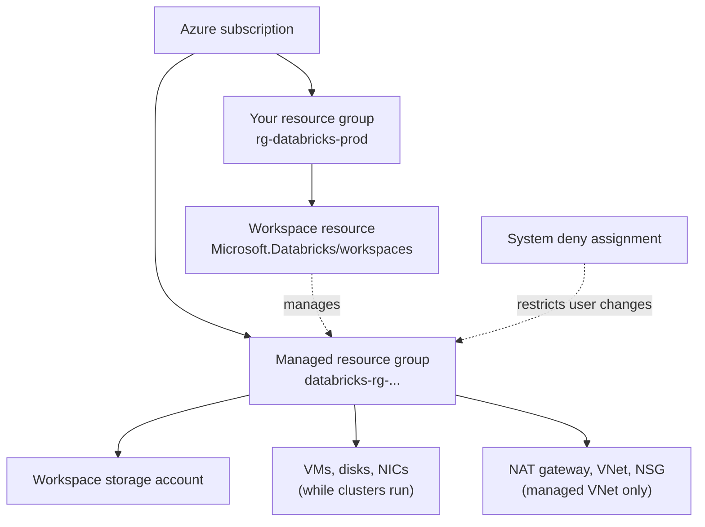

# Managed Resource Group

Mastery: `INPUT[inlineSelect(option(new), option(learning), option(solid)):mastery]`

> [!story] Context
> [[Creating an Azure Databricks Workspace]] creates one Azure resource. A classic workspace also creates a second resource group in your subscription, named like `databricks-rg-<workspace>-<hash>`, that Azure Databricks manages and users cannot modify.

> [!eli5] Summary
> Databricks keeps the machines it runs for you in a separate, locked section of your Microsoft cloud account. You pay for what is there and can see it, but only Databricks changes it, so nothing breaks by accident.

> [!analogy]- Analogy: a building's plant room
> | Building | Azure |
> |---|---|
> | Your office floor | Your resource group with the workspace resource |
> | The plant room on your electricity bill | The managed resource group |
> | "Authorized staff only" lock | The system deny assignment |
> | Maintenance contractor | Azure Databricks |

## Background

Classic clusters run as Azure VMs in your subscription. Azure Databricks creates, resizes, and deletes these VMs, their disks, and their network interfaces continuously. If a user changed or deleted those resources, clusters could fail.

For this reason, each classic workspace has a dedicated resource group that the Azure Databricks service manages, protected by a system **deny assignment** that restricts changes by users.

## Overview

The managed resource group is an Azure resource group with two properties: Azure Databricks manages its contents, and a system deny assignment restricts user changes.

Typical contents of a classic workspace's managed resource group:

| Resource | Purpose | Notes |
|---|---|---|
| **Workspace storage account** | Workspace system data (job results, Databricks SQL results, notebook revisions, logs), the DBFS root, and in some cases the workspace catalog | Supports a storage firewall and [[Customer-Managed Keys on Azure\|customer-managed keys]] |
| **Virtual machines** | Cluster driver and worker [[Node\|nodes]] | Created when clusters start, removed when they stop |
| **Managed disks** | OS and local disks for those VMs | Supports customer-managed keys |
| **Network interfaces and IP addresses** | Each node has an IP in the host subnet and one in the container subnet | |
| **VNet and network security group** | Only for a Databricks-managed VNet | With [[VNet Injection]], the VNet is in your own resource group |
| **NAT gateway** | Outbound path for [[Secure Cluster Connectivity\|secure cluster connectivity]] on a Databricks-managed VNet | Created automatically, has an additional cost, and cannot be modified |

Serverless workspaces do not support a custom managed resource group. Serverless compute runs in the Azure Databricks account, not in your subscription.

## How it works



### Deny assignment

Azure [[Role-Based Access Control|RBAC]] role assignments grant permissions. A deny assignment blocks specified actions for specified principals and takes precedence over role assignments. The Azure Databricks documentation references the managed resource group's deny assignment in the storage firewall guide but does not publish the full list of blocked actions. Treat the resources inside as read-only.

To find the managed resource group for a workspace:

```bash
az databricks workspace show \
  --resource-group rg-databricks-prod \
  --name dbw-contoso-prod-eus2 \
  --query managedResourceGroupId --output tsv
```

In the Azure portal, the deny assignment is listed under the managed resource group's **Access control (IAM)** > **Deny assignments**.

### Tags

Apply tags to the workspace resource and to Databricks compute, not to resources in the managed resource group. Workspace and cluster tags are applied to the VMs that host clusters, together with default tags:

| Compute | Default tags |
|---|---|
| All-purpose and jobs compute | `Vendor` (`Databricks`), `ClusterId`, `ClusterName`, `Creator`; jobs compute also gets `RunName` and `JobId` |
| SQL warehouses | `Vendor`, `ClusterId`, `SqlEndpointId`, `Creator` |
| Pools | `Vendor`, `DatabricksInstancePoolCreatorId`, `DatabricksInstancePoolId` |

For clusters created from a pool, only workspace tags and pool tags are propagated to the VMs. Tags appear in the detailed cost analysis reports in the Azure portal. See [[Tagging for Chargeback]].

## Small-business considerations

> [!smallbiz] Small-business considerations
> - **Do not modify or delete the managed resource group.** Manage the workspace resource instead.
> - **Tag the workspace and compute** so VM and disk costs can be attributed in Azure cost analysis.
> - **Keep business data out of the workspace storage account.** Store it in your own [[Azure Data Lake Storage|ADLS Gen2]] account governed by Unity Catalog. See [[ADLS and Access Connectors]].
>
> A serverless workspace has no cluster VMs in your subscription.

## Cloud differences

> [!azure]- Azure Databricks
> The managed resource group, its deny assignment, and the workspace storage account are specific to Azure. The storage firewall guide states that a deny assignment error on the managed resource group can mean the workspace predates the current managed resource group permissions model; contact your Azure Databricks account team to update it.

> [!aws]- Databricks on AWS
> There is no managed resource group. Databricks launches EC2 instances through a [[Cross-Account IAM Role|cross-account IAM role]] whose trust policy uses your Databricks account ID as the external ID, and workspace system data is stored in a [[Workspace Storage Bucket|workspace S3 bucket]] you provide. Access is constrained by IAM policies.

> [!gcp]- Databricks on Google Cloud
> Databricks creates two GCS buckets in your Google Cloud project and runs cluster VMs on Compute Engine. Access is controlled by [[Google Service Accounts|Google service accounts]] and IAM roles on the project. See [[Compute on Google Cloud]].

## Advanced topics

> [!deepdive]- Advanced topics (301–401)
> - **Guardrails.** Restrict cluster size, node type, and tags with [[Compute Policies|compute policies]], which Databricks evaluates before creating VMs.
> - **Workspace storage firewall.** You can enable firewall support for the workspace storage account. It requires the Premium plan and secure cluster connectivity for classic compute. Serverless compute reaches the account through the `AzureDatabricksServerless` service tag (onboarded through a network security perimeter) or through private endpoints configured in a network connectivity configuration.
> - **Tag propagation timing.** Changed workspace tags can take up to one hour to propagate and do not reach existing compute until it is edited and restarted. Tags do not apply to past usage. A custom tag that reuses a default key is renamed with an `x_` prefix.
> - **Naming.** ARM and Bicep examples generate the name as `databricks-rg-<workspace>-<hash>`.

## Common misconceptions

> [!confusion] The managed resource group is not a data store
> It holds workspace system data. Business data belongs in your own storage under Unity Catalog, independent of any workspace.

> [!confusion] An access-denied error here is expected
> A deny assignment takes precedence over role assignments, so privileged Azure roles can still be blocked from changing resources in the managed resource group.

## Recall

What is the managed resource group?::A resource group that Azure Databricks manages for a classic workspace, holding its VMs, disks, network resources, and workspace storage account.
What restricts user changes in the managed resource group?::A system deny assignment, which takes precedence over role assignments.
Where should you apply tags so they reach cluster VMs?::On the workspace resource and on clusters, SQL warehouses, or pools.
Which tags reach the VMs of a cluster created from a pool?::Workspace tags and pool tags, plus default tags. Cluster tags do not.
Does a serverless workspace support a custom managed resource group?::No.
Where is the VNet when you use VNet injection?::In your own resource group.
What does the NAT gateway in the managed resource group provide?::Outbound connectivity for secure cluster connectivity on a Databricks-managed VNet.
Which AWS components fill the managed resource group's role?::The cross-account IAM role and the workspace S3 bucket.

## Next steps

> [!path] Learning path
> **Needs first:** [[Creating an Azure Databricks Workspace]], [[Control Plane and Compute Plane]]
> **Unlocks next:** [[VNet Injection]], [[Tagging for Chargeback]], [[Customer-Managed Keys on Azure]]

> [!nextup] Next
> [[Microsoft Entra ID Integration]] covers sign-in, identity sync, and service principals.

> [!sources]- Sources (last verified: 2026-10-25)
> - [Deploy a workspace using the Azure portal](https://learn.microsoft.com/en-us/azure/databricks/admin/workspace/create-workspace)
> - [Deploy Azure Databricks in your Azure virtual network (VNet injection)](https://learn.microsoft.com/en-us/azure/databricks/security/network/classic/vnet-inject)
> - [Enable secure cluster connectivity](https://learn.microsoft.com/en-us/azure/databricks/security/network/classic/secure-cluster-connectivity)
> - [Enable firewall support for your workspace storage account](https://learn.microsoft.com/en-us/azure/databricks/security/network/storage/firewall-support)
> - [Customer-managed keys for DBFS root](https://learn.microsoft.com/en-us/azure/databricks/security/keys/customer-managed-keys-dbfs/)
> - [Use tags to attribute and track usage (Azure)](https://learn.microsoft.com/en-us/azure/databricks/admin/account-settings/usage-detail-tags)
> - [Cost management tools on Databricks (Azure)](https://learn.microsoft.com/en-us/azure/databricks/admin/usage/)
> - [Deploy a workspace with Bicep](https://learn.microsoft.com/en-us/azure/databricks/admin/workspace/bicep)
> - [Deploy a workspace with an ARM template](https://learn.microsoft.com/en-us/azure/databricks/admin/workspace/arm-template)
> - [Create a workspace with manual AWS configurations](https://docs.databricks.com/aws/en/admin/workspace/create-uc-workspace)
> - [Create a classic workspace (GCP)](https://docs.databricks.com/gcp/en/admin/workspace/create-workspace)
