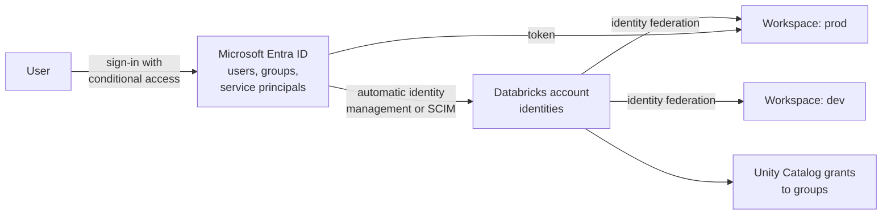

# Microsoft Entra ID Integration

Mastery: `INPUT[inlineSelect(option(new), option(learning), option(solid)):mastery]`

> [!story] Context
> [[Managed Resource Group]] covers the infrastructure behind a classic workspace. This note covers identity: how users, groups, and service principals from Microsoft Entra ID sign in to and are managed in Azure Databricks.

> [!eli5] Summary
> Azure Databricks uses the same work accounts people already use for Microsoft email and Office. Administrators do not create separate Databricks passwords; they decide which existing people and groups get access.

> [!renamed] Renamed
> Microsoft renamed **Azure Active Directory (Azure AD, AAD)** to **Microsoft Entra ID**, announced July 11, 2023, with rollout from August 15, 2023. Only the name changed. Older Databricks pages, APIs, and error messages may still use "AAD", for example in "AAD token".

## Background

On AWS and Google Cloud, Databricks connects to an external [[Identity Provider|identity provider]] through [[Single Sign-On|SSO]] and [[SCIM Provisioning|SCIM]], which an administrator configures. Azure Databricks is integrated with Microsoft Entra ID from the start: sign-in uses Entra ID with no SSO setup, and identities can be synchronized from Entra ID with or without a SCIM application.

## Overview

| Capability | Azure Databricks implementation |
|---|---|
| **Sign-in** | Microsoft Entra ID, built in |
| **Identity sync** | Automatic identity management (recommended) or SCIM provisioning through an Entra ID enterprise application |
| **Sign-in policy** | Entra ID conditional access targeting the AzureDatabricks application |
| **Machine identities** | Databricks-managed service principals, Entra ID-managed service principals, and Azure managed identities |
| **API tokens** | Entra ID access tokens for resource ID `2ff814a6-3304-4ab8-85cb-cd0e6f879c1d`, OAuth, or personal access tokens |

### Automatic identity management

Automatic identity management adds users, service principals, and groups from Entra ID to Azure Databricks without configuring an application in Entra ID. Microsoft's documentation recommends it over SCIM.

| Property | Value |
|---|---|
| Default | Enabled by default for accounts created after August 1, 2025 |
| Source of record | Entra ID. Group membership changes in Entra ID apply in Azure Databricks |
| Requirement | Identity-federated workspaces |
| Just-in-time provisioning | Always on when automatic identity management is on; cannot be turned off |
| Nested groups and Entra service principals | Supported (not supported by SCIM provisioning) |
| Identity matching | The Entra ID object ID is stored as the account user's `externalId`; at sign-in, the username in the token resolves the user |

Do not provision the same identity through both automatic identity management and SCIM. Doing so creates duplicate entries and permission conflicts.

### SCIM provisioning

SCIM provisioning uses an Entra ID enterprise application to push users and groups to the Databricks account. Use it if you already run SCIM provisioning and are not ready to migrate. It does not sync nested groups or Entra ID service principals. See [[SCIM Provisioning]].

### Conditional access

Entra ID conditional access controls when and from where users can sign in, for example by requiring multi-factor authentication or a corporate network. Requirements:

- Azure Databricks Premium (the only tier for new workspaces).
- Microsoft Entra ID Premium.
- The Conditional Access Administrator role in Entra ID.

In the Entra admin center, create a conditional access policy and select the **AzureDatabricks** application under cloud apps.

## How it works



1. Identities live at the Databricks **account** level and are assigned to workspaces through identity federation. See [[Users Groups and Service Principals]].
2. Users sign in with Entra ID. Conditional access policies apply at this step.
3. [[Unity Catalog]] grants reference account groups, so an Entra group membership change changes data access.

### Entra ID tokens for automation

Databricks recommends unified client authentication in the Databricks CLI and SDKs over handling tokens manually. When a raw token is needed, request it for the Azure Databricks resource ID:

```bash
az login --tenant <tenant-id>

# Entra ID access token for the Azure Databricks REST API
az account get-access-token \
  --resource 2ff814a6-3304-4ab8-85cb-cd0e6f879c1d \
  --query accessToken --output tsv
```

Entra ID access tokens expire within about an hour. A valid token has an `aud` claim matching the Azure Databricks resource ID and a `tid` claim matching the workspace's tenant.

### Service principal types

| Type | Created in | Use when |
|---|---|---|
| **Databricks-managed service principal** | Azure Databricks | Automation that only calls Azure Databricks. Databricks recommends this type for Databricks automation. |
| **Entra ID-managed service principal** | Microsoft Entra ID | A workload must authenticate to Azure Databricks and other Azure resources with the same identity. |
| **Azure managed identity** | Azure (system- or user-assigned) | Code running on Azure resources (VMs, Azure Data Factory, Azure Functions) authenticates without stored secrets. |

## Small-business considerations

> [!smallbiz] Small-business considerations
> - Confirm that **automatic identity management** is on (it is the default for accounts created after August 1, 2025). No SCIM application is needed.
> - Create Entra ID groups such as `databricks-analysts` and `databricks-engineers`, add them to the workspace, and grant Unity Catalog privileges to the groups.
> - Require multi-factor authentication for Azure Databricks with conditional access if you have Entra ID Premium.
> - Use a Databricks-managed service principal with OAuth for scheduled jobs, not a person's account or personal access token.

## Cloud differences

> [!azure]- Azure Databricks
> Entra ID is built in for sign-in. Identity sync uses automatic identity management or Entra SCIM. Conditional access, Entra ID tokens, Entra ID-managed service principals, and Azure managed identities are Azure-only options. The first account admin is established by an Entra ID Global Administrator.

> [!aws]- Databricks on AWS
> An account admin configures SSO in the account console (**Security** > **Identity provider setup**) with any SAML 2.0 or OIDC identity provider, such as Entra ID, Okta, OneLogin, or Keycloak. Unified login applies one SSO configuration to the account and all workspaces, and Databricks recommends adding users with SCIM. Service principals are Databricks-managed and use OAuth machine-to-machine authentication. See [[Single Sign-On]] and [[SCIM Provisioning]].

> [!gcp]- Databricks on Google Cloud
> SSO with Google Cloud Identity is available by default. You can configure a different SAML 2.0 or OIDC identity provider instead, which then disables Google ID token authentication. Identities sync through SCIM. Google Cloud resources are accessed through [[Google Service Accounts|Google service accounts]] rather than Entra identities.

## Advanced topics

> [!deepdive]- Advanced topics (301–401)
> - **Duplicate emails.** If more than one Entra ID user has an email equal to an Azure Databricks username and none has a matching UPN, automatic identity management cannot determine the intended user. Keep one Entra object per email.
> - **Migrating from SCIM.** Turning on automatic identity management while a SCIM application still provisions the same identities creates duplicates. Plan the cutover so each identity has one provisioning path.
> - **Account admin bootstrap.** An Entra ID Global Administrator signs in at `accounts.azuredatabricks.net` to become the first account admin, then assigns the role to others. After that, the Global Administrator is no longer needed. See [[Admin Roles]].
> - **Managed identity authentication.** The Databricks CLI and SDKs support Azure managed identity authentication for code running on Azure resources. Grant the managed identity access to the workspace like any other service principal.
> - **Token validation.** For custom integrations, validate `aud` (the Azure Databricks resource ID) and `tid` (your tenant) before trusting a token.

## Common misconceptions

> [!confusion] Automatic identity management is not SCIM
> Automatic identity management requires no Entra ID application, supports nested groups and Entra service principals, and resolves users at sign-in. SCIM pushes identities through an Entra ID enterprise application.

> [!confusion] An Azure role on the workspace is not a data permission
> Azure RBAC roles control the Azure resource. Access to tables is controlled by Unity Catalog grants to Databricks account identities.

## Recall

What was Microsoft Entra ID called before 2023?::Azure Active Directory (Azure AD, AAD).
Which identity sync method does Microsoft recommend for Azure Databricks?::Automatic identity management.
For which accounts is automatic identity management on by default?::Accounts created after August 1, 2025.
What can automatic identity management sync that SCIM cannot?::Nested groups and Entra ID service principals.
What happens if you provision the same identity with automatic identity management and SCIM?::Duplicate entries and permission conflicts.
What does conditional access for Azure Databricks require?::Azure Databricks Premium, Entra ID Premium, and the Conditional Access Administrator role.
Which application does a conditional access policy target?::AzureDatabricks.
What resource ID do you request an Entra ID token for?::`2ff814a6-3304-4ab8-85cb-cd0e6f879c1d`.
When should you use an Entra ID-managed service principal instead of a Databricks-managed one?::When the same identity must authenticate to Azure Databricks and other Azure resources.

## Next steps

> [!path] Learning path
> **Needs first:** [[Users Groups and Service Principals]], [[First-Party Microsoft Service]]
> **Unlocks next:** [[SCIM Provisioning]], [[Authentication - Tokens and OAuth]], [[Power BI on Azure Databricks]]

> [!nextup] Next
> [[VNet Injection]] covers deploying classic compute into a virtual network you control.

> [!sources]- Sources (last verified: 2026-10-25)
> - [Automatic identity management (Azure Databricks)](https://learn.microsoft.com/en-us/azure/databricks/admin/users-groups/automatic-identity-management/)
> - [Identity best practices (Azure Databricks)](https://learn.microsoft.com/en-us/azure/databricks/admin/users-groups/best-practices)
> - [Manage users, service principals, and groups (Azure)](https://learn.microsoft.com/en-us/azure/databricks/admin/users-groups/)
> - [Service principals (Azure Databricks)](https://learn.microsoft.com/en-us/azure/databricks/admin/users-groups/service-principals)
> - [Sync users and groups from Microsoft Entra ID using SCIM](https://learn.microsoft.com/en-us/azure/databricks/admin/users-groups/scim/)
> - [Configure SCIM provisioning using Microsoft Entra ID](https://learn.microsoft.com/en-us/azure/databricks/admin/users-groups/scim/aad)
> - [Conditional access (Azure Databricks)](https://learn.microsoft.com/en-us/azure/databricks/admin/access-control/conditional-access)
> - [Authentication and access control (Azure Databricks)](https://learn.microsoft.com/en-us/azure/databricks/security/auth/)
> - [Get Microsoft Entra ID tokens manually](https://learn.microsoft.com/en-us/azure/databricks/dev-tools/auth/aad-token-manual)
> - [Get Microsoft Entra ID tokens for users by using the Azure CLI](https://learn.microsoft.com/en-us/azure/databricks/dev-tools/user-aad-token)
> - [Get Microsoft Entra ID tokens for service principals](https://learn.microsoft.com/en-us/azure/databricks/dev-tools/service-prin-aad-token)
> - [Use Azure managed identities with Azure Databricks](https://learn.microsoft.com/en-us/azure/databricks/dev-tools/auth/azure-mi-auth)
> - [Databricks administration overview (Azure)](https://learn.microsoft.com/en-us/azure/databricks/admin/admin-concepts)
> - [New name for Azure Active Directory (Microsoft Entra)](https://learn.microsoft.com/en-us/entra/fundamentals/new-name)
> - [Configure SSO using SAML (AWS)](https://docs.databricks.com/aws/en/admin/account-settings-e2/single-sign-on/saml)
> - [Configure SSO in Databricks (GCP)](https://docs.databricks.com/gcp/en/security/auth/single-sign-on/)
