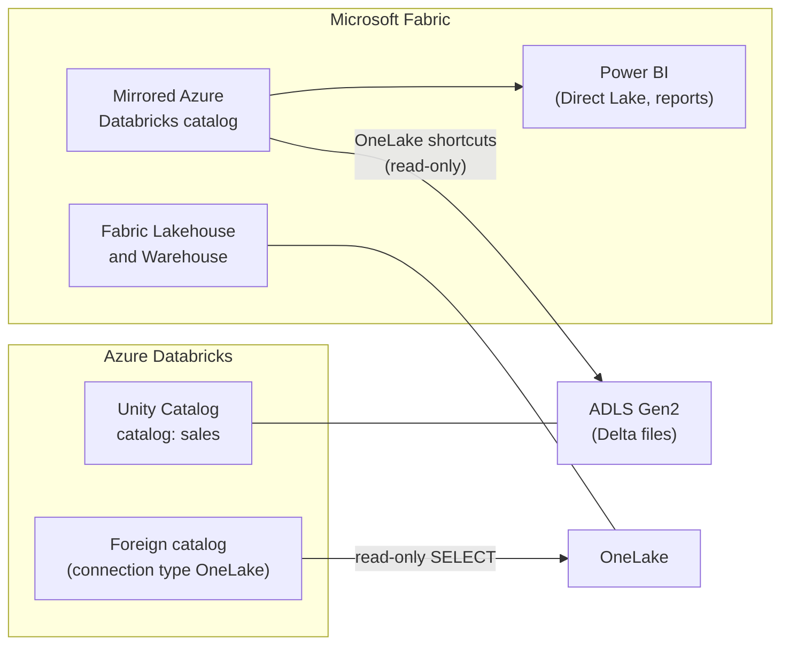

# Microsoft Fabric and OneLake vs Databricks

Mastery: `INPUT[inlineSelect(option(new), option(learning), option(solid)):mastery]`

> [!story] Context
> [[Azure Data Factory with Databricks]] covers Azure's orchestration service. Microsoft also sells Microsoft Fabric, a SaaS analytics platform that overlaps with Azure Databricks. This note compares the two and describes the integrations between them.

> [!eli5] Summary
> Microsoft Fabric and Azure Databricks are two different Microsoft-sold products for storing and analyzing company data. Fabric is a packaged, all-in-one service built around Power BI. Databricks is a more configurable platform for heavy data engineering and AI. Many companies use both, and each can read the other's tables without copying them.

## Background

Microsoft Fabric is a SaaS analytics platform that combines data integration (Data Factory), lakehouse and warehouse engines, real-time analytics, data science, and Power BI. All Fabric items store data in **OneLake**, a single logical data lake per tenant, built on Azure Data Lake Storage. OneLake stores tables in open formats (Delta Parquet, or Iceberg), and a Fabric lakehouse uses [[Delta Lake]] as its default table format.

Because both products store Delta tables on Azure storage, the question for most Microsoft shops is not which one to pick exclusively, but which workloads belong where and how to avoid duplicate copies.

## Overview

| Dimension | Microsoft Fabric | Azure Databricks |
|---|---|---|
| **Delivery model** | SaaS, inside the Fabric/Power BI tenant | Azure first-party service with workspaces in your subscription |
| **Billing model** | Capacity-based (Fabric capacity SKUs) | Usage-based, in [[DBUs]] (plus Azure infrastructure for classic compute) |
| **Storage** | OneLake (Delta Parquet or Iceberg) | Your ADLS Gen2 or Databricks default storage (Delta Lake, Iceberg) |
| **Governance** | Fabric workspaces, item permissions, OneLake security | [[Unity Catalog]] |
| **Strengths cited by Microsoft** | Low-code, Power BI-centric analytics on a unified SaaS platform | Lakehouse-scale Spark, ML with MLflow and Unity Catalog, fine-grained compute control |
| **Not the best fit (per Microsoft)** | Deep learning at scale, comprehensive MLOps with governed registries, fine-grained compute control | Teams that want only low-code BI without platform administration |

Integration paths:

| Direction | Feature | Status (October 2026) | Data copied? |
|---|---|---|---|
| Databricks → Fabric | **Mirrored Azure Databricks catalog**, created from Fabric | GA | No. Metadata is mirrored; data is reached through OneLake shortcuts |
| Databricks → Fabric | **Publish a Unity Catalog catalog to Fabric**, started from Azure Databricks | Public Preview | No. Tables appear in Fabric as read-only mirrored tables |
| Fabric → Databricks | **OneLake catalog federation**: a foreign catalog in Unity Catalog over Fabric Lakehouse and Warehouse items | Available (read-only) | No. Queried in place |
| Fabric → Databricks | **OneLake external location** for creating Unity Catalog objects on OneLake storage | Beta | Not applicable |

## How it works



### Mirror Unity Catalog into Fabric

Requirements on the Databricks side:

- External data access enabled on the metastore.
- The `EXTERNAL USE SCHEMA` privilege on the schemas being mirrored.
- Delta Lake tables (or Delta tables with Iceberg reads enabled).
- For the publish-from-Databricks path: serverless compute or Databricks Runtime 18.1 or later.

Requirements on the Fabric side: a Fabric capacity and a Fabric workspace where you can create items.

Fabric-initiated steps:

1. In the Fabric portal, open a workspace and select **+ New** > **Mirrored Azure Databricks catalog**.
2. Connect to the Azure Databricks workspace.
3. Select the catalog, schemas, and tables, and optionally enable automatic sync of new ones.
4. Configure access in Fabric (OneLake security roles for Entra groups).

### Query OneLake from Databricks

OneLake catalog federation creates a read-only foreign catalog over Fabric Lakehouse and Warehouse items:

1. A Fabric admin enables the required tenant settings, including the one that allows short-lived user-delegated SAS tokens.
2. In Azure Databricks, create a connection of type **OneLake** that authenticates with a managed identity or service principal.
3. Create a foreign catalog from the connection.
4. Query from compute running Databricks Runtime 18.0 or later in standard access mode.

```sql
-- After creating a OneLake connection and foreign catalog named fabric_sales
SELECT region, SUM(amount) AS revenue
FROM fabric_sales.lakehouse_sales.orders
GROUP BY region;
```

Limits: `SELECT` only; Fabric Lakehouse and Warehouse items only; no dedicated access mode, complex types, or views.

## Small-business considerations

> [!smallbiz] Small-business considerations
> - **Power BI is the main tool and data volumes are modest:** Fabric alone may be sufficient. See [[Databricks vs Alternatives for Small Teams]].
> - **You need Python or Spark engineering, ML, or AI agents, or you want usage-based billing:** use Azure Databricks.
> - **Both:** keep engineering and governance in Databricks, mirror the gold catalog into Fabric for Power BI, and avoid copying data between them.
>
> Fabric capacity and Databricks DBUs are separate charges. See the Microsoft Fabric and Azure Databricks pricing pages.

## Cloud differences

> [!azure]- Azure Databricks
> Fabric integration is Azure-specific: Fabric mirroring of Unity Catalog, publishing catalogs to Fabric, OneLake catalog federation, and OneLake external locations are documented for Azure Databricks.

> [!aws]- Databricks on AWS
> Fabric is a Microsoft service and has no AWS equivalent. Databricks on AWS can share data with Fabric or other platforms through [[OpenSharing]] or Iceberg REST catalog access to Unity Catalog.

> [!gcp]- Databricks on Google Cloud
> There is no Fabric on Google Cloud. The comparable integration on GCP is with [[BigQuery Integration|BigQuery]], through federation and connectors. See [[Google BigQuery]].

## Advanced topics

> [!deepdive]- Advanced topics (301–401)
> - **Governance does not travel:** Microsoft's mirroring security guidance states that Unity Catalog policies and permissions are not mirrored into Fabric. Re-create access in Fabric with OneLake security, and do not mirror tables protected by [[Row Filters and Column Masks|row filters or column masks]] unless Fabric-side controls are equivalent.
> - **Read-only in Fabric:** Mirrored tables are read-only in Fabric. Writes go through Databricks, which keeps Unity Catalog lineage and audit intact.
> - **Direct Lake guardrails:** Power BI Direct Lake models read Delta tables in OneLake, subject to capacity SKU guardrails such as a maximum number of Parquet files per table (1,000 for F2 to F32, 5,000 for F64 and above, as of October 2026). Compacting source tables with `OPTIMIZE` keeps file counts within limits.
> - **Roadmap:** Databricks' blog on OneLake support in Unity Catalog describes reads from OneLake first and write support on the roadmap, aligned with the Unity Catalog open APIs. The OneLake external location (Beta) is the first write-capable path.
> - **ADF migration:** Fabric Data Factory includes an Azure Databricks activity, so moving orchestration to Fabric does not require moving Databricks jobs.

## Common misconceptions

> [!confusion] Mirroring is not copying
> A mirrored Azure Databricks catalog stores metadata in Fabric and reaches the data through OneLake shortcuts. The Delta files stay in your storage.

> [!confusion] Fabric Spark is not Databricks
> Fabric includes its own Spark runtime. It does not run Databricks Runtime, Photon, Unity Catalog, or Lakeflow.

## Recall

Where does Microsoft Fabric store data?::OneLake, one logical data lake per tenant built on ADLS, in Delta Parquet or Iceberg format.
How is Fabric billed compared with Azure Databricks?::Fabric uses capacity-based pricing; Azure Databricks bills usage in DBUs.
What is the Fabric item that mirrors Unity Catalog?::Mirrored Azure Databricks catalog.
What is the status of publishing a Unity Catalog catalog to Fabric from Databricks?::Public Preview (Fabric-initiated mirroring is GA).
Which Unity Catalog privilege is needed for Fabric mirroring?::`EXTERNAL USE SCHEMA`.
Are Unity Catalog permissions applied in Fabric after mirroring?::No. Access must be configured in Fabric.
What does OneLake catalog federation allow?::Read-only `SELECT` queries from Unity Catalog over Fabric Lakehouse and Warehouse items.
Which Databricks Runtime and access mode does OneLake federation require?::Databricks Runtime 18.0 or later, standard access mode.

## Next steps

> [!path] Learning path
> **Needs first:** [[Unity Catalog]], [[The Lakehouse Idea]]
> **Unlocks next:** [[Power BI on Azure Databricks]], [[Lakehouse Federation]]

> [!nextup] Next
> [[Power BI on Azure Databricks]] covers connecting Power BI directly to Databricks SQL warehouses and publishing semantic models from Unity Catalog.

> [!sources]- Sources (last verified: 2026-10-25)
> - [Microsoft Fabric with Azure Databricks](https://learn.microsoft.com/en-us/azure/databricks/partners/bi/fabric)
> - [Publish a Unity Catalog catalog to Microsoft Fabric](https://learn.microsoft.com/en-us/azure/databricks/partners/bi/fabric-publish)
> - [Use Microsoft Fabric to read data registered in Unity Catalog](https://learn.microsoft.com/en-us/azure/databricks/partners/bi/fabric-mirror)
> - [Enable OneLake catalog federation (Azure Databricks)](https://learn.microsoft.com/en-us/azure/databricks/query-federation/onelake)
> - [Connect Azure Databricks to a OneLake external location](https://learn.microsoft.com/en-us/azure/databricks/connect/unity-catalog/cloud-storage/external-locations-onelake)
> - [Expanding support for OneLake in Unity Catalog (Databricks blog)](https://www.databricks.com/blog/expanding-support-onelake-unity-catalog)
> - [Microsoft Fabric mirrored catalog from Azure Databricks tutorial](https://learn.microsoft.com/en-us/fabric/mirroring/azure-databricks-tutorial)
> - [Mirrored databases from Azure Databricks: security (Microsoft Fabric)](https://learn.microsoft.com/en-us/fabric/mirroring/azure-databricks-security)
> - [OneLake, the unified data lake (Microsoft Fabric)](https://learn.microsoft.com/en-us/fabric/onelake/onelake-overview)
> - [Direct Lake overview (Microsoft Fabric)](https://learn.microsoft.com/en-us/fabric/fundamentals/direct-lake-overview)
> - [AI and machine learning products (Azure Architecture Center)](https://learn.microsoft.com/en-us/azure/architecture/ai-ml/guide/data-science-and-machine-learning)
> - [Choose a batch processing technology (Azure Architecture Center)](https://learn.microsoft.com/en-us/azure/architecture/data-guide/technology-choices/batch-processing)
> - [Azure Databricks activity (Microsoft Fabric)](https://learn.microsoft.com/en-us/fabric/data-factory/azure-databricks-activity)
