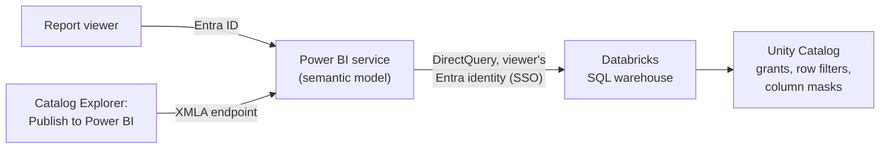

# Power BI on Azure Databricks

Mastery: `INPUT[inlineSelect(option(new), option(learning), option(solid)):mastery]`

> [!story] Context
> [[Microsoft Fabric and OneLake vs Databricks]] covers mirroring Unity Catalog into Fabric. Power BI can also connect directly to Azure Databricks SQL warehouses. This note covers the Azure-specific parts: Entra ID sign-in and SSO, the ADBC driver, and publishing from Unity Catalog. Cloud-neutral connection basics are in [[Connecting Power BI]].

> [!eli5] Summary
> Power BI is Microsoft's reporting tool. On Azure it connects to Databricks using the same work accounts, so each person who opens a report sees only the data they are allowed to see. Databricks can also create the Power BI dataset for you in a few clicks.

## Background

Power BI is the most common BI tool in Microsoft shops. Because Azure Databricks uses Microsoft Entra ID, Power BI can pass each report viewer's Entra identity to Databricks, and [[Unity Catalog]] permissions apply per viewer. Databricks also adds features that generate and refresh Power BI semantic models from Unity Catalog.

## Overview

| Capability | What it does | Status (October 2026) |
|---|---|---|
| **Azure Databricks connector** | Power BI Desktop and service connector for SQL warehouses and clusters, with Entra ID sign-in | Available |
| **ADBC driver** | Arrow Database Connectivity driver for the connector, replacing the embedded Simba Spark ODBC driver | GA October 15, 2026; default for new connections since February 2026 |
| **Publish to Power BI service** | Creates or updates a semantic model from Unity Catalog tables in Catalog Explorer | Available |
| **Power BI task in Lakeflow Jobs** | Republishes and refreshes semantic models as a job task | Public Preview |
| **SSO with DirectQuery** | Report viewers query Databricks with their own Entra identity | Available |

### Storage modes

| Mode | Where queries run | Use when |
|---|---|---|
| **DirectQuery** | On a Databricks [[SQL Warehouses\|SQL warehouse]] at report time | Large or frequently changing data; per-viewer Unity Catalog security with SSO |
| **Import** | In the Power BI model after a scheduled refresh | Small, slowly changing data; fastest visuals |

Databricks recommends SQL warehouses for DirectQuery.

## How it works

### Connect from Power BI Desktop

1. Use Power BI Desktop 2.145.1105.0 or later for the ADBC driver.
2. Select **Get data** > **Azure Databricks**.
3. Enter the SQL warehouse's **Server hostname** and **HTTP path** (from the warehouse's **Connection details** tab).
4. Choose **DirectQuery** or **Import**.
5. Sign in with **Microsoft Entra ID**.

New connections use ADBC by default. To switch an existing connection, open **Transform data** > **Advanced Editor** and add the option `Implementation = "2.0"` to the connector's options record. Use one driver type for every Databricks connection in a semantic model.

### Publish from Unity Catalog

Requirements:

- Data in Unity Catalog (Hive metastore and the `samples` catalog are not supported) on Unity Catalog-enabled compute.
- A Power BI Premium license (Premium capacity, Premium Per User, or a Fabric capacity) with the XMLA endpoint set to **Read Write**.

Steps:

1. In Catalog Explorer, select the schema or tables.
2. Choose the option to publish to a Power BI workspace, and select a SQL warehouse.
3. Authenticate with Entra ID through the **Databricks Dataset Publishing Integration** application.
4. Select the Power BI workspace, the storage mode (DirectQuery or Import), and a new or existing semantic model.
5. Choose OAuth for data source authentication. Databricks recommends OAuth over a personal access token because it gives per-user access control and auditing.

### Turn on SSO for report viewers

After publishing, open the semantic model's settings in the Power BI service. Under **Data source credentials**, edit the credentials and select the option that report viewers can access the data source only with their own Power BI identities using DirectQuery. Without it, every viewer queries Databricks as the publisher.

## Small-business considerations

> [!smallbiz] Small-business considerations
> - Start with **DirectQuery on a small serverless SQL warehouse** with SSO enabled, so Unity Catalog permissions apply to every viewer and there is one copy of the data.
> - Switch large, static tables to Import if visuals are slow.
> - Publishing from Catalog Explorer requires a Power BI Premium, Premium Per User, or Fabric capacity license. With Power BI Pro only, connect from Power BI Desktop and publish the report as usual.
> - SQL warehouse usage is billed in DBUs while the warehouse runs. Set auto-stop on the warehouse.

## Cloud differences

> [!azure]- Azure Databricks
> Entra ID sign-in and DirectQuery SSO work natively because both services use Entra ID. Publishing uses the Databricks Dataset Publishing Integration Entra application. On-premises data gateways support Entra SSO for Azure Databricks with DirectQuery only.

> [!aws]- Databricks on AWS
> Power BI connects with the Databricks connector, using OAuth (SSO through your identity provider) or a personal access token. See [[Connecting Power BI]].

> [!gcp]- Databricks on Google Cloud
> Power BI connects with the Databricks connector in the same way as on AWS. See [[Connecting Power BI]].

## Advanced topics

> [!deepdive]- Advanced topics (301–401)
> - **Auto query tags:** With ADBC, Power BI context is attached to queries as query tags in Databricks SQL, which helps attribute warehouse cost and load to reports. ODBC connections do not support this.
> - **`Databricks.Query`:** The native-query data source `Databricks.Query` is not supported with semantic model DirectQuery mode.
> - **Service principal token lifetime:** When automation uses an Entra ID-managed service principal, workflows that run longer than one hour fail because the token expires.
> - **Scheduled republish:** The Power BI task in Lakeflow Jobs (Public Preview) republishes models after upstream tables refresh. It requires a Unity Catalog Power BI connection, consent to the Databricks Dataset Publishing Integration application, and `USE CONNECTION` on that connection.
> - **Metric views:** Power BI support for querying Unity Catalog [[Metric Views|metric views]] has changed several times during 2026. Check the current "Query metric views in Power BI" page before building on it.
> - **Warehouse sizing:** DirectQuery reports send queries to the warehouse whenever visuals load, so size the SQL warehouse for concurrent report users. See [[Query Performance and Caching]].

## Common misconceptions

> [!confusion] SSO is not on by default after publishing
> Until the viewer-identity option is selected in the data source credentials, all viewers query with the publisher's credentials.

> [!confusion] Fabric mirroring and the Power BI connector are different paths
> The connector queries a Databricks SQL warehouse. Fabric mirroring exposes Unity Catalog tables in OneLake for Fabric engines and Direct Lake. See [[Microsoft Fabric and OneLake vs Databricks]].

## Recall

Which driver is the default for new Power BI connections to Azure Databricks?::ADBC (Arrow Database Connectivity), default since February 2026 and GA on October 15, 2026.
How do you switch an existing Power BI connection to ADBC?::Add `Implementation = "2.0"` to the connector options in Advanced Editor.
Which compute does Databricks recommend for DirectQuery?::SQL warehouses.
What license is required to publish to the Power BI service from Catalog Explorer?::Power BI Premium capacity, Premium Per User, or a Fabric capacity, with the XMLA endpoint set to Read Write.
Which Entra application handles publishing from Databricks?::Databricks Dataset Publishing Integration.
Why does Databricks recommend OAuth over a personal access token when publishing?::It enables per-user access control and auditing.
What must you enable for viewers to query with their own identity?::The DirectQuery SSO option in the semantic model's data source credentials.
Which Power BI data source is not supported with DirectQuery?::`Databricks.Query`.

## Next steps

> [!path] Learning path
> **Needs first:** [[Connecting Power BI]], [[SQL Warehouses]], [[Microsoft Entra ID Integration]]
> **Unlocks next:** [[Metric Views]], [[Query Performance and Caching]], [[Migrating BI Reports]]

> [!nextup] Next
> [[Azure Billing and Commit Units]] covers how warehouse, job, and cluster usage appears on the Azure bill and how to prepay for it.

> [!sources]- Sources (last verified: 2026-10-25)
> - [Power BI with Azure Databricks](https://learn.microsoft.com/en-us/azure/databricks/partners/bi/power-bi/)
> - [Connect Power BI Desktop to Azure Databricks](https://learn.microsoft.com/en-us/azure/databricks/partners/bi/power-bi/desktop)
> - [Configure ADBC or ODBC driver for Power BI](https://learn.microsoft.com/en-us/azure/databricks/partners/bi/power-bi/adbc)
> - [Publish to the Power BI service from Azure Databricks](https://learn.microsoft.com/en-us/azure/databricks/partners/bi/power-bi/service)
> - [Power BI task for jobs (Azure Databricks)](https://learn.microsoft.com/en-us/azure/databricks/jobs/powerbi)
> - [Create a Power BI connection in Unity Catalog for orchestration](https://learn.microsoft.com/en-us/azure/databricks/partners/bi/power-bi/uc-connect)
> - [October 2026 release notes (Azure Databricks)](https://learn.microsoft.com/en-us/azure/databricks/release-notes/product/2026/october)
> - [Azure Databricks Power Query connector](https://learn.microsoft.com/en-us/power-query/connectors/databricks-azure)
> - [Overview of single sign-on for on-premises data gateways (Power BI)](https://learn.microsoft.com/en-us/power-bi/connect-data/service-gateway-sso-overview)
> - [Query tags (Databricks SQL, Azure)](https://learn.microsoft.com/en-us/azure/databricks/sql/user/queries/query-tags)
> - [Power BI with Databricks (AWS)](https://docs.databricks.com/aws/en/partners/bi/power-bi/)
> - [Power BI with Databricks (GCP)](https://docs.databricks.com/gcp/en/partners/bi/power-bi/)
