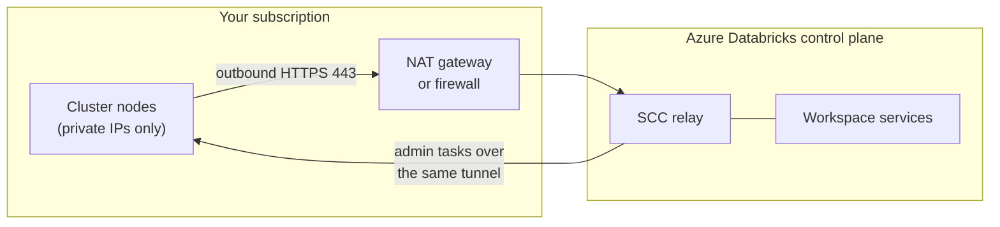

# Secure Cluster Connectivity

Mastery: `INPUT[inlineSelect(option(new), option(learning), option(solid)):mastery]`

> [!story] Context
> [[VNet Injection]] places classic compute in your VNet. Secure cluster connectivity (SCC), also called No Public IP (NPIP), removes public IP addresses from those cluster nodes and closes all inbound ports.

> [!eli5] Summary
> With secure cluster connectivity, the Databricks computers have no public internet address and accept no incoming connections. Each computer calls out to Databricks and keeps that line open, and all instructions arrive over it.

## Background

Without SCC, each cluster node has a public IP, and the network security group must allow inbound connections from the control plane on ports 22 and 5557. Security teams generally do not accept internet-reachable VMs in a data environment.

SCC reverses the direction of the connection: clusters connect outbound to the control plane, so no inbound rules or public IPs are needed. It is the default in the Azure portal, the default in ARM templates from API version 2024-05-01, and Microsoft states that it plans to require SCC for all classic workspaces.

## Overview

| Property | Behavior with SCC |
|---|---|
| Public IPs on cluster nodes | None |
| Inbound ports on cluster subnets | None required |
| Connection direction | Each cluster opens an outbound HTTPS (port 443) connection to the SCC relay in the control plane when it is created |
| Control traffic | The control plane sends cluster administration tasks back through that tunnel |
| Egress path | A NAT gateway (Databricks-managed VNet) or the path you configure (VNet injection) |
| Setting name | **Secure Cluster Connectivity (No Public IP)** in the portal; `enableNoPublicIp` in ARM and Bicep; `--enable-no-public-ip` in the Azure CLI |

SCC applies to classic compute. Serverless compute does not use the SCC relay, and serverless compute resources do not have public IP addresses.

## How it works



### Egress options

Because nodes have no public IPs, outbound traffic needs a path to the Azure backbone and public network.

| Deployment | Egress | Notes |
|---|---|---|
| **Databricks-managed VNet** | Azure Databricks automatically creates a NAT gateway in the [[Managed Resource Group\|managed resource group]] | Additional cost; cannot be modified |
| **VNet injection: Azure NAT gateway** | You attach a NAT gateway to both workspace subnets | Recommended for most deployments. Stable egress public IP; configurable |
| **VNet injection: user-defined routes** | Routes send traffic to a firewall or network virtual appliance | For firewall-based egress control |
| **VNet injection: egress load balancer** | An outbound load balancer | Configuration is fixed. Databricks recommends avoiding it because of port-exhaustion risk |

Microsoft states that after March 31, 2026, new Azure virtual networks default to private configurations without outbound internet access. A new VNet-injected workspace therefore needs one of these egress methods.

### Attach a NAT gateway (VNet injection)

```bash
RG=rg-databricks-net
az network public-ip create -g $RG -n pip-dbw-nat --sku Standard
az network nat gateway create -g $RG -n nat-dbw-prod \
  --public-ip-addresses pip-dbw-nat --idle-timeout 10

for SUBNET in snet-dbw-host snet-dbw-container; do
  az network vnet subnet update -g $RG --vnet-name vnet-dbw-prod \
    -n $SUBNET --nat-gateway nat-dbw-prod
done
```

The NAT gateway's public IP is the stable source address that external services (for example, a SaaS API allowlist) see for classic cluster traffic.

### Enabling SCC

- **New workspaces:** keep the portal default (**Yes**), or set `enableNoPublicIp` to `true` in templates.
- **Existing VNet-injected workspaces:** SCC can be added through the Azure portal or an ARM template update. The workspace must already use VNet injection.

## Small-business considerations

> [!smallbiz] Small-business considerations
> Keep SCC on. It is the default, it requires no inbound firewall rules, and Microsoft plans to require it for all classic workspaces. The main cost is the NAT gateway or other egress path, which Azure bills separately. A serverless workspace avoids the question entirely, because serverless compute has no public IPs and does not use the relay.

## Cloud differences

> [!azure]- Azure Databricks
> SCC is named No Public IP (NPIP) in templates (`enableNoPublicIp`). With a Databricks-managed VNet, a non-modifiable NAT gateway is created in the managed resource group. With VNet injection, you provide egress through a NAT gateway, UDRs, or a load balancer.

> [!aws]- Databricks on AWS
> SCC is the default baseline architecture for classic compute: no open ports in the customer VPC and no public IPs on compute plane resources. SCC works with both Databricks-managed and [[Customer-Managed VPC on AWS|customer-managed VPCs]]. Classic [[AWS PrivateLink]] (Enterprise plan) can carry relay traffic privately.

> [!gcp]- Databricks on Google Cloud
> All new workspaces are created with SCC by default, and clusters have no public IPs. The classic compute VPC cannot reach the public internet by default, so firewalls must allow the control plane and relay endpoints. Do not enable TLS inspection on cluster-to-control-plane traffic. [[Private Service Connect]] can carry relay traffic privately.

## Advanced topics

> [!deepdive]- Advanced topics (301–401)
> - **Fully private compute:** SCC removes public IPs from nodes. Classic compute (back-end) [[Azure Private Link]] additionally keeps SCC relay and REST API traffic on the Microsoft backbone, which together give a compute environment with no public IP addresses.
> - **Storage firewall dependency:** Firewall support for the workspace storage account requires SCC for connections from classic compute.
> - **Egress cost:** Microsoft notes that SCC can incur additional egress costs. The NAT gateway is billed separately by Azure.
> - **NSG implications:** With SCC on, the inbound rules for ports 22 and 5557 are not created. Outbound rules to the `AzureDatabricks` service tag (443, 3306, 8443–8451) remain required. See [[VNet Injection]].
> - **Deprecation of `false`:** Workspaces created with `enableNoPublicIp` set to `false` will no longer be supported once SCC becomes mandatory. Inventory older workspaces and migrate them.

## Common misconceptions

> [!confusion] SCC is not Private Link
> SCC removes public IPs from cluster nodes and makes connections outbound-only. Private Link replaces the public network path to the control plane with private endpoints. They are complementary.

> [!confusion] No public IP does not mean no internet access
> With SCC, clusters can still reach the internet through the NAT gateway or firewall you configure, for example to download libraries. Restrict egress with UDRs and a firewall if required.

## Recall

What does secure cluster connectivity remove from cluster nodes?::Public IP addresses and the need for inbound ports.
In which direction does the SCC connection start?::Outbound from each cluster to the SCC relay in the control plane, over HTTPS port 443.
What is the template parameter for SCC?::`enableNoPublicIp`.
What is the default value of `enableNoPublicIp` from API version 2024-05-01?::`true`.
What does Azure Databricks create for egress in a Databricks-managed VNet with SCC?::A NAT gateway in the managed resource group, which cannot be modified.
Which egress option does Microsoft recommend for most VNet-injected workspaces?::An Azure NAT gateway attached to both workspace subnets.
Why is an egress load balancer not recommended?::Its configuration is fixed and it risks port exhaustion.
What changes for new Azure VNets after March 31, 2026?::They default to private configurations without outbound internet access.
Does serverless compute use the SCC relay?::No, and serverless compute resources have no public IPs.

## Next steps

> [!path] Learning path
> **Needs first:** [[VNet Injection]], [[Public vs Private IP]]
> **Unlocks next:** [[Azure Private Link]], [[Network Security Overview]]

> [!nextup] Next
> [[Azure Private Link]] removes the public network path between users, clusters, and the control plane.

> [!sources]- Sources (last verified: 2026-10-25)
> - [Enable secure cluster connectivity](https://learn.microsoft.com/en-us/azure/databricks/security/network/classic/secure-cluster-connectivity)
> - [Deploy Azure Databricks in your Azure virtual network (VNet injection)](https://learn.microsoft.com/en-us/azure/databricks/security/network/classic/vnet-inject)
> - [Phase 4: Design network architecture (Azure)](https://learn.microsoft.com/en-us/azure/databricks/lakehouse-architecture/deployment-guide/network)
> - [Configure classic compute plane private connectivity (Azure)](https://learn.microsoft.com/en-us/azure/databricks/security/network/classic/private-link-standard)
> - [Enable firewall support for your workspace storage account](https://learn.microsoft.com/en-us/azure/databricks/security/network/storage/firewall-support)
> - [Managed security (Azure)](https://learn.microsoft.com/en-us/azure/databricks/security/network/deployment-architecture/managed-security)
> - [Hardened connectivity (Azure)](https://learn.microsoft.com/en-us/azure/databricks/security/network/deployment-architecture/hardened-connectivity)
> - [Microsoft.Databricks/workspaces template reference](https://learn.microsoft.com/en-us/azure/templates/microsoft.databricks/workspaces)
> - [az databricks workspace (Azure CLI reference)](https://learn.microsoft.com/en-us/cli/azure/databricks/workspace?view=azure-cli-latest)
> - [Managed security (AWS)](https://docs.databricks.com/aws/en/security/network/deployment-architecture/managed-security)
> - [Classic compute plane networking (GCP)](https://docs.databricks.com/gcp/en/security/network/classic)
> - [Limit network egress for your workspace using a firewall (GCP)](https://docs.databricks.com/gcp/en/security/network/classic/firewall)
