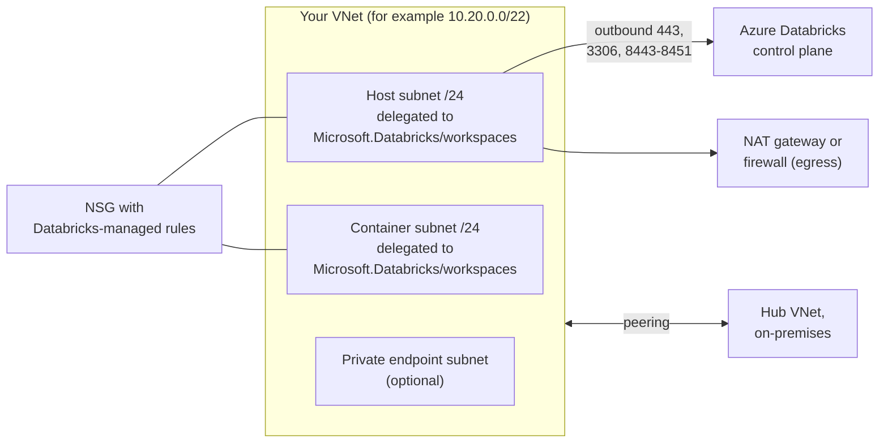

# VNet Injection

Mastery: `INPUT[inlineSelect(option(new), option(learning), option(solid)):mastery]`

> [!story] Context
> [[Microsoft Entra ID Integration]] covers who can sign in. This note covers where classic compute runs on the network. By default a classic workspace uses a VNet that Azure Databricks manages in the [[Managed Resource Group|managed resource group]]. VNet injection places classic compute in a VNet you own instead.

> [!eli5] Summary
> VNet injection puts the Databricks computers inside the company's own private network on Microsoft's cloud. The company's network team then controls which other systems those computers can reach and how their traffic leaves.

## Background

A Databricks-managed VNet is simple but closed to customization. You cannot peer it to a hub network, route its traffic through a firewall, or connect it to on-premises networks over ExpressRoute or VPN. Enterprises usually need all three. Microsoft also states that it plans to deprecate creating classic workspaces with an Azure Databricks-managed VNet, so VNet injection is the expected model for new classic workspaces.

VNet injection applies only to **classic compute**. [[Serverless Compute|Serverless compute]] runs in the Azure Databricks account and is governed by [[Serverless Network Security|network connectivity configurations]] instead.

## Overview

A VNet-injected workspace uses two dedicated subnets in your VNet:

| Subnet | Also called | Purpose |
|---|---|---|
| **Host subnet** | Public subnet | One IP per cluster node, for the host VM |
| **Container subnet** | Private subnet | One IP per cluster node, for the Databricks Runtime container |

Requirements and limits:

| Item | Requirement |
|---|---|
| VNet address space | Between `/16` and `/24` |
| Subnet size | `/26` minimum recommended (smaller, down to `/28`, is technically possible but not recommended). Microsoft's network architecture guide notes most use cases need at least `/23` |
| IP usage | Each node uses one IP in each subnet; Azure reserves 5 IPs per subnet |
| Sharing | The two subnets are dedicated to one workspace |
| Delegation | Both subnets are delegated to `Microsoft.Databricks/workspaces` |
| NSG | Each subnet has a network security group; Databricks recommends one NSG per workspace |
| Changes | Subnet CIDR ranges cannot be changed after deployment, except through the VNet update feature (Public Preview as of October 2026) or a request to your account team |

### Capacity by subnet size

Because every node takes one address in each subnet, the smaller subnet sets the maximum number of nodes in the workspace (all running clusters combined):

| Subnet size | Addresses | Usable (minus 5 reserved) | Maximum concurrent nodes |
|---|---|---|---|
| `/26` | 64 | 59 | 59 |
| `/24` | 256 | 251 | 251 |
| `/23` | 512 | 507 | 507 |
| `/22` | 1,024 | 1,019 | 1,019 |

## How it works



### Network security group rules

Azure Databricks provisions and manages the required NSG rules through the subnet delegation to `Microsoft.Databricks/workspaces`. The delegated rules cannot be edited. The required outbound rules are:

| Destination (service tag) | Ports | Purpose |
|---|---|---|
| `AzureDatabricks` | TCP 443 | Azure Databricks infrastructure, cloud data sources, library repositories |
| `AzureDatabricks` | TCP 3306 | Metastore |
| `AzureDatabricks` | TCP 8443 | Compute plane calls to the control plane API |
| `AzureDatabricks` | TCP 8444 | Unity Catalog logging and lineage streaming |
| `AzureDatabricks` | TCP 8445–8451 | Reserved for future use |
| `Storage` | TCP 443 | Azure Storage |
| `EventHub` | TCP 9093 | Required by the provisioning template (purpose not documented) |
| `Sql` | TCP 3306 | Required for workspaces created with the current template; Microsoft is removing this requirement for new workspaces |

Inbound rules on ports 22 and 5557 are required only when [[Secure Cluster Connectivity|secure cluster connectivity]] is disabled. Databricks recommends adding inbound and outbound deny rules on NSGs attached to other subnets in the same or peered VNets, so that other workloads cannot reach cluster nodes.

### Egress

With VNet injection, you provide the outbound path. Microsoft states that after March 31, 2026, new Azure virtual networks default to private configurations without outbound internet access, so a new VNet-injected workspace needs an explicit egress method. Options are described in [[Secure Cluster Connectivity]]: an Azure NAT gateway (recommended for most deployments), user-defined routes to a firewall, or a load balancer (not recommended).

### Deploying with the Azure CLI and Bicep

Create the VNet, NSG, and delegated subnets:

```bash
RG=rg-databricks-net
az network vnet create -g $RG -n vnet-dbw-prod --address-prefixes 10.20.0.0/22
az network nsg create -g $RG -n nsg-dbw-prod

for SUBNET in snet-dbw-host:10.20.0.0/24 snet-dbw-container:10.20.1.0/24; do
  az network vnet subnet create -g $RG --vnet-name vnet-dbw-prod \
    -n ${SUBNET%%:*} --address-prefixes ${SUBNET##*:} \
    --network-security-group nsg-dbw-prod \
    --delegations Microsoft.Databricks/workspaces
done
```

Reference the VNet and subnets in the workspace:

```bicep
resource workspace 'Microsoft.Databricks/workspaces@2024-05-01' = {
  name: 'dbw-contoso-prod-eus2'
  location: location
  sku: { name: 'premium' }
  properties: {
    managedResourceGroupId: managedRgId
    parameters: {
      customVirtualNetworkId: { value: vnetId }
      customPublicSubnetName: { value: 'snet-dbw-host' }
      customPrivateSubnetName: { value: 'snet-dbw-container' }
      enableNoPublicIp: { value: true }
    }
  }
}
```

`customVirtualNetworkId` is not allowed for a workspace in `Serverless` compute mode.

## Small-business considerations

> [!smallbiz] Small-business considerations
> Skip VNet injection if you use a serverless workspace, which has no classic compute to inject. Consider it for a classic workspace when:
> - clusters must reach a database on-premises or in another VNet over private addresses, or
> - a security policy requires all outbound traffic to pass through a firewall.
>
> If you do deploy it, size each subnet at `/24` or larger so the workspace does not run out of addresses, and add a NAT gateway for egress. A NAT gateway has its own Azure charge.

## Cloud differences

> [!azure]- Azure Databricks
> Two delegated subnets per workspace, NSG rules managed through a network intent policy, and service tags (`AzureDatabricks`, `Storage`, `EventHub`, `Sql`) in the rules. Existing workspaces can move from a Databricks-managed VNet to an injected VNet with the workspace network update procedure (Public Preview).

> [!aws]- Databricks on AWS
> The equivalent is a [[Customer-Managed VPC on AWS|customer-managed VPC]]: a VPC with DNS hostnames and DNS resolution enabled and at least two subnets in different availability zones, registered as a network configuration in the account console. It is required for classic PrivateLink. An existing workspace on a Databricks-managed VPC cannot be moved to a customer-managed VPC.

> [!gcp]- Databricks on Google Cloud
> The equivalent is a [[Customer-Managed VPC on Google Cloud|customer-managed VPC]], referenced in a network configuration in the account console. It is required for Private Service Connect.

## Advanced topics

> [!deepdive]- Advanced topics (301–401)
> - **Managed NSG rules:** Because Azure Databricks manages the delegated NSG rules, infrastructure-as-code definitions of the NSG should add your own rules alongside them rather than replace the full rule set. A custom deny-all outbound rule must sit below explicit allows for the required service tags and ports.
> - **Service endpoints versus private endpoints:** To reach storage accounts with firewalls, prefer private endpoints in a dedicated subnet. See [[ADLS and Access Connectors]] and [[Azure Private Link]].
> - **User-defined routes:** To send egress through a firewall, add user-defined routes on both subnets and allow the Databricks control plane endpoints and service tags at the firewall. The Azure Databricks UDR guide lists the required routes, and notes that port 3306 must stay open for the legacy Hive metastore.
> - **Private Link prerequisite:** Classic compute (back-end) Private Link requires VNet injection, secure cluster connectivity, and the Premium plan. Plan a `/27` subnet for private endpoints.
> - **Workspace network update:** The update procedure (Public Preview) can move an existing workspace from a Databricks-managed VNet into your VNet, move it to a new VNet, or replace its subnets, using an exported ARM template. Stop all clusters and SQL warehouses first; network updates can take more than 15 minutes.

## Common misconceptions

> [!confusion] VNet injection does not affect serverless compute
> It controls only classic compute. Serverless egress and private connectivity are configured with network connectivity configurations. See [[Serverless Network Security]].

> [!confusion] VNet injection does not remove public IPs by itself
> Public IPs on cluster nodes are removed by [[Secure Cluster Connectivity|secure cluster connectivity]]. The two features are usually deployed together.

## Recall

What does VNet injection do?::Deploys Azure Databricks classic compute into a VNet you own instead of a Databricks-managed VNet.
How many dedicated subnets does a VNet-injected workspace need?::Two: a host (public) subnet and a container (private) subnet.
What is the recommended minimum subnet size for VNet injection?::`/26`.
How many IP addresses does each cluster node use?::One in each subnet, so two in total.
How many addresses does Azure reserve in each subnet?::Five.
To which service are the subnets delegated?::`Microsoft.Databricks/workspaces`.
Which outbound ports to the `AzureDatabricks` service tag are required?::TCP 443, 3306, and 8443–8451.
When are inbound ports 22 and 5557 required?::Only when secure cluster connectivity is disabled.
What is the AWS equivalent of VNet injection?::A customer-managed VPC.

## Next steps

> [!path] Learning path
> **Needs first:** [[Creating an Azure Databricks Workspace]], [[VPC and VNet]], [[Subnet]]
> **Unlocks next:** [[Secure Cluster Connectivity]], [[Azure Private Link]], [[Network Security Overview]]

> [!nextup] Next
> [[Secure Cluster Connectivity]] removes public IPs from cluster nodes and defines how their outbound traffic reaches the control plane.

> [!sources]- Sources (last verified: 2026-10-25)
> - [Deploy Azure Databricks in your Azure virtual network (VNet injection)](https://learn.microsoft.com/en-us/azure/databricks/security/network/classic/vnet-inject)
> - [Update workspace network configuration](https://learn.microsoft.com/en-us/azure/databricks/security/network/classic/update-workspaces)
> - [Phase 4: Design network architecture (Azure)](https://learn.microsoft.com/en-us/azure/databricks/lakehouse-architecture/deployment-guide/network)
> - [Classic compute plane networking (Azure)](https://learn.microsoft.com/en-us/azure/databricks/security/network/classic/)
> - [Enable secure cluster connectivity](https://learn.microsoft.com/en-us/azure/databricks/security/network/classic/secure-cluster-connectivity)
> - [Private Link concepts (Azure)](https://learn.microsoft.com/en-us/azure/databricks/security/network/concepts/privatelink-concepts)
> - [Deploy a workspace using the Azure portal](https://learn.microsoft.com/en-us/azure/databricks/admin/workspace/create-workspace)
> - [Microsoft.Databricks/workspaces template reference](https://learn.microsoft.com/en-us/azure/templates/microsoft.databricks/workspaces)
> - [User-defined route settings for Azure Databricks](https://learn.microsoft.com/en-us/azure/databricks/security/network/classic/udr)
> - [Configure classic compute plane private connectivity](https://learn.microsoft.com/en-us/azure/databricks/security/network/classic/private-link-standard)
> - [Subnet delegation in Azure Virtual Network](https://learn.microsoft.com/en-us/azure/virtual-network/subnet-delegation-overview)
> - [Configure a customer-managed VPC (AWS)](https://docs.databricks.com/aws/en/security/network/classic/customer-managed-vpc)
> - [Configure a customer-managed VPC (GCP)](https://docs.databricks.com/gcp/en/security/network/classic/customer-managed-vpc)
