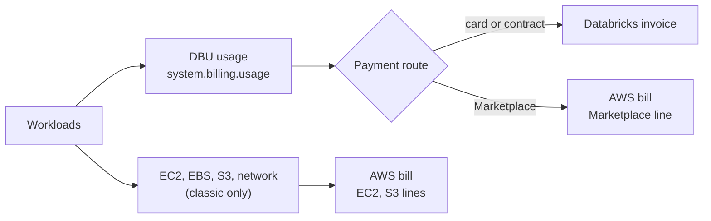

# AWS Marketplace and Billing

Mastery: `INPUT[inlineSelect(option(new), option(learning), option(solid)):mastery]`

> [!story] Context
> [[Hive Metastore Federation for AWS Glue]] finished the data access topics. Every one of those workloads costs money in two places: Databricks charges for usage, and AWS charges for the infrastructure that classic compute uses. This note shows where each charge appears and how to choose a payment route.

> [!eli5] Summary
> Using Databricks on AWS can produce two bills. One is for Databricks itself. The other is Amazon's bill for the computers and storage that run in your account. You can pay the Databricks part with a card, through Amazon's bill, or with a contract.

## Background

Databricks meters usage in [[DBUs]] (Databricks Units). On AWS, Databricks is sold by Databricks, so the Databricks charge can be billed by Databricks directly or by AWS through **AWS Marketplace**. Marketplace billing lets companies consolidate vendors on one AWS invoice. Databricks introduced a pay-as-you-go offering in AWS Marketplace in 2022.

## Overview

### Payment routes for the Databricks charge

| Route | Billed by | Typical buyer | Notes |
|---|---|---|---|
| **Credit card (pay-as-you-go)** | Databricks, monthly | Small teams, trials | Added under **Manage trial** or account console **Subscription & billing** |
| **AWS Marketplace (pay-as-you-go)** | AWS, on the AWS bill | Companies that want one AWS invoice | No upfront commitment; usage billed in Databricks units through the listing |
| **AWS Marketplace private offer** | AWS | Negotiated terms through AWS | Request from the Marketplace listing |
| **Contract or commit** | Databricks (invoice) | Larger, predictable spend | Contact the Databricks account team |

### Where each cost appears

| Cost | Serverless workspace | Classic compute |
|---|---|---|
| Databricks DBUs | Databricks or AWS Marketplace bill | Databricks or AWS Marketplace bill |
| EC2 instances, EBS volumes | Included in the serverless DBU rate | AWS bill (your account) |
| S3 storage for your data | AWS bill | AWS bill |
| Default storage (serverless workspaces) | Databricks charge (see the pricing page) | Not applicable |
| NAT gateway, endpoints, data transfer | Serverless networking charges on the Databricks bill where applicable | AWS bill |

Pricing per DBU depends on the product (jobs, SQL, all-purpose, serverless), the plan, and the region. See the [Databricks AWS pricing page](https://www.databricks.com/product/aws-pricing). For EC2, see AWS pricing.

## How it works



### Procedure: link AWS Marketplace as the payment method

1. Sign in to the account console as an account admin.
2. Open **Settings**, **Subscription & billing**.
3. Add a payment method and choose **AWS Marketplace**. Follow the link to the Databricks listing in AWS Marketplace and subscribe.
4. Return to the account console and confirm the Marketplace account is linked.

Multiple AWS Marketplace accounts can be linked to one Databricks account, but each Marketplace account can link to only one Databricks account. Cancelling in AWS Marketplace removes that payment method; it does not cancel the Databricks subscription.

### Query your Databricks usage

```sql
SELECT usage_date,
       sku_name,
       SUM(usage_quantity) AS dbus
FROM system.billing.usage
WHERE usage_date >= current_date() - INTERVAL 30 DAYS
GROUP BY ALL
ORDER BY usage_date, dbus DESC;
```

To see AWS-side costs for classic compute, use AWS Cost Explorer filtered by the tags Databricks applies to cluster resources (default tags such as `Vendor`, `ClusterId`, and `Creator`, plus your custom tags). See [[Tagging for Chargeback]].

## Small-business considerations

> [!smallbiz] Small-business considerations
> - **Serverless-first keeps billing simple:** With serverless, compute infrastructure is included in the Databricks charge, so most cost appears in one place.
> - **Pick the route your finance team prefers:** A card is fastest. AWS Marketplace helps if you already have an AWS account and want one invoice.
> - **Set budgets on day one:** Create a budget alert in the account console and review `system.billing.usage` weekly. See [[Budgets and Usage Dashboards]].
> - **Tag classic compute:** Without tags, EC2 costs on the AWS bill are hard to attribute to teams or projects.

## Cloud differences

> [!azure]- Azure Databricks
> - Always billed by Microsoft on the Azure invoice, with optional prepurchase of Databricks commit units (DBCU). See [[Azure Billing and Commit Units]].

> [!aws]- Databricks on AWS
> - This note. Billed by Databricks directly, or by AWS through AWS Marketplace. Classic infrastructure is billed by AWS.

> [!gcp]- Databricks on Google Cloud
> - Billed through Google Cloud Marketplace to a Google Cloud billing account, with one Databricks account per billing account. See [[Google Cloud Marketplace and Billing]].

## Advanced topics

> [!deepdive]- Advanced topics (301–401)
> - **Trial conversion:** For trials started through AWS Marketplace, the account moves to pay-as-you-go on the AWS bill when trial credits run out. To avoid conversion, terminate compute, remove any card on file, and cancel before the trial ends.
> - **Contract accounts:** The account console's subscription page does not apply to contract accounts. Billing changes go through the Databricks account team.
> - **Commit spend on partner products:** Since June 2026, up to 10% of a Databricks Universal Commit can be used to buy eligible third-party partner products through [[Databricks Marketplace]], under the published commitment terms.
> - **AWS commitments:** Databricks' 2022 announcement said Marketplace usage could count toward an existing AWS Enterprise Discount Program commitment. Confirm current eligibility with AWS or Databricks; it is not stated in current Databricks docs.
> - **GovCloud:** Databricks on AWS GovCloud has its own AWS Marketplace listing. See [[Databricks on AWS GovCloud]].

## Common misconceptions

> [!confusion] AWS Marketplace billing does not include EC2
> The Marketplace line covers Databricks usage. EC2, EBS, and S3 for classic compute are separate AWS charges.

> [!confusion] Cancelling in AWS Marketplace does not close the Databricks account
> It removes Marketplace as a payment method only.

## Recall

What are the two cost sources for classic compute on AWS?::Databricks DBUs and AWS infrastructure (EC2, EBS, S3, networking).
Name three ways to pay the Databricks charge on AWS.::Credit card billed by Databricks, AWS Marketplace, and a contract or commit.
Where do Marketplace charges appear?::On the AWS bill (Billing and Cost Management) with other AWS charges.
How many Databricks accounts can one AWS Marketplace account link to?::One.
Does cancelling in AWS Marketplace cancel the Databricks subscription?::No. It removes that payment method.
Which system table records DBU usage?::`system.billing.usage`.
Is EC2 cost included for serverless compute?::Yes, it is part of the serverless DBU charge.

## Next steps

> [!path] Learning path
> **Needs first:** [[DBUs]], [[How Databricks Pricing Works]]
> **Unlocks next:** [[EC2 Instance Types and Graviton]], [[Cost Management Basics]], [[Budgets and Usage Dashboards]]

> [!nextup] Next
> [[EC2 Instance Types and Graviton]] covers the biggest lever on the AWS side of the bill: which instances classic compute runs on.

> [!sources]- Sources (last verified: 2026-10-25)
> - [Manage your subscription and billing (AWS)](https://docs.databricks.com/aws/en/admin/account-settings/account)
> - [Sign up for Databricks for free (AWS)](https://docs.databricks.com/aws/en/getting-started/free-trial)
> - [Sign up for Databricks with express setup (AWS)](https://docs.databricks.com/aws/en/getting-started/express-setup)
> - [Databricks Data Intelligence Platform (AWS Marketplace listing)](https://aws.amazon.com/marketplace/pp/prodview-wtyi5lgtce6n6)
> - [Databricks pay-as-you-go offering in AWS Marketplace (press release)](https://www.databricks.com/company/newsroom/press-releases/databricks-strengthens-scope-of-work-with-aws)
> - [Building a Lakehouse Faster on AWS With Databricks (Databricks blog, 2022)](https://www.databricks.com/blog/2022/05/10/building-a-lakehouse-faster-on-aws-with-databricks-announcing-our-new-pay-as-you-go-offering.html)
> - [AWS pricing by Databricks](https://www.databricks.com/product/aws-pricing)
> - [Billable usage system table reference (AWS)](https://docs.databricks.com/aws/en/admin/system-tables/billing)
> - [June 2026 release notes (AWS)](https://docs.databricks.com/aws/en/release-notes/product/2026/june)
> - [Additional Billing and Commitment Terms (Databricks)](https://www.databricks.com/legal/additional-billing-and-commitment-terms)
> - [Understand Databricks networking costs (AWS)](https://docs.databricks.com/aws/en/security/network/serverless-network-security/cost-management)
> - [Databricks on AWS GovCloud (AWS Marketplace listing)](https://aws.amazon.com/marketplace/pp/prodview-in6gcqeezsths)
