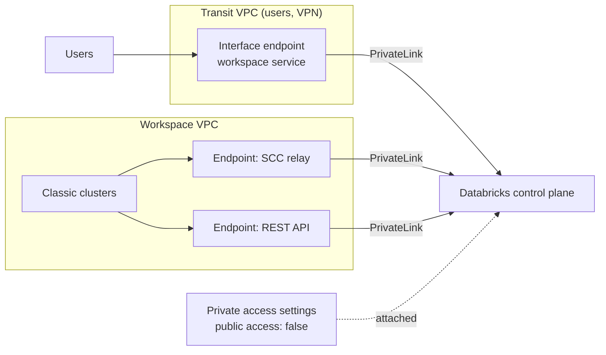

# AWS PrivateLink

Mastery: `INPUT[inlineSelect(option(new), option(learning), option(solid)):mastery]`

> [!story] Context
> A [[Customer-Managed VPC on AWS]] puts classic compute in your network, but clusters and users still reach the Databricks control plane over public endpoints (encrypted with TLS). AWS PrivateLink replaces those public paths with private VPC endpoints.

> [!eli5] Summary
> Normally your computers talk to Databricks over the public internet, protected by encryption. PrivateLink gives them a private road instead, so the traffic never leaves Amazon's network. You can also close the public road completely.

## Background

Regulated companies often require that no traffic to a SaaS control plane crosses the public internet, and that the service is not reachable from outside the corporate network. AWS PrivateLink is AWS's mechanism for exposing a service through **interface VPC endpoints** in the consumer's VPC. Databricks publishes PrivateLink endpoint services per region.

## Overview

Databricks on AWS supports three private connectivity paths (see [[Network Security Overview]]):

| Path | From | To | Endpoints | Requirements |
|---|---|---|---|---|
| **Inbound (front-end)** | Users, BI tools, API clients in a *transit VPC* | Workspace web app and REST APIs | One endpoint to the workspace (General Access) service | Enterprise plan |
| **Classic (back-end)** | Classic clusters in the workspace VPC | Control plane | Two endpoints: **SCC relay** and **REST API** | Enterprise plan, customer-managed VPC |
| **Outbound (serverless)** | Serverless compute | Resources in your VPC, S3 | Managed through network connectivity configurations (NCCs) | See [[Serverless Network Security]] |

Two objects control the setup in Databricks:

- **VPC endpoint registrations.** Each AWS endpoint you create is registered in the account (**Security**, **Private endpoints**, or the API). The registration region must match the endpoint region.
- **Private access settings (PAS).** An account object attached to workspaces:
  - **Public access enabled.** `false` (default) allows only PrivateLink. `true` allows both PrivateLink and public internet access.
  - **Private access level.** `ACCOUNT` allows any endpoint registered in the account. `ENDPOINT` allows only a listed set, which must include your front-end registration.

A workspace with no private access settings attached denies all private access.

**Service Direct** is a separate inbound option for performance-intensive services, with its own same-region constraint.

## How it works



### Procedure: classic (back-end) PrivateLink

1. Use a customer-managed VPC. Add a dedicated subnet for the endpoints, and a security group that allows HTTPS (443) and port 6666 between the workspace subnets and the endpoints.
2. Look up the regional endpoint service names for the **workspace (REST API)** and **SCC relay** services in the Databricks docs.
3. Create both interface endpoints:

```bash
aws ec2 create-vpc-endpoint --vpc-id $VPC --vpc-endpoint-type Interface \
  --service-name <workspace-service-name-for-region> \
  --subnet-ids $PL_SUBNET --security-group-ids $PL_SG --private-dns-enabled

aws ec2 create-vpc-endpoint --vpc-id $VPC --vpc-endpoint-type Interface \
  --service-name <scc-relay-service-name-for-region> \
  --subnet-ids $PL_SUBNET --security-group-ids $PL_SG --private-dns-enabled
```

4. Register both endpoints in Databricks:

```bash
databricks account vpc-endpoints create --json '{
  "vpc_endpoint_name": "prod-rest-api",
  "aws_vpc_endpoint_id": "vpce-0123456789abcdef0",
  "region": "us-east-1"
}'
```

5. Create the network configuration with `vpc_endpoints.rest_api` and `vpc_endpoints.dataplane_relay` set to the registration IDs. A network configuration cannot be changed after creation.
6. Create a private access settings object and attach it, with the network configuration, to the workspace.

### Procedure: inbound (front-end) PrivateLink

1. Create an interface endpoint in a transit VPC (where users or VPN traffic arrive) using the workspace service name.
2. Register it under **Security**, **Private endpoints** in the account console.
3. Set up DNS so the workspace URL resolves to the endpoint's private IP for clients in your network.
4. Create private access settings. Start with **public access enabled** set to `true` while you test DNS, then set it to `false` in a maintenance window.
5. Attach the private access settings to the workspace under **Advanced configurations**.

In Terraform, the resources are `databricks_mws_vpc_endpoint`, `databricks_mws_private_access_settings`, and `databricks_mws_networks` (with a `vpc_endpoints` block).

## Small-business considerations

> [!smallbiz] Small-business considerations
> - PrivateLink is an Enterprise-plan feature for regulated or high-security environments. Most small companies do not need it.
> - Single sign-on with MFA, secure cluster connectivity (on by default), and [[IP Access Lists]] cover most small-business requirements.
> - Interface endpoints have hourly and per-GB charges on the AWS bill. See the AWS PrivateLink pricing page.

## Cloud differences

> [!azure]- Azure Databricks
> - [[Azure Private Link]] uses Azure private endpoints for front-end and back-end. Public access is controlled by the workspace's *Allow Public Network Access* setting rather than a private access settings object.

> [!aws]- Databricks on AWS
> - This note. Back-end needs two endpoints (SCC relay and REST API). Front-end needs one endpoint in a transit VPC. Private access settings control whether public access remains.

> [!gcp]- Databricks on Google Cloud
> - [[Private Service Connect]] (PSC) uses the same model: a workspace (`plproxy-psc-endpoint-all-ports`) endpoint and an SCC relay (`ngrok-psc-endpoint`) endpoint, registered as VPC endpoints and referenced in the network configuration as `rest_api` and `dataplane_relay`.

## Advanced topics

> [!deepdive]- Advanced topics (301–401)
> - **Account-level resources.** A separate inbound PrivateLink configuration covers account-level resources such as the account console.
> - **Ports.** The security group rules for PrivateLink include port 6666 for the SCC relay, in addition to 443.
> - **Testing public access off.** Setting public access to `false` blocks every client not on a registered endpoint, including CI/CD runners on the internet. Plan connectivity for automation before you switch.
> - **Combining controls.** Private access settings, [[IP Access Lists]], and context-based ingress policies stack. A request must pass all applicable controls.
> - **Serverless.** Classic PrivateLink does not cover serverless compute. Serverless private endpoints to S3 and to resources in your VPC are configured through NCCs, with per-region quotas. See [[Serverless Network Security]].
> - **GovCloud.** The GovCloud page lists private connectivity to AWS resources as not yet available. Check it before designing a GovCloud network. See [[Databricks on AWS GovCloud]].
> - **Databricks Apps.** With front-end PrivateLink, Apps need conditional DNS forwarding for the `databricksapps.com` domain.

## Common misconceptions

> [!confusion] PrivateLink does not disable public access by itself
> Public access depends on the private access settings object. `true` keeps both paths open.

> [!confusion] One endpoint is not enough for classic compute
> Back-end PrivateLink needs both the SCC relay endpoint and the REST API endpoint.

## Recall

Which two endpoints does back-end PrivateLink need?::The SCC relay endpoint and the REST API (workspace) endpoint.
Which plan does PrivateLink require on AWS?::Enterprise.
What does "public access enabled = false" do?::Allows access to the workspace only through PrivateLink.
What happens to a workspace with no private access settings attached?::It denies all private access.
What is the difference between ACCOUNT and ENDPOINT private access level?::ACCOUNT allows any registered endpoint in the account; ENDPOINT allows only listed endpoints.
Where does a front-end endpoint live?::In a transit VPC where users or VPN traffic arrive.
Does classic PrivateLink cover serverless compute?::No. Serverless uses network connectivity configurations.
What is the GCP equivalent?::Private Service Connect.

## Next steps

> [!path] Learning path
> **Needs first:** [[Customer-Managed VPC on AWS]], [[Network Security Overview]], [[Public vs Private IP]]
> **Unlocks next:** [[Serverless Network Security]], [[Compliance Security Profile]]

> [!nextup] Next
> [[Instance Profiles]] moves from networks to data access: the legacy way clusters reached S3.

> [!sources]- Sources (last verified: 2026-10-25)
> - [Configure classic private connectivity to Databricks (AWS)](https://docs.databricks.com/aws/en/security/network/classic/privatelink)
> - [Configure inbound PrivateLink for workspaces (AWS)](https://docs.databricks.com/aws/en/security/network/front-end/front-end-private-connect)
> - [Configure inbound PrivateLink for performance-intensive services (AWS)](https://docs.databricks.com/aws/en/security/network/front-end/service-direct-privatelink)
> - [Configure inbound Private Link for account-level resources (AWS)](https://docs.databricks.com/aws/en/security/network/front-end/front-end-private-connect-account)
> - [Manage VPC endpoint registrations (AWS)](https://docs.databricks.com/aws/en/security/network/classic/vpc-endpoints)
> - [Manage private access settings (AWS)](https://docs.databricks.com/aws/en/security/network/classic/private-access-settings)
> - [Private Link concepts (AWS)](https://docs.databricks.com/aws/en/security/network/concepts/privatelink-concepts)
> - [Configure a customer-managed VPC (AWS)](https://docs.databricks.com/aws/en/security/network/classic/customer-managed-vpc)
> - [Configure private connectivity to resources in your VPC (AWS)](https://docs.databricks.com/aws/en/security/network/serverless-network-security/pl-to-internal-network)
> - [Configure networking for Databricks Apps (AWS)](https://docs.databricks.com/aws/en/dev-tools/databricks-apps/networking)
> - [Databricks on AWS GovCloud](https://docs.databricks.com/aws/en/security/privacy/gov-cloud)
> - [Enable Private Service Connect for your workspace (GCP)](https://docs.databricks.com/gcp/en/security/network/classic/private-service-connect)
