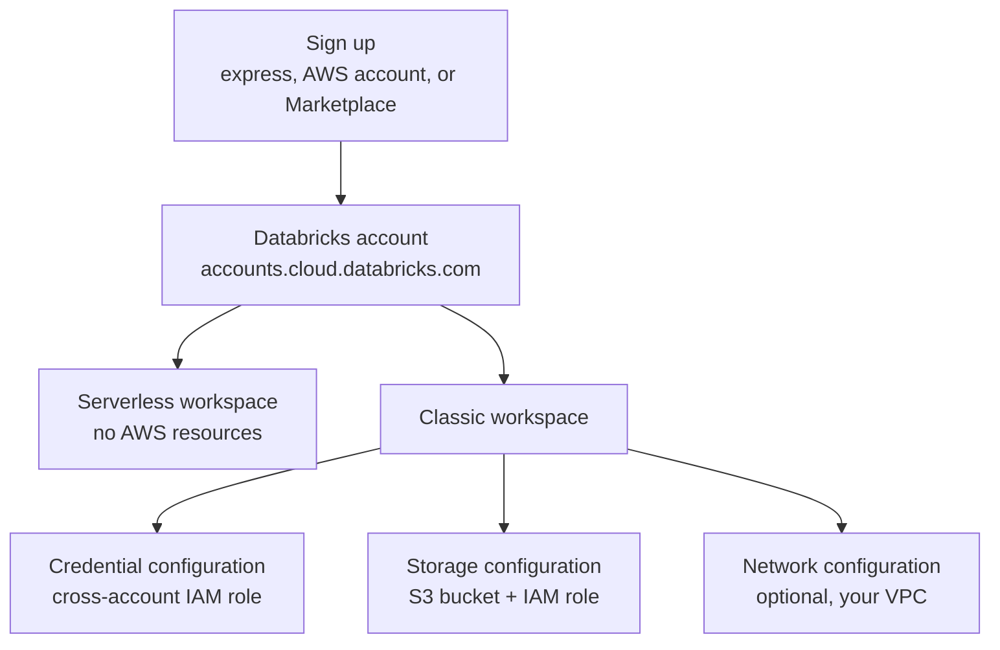

# Account Setup on AWS

Mastery: `INPUT[inlineSelect(option(new), option(learning), option(solid)):mastery]`

> [!story] Context
> [[Databricks on AWS Overview]] described the pieces of a deployment on AWS. This note covers how to get an account and create the first workspace, and how much AWS setup each option requires.

> [!eli5] Summary
> You can sign up for Databricks on AWS with just an email address and get a ready-to-use workspace. If you want the computers to run inside your own AWS account, you create a "classic" workspace, which needs a few AWS pieces that a setup wizard can create for you.

## Background

A Databricks account on AWS holds workspaces, identities, and [[Unity Catalog]] metastores (see [[Accounts and Workspaces]]). Earlier, every workspace needed AWS resources in your account: an [[IAM]] role (an AWS permission identity), an [[Amazon S3|S3]] bucket (storage), and a [[VPC and VNet|VPC]] (private network). Since serverless workspaces became generally available (January 29, 2026), a workspace can exist without any of these.

## Overview

Account setup on AWS has two steps: signing up for a Databricks account, then creating a workspace, either serverless or classic.

### Ways to sign up

| Path | What you need | Billing |
|---|---|---|
| **Express setup** | An email address | Free trial credits, then a credit card (Databricks) or AWS Marketplace |
| **Existing AWS account** | An AWS account | Free trial, then Databricks or AWS Marketplace billing |
| **AWS Marketplace** | An AWS account with Marketplace access | Pay-as-you-go on the AWS bill after the trial |
| **Contract** | A Databricks account team | Invoice or commit |

Express setup creates a **serverless workspace** with trial credits valid for 14 days. Trial limits include serverless compute for notebooks, jobs, and pipelines capped at 50 [[DBUs]] per hour, and no [[GPU|GPUs]]. To keep going, choose **Manage trial** in the workspace top bar and add a credit card or link an AWS account for Marketplace billing.

### Ways to create a workspace

| Method | Creates in your AWS account | Best for |
|---|---|---|
| **Serverless workspace** (account console) | Nothing | Most new users and small teams |
| **Classic, AWS Quickstart** (CloudFormation, the AWS infrastructure-as-code service) | IAM roles, S3 bucket, VPC | A first classic workspace |
| **Classic, automated configuration** | IAM roles, S3 bucket, networking, through temporary access | A guided classic setup |
| **Classic, manual configuration** | Whatever you created yourself | Your own VPC, IAM policies, or existing buckets |
| **Account API, CLI, or Terraform** | Whatever your code creates | Repeatable, production deployments |

## How it works



### Procedure: create a serverless workspace

1. Sign in to the account console at `https://accounts.cloud.databricks.com` as an account admin.
2. Open **Workspaces** and click **Create workspace**.
3. Choose the option to use serverless compute and default storage.
4. Enter a name and pick a region that supports serverless compute.
5. Click **Create**.

### Procedure: create a classic workspace with AWS Quickstart

1. In the account console, open **Workspaces**, click **Create workspace**, and choose **Quickstart**.
2. Enter a workspace name and region, then click **Start Quickstart**. The AWS CloudFormation **Quick create stack** page opens with fields pre-filled.
3. Enter the requested Databricks credential and acknowledge that the stack can create IAM resources.
4. Click **Create stack** and wait for `CREATE_COMPLETE`.
5. Return to the account console. The new workspace appears in the list.

The stack creates the [[Cross-Account IAM Role]], the [[Workspace Storage Bucket]] and its IAM role, and a Databricks-managed VPC.

### Procedure: create a classic workspace manually (CLI)

Use manual configuration when you bring your own VPC, IAM policies, or buckets. Create the AWS resources first (see the next three notes), then register them as account objects and create the workspace:

```bash
# 1. Register the cross-account IAM role
databricks account credentials create --json '{
  "credentials_name": "prod-cred",
  "aws_credentials": { "sts_role": { "role_arn": "arn:aws:iam::111122223333:role/databricks-cross-account" } }
}'

# 2. Register the workspace storage bucket
databricks account storage create --json '{
  "storage_configuration_name": "prod-storage",
  "root_bucket_info": { "bucket_name": "acme-databricks-prod-root" }
}'

# 3. Create the workspace from the returned IDs
databricks account workspaces create --json '{
  "workspace_name": "prod",
  "aws_region": "us-east-1",
  "credentials_id": "<credentials-id>",
  "storage_configuration_id": "<storage-configuration-id>"
}'
```

Creation is asynchronous. Poll `databricks account workspaces get <workspace-id>` until `workspace_status` is `RUNNING`.

### Terraform

The [[Terraform Provider]] uses an account-level provider (alias `mws` in the official guide) and the resources `databricks_mws_credentials`, `databricks_mws_storage_configurations`, optional `databricks_mws_networks`, and `databricks_mws_workspaces`:

```hcl
resource "databricks_mws_workspaces" "prod" {
  provider                 = databricks.mws
  account_id               = var.databricks_account_id
  workspace_name           = "prod"
  aws_region               = "us-east-1"
  credentials_id           = databricks_mws_credentials.this.credentials_id
  storage_configuration_id = databricks_mws_storage_configurations.this.storage_configuration_id
  network_id               = databricks_mws_networks.this.network_id # omit for a Databricks-managed VPC
}
```

## Small-business considerations

> [!smallbiz] Small-business considerations
> 1. Sign up with express setup using a business email.
> 2. Use the serverless workspace it creates. Skip IAM, S3, and VPC work entirely.
> 3. Before trial credits run out, add a payment method under **Manage trial**.
> 4. If you later need a classic workspace, use **Quickstart** rather than manual setup. Switch to Terraform once you manage more than one or two workspaces.

## Cloud differences

> [!azure]- Azure Databricks
> - You create a workspace as an Azure resource in the Azure portal, Azure CLI, or Bicep, choosing a pricing tier and resource group. Azure creates a [[Managed Resource Group]] for classic resources. See [[Creating an Azure Databricks Workspace]].

> [!aws]- Databricks on AWS
> - This note. Workspaces are created in the Databricks account console or Account API, not in the AWS console. Quickstart uses an AWS CloudFormation stack.

> [!gcp]- Databricks on Google Cloud
> - You subscribe through Google Cloud Marketplace, then create workspaces at `accounts.gcp.databricks.com`, choosing a Google Cloud project and region. See [[Account Setup on Google Cloud]].

## Advanced topics

> [!deepdive]- Advanced topics (301–401)
> - **Prerequisites for classic setup:** Account admin rights, permission to create IAM roles, S3 buckets, and policies, available VPC and NAT gateway quota, and (for automated configuration) the STS endpoint enabled for `us-west-2`.
> - **Workspace catalog at creation:** If the storage configuration includes an optional IAM role ARN for Unity Catalog, a workspace catalog is created together with the workspace.
> - **CloudFormation versus Terraform:** Databricks' IaC guidance says CloudFormation is no longer the preferred way to launch workspaces through the Account API. Use CloudFormation or Terraform for AWS infrastructure, and Terraform for Databricks resources.
> - **IAM propagation:** Credential validation can fail if a newly created IAM role has not propagated yet. The Terraform guide suggests a `time_sleep` resource between role creation and `databricks_mws_credentials`.
> - **Troubleshooting:** Common failures are AWS service limits, storage or credential validation errors, and VPC, subnet, or security group problems. Service control policies (SCPs) that deny `sts:AssumeRole` also block setup.

## Common misconceptions

> [!confusion] A trial is not Free Edition
> The free trial is a full account with time-limited credits. Free Edition is a separate, permanently free offering with its own limits. See [[Databricks Free Edition and Trials]].

> [!confusion] Workspace settings mostly cannot be changed later
> Region, and on classic workspaces the VPC choice, are fixed at creation. Plan them before you click **Create**.

## Recall

What does express setup require?::Only an email address. It creates a serverless workspace with trial credits.
How long are AWS trial credits valid?::14 days after the trial starts.
Which AWS service does the Quickstart use?::AWS CloudFormation (a Quick create stack).
Which three resources does a classic workspace need?::A cross-account IAM role, a workspace storage bucket with its IAM role, and a VPC (Databricks-managed or customer-managed).
Which status means a workspace created through the API is ready?::`RUNNING`.
Which Terraform resource creates an AWS workspace?::`databricks_mws_workspaces`, using an account-level provider.
Does a serverless workspace create resources in your AWS account?::No.

## Next steps

> [!path] Learning path
> **Needs first:** [[Databricks on AWS Overview]], [[Accounts and Workspaces]]
> **Unlocks next:** [[Cross-Account IAM Role]], [[Workspace Storage Bucket]], [[Terraform Provider]]

> [!nextup] Next
> [[Cross-Account IAM Role]] explains the first AWS resource a classic workspace needs: the role that lets Databricks launch EC2 instances.

> [!sources]- Sources (last verified: 2026-10-25)
> - [Sign up for Databricks with express setup (AWS)](https://docs.databricks.com/aws/en/getting-started/express-setup)
> - [Sign up for Databricks free trial with existing AWS account](https://docs.databricks.com/aws/en/getting-started/onboarding-account)
> - [Sign up for Databricks for free (AWS)](https://docs.databricks.com/aws/en/getting-started/free-trial)
> - [Create a serverless workspace (AWS)](https://docs.databricks.com/aws/en/admin/workspace/serverless-workspaces)
> - [Create a classic workspace (AWS)](https://docs.databricks.com/aws/en/admin/workspace/create-workspace)
> - [Create a workspace using the AWS Quick Start (AWS)](https://docs.databricks.com/aws/en/admin/workspace/quick-start)
> - [Create a workspace with manual AWS configurations (AWS)](https://docs.databricks.com/aws/en/admin/workspace/create-uc-workspace)
> - [Create a workspace using the Account API (AWS)](https://docs.databricks.com/aws/en/admin/workspace/create-workspace-api)
> - [account workspaces command group (CLI)](https://docs.databricks.com/aws/en/dev-tools/cli/reference/account-workspaces-commands)
> - [Create a workspace using Terraform (AWS)](https://docs.databricks.com/aws/en/admin/workspace/terraform)
> - [Provisioning AWS Databricks workspace (Terraform Registry)](https://registry.terraform.io/providers/databricks/databricks/latest/docs/guides/aws-workspace)
> - [Troubleshoot Databricks workspace creation (AWS)](https://docs.databricks.com/aws/en/admin/workspace/troubleshooting)
> - [Phase 7: Plan Infrastructure as Code approach (AWS)](https://docs.databricks.com/aws/en/lakehouse-architecture/deployment-guide/iac)
> - [Storage Configuration API](https://docs.databricks.com/api/storage-configurations/v1/storage-configuration)
