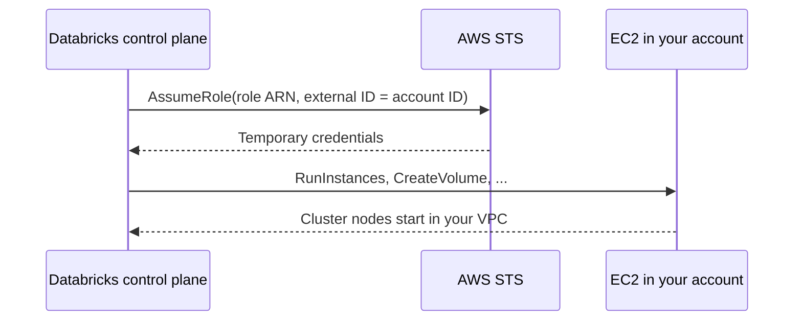

# Cross-Account IAM Role

Mastery: `INPUT[inlineSelect(option(new), option(learning), option(solid)):mastery]`

> [!story] Context
> [[Account Setup on AWS]] showed that a classic workspace needs a *credential configuration*. That configuration wraps one AWS resource: an IAM role in your account that the Databricks control plane assumes to run classic compute.

> [!eli5] Summary
> Databricks needs permission to start and stop computers in your AWS account. You create a special role that says "Databricks may do these specific things here," and Databricks uses that role whenever it starts or stops your clusters.

## Background

The Databricks control plane runs in Databricks' AWS account (see [[Control Plane and Compute Plane]]). Classic compute runs in yours. AWS lets one account act in another only through an [[IAM]] role with a trust policy that names the other account. This is the standard AWS cross-account pattern, and it avoids sharing long-lived access keys.

## Overview

The cross-account IAM role (also called the *Databricks deployment role*):

- **Trusts** a Databricks-owned AWS principal, with an **external ID** equal to your Databricks account ID. The external ID guards against the confused deputy problem.
- **Allows** EC2 actions: launching and terminating instances, creating and attaching volumes, managing security group rules, spot requests, fleets and launch templates, and describe calls for health and network checks.
- **Is registered** in the Databricks account as a **credential configuration**, which a workspace references by `credentials_id`.

Databricks publishes three policy variants:

| Policy variant | Use when | Scope |
|---|---|---|
| **Databricks-managed VPC** | Databricks creates the VPC | Broadest: includes creating VPC resources, plus a statement for the spot service-linked role |
| **Customer-managed VPC, default restrictions** | You bring your own VPC | Fewer permissions; no VPC creation |
| **Customer-managed VPC, custom restrictions** | You need tight scoping | `ec2:RunInstances` and security group actions limited by VPC, subnet, region, account, and tag conditions |

The role does **not** grant access to your data. Data access goes through [[S3 Access via Unity Catalog|Unity Catalog storage credentials]] (or legacy [[Instance Profiles]]).

## How it works



### Procedure: create the role with the AWS CLI

1. Write the trust policy. Use the Databricks principal ARN from the official guide (GovCloud uses different account IDs) and your Databricks account ID as the external ID:

```json
{
  "Version": "2012-10-17",
  "Statement": [{
    "Effect": "Allow",
    "Principal": { "AWS": "<databricks-principal-arn-from-the-docs>" },
    "Action": "sts:AssumeRole",
    "Condition": { "StringEquals": { "sts:ExternalId": "<databricks-account-id>" } }
  }]
}
```

2. Create the role and attach the access policy copied from the Databricks permissions page:

```bash
aws iam create-role \
  --role-name databricks-cross-account \
  --assume-role-policy-document file://trust.json

aws iam put-role-policy \
  --role-name databricks-cross-account \
  --policy-name databricks-cross-account-policy \
  --policy-document file://customer-managed-vpc-policy.json
```

3. Register the role in Databricks. In the account console, add a credential configuration and paste the role ARN (**Add manually**), or use the CLI:

```bash
databricks account credentials create --json '{
  "credentials_name": "prod-cred",
  "aws_credentials": { "sts_role": { "role_arn": "arn:aws:iam::111122223333:role/databricks-cross-account" } }
}'
```

4. Use the returned `credentials_id` when you create the workspace.

In Terraform, the resource is `databricks_mws_credentials`, used with an account-level provider. One credential configuration can be shared by several workspaces (unless the policy restricts security groups; see Advanced topics).

## Small-business considerations

> [!smallbiz] Small-business considerations
> - Serverless workspaces do not need this role. If you use only serverless, skip this note.
> - For a first classic workspace, let **Quickstart** create the role. It applies the Databricks-managed VPC policy.
> - Do not edit the role's policy by hand after creation unless you follow the Databricks permissions page. Removing an action can break cluster launches in ways that are hard to diagnose.

## Cloud differences

> [!azure]- Azure Databricks
> - There is no cross-account role. Azure Databricks is a first-party service: Azure creates a locked [[Managed Resource Group]] for the workspace, and the Azure Databricks resource provider manages VMs inside it.

> [!aws]- Databricks on AWS
> - This note. The role ARN lives in a credential configuration. If you use [[Customer-Managed Keys on AWS]] for EBS volumes, the KMS key policy grants access through this role.

> [!gcp]- Databricks on Google Cloud
> - Workspace creation makes a **workspace service account** in your project, with custom project-level roles for instances, disks, and service accounts. See [[Google Service Accounts]].

## Advanced topics

> [!deepdive]- Advanced topics (301–401)
> - **External ID differs by role.** The cross-account role uses your *Databricks account ID* as the external ID. Unity Catalog storage and service credentials use the *credential's own* external ID and must be self-assuming. Do not reuse one trust policy for the other.
> - **Security group restrictions.** If the policy restricts actions to specific security groups, the role cannot be reused across workspaces. Create a separate role, policy, and credential configuration per workspace.
> - **Service control policies.** If an AWS Organizations SCP denies `sts:AssumeRole` or EC2 actions, setup fails even with a correct IAM policy. Allowlist the required actions.
> - **Updating a running workspace.** `credentials_id` is one of the few fields you can update on a running workspace (with `network_id`, `storage_customer_managed_key_id`, and `private_access_settings_id`).
> - **Least privilege.** Prefer a customer-managed VPC with custom restrictions for production. See [[Least Privilege]].

## Common misconceptions

> [!confusion] The cross-account role does not read your data
> It manages EC2 resources. Reading S3 data is controlled by Unity Catalog storage credentials or, on legacy setups, instance profiles.

> [!confusion] The cross-account role is not the instance profile
> The cross-account role is assumed by the control plane. An instance profile is attached to cluster nodes. The cross-account role needs `iam:PassRole` on an instance profile only so it can attach it to instances.

## Recall

What does the cross-account IAM role let Databricks do?::Launch and manage EC2 resources for classic compute in your AWS account.
What external ID does the cross-account role's trust policy use?::Your Databricks account ID.
What Databricks object wraps the role ARN?::A credential configuration, referenced by `credentials_id`.
Which policy variant grants the fewest permissions?::Customer-managed VPC with custom restrictions.
Does a serverless workspace need a cross-account role?::No.
Which Terraform resource registers the role?::`databricks_mws_credentials`.
What blocks setup even with a correct IAM policy?::An SCP that denies `sts:AssumeRole` or required EC2 actions.

## Next steps

> [!path] Learning path
> **Needs first:** [[IAM]], [[Account Setup on AWS]]
> **Unlocks next:** [[Workspace Storage Bucket]], [[Customer-Managed VPC on AWS]], [[Instance Profiles]]

> [!nextup] Next
> [[Workspace Storage Bucket]] covers the second required resource: the S3 bucket where a classic workspace keeps its own system data.

> [!sources]- Sources (last verified: 2026-10-25)
> - [Permissions in cross-account IAM roles (AWS)](https://docs.databricks.com/aws/en/admin/cloud-configurations/aws/permissions)
> - [Create a workspace with manual AWS configurations (AWS)](https://docs.databricks.com/aws/en/admin/workspace/create-uc-workspace)
> - [Create a workspace using the Account API (AWS)](https://docs.databricks.com/aws/en/admin/workspace/create-workspace-api)
> - [account credentials command group (CLI)](https://docs.databricks.com/aws/en/dev-tools/cli/reference/account-credentials-commands)
> - [databricks_mws_credentials (Terraform Registry)](https://registry.terraform.io/providers/databricks/databricks/latest/docs/resources/mws_credentials)
> - [Provisioning AWS Databricks workspace (Terraform Registry)](https://registry.terraform.io/providers/databricks/databricks/latest/docs/guides/aws-workspace)
> - [Create service credentials (AWS)](https://docs.databricks.com/aws/en/connect/unity-catalog/cloud-services/service-credentials)
> - [Configure customer-managed keys for encryption (AWS)](https://docs.databricks.com/aws/en/security/keys/configure-customer-managed-keys)
> - [Required permissions for workspace creation (GCP)](https://docs.databricks.com/gcp/en/admin/cloud-configurations/gcp/permissions)
