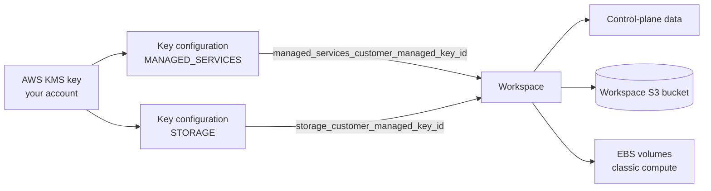

# Customer-Managed Keys on AWS

Mastery: `INPUT[inlineSelect(option(new), option(learning), option(solid)):mastery]`

> [!story] Context
> [[EC2 Instance Types and Graviton]] covered the instances classic compute runs on. Their disks, the [[Workspace Storage Bucket]], and the control-plane data are encrypted by default with keys you do not manage. Customer-managed keys (CMK) let you supply AWS KMS keys instead, so you control access and can revoke it.

> [!eli5] Summary
> Databricks already locks your data with keys. With customer-managed keys, you keep the master key in your own Amazon key service. If you ever take the key back, Databricks can no longer open that data.

## Background

The general model is in [[Encryption]]. On AWS, Databricks supports two CMK use cases, both on the **Enterprise** tier:

| Use case | Protects | API use case value |
|---|---|---|
| **Managed services** | Control-plane data: notebook source and results, secrets, Databricks SQL queries and query history. Also default storage in serverless workspaces | `MANAGED_SERVICES` |
| **Workspace storage** | The workspace S3 bucket (DBFS root) and, optionally, EBS volumes of classic compute | `STORAGE` |

Your own data buckets are encrypted with their own S3 and KMS settings, which you configure in AWS. See [[S3 Access via Unity Catalog]].

## Overview

Rules from the AWS docs:

- **Symmetric KMS key in the workspace region.**
- **Add, do not replace:** Append the Databricks statements to the key's existing key policy.
- **Key configurations are account objects:** One key configuration can be attached to one or more workspaces.
- **Serverless workspaces** need only the managed services key.
- **Cross-account keys:** If the KMS key is in a different AWS account than the [[Cross-Account IAM Role]], add a policy to that role. In the same account, skip this step.
- **EBS:** For `STORAGE`, `reuse_key_for_cluster_volumes` (default `true`) also encrypts EBS volumes. The key policy grant for EBS is tied to the cross-account role and limited to EC2 through `kms:ViaService`.
- **Rotation:** Keep the old key available to Databricks for 24 hours after rotating.
- **Propagation:** Workspace storage key updates can take up to 24 hours. Terminate running compute first.
- **GovCloud:** Databricks on AWS GovCloud uses different Databricks AWS account IDs in the key policy.

## How it works



### Procedure

1. **Create the key** in the workspace region:

```bash
aws kms create-key --description "Databricks prod" --key-usage ENCRYPT_DECRYPT \
  --key-spec SYMMETRIC_DEFAULT --region us-east-1
aws kms create-alias --alias-name alias/databricks-prod --target-key-id <key-id>
```

2. **Update the key policy:** Get the current policy, append the Databricks statements for each use case from the AWS CMK guide, and put it back:

```bash
aws kms get-key-policy --key-id <key-id> --policy-name default --output text > policy.json
# edit policy.json: add the managed services and workspace storage statements
aws kms put-key-policy --key-id <key-id> --policy-name default --policy file://policy.json
```

3. **Register key configurations** (account console: **Security**, **Encryption keys**, or the CLI):

```bash
databricks account encryption-keys create --json '{
  "aws_key_info": {
    "key_arn": "arn:aws:kms:us-east-1:111122223333:key/<key-id>",
    "key_alias": "alias/databricks-prod",
    "reuse_key_for_cluster_volumes": true
  },
  "use_cases": ["MANAGED_SERVICES", "STORAGE"]
}'
```

4. **Attach to the workspace** at creation (`managed_services_customer_managed_key_id`, `storage_customer_managed_key_id`), or update an existing workspace with the CLI or API. The account console does not support adding workspace storage keys to existing workspaces.

```bash
databricks account workspaces update <workspace-id> --json '{
  "managed_services_customer_managed_key_id": "<key-config-id>",
  "storage_customer_managed_key_id": "<key-config-id>"
}'
```

5. **Verify:** Restart compute after a storage key change, and confirm notebooks and jobs still run.

## Small-business considerations

> [!smallbiz] Small-business considerations
> - Default encryption is enough for most small companies. CMK needs the Enterprise tier and adds operational risk.
> - Adopt CMK when a contract or regulator requires customer control of keys.
> - If you adopt it, protect the key with AWS deletion protection practices (key policy controls and a deletion waiting period), and document who may change the key policy. Losing the key makes workspace data unreadable.
> - KMS charges per key and per request on the AWS bill.

## Cloud differences

> [!azure]- Azure Databricks
> - Three features: managed services, managed disks, and DBFS root. Keys come from Azure Key Vault or Managed HSM. Premium plan. Managed services CMK cannot be disabled once enabled. See [[Customer-Managed Keys on Azure]].

> [!aws]- Databricks on AWS
> - This note. Two use cases (managed services and workspace storage, with optional EBS). Enterprise tier. Keys can be added to existing workspaces through the API.

> [!gcp]- Databricks on Google Cloud
> - Cloud KMS keys for managed services and workspace storage (two GCS buckets and Compute Engine persistent disks). Keys can be added only at workspace creation. See [[Customer-Managed Keys on Google Cloud]].

## Advanced topics

> [!deepdive]- Advanced topics (301–401)
> - **Key hierarchy:** The managed services key protects the data key used for future writes. Adding a key does not re-encrypt existing data.
> - **Revocation:** Revoking or deleting the managed services key makes all control-plane data for the workspace inaccessible.
> - **Scope gaps:** Workspace storage keys do not cover legacy DBFS mounts of other buckets, and serverless compute's short-lived disks are not covered by the EBS key.
> - **Updatable fields:** On a running workspace, `storage_customer_managed_key_id` can be updated; plan a maintenance window because of propagation time.
> - **Unity Catalog:** A separate AWS page describes customer-managed keys for Unity Catalog. Check its current status and scope before relying on it.
> - **Compliance:** CMK is commonly paired with the [[Compliance Security Profile]] for regulated workloads.

## Common misconceptions

> [!confusion] Databricks CMK does not encrypt your data lake
> It covers control-plane data, the workspace bucket, and EBS volumes. Encrypt your own buckets with S3 settings in AWS.

> [!confusion] Rotating does not mean deleting the old key
> Keep the old key available for 24 hours after rotation.

## Recall

Which two CMK use cases does Databricks support on AWS?::Managed services and workspace storage.
Which tier is required for CMK on AWS?::Enterprise.
Which key type and location are required?::A symmetric AWS KMS key in the same region as the workspace.
Which setting also encrypts EBS volumes with the storage key?::`reuse_key_for_cluster_volumes` (default true).
How long must the old key stay available after rotation?::24 hours.
How long can workspace storage key updates take?::Up to 24 hours.
Can the account console add a storage key to an existing workspace?::No. Use the CLI or API.
Which key does a serverless workspace need?::Only the managed services key.

## Next steps

> [!path] Learning path
> **Needs first:** [[Encryption]], [[Encryption at Rest]], [[Workspace Storage Bucket]]
> **Unlocks next:** [[Compliance Security Profile]], [[Databricks on AWS GovCloud]]

> [!nextup] Next
> [[Databricks on AWS GovCloud]] covers the separate environment for US public-sector workloads, where compliance controls are on by default.

> [!sources]- Sources (last verified: 2026-10-25)
> - [Configure customer-managed keys for encryption (AWS)](https://docs.databricks.com/aws/en/security/keys/configure-customer-managed-keys)
> - [Customer-managed keys for encryption (AWS)](https://docs.databricks.com/aws/en/security/keys/customer-managed-keys)
> - [Data security and encryption (AWS)](https://docs.databricks.com/aws/en/security/keys)
> - [Customer-managed keys for Unity Catalog (AWS)](https://docs.databricks.com/aws/en/security/keys/cmek-unity-catalog)
> - [Key configurations API](https://docs.databricks.com/api/account/encryptionkeys)
> - [account encryption-keys command group (CLI)](https://docs.databricks.com/aws/en/dev-tools/cli/reference/account-encryption-keys-commands)
> - [Create a serverless workspace (AWS)](https://docs.databricks.com/aws/en/admin/workspace/serverless-workspaces)
> - [Create a workspace using the Account API (AWS)](https://docs.databricks.com/aws/en/admin/workspace/create-workspace-api)
> - [Customer-managed keys for encryption (Azure)](https://learn.microsoft.com/en-us/azure/databricks/security/keys/customer-managed-keys)
> - [Configure customer-managed keys for encryption (GCP)](https://docs.databricks.com/gcp/en/security/keys/configure-customer-managed-keys)
