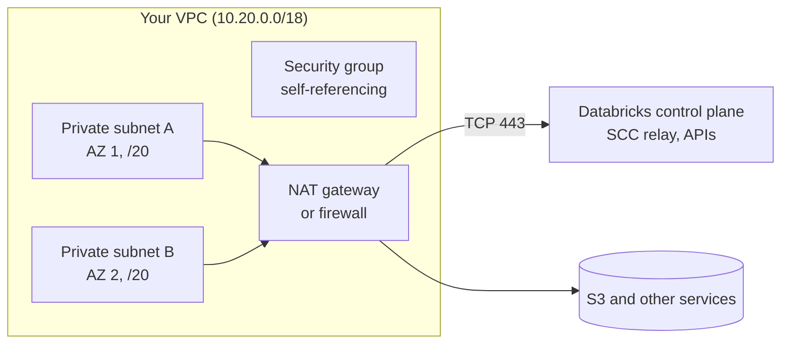

# Customer-Managed VPC on AWS

Mastery: `INPUT[inlineSelect(option(new), option(learning), option(solid)):mastery]`

> [!story] Context
> The [[Cross-Account IAM Role]] and [[Workspace Storage Bucket]] are enough for a classic workspace in a Databricks-managed VPC. Companies with a network team usually want classic compute in a VPC they design, with their own address ranges, routing, and egress controls.

> [!eli5] Summary
> By default, Databricks builds the private network its computers use. With a customer-managed VPC, your own network team builds that network, and Databricks puts its computers inside it. You decide what those computers can connect to.

## Background

A **Databricks-managed VPC** is created by Databricks in your account during workspace creation. It works, but you cannot choose its CIDR range, peer it cleanly with existing networks, or route its egress through your firewall. A **customer-managed VPC** moves those decisions to you. It also lets the [[Cross-Account IAM Role]] use a narrower policy, because Databricks no longer creates network resources.

## Overview

A customer-managed VPC is required for:

- Classic compute (back-end) [[AWS PrivateLink]].
- Inbound (front-end) PrivateLink on workspaces with classic compute.

It is not required for serverless-only workspaces or for outbound (serverless) private connectivity.

### Requirements

| Item | Requirement |
|---|---|
| **Subnets** | At least two, each in a different [[Availability Zone]]. Netmask between `/17` and `/26`. Private (no direct internet route) |
| **IP capacity** | Two IP addresses per node (management and Spark). Instances per subnet equal half the available IPs |
| **Egress** | Route table sends `0.0.0.0/0` to a NAT gateway (with an internet gateway) or your own NAT, proxy, or firewall appliance |
| **Security groups** | One to five per workspace. Allow all TCP and UDP within the same group; allow outbound TCP 443 to `0.0.0.0/0`; add ports 3306 (legacy Hive metastore), 53 (custom DNS), and 6666 (PrivateLink) when those apply |
| **Network ACLs** | Allow traffic within the VPC CIDR and TCP 443 outbound; the docs require `0.0.0.0/0` in the allow list |
| **VPC CIDR** | Pages differ: one says Databricks does not limit the VPC netmask, the deployment guide recommends at least `/18`, and the PrivateLink guide asks for at least `/25` |
| **PrivateLink** | Classic PrivateLink additionally requires the Enterprise plan |

## How it works



### Procedure: build and register the network

1. Create the VPC, two private subnets in different AZs, a NAT gateway, and routes (one AZ shown):

```bash
VPC=$(aws ec2 create-vpc --cidr-block 10.20.0.0/18 --query Vpc.VpcId --output text)
aws ec2 modify-vpc-attribute --vpc-id $VPC --enable-dns-hostnames
SUBNET_A=$(aws ec2 create-subnet --vpc-id $VPC --cidr-block 10.20.0.0/20 \
  --availability-zone us-east-1a --query Subnet.SubnetId --output text)
SUBNET_B=$(aws ec2 create-subnet --vpc-id $VPC --cidr-block 10.20.16.0/20 \
  --availability-zone us-east-1b --query Subnet.SubnetId --output text)
```

2. Create a security group that allows all traffic from itself, and outbound 443:

```bash
SG=$(aws ec2 create-security-group --group-name databricks-ws --description "Databricks workspace" \
  --vpc-id $VPC --query GroupId --output text)
aws ec2 authorize-security-group-ingress --group-id $SG --protocol all --source-group $SG
```

3. Create the NAT gateway and route tables so each private subnet sends `0.0.0.0/0` to the NAT gateway. Optionally add an S3 gateway endpoint so S3 traffic does not pass through the NAT gateway.
4. Register the network configuration with the VPC ID, at least two subnet IDs, and at least one security group ID:

```bash
databricks account networks create --json '{
  "network_name": "prod-network",
  "vpc_id": "'$VPC'",
  "subnet_ids": ["'$SUBNET_A'", "'$SUBNET_B'"],
  "security_group_ids": ["'$SG'"]
}'
```

5. Pass the returned `network_id` when you create the workspace. In Terraform, use `databricks_mws_networks`.

## Small-business considerations

> [!smallbiz] Small-business considerations
> - Most small companies do not need a customer-managed VPC. Serverless compute and the Databricks-managed VPC are simpler.
> - Adopt it when you must route egress through a firewall, peer with existing VPCs (for example, to reach a database), or enable PrivateLink.
> - NAT gateways and VPC endpoints have hourly and data processing charges on the AWS bill. See the AWS pricing pages.

## Cloud differences

> [!azure]- Azure Databricks
> - The equivalent is [[VNet Injection]]: two delegated subnets (host and container) in your VNet, with network security group rules that Azure Databricks manages. See also [[Secure Cluster Connectivity]].

> [!aws]- Databricks on AWS
> - This note. The network is registered as a *network configuration*. A network configuration cannot be edited after it is created; to change it, create a new one and update the workspace's `network_id`. Plan subnet sizing up front.

> [!gcp]- Databricks on Google Cloud
> - [[Customer-Managed VPC on Google Cloud]] uses one subnet per workspace, supports Shared VPC host and service projects, and is required for Private Service Connect. Databricks plans to deprecate classic workspace creation with a Databricks-managed VPC on GCP.

## Advanced topics

> [!deepdive]- Advanced topics (301–401)
> - **Sharing a VPC:** Several workspaces can share one VPC, each with its own or shared subnets. Size subnets for peak concurrent nodes across all of them.
> - **Egress lockdown:** The data exfiltration protection architecture routes egress through AWS Network Firewall with an allow list of Databricks and AWS endpoints. Do not inspect TLS on the SCC relay connection.
> - **VPC peering:** Peering lets clusters reach resources such as databases in other VPCs. It is separate from PrivateLink.
> - **Network configuration with PrivateLink:** For back-end PrivateLink, the network configuration also references two registered VPC endpoints: the SCC relay and the REST API. See [[AWS PrivateLink]].
> - **Serverless is separate:** A customer-managed VPC does not affect serverless compute. Use network connectivity configurations and network policies. See [[Serverless Network Security]].

## Common misconceptions

> [!confusion] A customer-managed VPC is not PrivateLink
> A customer-managed VPC controls where classic compute runs. PrivateLink is an additional option that keeps traffic to the control plane off the public internet. PrivateLink requires a customer-managed VPC, but not the reverse.

> [!confusion] Subnet size is not node count
> Each node uses two IPs. A `/24` subnet with 251 usable addresses (after AWS reserves 5) supports about 125 nodes, not 251.

## Recall

How many subnets does a customer-managed VPC need, and where?::At least two, each in a different availability zone.
What netmask range must each workspace subnet use?::Between `/17` and `/26`.
How many IP addresses does each node use?::Two (management and Spark).
How many security groups can a workspace use?::One to five.
Where must quad-zero traffic from workspace subnets go?::To a NAT gateway or your own NAT, proxy, or firewall appliance.
Do serverless-only workspaces need a customer-managed VPC?::No.
What is the Azure equivalent?::VNet injection.
Which Terraform resource registers the network?::`databricks_mws_networks`.

## Next steps

> [!path] Learning path
> **Needs first:** [[VPC and VNet]], [[Subnet]], [[Cross-Account IAM Role]]
> **Unlocks next:** [[AWS PrivateLink]], [[Network Security Overview]]

> [!nextup] Next
> [[AWS PrivateLink]] adds private endpoints so users and clusters reach Databricks without the public internet.

> [!sources]- Sources (last verified: 2026-10-25)
> - [Configure a customer-managed VPC (AWS)](https://docs.databricks.com/aws/en/security/network/classic/customer-managed-vpc)
> - [Phase 4: Design network architecture (AWS)](https://docs.databricks.com/aws/en/lakehouse-architecture/deployment-guide/network)
> - [Configure classic private connectivity to Databricks (AWS)](https://docs.databricks.com/aws/en/security/network/classic/privatelink)
> - [Permissions in cross-account IAM roles (AWS)](https://docs.databricks.com/aws/en/admin/cloud-configurations/aws/permissions)
> - [VPC peering (AWS)](https://docs.databricks.com/aws/en/security/network/classic/vpc-peering)
> - [Data exfiltration protection architecture (AWS)](https://docs.databricks.com/aws/en/security/network/data-exfiltration-protection/architecture)
> - [Network API](https://docs.databricks.com/api/networking/v1/network)
> - [Best practices for security, compliance, and privacy (AWS)](https://docs.databricks.com/aws/en/lakehouse-architecture/security-compliance-and-privacy/best-practices)
> - [Configure a customer-managed VPC (GCP)](https://docs.databricks.com/gcp/en/security/network/classic/customer-managed-vpc)
> - [What's coming? (GCP)](https://docs.databricks.com/gcp/en/release-notes/whats-coming)
