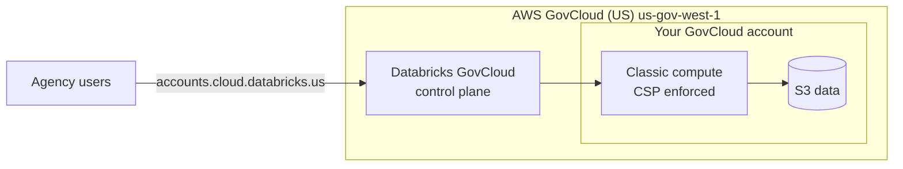

# Databricks on AWS GovCloud

Mastery: `INPUT[inlineSelect(option(new), option(learning), option(solid)):mastery]`

> [!story] Context
> [[Customer-Managed Keys on AWS]] and the [[Compliance Security Profile]] harden a commercial workspace. Some US public-sector and defense workloads must run in an environment authorized at [[FedRAMP]] High or DoD Impact Level 5. Databricks provides a separate deployment in AWS GovCloud (US) for them.

> [!eli5] Summary
> AWS has a walled-off part of its cloud for the US government and its contractors. Databricks runs a separate copy of its platform there, with stricter security switched on for every workspace, so agencies can use it for sensitive data.

## Background

**AWS GovCloud (US)** is a set of isolated AWS regions for US government agencies and regulated customers. **FedRAMP** is the US government program that authorizes cloud services; **High** is its most demanding baseline. **DoD IL5** is a Department of Defense authorization level for Controlled Unclassified Information (CUI) and mission data.

Databricks on AWS GovCloud is a separate Databricks environment with its own account console, URLs, and release notes.

## Overview

| Item | Detail |
|---|---|
| **Status** | Generally available |
| **Region** | `us-gov-west-1` (listed for both FedRAMP High and IL5) |
| **Account console** | `https://accounts.cloud.databricks.us` (also the base URL for account REST APIs) |
| **Workspace URLs** | `<deployment-name>.cloud.databricks.us` |
| **FedRAMP High** | Agency ATO received April 30, 2024; FedRAMP High authorization confirmed by the FedRAMP PMO as of February 26, 2025 |
| **DoD IL5** | Provisional Authorization received November 2024 |
| **Compliance security profile** | Enabled automatically on all workspaces |
| **Purchase** | Through Databricks or the Databricks on AWS GovCloud listing in AWS Marketplace |
| **Release notes** | Separate GovCloud release notes; features can arrive later than in commercial regions |

Known differences from commercial AWS, as documented:

- **Fleet instance types** are not available.
- **Graviton:** Supported with the compliance security profile since June 5, 2026 (GovCloud release notes), and listed for GovCloud Regions in the supported instance types (for example `M7g` and `C7gd`). The Graviton limitations list in the compute configuration reference still names GovCloud; the docs conflict on this point.
- **Private connectivity to AWS resources** is listed as not yet available in GovCloud.
- **Cross-Geo processing** settings do not apply.
- **Key policies** use different Databricks AWS account IDs for [[Customer-Managed Keys on AWS]].
- AI features such as AI/BI Genie, Foundation Model APIs, and Databricks Assistant were announced as generally available in GovCloud in a Databricks blog post.

## How it works



Setup follows the same model as commercial AWS (credential, storage, and network configurations; see [[Account Setup on AWS]]), with GovCloud ARNs and account IDs. Configure the CLI with the GovCloud account host:

```ini
# ~/.databrickscfg
[gov-account]
host       = https://accounts.cloud.databricks.us
account_id = <databricks-account-id>
auth_type  = databricks-cli
```

```bash
databricks auth login --profile gov-account
databricks account workspaces list --profile gov-account
```

AWS resource ARNs in GovCloud use the `aws-us-gov` partition, for example `arn:aws-us-gov:iam::111122223333:role/databricks-cross-account`.

## Small-business considerations

> [!smallbiz] Small-business considerations
> - GovCloud is for organizations with US government compliance obligations, such as federal contractors handling CUI. Most small businesses do not need it.
> - A small contractor should first confirm the contract's requirement (FedRAMP Moderate, High, or IL5). Commercial AWS supports FedRAMP Moderate in `us-east-1` with the compliance security profile, which may be enough.
> - GovCloud requires an AWS GovCloud account, which has its own eligibility process with AWS.

## Cloud differences

> [!azure]- Azure Databricks
> - Databricks has announced a partnership with Microsoft to bring its platform to **Azure Government**. Check Microsoft Learn for current availability and authorizations. See [[Azure Databricks Overview]].

> [!aws]- Databricks on AWS
> - This note. GovCloud is a separate Databricks environment with `.cloud.databricks.us` URLs and the compliance security profile always on.

> [!gcp]- Databricks on Google Cloud
> - No equivalent government environment for Databricks on Google Cloud is documented. See [[Databricks on Google Cloud Overview]].

## Advanced topics

> [!deepdive]- Advanced topics (301–401)
> - **Two environments, two accounts:** A GovCloud Databricks account is separate from a commercial one. Identities, metastores, and workspaces do not span them. Plan sharing between them explicitly.
> - **Feature lag:** Check the GovCloud release notes, not only the commercial ones, before planning a feature. For example, the GovCloud 2025 release notes record the rename to Lakeflow Spark Declarative Pipelines separately.
> - **Profile is mandatory:** Because the compliance security profile is on for every workspace, its constraints (hardened images, enhanced monitoring, automatic cluster updates, Nitro instance types) always apply. See [[Compliance Security Profile]].
> - **Audit:** Deliver [[Audit Logs]] and use system tables to evidence controls to assessors.

## Common misconceptions

> [!confusion] FedRAMP Moderate does not require GovCloud
> Commercial AWS `us-east-1` is FedRAMP Authorized at Moderate with the compliance security profile. GovCloud is for FedRAMP High and IL5.

> [!confusion] GovCloud is not a workspace setting
> It is a separate deployment with its own account console. You cannot switch a commercial workspace into GovCloud.

## Recall

Which AWS region hosts Databricks on AWS GovCloud?::`us-gov-west-1`.
What is the GovCloud account console URL?::`https://accounts.cloud.databricks.us`.
Which compliance setting is enabled on every GovCloud workspace?::The compliance security profile.
When did Databricks receive a FedRAMP High agency ATO for GovCloud?::April 30, 2024.
When did Databricks receive DoD IL5 provisional authorization?::November 2024.
Are fleet instance types available in GovCloud?::No.
Which ARN partition does AWS GovCloud use?::`aws-us-gov`.

## Next steps

> [!path] Learning path
> **Needs first:** [[Compliance Security Profile]], [[Databricks on AWS Overview]]
> **Unlocks next:** [[Chapter 13 - Databricks on Google Cloud]]

> [!nextup] Next
> [[Chapter 13 - Databricks on Google Cloud]] moves to the third cloud, where Databricks is bought through Google Cloud Marketplace and authenticates with Google service accounts.

> [!sources]- Sources (last verified: 2026-10-25)
> - [Databricks on AWS GovCloud](https://docs.databricks.com/aws/en/security/privacy/gov-cloud)
> - [Databricks on AWS GovCloud release notes](https://docs.databricks.com/aws/en/release-notes/gov-cloud/)
> - [Databricks on AWS GovCloud release notes 2026](https://docs.databricks.com/aws/en/release-notes/gov-cloud/2026)
> - [Databricks on AWS GovCloud release notes 2025](https://docs.databricks.com/aws/en/release-notes/gov-cloud/2025)
> - [Configure enhanced security and compliance settings (AWS)](https://docs.databricks.com/aws/en/security/privacy/enhanced-security-compliance)
> - [Compute configuration reference (AWS)](https://docs.databricks.com/aws/en/compute/configure)
> - [Announcing the General Availability of AWS GovCloud with FedRAMP High and DoD IL5 (Databricks blog)](https://www.databricks.com/blog/announcing-general-availability-aws-govcloud-fedramp-high-agency-ato-and-department-defense)
> - [Databricks Achieves FedRAMP High Agency ATO for AWS GovCloud (press release)](https://www.databricks.com/company/newsroom/press-releases/databricks-achieves-fedramp-high-agency-authority-operate-aws)
> - [Databricks Achieves Authorization for DoD IL5 on AWS GovCloud (press release)](https://www.databricks.com/company/newsroom/press-releases/databricks-achieves-authorization-dod-il5-aws-govcloud)
> - [Databricks FedRAMP compliance](https://www.databricks.com/trust/compliance/fedramp)
> - [Department of Defense Impact Level 5 (Databricks)](https://www.databricks.com/trust/compliance/department-of-defense-impact-level-5)
> - [AI/BI Genie, Foundation Model API, and Databricks Assistant GA in AWS GovCloud (Databricks blog)](https://www.databricks.com/blog/aibi-genie-foundational-model-api-and-databricks-assistant-now-generally-available-aws)
> - [Databricks Partners with Microsoft to bring its platform to Azure Government (Databricks blog)](https://www.databricks.com/blog/databricks-partners-microsoft-bring-our-data-intelligence-platform-azure-government)
> - [Databricks on AWS GovCloud (AWS Marketplace listing)](https://aws.amazon.com/marketplace/pp/prodview-in6gcqeezsths)
