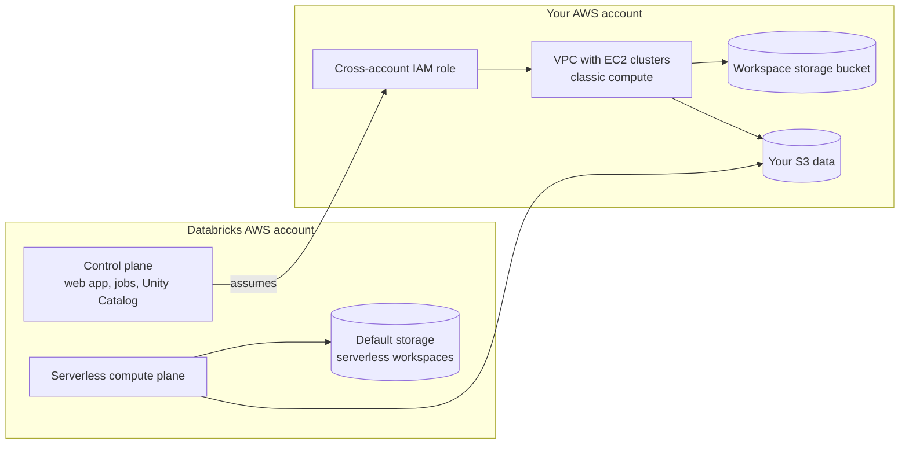

# Databricks on AWS Overview

Mastery: `INPUT[inlineSelect(option(new), option(learning), option(solid)):mastery]`

> [!story] Context
> [[Chapter 12 - Databricks on AWS]] opens Part 2's second cloud. [[Chapter 11 - Azure Databricks|Chapter 11]] covered Databricks as a first-party Microsoft service. On AWS, Databricks is a separate company's product that runs inside your AWS account through [[IAM]] roles you grant it.

> [!eli5] Summary
> Databricks on AWS is the Databricks platform running on Amazon's cloud. Databricks runs the main website and services. When you choose to, the computers that process your data run in your own AWS account, and your data stays in your own storage buckets.

## Background

AWS was the first cloud Databricks ran on (see [[The Founding of Databricks]]). Azure Databricks is sold and supported by Microsoft, but on AWS you buy Databricks either from Databricks or through **AWS Marketplace**. Databricks then reaches into your AWS account only through the permissions you give it.

This shapes every setup decision on AWS:

- **Identity** comes from Databricks account identities and your [[Identity Provider|identity provider]], not from AWS IAM users.
- **Access to your AWS account** goes through [[IAM]] roles that you create and that Databricks assumes.
- **Billing** has two parts: the Databricks charge (in [[DBUs]]) and the AWS charges for the EC2 (virtual machines), EBS (disks), [[Amazon S3|S3]] (storage), and networking that classic compute uses.

## Overview

Databricks on AWS is the Databricks platform deployed on Amazon Web Services, bought from Databricks or through AWS Marketplace and connected to your AWS account through IAM roles.

| Area | On AWS | Note |
|---|---|---|
| Sign-up | Express setup (email only), existing AWS account, or AWS Marketplace | [[Account Setup on AWS]] |
| Account console | `https://accounts.cloud.databricks.com` | [[Account Console]] |
| Workspace types | **Serverless** (no resources in your account) or **classic** (compute in your [[VPC and VNet\|VPC]]) | [[Accounts and Workspaces]] |
| Launching classic compute | A [[Cross-Account IAM Role]] that Databricks assumes | |
| Workspace system data | A [[Workspace Storage Bucket]] in S3 (classic) or Databricks-managed default storage (serverless) | |
| Network | Databricks-managed VPC or a [[Customer-Managed VPC on AWS]] | [[AWS PrivateLink]] for private connectivity |
| Data access | Unity Catalog storage credentials backed by IAM roles | [[S3 Access via Unity Catalog]] |
| Legacy data access | [[Instance Profiles]] attached to clusters | Replaced by Unity Catalog |
| Other catalogs | AWS Glue federation | [[Hive Metastore Federation for AWS Glue]] |
| Compute | EC2 instance types, Graviton, [[Spot Instances\|spot]] | [[EC2 Instance Types and Graviton]] |
| Keys | AWS KMS (Key Management Service) | [[Customer-Managed Keys on AWS]] |
| Regulated US public sector | Separate GovCloud environment | [[Databricks on AWS GovCloud]] |

**Serverless workspaces** became generally available on AWS on January 29, 2026. They include serverless compute and Databricks-managed default storage, so you can start without creating any AWS resources.

## How it works



1. The **control plane** runs in Databricks' AWS account. It hosts the web UI, APIs, job scheduler, and [[Unity Catalog]]. See [[Control Plane and Compute Plane]].
2. **Serverless compute** also runs in Databricks' account, in the same region as your workspace. It reaches your S3 data through Unity Catalog credentials.
3. **Classic compute** runs as EC2 instances in a VPC in your account. The control plane launches them by assuming the cross-account IAM role. Nodes connect back to the control plane through [[Secure Cluster Connectivity|secure cluster connectivity]].
4. **Your data** stays in S3 buckets you own. Unity Catalog issues short-lived credentials to compute for the files a user is allowed to read.

To see what an existing account contains, use the [[Databricks CLI]] with an account-level profile:

```bash
databricks account workspaces list
databricks account credentials list
databricks account storage list
```

## Small-business considerations

> [!smallbiz] Small-business considerations
> - Start with **express setup** and a **serverless workspace**. It needs only an email address and creates no resources in your AWS account, so there is no IAM, VPC, or bucket to configure.
> - Add a classic workspace later only if you need something serverless does not provide (for example, specific instance types or a custom VPC).
> - Decide early whether Databricks charges go on a credit card billed by Databricks or on your AWS bill through AWS Marketplace. See [[AWS Marketplace and Billing]].
> - Keep your data in your own S3 buckets governed by Unity Catalog. That keeps the data portable if you change platforms later (see [[Vendor Lock-In]]).
>
> Pricing is published on the [Databricks AWS pricing page](https://www.databricks.com/product/aws-pricing). Classic compute adds EC2 and storage charges on the AWS bill.

## Cloud differences

> [!azure]- Azure Databricks
> - Sold, billed, and supported by Microsoft as a first-party Azure service. Workspaces are Azure resources created in the Azure portal. See [[Azure Databricks Overview]] and [[First-Party Microsoft Service]].
> - Classic compute runs in a locked [[Managed Resource Group]] instead of through a cross-account role, and identity comes from [[Microsoft Entra ID Integration|Microsoft Entra ID]].

> [!aws]- Databricks on AWS
> - This note. Databricks is a separate vendor that you grant access through IAM roles. The account console is at `accounts.cloud.databricks.com`, or `accounts.cloud.databricks.us` for [[Databricks on AWS GovCloud]].

> [!gcp]- Databricks on Google Cloud
> - Sold through Google Cloud Marketplace and billed on the Google Cloud bill. Classic compute runs on Compute Engine VMs and authenticates with Google service accounts. See [[Databricks on Google Cloud Overview]].

## Advanced topics

> [!deepdive]- Advanced topics (301–401)
> - **Account objects for classic workspaces:** A classic workspace is assembled from account-level configuration objects: a *credential configuration* (cross-account role), a *storage configuration* (workspace bucket), an optional *network configuration* (customer-managed VPC), optional *key configurations* (KMS keys), and optional *private access settings* (PrivateLink). See [[Account Setup on AWS]].
> - **Serverless-only workspaces need no VPC:** A customer-managed VPC is required only for classic compute and for front-end or back-end PrivateLink on workspaces with classic compute.
> - **Default storage limits:** Classic compute cannot read data assets in default storage; only serverless compute can.
> - **Infrastructure as code:** Databricks' deployment guide recommends AWS-native tools (such as CloudFormation) for AWS infrastructure and the [[Terraform Provider]] for Databricks resources.

## Common misconceptions

> [!confusion] AWS Marketplace is not Databricks Marketplace
> **AWS Marketplace** is where you can buy a Databricks subscription billed through AWS. [[Databricks Marketplace]] is a data and AI product exchange inside Databricks. They are unrelated.

> [!confusion] Databricks on AWS does not always put compute in your account
> Serverless compute and serverless workspaces run in Databricks' AWS account. Only classic compute runs in your VPC.

## Recall

Who sells Databricks on AWS?::Databricks, either directly or through AWS Marketplace.
What is the AWS account console URL?::`https://accounts.cloud.databricks.com`.
What lets the control plane launch EC2 instances in your account?::A cross-account IAM role.
When did serverless workspaces become GA on AWS?::January 29, 2026.
Where does serverless compute run?::In Databricks' AWS account, in the same region as the workspace.
Which two charges make up the cost of classic compute on AWS?::Databricks DBUs and AWS infrastructure (EC2, EBS, S3, networking).
What replaced instance profiles for S3 access?::Unity Catalog storage credentials backed by IAM roles.

## Next steps

> [!path] Learning path
> **Needs first:** [[Control Plane and Compute Plane]], [[Accounts and Workspaces]]
> **Unlocks next:** [[Account Setup on AWS]], [[Cross-Account IAM Role]], [[Customer-Managed VPC on AWS]]

> [!nextup] Next
> [[Account Setup on AWS]] walks through signing up and the three ways to create a workspace.

> [!sources]- Sources (last verified: 2026-10-25)
> - [High-level architecture (AWS)](https://docs.databricks.com/aws/en/getting-started/high-level-architecture)
> - [Create a serverless workspace (AWS)](https://docs.databricks.com/aws/en/admin/workspace/serverless-workspaces)
> - [Default storage in Databricks (AWS)](https://docs.databricks.com/aws/en/storage/default-storage)
> - [January 2026 release notes (AWS)](https://docs.databricks.com/aws/en/release-notes/product/2026/january)
> - [Create a classic workspace (AWS)](https://docs.databricks.com/aws/en/admin/workspace/create-workspace)
> - [Configure a customer-managed VPC (AWS)](https://docs.databricks.com/aws/en/security/network/classic/customer-managed-vpc)
> - [Phase 7: Plan Infrastructure as Code approach (AWS)](https://docs.databricks.com/aws/en/lakehouse-architecture/deployment-guide/iac)
> - [Sign up for Databricks with express setup (AWS)](https://docs.databricks.com/aws/en/getting-started/express-setup)
> - [Databricks on AWS GovCloud](https://docs.databricks.com/aws/en/security/privacy/gov-cloud)
> - [AWS pricing by Databricks](https://www.databricks.com/product/aws-pricing)
> - [Databricks Data Intelligence Platform (AWS Marketplace listing)](https://aws.amazon.com/marketplace/pp/prodview-wtyi5lgtce6n6)
