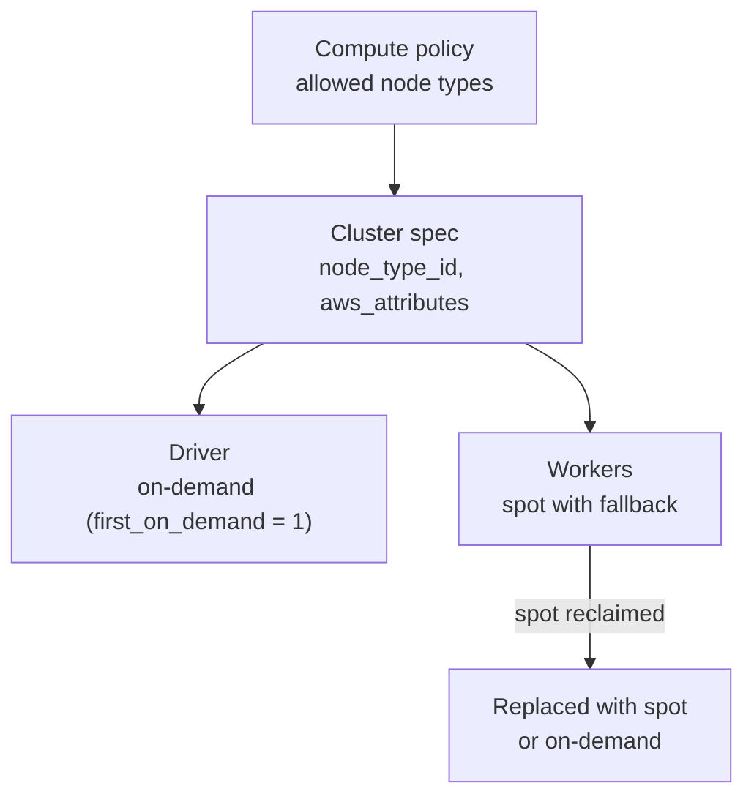

# EC2 Instance Types and Graviton

Mastery: `INPUT[inlineSelect(option(new), option(learning), option(solid)):mastery]`

> [!story] Context
> [[AWS Marketplace and Billing]] showed that classic compute adds EC2 charges to the AWS bill, and that the DBU rate also depends on the instance type. Choosing node types, purchase options, and processor architecture is the main way to control classic compute cost and performance on AWS.

> [!eli5] Summary
> Each Databricks cluster on AWS is a group of rented Amazon computers. You choose their size and kind. Some kinds use Amazon's own chips (Graviton) and often cost less for the same work. You can also rent spare computers at a discount, with the risk that Amazon takes them back.

## Background

A classic cluster is a driver [[Node|node]] and worker nodes, each an EC2 instance (see [[Virtual Machine]]). EC2 instance types are grouped into families by purpose (general purpose, memory optimized, compute optimized, storage optimized, accelerated). Databricks supports a subset of EC2 types, shown in the compute UI. Serverless compute removes this choice entirely.

## Overview

### Instance families

| Family examples | Optimized for | Typical Databricks use |
|---|---|---|
| `m` (for example `m7gd`, `m6gd`) | General purpose | Default ETL and notebooks |
| `r` (for example `r7gd`) | Memory | Large joins, caching, wide tables |
| `c` (for example `c7gd`) | Compute | CPU-heavy transforms |
| `i` (for example `i3`) | Local NVMe storage | Disk cache, shuffle-heavy work |
| `g`, `p` | GPUs | ML training and inference; see [[AI Runtime]] |

The `g` in a name such as `m7g` marks Graviton; a `d` marks local NVMe storage.

### Graviton

AWS Graviton instances use Arm64 processors. Databricks supports them with conditions:

- **Runtime.** The compute reference lists Graviton support on Databricks Runtime 9.1 LTS and above without [[Photon]], and 10.2 and above with Photon. For ML, Databricks Runtime 15.4 LTS ML and above supports Graviton.
- **No mixing.** A cluster cannot mix Graviton and non-Graviton instance types.
- **Limitations.** The Graviton limitations list on the compute reference includes features that do not run on Graviton (check it for your runtime). Databricks Container Services now offers an Arm base image for standard compute on Databricks Runtime 18 LTS and above.
- **Photon exceptions.** `C7g` instances do not support Photon runtimes.
- **Price performance.** A 2022 Databricks release note stated that Graviton2 instances with Photon can deliver up to 3x better price performance than comparable instances. Measure on your own workloads.

### Fleet instance types

A **fleet instance type** resolves at launch to the best available instance from a pool of families, based on spot capacity and price, with the same vCPU and memory as the fleet size you chose:

| Fleet type | Draws from |
|---|---|
| `mg-fleet` (general purpose, Graviton) | `m7g`, `m6g` |
| `rg-fleet` (memory optimized, Graviton) | `r7g`, `r6g` |
| `mgd-fleet`, `cgd-fleet` | Graviton with local disks; not available with the compliance security profile |

### Spot and on-demand

Set in `aws_attributes`:

| Field | Values | Meaning |
|---|---|---|
| `availability` | `SPOT`, `ON_DEMAND`, `SPOT_WITH_FALLBACK` | Default `SPOT_WITH_FALLBACK`: use spot, fall back to on-demand if spot is unavailable |
| `first_on_demand` | Integer | The first N nodes are on-demand. If greater than 0, the driver is on-demand |
| `spot_bid_price_percent` | 1 to 10000 | Max spot price as a percent of on-demand. Default 100 |
| `zone_id` | `auto` or a zone | `auto` picks a zone with free subnet IPs and retries on capacity errors |

## How it works



A cost-conscious job cluster on Graviton:

```json
{
  "spark_version": "<lts-runtime-version>",
  "node_type_id": "m7gd.xlarge",
  "driver_node_type_id": "m7gd.xlarge",
  "autoscale": { "min_workers": 1, "max_workers": 8 },
  "aws_attributes": {
    "availability": "SPOT_WITH_FALLBACK",
    "first_on_demand": 1,
    "spot_bid_price_percent": 100,
    "zone_id": "auto"
  }
}
```

List the node types your workspace offers:

```bash
databricks clusters list-node-types --output json | jq -r '.node_types[].node_type_id' | grep -E 'g[d]?\.'
```

## Small-business considerations

> [!smallbiz] Small-business considerations
> 1. Prefer serverless compute. It removes node type and spot decisions.
> 2. For classic jobs, start with a general-purpose Graviton type with local disk (such as `m7gd.xlarge`), autoscaling, and auto-termination.
> 3. Use spot with fallback for workers and keep the driver on-demand (`first_on_demand: 1`). Losing the driver fails the job; losing a worker only slows it.
> 4. Restrict allowed node types with a [[Compute Policies|compute policy]] so nobody launches an oversized GPU cluster by accident.

## Cloud differences

> [!azure]- Azure Databricks
> - Nodes are Azure VM sizes (for example `Standard_D4ds_v5`). Spot VMs are set with `azure_attributes` (`SPOT_WITH_FALLBACK_AZURE`). Azure Arm-based VMs are not covered in this vault.

> [!aws]- Databricks on AWS
> - This note. Graviton and fleet types are AWS-specific. Nitro-based instance types encrypt traffic between nodes, and the [[Compliance Security Profile]] enforces them.

> [!gcp]- Databricks on Google Cloud
> - Nodes are Compute Engine machine types such as `n2-standard-4`. Preemptible capacity is set with `gcp_attributes` (`PREEMPTIBLE_WITH_FALLBACK_GCP`). See [[Compute on Google Cloud]].

## Advanced topics

> [!deepdive]- Advanced topics (301–401)
> - **Compliance security profile.** In June 2026, Databricks announced Graviton support with the compliance security profile for all compliance standards, in commercial regions and in GovCloud. Choose specific Graviton types that support encryption in transit, such as `m7gd` or `c7gd`, because `mgd-fleet` and `cgd-fleet` are not available with the profile.
> - **GovCloud conflict.** The compute reference still lists GovCloud among Graviton limitations, while the June 2026 GovCloud release notes say Graviton is supported. Fleet instances are not available in GovCloud. Check the current pages.
> - **Pools.** Instance pools keep idle instances warm to cut start time. Changing a pool's `spot_bid_price_percent` affects new clusters only.
> - **Zone capacity.** With `zone_id: auto`, Databricks retries in another zone on insufficient-capacity errors. A cluster's nodes all run in one zone.
> - **DBU rate varies by type.** Larger instances consume more DBUs per hour. Compare DBU and EC2 cost together, not separately.

## Common misconceptions

> [!confusion] Spot is not free capacity
> Spot instances are cheaper but can be reclaimed. Use fallback and an on-demand driver for jobs that must finish.

> [!confusion] Graviton is not a separate Databricks product
> It is an EC2 processor choice. The same Databricks Runtime images run on it, subject to the listed limitations.

## Recall

What processor architecture do Graviton instances use?::Arm64.
Can a cluster mix Graviton and x86 instance types?::No.
What does `SPOT_WITH_FALLBACK` do?::Uses spot instances and falls back to on-demand when spot is unavailable.
What does `first_on_demand: 1` guarantee?::The driver node runs on an on-demand instance.
What is the default `spot_bid_price_percent`?::100 (the on-demand price).
Which families does `mg-fleet` draw from?::`m7g` and `m6g`.
Which Graviton fleet types are unavailable with the compliance security profile?::`mgd-fleet` and `cgd-fleet`.
Which ML runtime first supports Graviton?::Databricks Runtime 15.4 LTS ML.

## Next steps

> [!path] Learning path
> **Needs first:** [[Virtual Machine]], [[Compute Types]], [[Spot Instances]]
> **Unlocks next:** [[Compute Policies]], [[Cost Optimization Checklist]]

> [!nextup] Next
> [[Customer-Managed Keys on AWS]] covers encrypting control-plane data, the workspace bucket, and these instances' EBS volumes with your own KMS keys.

> [!sources]- Sources (last verified: 2026-10-25)
> - [Compute configuration reference (AWS)](https://docs.databricks.com/aws/en/compute/configure)
> - [Fleet instance types reference (AWS)](https://docs.databricks.com/aws/en/compute/fleet-instance-types)
> - [Databricks Runtime for Machine Learning (AWS)](https://docs.databricks.com/aws/en/machine-learning/databricks-runtime-ml)
> - [Databricks Container Services for standard compute (AWS)](https://docs.databricks.com/aws/en/compute/custom-containers-standard)
> - [September 2022 release notes (AWS)](https://docs.databricks.com/aws/en/release-notes/product/2022/september)
> - [June 2026 release notes (AWS)](https://docs.databricks.com/aws/en/release-notes/product/2026/june)
> - [Databricks on AWS GovCloud release notes 2026](https://docs.databricks.com/aws/en/release-notes/gov-cloud/2026)
> - [Compute policy reference (AWS)](https://docs.databricks.com/aws/en/admin/clusters/policy-definition)
> - [Instance Pool API](https://docs.databricks.com/api/instance-pools/v2/instance-pool)
> - [GPU-enabled compute (AWS)](https://docs.databricks.com/aws/en/compute/gpu)
> - [Compute configuration reference (GCP)](https://docs.databricks.com/gcp/en/compute/configure)
