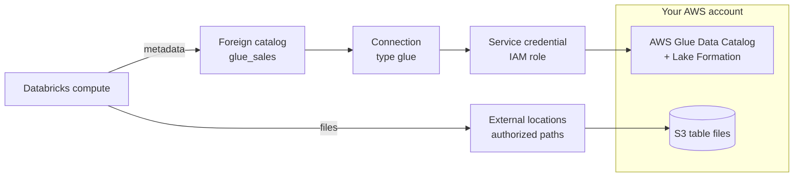

# Hive Metastore Federation for AWS Glue

Mastery: `INPUT[inlineSelect(option(new), option(learning), option(solid)):mastery]`

> [!story] Context
> [[S3 Access via Unity Catalog]] governs data you register in Unity Catalog. Many AWS shops already have hundreds of tables registered in the AWS Glue Data Catalog, used by Athena, EMR, or Glue jobs. Catalog federation lets Unity Catalog govern those tables in place, without re-registering or copying them.

> [!eli5] Summary
> Some companies already keep a list of their tables in an Amazon service called Glue. Federation lets Databricks read that list and show those tables in Databricks with Databricks permissions on top, so people can query them without moving the data.

## Background

The AWS Glue Data Catalog is a Hive-compatible metastore (see [[Hive Metastore]]). AWS Lake Formation adds fine-grained permissions on top of Glue. Before Unity Catalog, Databricks clusters could use Glue directly as their metastore, with access controlled by [[Instance Profiles]] and Lake Formation. That approach put governance outside Databricks.

**Lakehouse Federation** has two types (see [[Lakehouse Federation]]):

- **Query federation** pushes queries down to another database engine.
- **Catalog federation** reads another catalog's metadata and then reads the data files directly from object storage, on Databricks compute. Glue is a catalog federation source.

Databricks describes catalog federation as a good fit for phased migration and long-term hybrid setups.

## Overview

The Glue integration is documented as **Hive metastore federation for AWS Glue metastores**. It creates a **foreign catalog** in Unity Catalog that mirrors a Glue catalog.

| Aspect | Behavior |
|---|---|
| Metadata | Read from Glue; Glue table and column comments carry over |
| Data | Read directly from S3 by Databricks compute, through Unity Catalog external locations |
| Writes | Read-only for Hive tables in Glue through the foreign catalog |
| Governance | Unity Catalog grants, lineage, and audit apply to the foreign catalog |
| Supported operations | The docs list `OPTIMIZE` and `VACUUM`; `ANALYZE TABLE` is not supported |
| Iceberg | Foreign Iceberg tables managed in Glue are supported (Databricks describes Foreign Iceberg as GA); Glue stays the source of truth |
| Network | Traffic to Glue can cross the public internet; Databricks recommends private connectivity |

**Requirements:**

- An IAM role that can read the Glue catalog, and the Glue catalog's AWS region and account ID.
- `CREATE SERVICE CREDENTIAL` and `CREATE CONNECTION` on the metastore (metastore admins have both).
- `CREATE CATALOG` on the metastore, and ownership of the connection or `CREATE FOREIGN CATALOG` on it.
- External locations that cover the S3 paths of the tables, and `CREATE FOREIGN SECURABLE` on them for authorized paths.

## How it works



### Procedure

1. **Create a self-assuming IAM role** that trusts Databricks and can read Glue (and Lake Formation, if used). Register it as a **service credential**:

```bash
databricks credentials create-credential --json '{
  "name": "glue_svc_cred",
  "purpose": "SERVICE",
  "aws_iam_role": { "role_arn": "arn:aws:iam::111122223333:role/uc-glue-reader" }
}'
```

Update the role's trust policy with the external ID the credential returns, as for storage credentials.

2. **Create a connection** of type **AWS Glue** in Catalog Explorer (**External data**, **Connections**, **Create connection**), entering the Glue region, AWS account ID, and service credential. The SQL option names are listed in the Glue federation guide.
3. **Create external locations** that cover the S3 paths of the Glue tables. See [[S3 Access via Unity Catalog]].
4. **Create the foreign catalog** and grant access:

```sql
CREATE FOREIGN CATALOG IF NOT EXISTS glue_sales
  USING CONNECTION glue_conn
  OPTIONS (authorized_paths 's3://acme-lake/sales');

GRANT USE CATALOG, USE SCHEMA, SELECT ON CATALOG glue_sales TO `analysts`;

SELECT * FROM glue_sales.orders_db.orders LIMIT 10;
```

## Small-business considerations

> [!smallbiz] Small-business considerations
> - Use federation if you already have a working Glue catalog and want Databricks users to query it now, with Unity Catalog permissions.
> - If you are starting fresh, skip Glue. Register tables directly in Unity Catalog.
> - Federation is a bridge. For tables you will change often, plan to migrate them to Unity Catalog managed tables later. See [[Hive Metastore Migration to Unity Catalog]].

## Cloud differences

> [!azure]- Azure Databricks
> - There is no Glue. The closest equivalent is catalog federation to **OneLake** for Microsoft Fabric data. See [[Microsoft Fabric and OneLake vs Databricks]].

> [!aws]- Databricks on AWS
> - This note. Glue is listed as a catalog federation source on AWS, alongside external Hive metastores and legacy workspace Hive metastores.

> [!gcp]- Databricks on Google Cloud
> - Glue is not used. BigQuery is reached through query federation or the BigQuery connector. See [[BigQuery Integration]].

## Advanced topics

> [!deepdive]- Advanced topics (301–401)
> - **Keep Lake Formation permissions stable:** If the credential loses access to Glue or Lake Formation even briefly, the foreign catalog's schemas can be dropped and recreated, which removes existing Unity Catalog grants. Avoid revoke-then-grant changes in Lake Formation, and keep a re-runnable script of your schema grants.
> - **Authorized paths:** `authorized_paths` limits which S3 prefixes the foreign catalog may read. Tables outside them are not readable through Unity Catalog.
> - **Two governance layers:** Lake Formation controls what the service credential can see in Glue. Unity Catalog controls what each Databricks user can see in the foreign catalog. A user can read a table only if both layers allow it.
> - **Iceberg route:** For Iceberg tables in Glue, foreign Iceberg support lets Unity Catalog govern and read them while Glue remains the catalog of record. See [[Apache Iceberg]].

## Common misconceptions

> [!confusion] Federation does not copy data
> A foreign catalog mirrors metadata. Data stays in S3 and is read in place.

> [!confusion] A foreign catalog is not writable
> Hive tables in a Glue foreign catalog are read-only from Unity Catalog. Write through the system that owns them, or migrate the tables.

## Recall

Which federation type does Glue use?::Catalog federation (Hive metastore federation for AWS Glue).
What credential type does the Glue connection use?::A Unity Catalog service credential backed by a self-assuming IAM role.
Which connection type is used for Glue?::`glue` (AWS Glue).
Are Glue Hive tables writable through the foreign catalog?::No, they are read-only.
What does `authorized_paths` do?::Limits the S3 paths a foreign catalog can read.
What can happen if Lake Formation permissions are revoked briefly?::Foreign catalog schemas can be dropped and recreated, removing Unity Catalog grants.
Which privileges are needed on the metastore to start?::`CREATE SERVICE CREDENTIAL` and `CREATE CONNECTION`.

## Next steps

> [!path] Learning path
> **Needs first:** [[Lakehouse Federation]], [[S3 Access via Unity Catalog]], [[Hive Metastore]]
> **Unlocks next:** [[Hive Metastore Migration to Unity Catalog]]

> [!nextup] Next
> [[AWS Marketplace and Billing]] covers how Databricks on AWS is paid for and where each charge appears.

> [!sources]- Sources (last verified: 2026-10-25)
> - [Enable Hive metastore federation for AWS Glue metastores (AWS)](https://docs.databricks.com/aws/en/query-federation/hms-federation-glue)
> - [Hive metastore federation concepts (AWS)](https://docs.databricks.com/aws/en/query-federation/hms-federation-concepts)
> - [What is catalog federation? (AWS)](https://docs.databricks.com/aws/en/query-federation/catalog-federation)
> - [Connect to external databases and catalogs (AWS)](https://docs.databricks.com/aws/en/query-federation/)
> - [Create service credentials (AWS)](https://docs.databricks.com/aws/en/connect/unity-catalog/cloud-services/service-credentials)
> - [Talk to all your data, wherever it lives (Databricks blog)](https://www.databricks.com/blog/talk-all-your-data-wherever-it-lives)
> - [Advancing Apache Iceberg on Databricks (Databricks blog)](https://www.databricks.com/blog/unity-catalog-and-next-era-apache-icebergtm)
