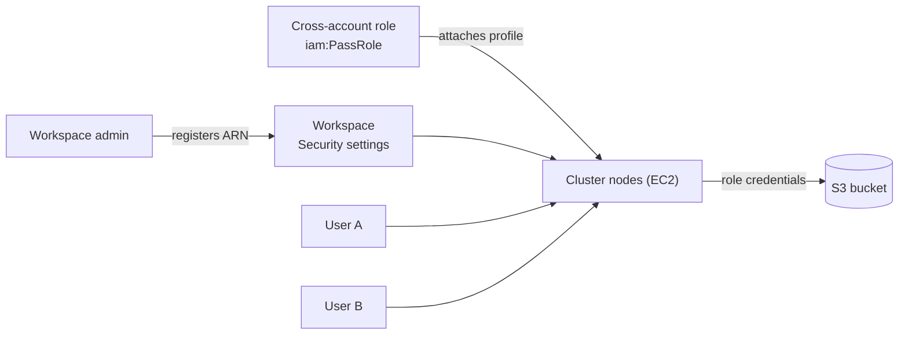

# Instance Profiles

Mastery: `INPUT[inlineSelect(option(new), option(learning), option(solid)):mastery]`

> [!story] Context
> [[AWS PrivateLink]] completes the network setup. The next question is how compute reads data in S3. Before [[Unity Catalog]], the answer on AWS was an instance profile attached to the cluster. This note explains that pattern so you can recognize and retire it.

> [!eli5] Summary
> An instance profile is like a building key card given to a whole computer. Every person using that computer can open every door the card opens. Unity Catalog replaced this with a system that checks each person before handing out a short-lived key for only the files they may use.

## Background

In AWS, an **instance profile** is a container for an IAM role that EC2 instances can use. Code running on the instance gets temporary credentials for that role automatically. Databricks used this so clusters could read and write S3 without access keys in notebooks.

The problem is scope. Permissions belong to the **cluster**, not the **user**. Everyone who can attach to a cluster gets everything its role allows, and there is no audit of which user read which file. [[Unity Catalog]] moved storage access to per-user, per-object grants.

## Overview

| | Instance profile (legacy) | Unity Catalog storage credential |
|---|---|---|
| Identity checked | The cluster | The user or service principal |
| Granularity | Whole buckets or prefixes in the IAM policy | Catalog, schema, table, volume, external location |
| Credentials | Role credentials on every node | Short-lived, scoped credentials per request |
| Audit | Cloud-level only | [[Audit Logs]] and [[Data Lineage]] |
| Serverless support | Limited (for SQL warehouses through data access configuration) | Full |
| Databricks guidance | Legacy | Recommended |

Databricks recommends Unity Catalog external locations for S3 access. Instance profiles still appear on older workspaces, in [[Compute Policies]] (`aws_attributes.instance_profile_arn`), and in legacy SQL data access configurations. IAM credential passthrough, another legacy method, is also retired in favor of Unity Catalog.

## How it works



The legacy setup has five steps:

1. Create an IAM role with the EC2 use case and an inline policy granting S3 actions on a bucket.
2. Optionally add a trust relationship for serverless compute (for serverless SQL).
3. Add a bucket policy if the bucket is in another account.
4. Grant `iam:PassRole` on the role to the [[Cross-Account IAM Role]], so Databricks can attach it to instances.
5. Register the instance profile ARN in the workspace admin settings (**Security**), then select it on a cluster.

```bash
aws iam create-role --role-name databricks-s3-legacy \
  --assume-role-policy-document file://ec2-trust.json
aws iam put-role-policy --role-name databricks-s3-legacy \
  --policy-name s3-access --policy-document file://s3-policy.json
aws iam create-instance-profile --instance-profile-name databricks-s3-legacy
aws iam add-role-to-instance-profile \
  --instance-profile-name databricks-s3-legacy --role-name databricks-s3-legacy
```

A cluster spec then references it:

```json
{
  "aws_attributes": {
    "instance_profile_arn": "arn:aws:iam::111122223333:instance-profile/databricks-s3-legacy"
  }
}
```

## Small-business considerations

> [!smallbiz] Small-business considerations
> - Do not create new instance profiles. Use [[S3 Access via Unity Catalog]] from the start.
> - If you inherit a workspace that uses them, list where they are attached (clusters, policies, SQL settings) and plan a move to storage credentials and external locations as part of [[Hive Metastore Migration to Unity Catalog]].

## Cloud differences

> [!azure]- Azure Databricks
> - The legacy pattern was storage account keys, SAS tokens, or service principal secrets in Spark configuration or mounts. Unity Catalog replaces them with an Access Connector's [[Managed Identity|managed identity]]. See [[ADLS and Access Connectors]].

> [!aws]- Databricks on AWS
> - This note. Instance profiles are legacy. If a bucket uses SSE-KMS, the role must also be a key user on the KMS key.

> [!gcp]- Databricks on Google Cloud
> - The closest equivalent is attaching a custom **Google service account** to a cluster (`google_service_account`), which gives every user of the cluster that account's GCS access. Unity Catalog storage credentials are recommended instead. See [[Google Service Accounts]].

## Advanced topics

> [!deepdive]- Advanced topics (301–401)
> - **Role name versus profile name.** If the role name and the instance profile name differ, enter the role ARN in the optional field when registering, or serverless SQL will not work with it.
> - **Two systems side by side.** While an instance profile remains attached, code on that cluster has two routes to S3: Unity Catalog grants and the role's IAM permissions. Removing the profile leaves Unity Catalog as the only route.
> - **Enforcement through policies.** Admins can force or forbid an instance profile with a compute policy on `aws_attributes.instance_profile_arn`.
> - **Migration order.** Create storage credentials and external locations for the same paths, upgrade tables to Unity Catalog, switch jobs to Unity Catalog compute, then detach the instance profile and remove `iam:PassRole` from the cross-account role.

## Common misconceptions

> [!confusion] Instance profiles are not the cross-account role
> The cross-account role is assumed by the control plane to manage EC2. An instance profile is attached to the nodes so code on them can reach AWS services.

> [!confusion] Credentials on the cluster are not per-user
> Every user of a cluster with an instance profile gets the same AWS permissions.

## Recall

What is an AWS instance profile?::A container for an IAM role that EC2 instances use to get temporary credentials.
Why did Unity Catalog replace instance profiles?::Instance profiles grant access per cluster, not per user, with no fine-grained grants or user-level audit.
Which permission must the cross-account role have to attach an instance profile?::`iam:PassRole` on the instance profile's role.
Which cluster field sets an instance profile?::`aws_attributes.instance_profile_arn`.
What is the GCP equivalent of an instance profile?::A custom Google service account attached to the cluster.
What extra step is needed if the bucket uses SSE-KMS?::Add the role as a key user on the KMS key.

## Next steps

> [!path] Learning path
> **Needs first:** [[IAM]], [[Cross-Account IAM Role]]
> **Unlocks next:** [[S3 Access via Unity Catalog]], [[Hive Metastore Migration to Unity Catalog]]

> [!nextup] Next
> [[S3 Access via Unity Catalog]] covers the replacement: IAM-role storage credentials and external locations.

> [!sources]- Sources (last verified: 2026-10-25)
> - [Tutorial: Configure S3 access with an instance profile (AWS)](https://docs.databricks.com/en/aws/iam/instance-profile.html)
> - [Data access configurations (AWS)](https://docs.databricks.com/aws/en/admin/sql/data-access-configuration)
> - [Configure encryption for S3 with KMS (AWS)](https://docs.databricks.com/aws/en/security/keys/kms-s3)
> - [Compute configuration reference (AWS)](https://docs.databricks.com/aws/en/compute/configure)
> - [Compute policy reference (AWS)](https://docs.databricks.com/aws/en/admin/clusters/policy-definition)
> - [Access S3 with IAM credential passthrough with SCIM, legacy (AWS)](https://docs.databricks.com/data-governance/credential-passthrough/iam-passthrough.html)
> - [Create a storage credential and external location for S3 (AWS)](https://docs.databricks.com/aws/en/connect/unity-catalog/cloud-storage/s3/s3-external-location-manual)
> - [Compute configuration reference (GCP)](https://docs.databricks.com/gcp/en/compute/configure)
