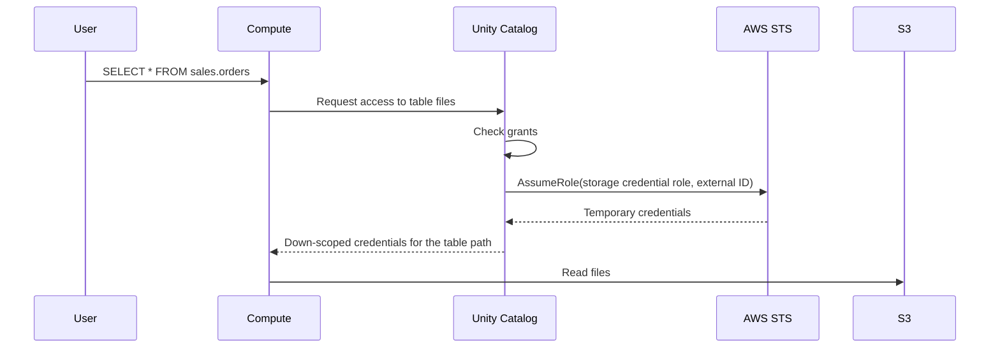

# S3 Access via Unity Catalog

Mastery: `INPUT[inlineSelect(option(new), option(learning), option(solid)):mastery]`

> [!story] Context
> [[Instance Profiles]] gave whole clusters access to S3. Unity Catalog replaces them with [[Storage Credentials and External Locations|storage credentials and external locations]]: an IAM role that only Unity Catalog can assume, and paths that you grant to users and groups.

> [!eli5] Summary
> You give Databricks one carefully limited key to a storage bucket and register which folders it covers. Databricks keeps the key. When a person who has permission reads a table, Databricks makes a short-lived copy of the key for just those files.

## Background

S3 has no idea who a Databricks user is. Something must translate "user `ana` may read `sales.orders`" into AWS permissions. Unity Catalog does this: it holds an IAM role, checks the user's grants, and then vends temporary, scoped credentials to the compute that runs the query. Users never see or hold AWS credentials.

## Overview

| Object | What it holds | Who creates it | Privilege needed |
|---|---|---|---|
| **IAM role** (AWS) | S3 (and optional KMS) permissions on a bucket or prefix | AWS admin | AWS IAM |
| **Storage credential** | The IAM role ARN, plus an external ID that Databricks generates | Metastore or account admin | `CREATE STORAGE CREDENTIAL` on the metastore |
| **External location** | An `s3://` path plus a storage credential | Admin | `CREATE EXTERNAL LOCATION` on the metastore and the credential |
| **Grants** | Who can read files, create tables, or create managed storage there | Owner | `GRANT` |

Two requirements are specific to AWS:

- **Self-assuming role:** The role's trust policy must trust the Databricks Unity Catalog master role and also the role itself. AWS changed role trust behavior on June 30, 2023, and on January 20, 2025 Databricks began blocking storage credentials with non-self-assuming roles.
- **External ID:** The trust policy's `sts:ExternalId` must match the external ID shown on the storage credential. This prevents the confused deputy problem.

Databricks recommends the automated setup (an AWS CloudFormation template launched from Catalog Explorer) where possible.

## How it works



### Procedure: manual setup

1. Create the IAM role with a placeholder external ID (`0000`) and the Unity Catalog master role as principal. Copy the exact trust policy from the Databricks guide.

```bash
aws iam create-role --role-name uc-sales-bucket \
  --assume-role-policy-document file://uc-trust-placeholder.json
aws iam put-role-policy --role-name uc-sales-bucket \
  --policy-name uc-sales-s3 --policy-document file://uc-s3-policy.json
```

2. Create the storage credential in Databricks with the role ARN. Catalog Explorer: **Catalog**, **External data**, **Credentials**, **Create credential**, type **AWS IAM Role**. Or use the CLI:

```bash
databricks storage-credentials create --json '{
  "name": "sales_bucket_cred",
  "aws_iam_role": { "role_arn": "arn:aws:iam::111122223333:role/uc-sales-bucket" }
}'
```

3. Copy the **external ID** from the new credential. Update the role's trust policy to use that external ID and to trust the role's own ARN (self-assuming).

```bash
aws iam update-assume-role-policy --role-name uc-sales-bucket \
  --policy-document file://uc-trust-final.json
```

4. Validate the credential in Catalog Explorer. The **Self Assume Role** check must pass.
5. Create the external location and grant access:

```sql
CREATE EXTERNAL LOCATION IF NOT EXISTS sales_raw
  URL 's3://acme-sales/raw'
  WITH (STORAGE CREDENTIAL sales_bucket_cred)
  COMMENT 'Landing zone for sales files';

GRANT READ FILES, CREATE EXTERNAL TABLE ON EXTERNAL LOCATION sales_raw TO `data_engineers`;

-- Test
LIST 's3://acme-sales/raw';
```

## Small-business considerations

> [!smallbiz] Small-business considerations
> - Use one bucket for business data and one storage credential for it. Split into more credentials only when teams need separate AWS permissions.
> - Use the CloudFormation quickstart from Catalog Explorer if you are not comfortable editing trust policies.
> - Grant external location privileges to engineers only. Analysts should read **tables**, not raw paths.
> - Keep the bucket in the same region as the workspace to avoid cross-region data transfer charges.

## Cloud differences

> [!azure]- Azure Databricks
> - The storage credential points to an **Access Connector for Azure Databricks** with a managed identity, granted a role such as *Storage Blob Data Contributor*. Paths use `abfss://`. See [[ADLS and Access Connectors]].

> [!aws]- Databricks on AWS
> - This note. A self-assuming IAM role with an external ID. Paths use `s3://`. Service credentials (for AWS services other than S3, such as Glue) use the same role pattern.

> [!gcp]- Databricks on Google Cloud
> - Databricks generates a Google service account for the storage credential, and you grant it roles on the bucket. Databricks on Google Cloud can also define read-only external locations on S3 with an IAM role credential. See [[GCS Access via Unity Catalog]].

## Advanced topics

> [!deepdive]- Advanced topics (301–401)
> - **KMS-encrypted buckets:** Keep the KMS statement from the Databricks policy template (encrypt and decrypt on the key) and allow the role in the key policy. Remove the statement if the bucket does not use KMS.
> - **File events:** For [[Auto Loader]] file notification mode and managed file events, the role needs the additional file-events policy, which the Databricks template marks as optional.
> - **Read-only credentials:** Mark a storage credential read-only to make every external location using it read-only.
> - **Managed storage:** Assign an external location as managed storage for a catalog or schema to keep each business unit's managed tables in its own bucket. See [[Managed vs External Tables]].
> - **Service credentials:** A separate securable, the *service credential*, lets code call AWS services through the same governed IAM-role pattern. Databricks also blocks non-self-assuming roles for service credentials.

## Common misconceptions

> [!confusion] The storage credential's external ID is not your account ID
> The [[Cross-Account IAM Role]] uses your Databricks account ID. A storage credential uses its own generated external ID.

> [!confusion] An external location is not a table
> It is a governed path. Tables, volumes, and managed storage are created on top of it.

## Recall

What does a Unity Catalog storage credential hold on AWS?::An IAM role ARN that Unity Catalog assumes, plus a generated external ID.
What does "self-assuming" mean for the IAM role?::Its trust policy trusts its own ARN as well as the Databricks Unity Catalog master role.
Since when does Databricks block non-self-assuming roles for storage credentials?::January 20, 2025.
Which privilege creates a storage credential?::`CREATE STORAGE CREDENTIAL` on the metastore.
What placeholder external ID is used before the credential exists?::`0000`.
Which SQL command creates an external location?::`CREATE EXTERNAL LOCATION ... URL 's3://...' WITH (STORAGE CREDENTIAL ...)`.
What does the user's compute receive when reading a table?::Short-lived credentials scoped to that table's path.

## Next steps

> [!path] Learning path
> **Needs first:** [[Storage Credentials and External Locations]], [[IAM]], [[Amazon S3]]
> **Unlocks next:** [[Hive Metastore Federation for AWS Glue]], [[Managed vs External Tables]], [[Volumes]]

> [!nextup] Next
> [[Hive Metastore Federation for AWS Glue]] uses the same IAM-role pattern to govern tables already registered in AWS Glue.

> [!sources]- Sources (last verified: 2026-10-25)
> - [Create a storage credential and external location for S3 using Catalog Explorer or SQL (AWS)](https://docs.databricks.com/aws/en/connect/unity-catalog/cloud-storage/s3/s3-external-location-manual)
> - [Create a storage credential and external location for S3 using AWS CloudFormation (AWS)](https://docs.databricks.com/aws/en/connect/unity-catalog/cloud-storage/s3/s3-external-location-cfn)
> - [Connect to an AWS S3 external location (AWS)](https://docs.databricks.com/aws/en/connect/unity-catalog/cloud-storage/s3/)
> - [Connect to cloud object storage using Unity Catalog (AWS)](https://docs.databricks.com/aws/en/connect/unity-catalog/cloud-storage#storage-credentials)
> - [Create a storage credential (API)](https://docs.databricks.com/api/uc-credentials/v1/create-storage-credential)
> - [Create service credentials (AWS)](https://docs.databricks.com/aws/en/connect/unity-catalog/cloud-services/service-credentials)
> - [Manage storage credentials (AWS)](https://docs.databricks.com/aws/en/connect/unity-catalog/cloud-storage/manage-storage-credentials)
> - [Phase 5: Design storage architecture (AWS)](https://docs.databricks.com/aws/en/lakehouse-architecture/deployment-guide/storage)
> - [Connect to an AWS S3 external location, read-only (GCP)](https://docs.databricks.com/gcp/en/connect/unity-catalog/cloud-storage/s3/s3-external-location-manual)
> - [Use Azure managed identities in Unity Catalog to access storage](https://learn.microsoft.com/en-us/azure/databricks/connect/unity-catalog/cloud-storage/azure-managed-identities)
