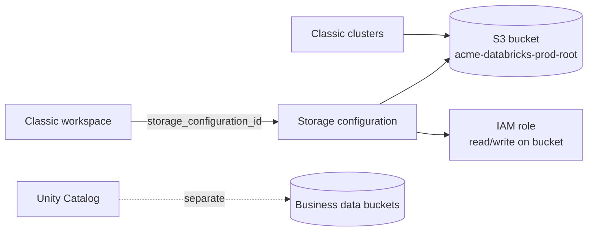

# Workspace Storage Bucket

Mastery: `INPUT[inlineSelect(option(new), option(learning), option(solid)):mastery]`

> [!story] Context
> The [[Cross-Account IAM Role]] lets Databricks run compute in your account. A classic workspace also needs a place to keep its own files. That place is an S3 bucket in your account, registered as the workspace's *storage configuration*.

> [!eli5] Summary
> Every classic workspace on AWS has a storage bucket of its own, like a filing cabinet for the workspace's internal files: logs, uploaded libraries, and job results. Your real business data should live in other buckets that you manage on purpose.

## Background

Older Databricks workspaces exposed this bucket to users as the **DBFS root** (`dbfs:/`), and many teams stored tables and files there. That made governance hard: anyone in the workspace could read the DBFS root. With [[Unity Catalog]], business data lives in governed [[Storage Credentials and External Locations|external locations]] and managed storage, and the workspace bucket goes back to holding system data.

## Overview

| Property | Detail |
|---|---|
| **Name in Databricks** | Storage configuration (`storage_configuration_id`) |
| **Also called** | Root bucket, workspace root storage, DBFS root |
| **Holds** | Workspace system data, libraries, logs, job results, and the legacy DBFS root |
| **Access** | A bucket policy plus an IAM role that Databricks uses to reach the bucket |
| **Encryption** | Encrypted at rest by default; optionally with your own KMS key through [[Customer-Managed Keys on AWS]] |
| **Serverless workspaces** | Not used. Databricks-managed default storage takes its place |

Rules from the docs:

- **Do not delete or modify the workspace storage:** If it is deleted, the workspace cannot be recovered.
- **Do not store production data in the DBFS root:** Use Unity Catalog managed or external storage in separate buckets.

## How it works



### Procedure: create and register the bucket

1. Create the bucket (in the workspace's region) and block public access:

```bash
aws s3api create-bucket --bucket acme-databricks-prod-root --region us-east-1
aws s3api put-public-access-block --bucket acme-databricks-prod-root \
  --public-access-block-configuration BlockPublicAcls=true,IgnorePublicAcls=true,BlockPublicPolicy=true,RestrictPublicBuckets=true
```

2. Attach the bucket policy from the Databricks manual setup guide. It grants the Databricks principal S3 actions on the bucket, conditioned on your Databricks account ID, and denies DBFS access to any Unity Catalog metastore prefix.

```bash
aws s3api put-bucket-policy --bucket acme-databricks-prod-root --policy file://root-bucket-policy.json
```

3. Create the IAM role for the bucket using the trust and read/write policies from the same guide. Remove the KMS section if the bucket does not use a KMS key.
4. Register the storage configuration:

```bash
databricks account storage create --json '{
  "storage_configuration_name": "prod-storage",
  "root_bucket_info": { "bucket_name": "acme-databricks-prod-root" }
}'
```

5. Pass the returned `storage_configuration_id` when you create the workspace. In Terraform, use `databricks_mws_storage_configurations`.

## Small-business considerations

> [!smallbiz] Small-business considerations
> - If you use a serverless workspace, there is no workspace bucket to manage.
> - For a classic workspace, let Quickstart create the bucket, then leave it alone. Do not add lifecycle rules that delete objects, and do not reuse it for other applications.
> - Create one separate bucket for business data and register it in Unity Catalog. See [[S3 Access via Unity Catalog]].
> - S3 storage and request charges for this bucket appear on your AWS bill.

## Cloud differences

> [!azure]- Azure Databricks
> - The workspace storage account (DBFS root) is created for you inside the locked [[Managed Resource Group]]. You do not create or register it. CMK for it is called **DBFS root** encryption. See [[Customer-Managed Keys on Azure]].

> [!aws]- Databricks on AWS
> - This note. You create the bucket (or Quickstart does), attach a bucket policy, and register it as a storage configuration.

> [!gcp]- Databricks on Google Cloud
> - Databricks creates **two GCS buckets** in your project when it creates a classic workspace: one for system data and one for the DBFS root. If the workspace was enabled for Unity Catalog automatically, a **third bucket** holds the default workspace catalog. See [[Databricks on Google Cloud Overview]] and [[Customer-Managed Keys on Google Cloud]].

## Advanced topics

> [!deepdive]- Advanced topics (301–401)
> - **Workspace catalog:** If the storage configuration includes an optional IAM role ARN, Databricks creates a workspace catalog together with the workspace, using this storage.
> - **Bring your own policy:** Newer docs describe creating the bucket first and then assigning it to a workspace, so you keep full control of the bucket policy while the workspace retains access.
> - **DBFS root as an external location (legacy):** Unity Catalog can register the DBFS root as an external location to govern old data during migration. Treat this as a migration aid, not a target design.
> - **Encryption:** A workspace storage key covers this bucket and, optionally, EBS volumes of classic compute (`reuse_key_for_cluster_volumes`). It does not cover DBFS mounts of other buckets.
> - **Metastore storage is separate:** Unity Catalog metastore-level managed storage, if used, is a different bucket from the workspace bucket.

## Common misconceptions

> [!confusion] The workspace bucket is not your data lake
> It holds workspace system data. Production tables belong in Unity Catalog managed or external storage in buckets you govern.

> [!confusion] Deleting the bucket does not just remove old files
> Without its storage, a workspace cannot be recovered.

## Recall

What does a classic workspace's storage bucket hold?::Workspace system data such as libraries, logs, job results, and the legacy DBFS root.
What Databricks object references the bucket?::A storage configuration (`storage_configuration_id`).
What happens if the workspace storage is deleted?::The workspace cannot be recovered.
Should you store production data in the DBFS root?::No. Use Unity Catalog storage in separate buckets.
Do serverless workspaces use a workspace storage bucket?::No. They use Databricks-managed default storage.
Which CMK use case covers the workspace bucket?::Workspace storage.
How many workspace buckets does Databricks create on Google Cloud?::Two (system data and DBFS root).

## Next steps

> [!path] Learning path
> **Needs first:** [[Amazon S3]], [[Account Setup on AWS]]
> **Unlocks next:** [[S3 Access via Unity Catalog]], [[Customer-Managed Keys on AWS]]

> [!nextup] Next
> [[Customer-Managed VPC on AWS]] covers the third building block of a classic workspace: running compute in a network you design.

> [!sources]- Sources (last verified: 2026-10-25)
> - [Create a classic workspace: secure the workspace's GCS buckets (GCP)](https://docs.databricks.com/gcp/en/admin/workspace/create-workspace)
> - [Databricks architecture overview: workspace storage (GCP)](https://docs.databricks.com/gcp/en/getting-started/overview)
> - [Create a workspace with manual AWS configurations (AWS)](https://docs.databricks.com/aws/en/admin/workspace/create-uc-workspace)
> - [Phase 5: Design storage architecture (AWS)](https://docs.databricks.com/aws/en/lakehouse-architecture/deployment-guide/storage)
> - [account storage command group (CLI)](https://docs.databricks.com/aws/en/dev-tools/cli/reference/account-storage-commands)
> - [Storage Configuration API](https://docs.databricks.com/api/storage-configurations/v1/storage-configuration)
> - [Create a workspace using the Account API (AWS)](https://docs.databricks.com/aws/en/admin/workspace/create-workspace-api)
> - [Connect to a DBFS root external location, legacy (AWS)](https://docs.databricks.com/aws/en/connect/unity-catalog/cloud-storage/external-locations-dbfs-root)
> - [Default storage in Databricks (AWS)](https://docs.databricks.com/aws/en/storage/default-storage)
> - [Customer-managed keys for encryption (AWS)](https://docs.databricks.com/aws/en/security/keys/customer-managed-keys)
> - [High-level architecture (GCP)](https://docs.databricks.com/gcp/en/getting-started/high-level-architecture)
> - [Configure customer-managed keys for encryption (GCP)](https://docs.databricks.com/gcp/en/security/keys/configure-customer-managed-keys)
