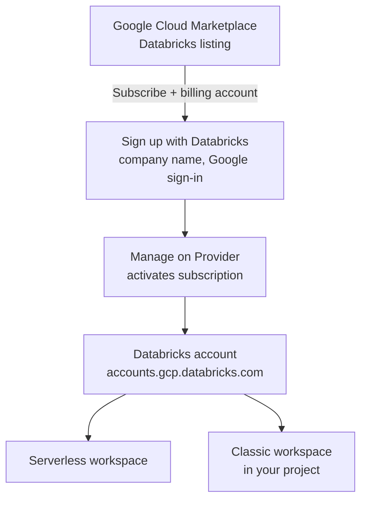

# Account Setup on Google Cloud

Mastery: `INPUT[inlineSelect(option(new), option(learning), option(solid)):mastery]`

> [!story] Context
> [[Databricks on Google Cloud Overview]] described the parts of a deployment on Google Cloud. Getting started has two stages: a Google Cloud Marketplace subscription that creates the Databricks account, then workspace creation in the Databricks account console.

> [!eli5] Summary
> You find Databricks in Google's business software store and subscribe with your company's Google billing account. That creates your Databricks account. Then you create a workspace, which is the place where your team actually works.

## Background

On Google Cloud, a Databricks account is tied to a **Google Cloud billing account**. You can have only **one Databricks account per billing account**. Usage is billed pay-as-you-go to that billing account after the trial. Contract or private offer customers should work with their Databricks account team instead of following the self-service steps.

## Overview

Account setup on Google Cloud means subscribing to Databricks through Google Cloud Marketplace, then creating a workspace in the Databricks account console.

### Prerequisites

| Requirement | Detail |
|---|---|
| Billing account | A Google Cloud billing account |
| Billing role | **Billing Administrator** on the billing account (or its organization) |
| Project role | **Viewer** on the project (a Google Cloud container for resources) linked to the billing account, for the Marketplace subscription |
| Email | A business email; trial limits apply to personal emails |
| Workspace project | A project for the workspace. It does not need to be the project used for the subscription |

### Trial

- Trial credits cover Databricks usage for **14 days**.
- Google Cloud bills its own resources ([[Virtual Machine|VMs]], disks, buckets, networking) separately, during and after the trial, for classic workspaces in your project.
- The default serverless trial workspace does not create billable resources in your project.

## How it works



### Procedure: subscribe

1. In the Google Cloud console, select the project associated with the billing account you want to use.
2. Open the Databricks listing in Google Cloud Marketplace and click **Subscribe**.
3. Choose the billing account, accept the terms, and click **Subscribe** again.
4. In the dialog, click the sign-up (or register) button for Databricks. Enter your company name and sign in with Google.
5. Return to the listing and click **Manage on Provider**. This step activates the subscription.

If you need a fresh project for the subscription, create it and link billing first:

```bash
gcloud projects create acme-dbx-billing --name="Databricks billing"
gcloud billing projects link acme-dbx-billing --billing-account=0123AB-4567CD-89EF01
```

### Procedure: create a classic workspace (console)

1. Sign in to `https://accounts.gcp.databricks.com` as an account admin.
2. Click **Workspaces**, then **Create workspace**.
3. In **Basics**, enter the workspace name, region, and the Google Cloud project ID.
4. Optionally open **Advanced** to choose a [[Customer-Managed VPC on Google Cloud|customer-managed VPC]], [[Private Service Connect]], or [[Customer-Managed Keys on Google Cloud|encryption keys]].
5. Click **Create workspace**. Workspace configurations cannot be modified after creation.

Databricks recommends that the workspace creator have `roles/owner` on the workspace project and, for a customer-managed VPC, on the VPC project.

### Account API and Terraform

```bash
databricks account workspaces create --json '{
  "workspace_name": "prod",
  "location": "us-central1",
  "cloud_resource_container": { "gcp": { "project_id": "acme-databricks-prod" } },
  "network_id": "<network-configuration-id>"
}'
```

```hcl
resource "databricks_mws_workspaces" "prod" {
  provider       = databricks.accounts
  account_id     = var.databricks_account_id
  workspace_name = "prod"
  location       = "us-central1"

  cloud_resource_container {
    gcp {
      project_id = "acme-databricks-prod"
    }
  }

  network_id = databricks_mws_networks.prod.network_id
}
```

## Small-business considerations

> [!smallbiz] Small-business considerations
> 1. Subscribe with the billing account your company already uses for Google Cloud.
> 2. Remember the **Manage on Provider** step; without it the subscription is not active.
> 3. Start with a serverless workspace. It creates no billable resources in your project.
> 4. Create a classic workspace only when a workload needs it, and use a customer-managed VPC, which Databricks recommends for new classic workspaces.

## Cloud differences

> [!azure]- Azure Databricks
> - No marketplace step. You create the workspace as an Azure resource in the Azure portal, CLI, or Bicep. See [[Creating an Azure Databricks Workspace]].

> [!aws]- Databricks on AWS
> - Sign up with express setup (email only), an AWS account, or AWS Marketplace. Classic workspaces need an IAM role and an S3 bucket. See [[Account Setup on AWS]].

> [!gcp]- Databricks on Google Cloud
> - This note. Subscription through Google Cloud Marketplace, one account per billing account, workspaces created at `accounts.gcp.databricks.com`.

## Advanced topics

> [!deepdive]- Advanced topics (301–401)
> - **Least-privilege workspace creation.** Security-conscious accounts can create workspaces with a creator service account that has custom IAM roles, calling the Account API. The creator then needs only read-level permissions to validate settings, and you pre-create resources and grants yourself. Databricks still recommends the standard flow for most deployments.
> - **Service account roles do not inherit.** A service account you create does not inherit your roles. Grant it roles on the project explicitly.
> - **What workspace creation makes.** A classic workspace creates a workspace service account with custom roles, two GCS buckets (three if the workspace was enabled for Unity Catalog automatically), and (if Databricks-managed) a VPC. See [[Google Service Accounts]].
> - **Orders.** The Google order number appears in the account console under **Settings**, **Subscription & billing**, and matches the listing's **Manage orders** page.
> - **Terraform networks.** In `databricks_mws_networks`, the GKE secondary range arguments of `gcp_managed_network_config` are deprecated and can be removed from templates.

## Common misconceptions

> [!confusion] The subscription project is not the workspace project
> The project used to subscribe only needs to be linked to the billing account. Workspaces can live in any project.

> [!confusion] Trial credits do not cover Google Cloud resources
> Credits apply to Databricks usage only. VMs and storage for classic workspaces are billed by Google Cloud.

## Recall

How many Databricks accounts can one Google Cloud billing account have?::One.
Which button activates a new Marketplace subscription?::**Manage on Provider**.
Which billing role do you need to subscribe?::Billing Administrator on the billing account.
How long are Google Cloud trial credits valid?::14 days.
Which role does Databricks recommend for the workspace creator?::`roles/owner` on the workspace project and the VPC project.
Can workspace configuration be changed after creation on GCP?::No.
Which Terraform block names the workspace's Google Cloud project?::`cloud_resource_container { gcp { project_id = ... } }`.

## Next steps

> [!path] Learning path
> **Needs first:** [[Databricks on Google Cloud Overview]], [[Accounts and Workspaces]]
> **Unlocks next:** [[Compute on Google Cloud]], [[Customer-Managed VPC on Google Cloud]], [[Google Cloud Marketplace and Billing]]

> [!nextup] Next
> [[Compute on Google Cloud]] explains how classic clusters run on Compute Engine VMs in the workspace project.

> [!sources]- Sources (last verified: 2026-10-25)
> - [Databricks architecture overview: workspace storage (GCP)](https://docs.databricks.com/gcp/en/getting-started/overview)
> - [Start a Databricks free trial on Google Cloud](https://docs.databricks.com/gcp/en/admin/account-settings-gcp/create-subscription)
> - [Sign up for Databricks for free (GCP)](https://docs.databricks.com/gcp/en/getting-started/free-trial)
> - [Manage your subscription (GCP)](https://docs.databricks.com/gcp/en/admin/account-settings/account)
> - [Create a classic workspace (GCP)](https://docs.databricks.com/gcp/en/admin/workspace/create-workspace)
> - [Required permissions for workspace creation (GCP)](https://docs.databricks.com/gcp/en/admin/cloud-configurations/gcp/permissions)
> - [Create a least-privilege workspace (GCP)](https://docs.databricks.com/gcp/en/admin/workspace/create-least-privilege-workspace)
> - [Create a serverless workspace (GCP)](https://docs.databricks.com/gcp/en/admin/workspace/serverless-workspaces)
> - [Create a workspace using Terraform (GCP)](https://docs.databricks.com/gcp/en/admin/workspace/terraform)
> - [databricks_mws_workspaces (Terraform Registry)](https://registry.terraform.io/providers/databricks/databricks/1.63.0/docs/resources/mws_workspaces)
> - [databricks_mws_networks (Terraform Registry)](https://registry.terraform.io/providers/databricks/databricks/1.112.0/docs/resources/mws_networks)
> - [Workspace API](https://docs.databricks.com/api/workspaces/v1/workspace)
> - [Databricks (Google Cloud Marketplace listing)](https://console.cloud.google.com/marketplace/product/databricks-prod/databricks)
