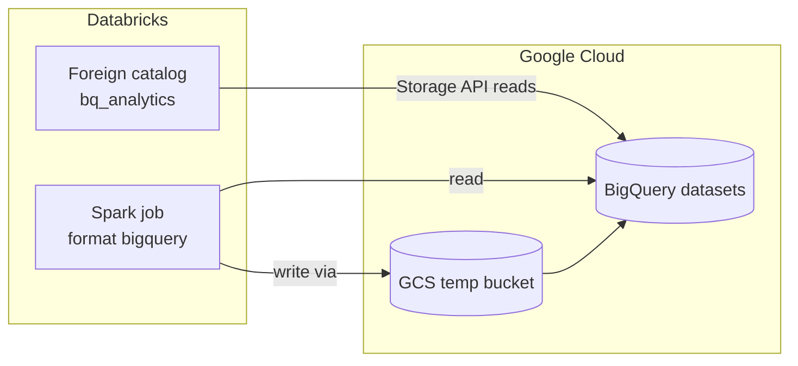

# BigQuery Integration

Mastery: `INPUT[inlineSelect(option(new), option(learning), option(solid)):mastery]`

> [!story] Context
> [[GCS Access via Unity Catalog]] covers files in Cloud Storage. Many Google Cloud companies also keep tables in [[Google BigQuery]], Google's serverless warehouse. Databricks connects to BigQuery in two ways: a Spark connector for reading and writing, and Lakehouse Federation for querying in place through Unity Catalog.

> [!eli5] Summary
> Many companies on Google Cloud keep data in BigQuery. Databricks can look at those tables directly without copying them, or copy data in and out when you need to. Both ways let a company use Databricks and BigQuery side by side.

## Background

Teams that run BigQuery and Databricks together usually need one of three things:

1. **Query BigQuery tables from Databricks** without moving them, for example to join them with Delta tables.
2. **Move data** between BigQuery and Databricks, in either direction, in a pipeline.
3. **Migrate** off BigQuery. See [[Migrating from Google BigQuery]].

## Overview

| | Lakehouse Federation | Spark BigQuery connector |
|---|---|---|
| Direction | Read-only | Read and write |
| Interface | SQL on a foreign catalog in Unity Catalog | `spark.read.format("bigquery")` and `df.write.format("bigquery")` |
| Governance | Unity Catalog grants, lineage, audit | Credentials on the cluster |
| Compute | Databricks Runtime 16.1+ (standard or dedicated access mode); pro or serverless SQL warehouses | Classic clusters with the bundled connector |
| Under the hood | BigQuery Storage API (not JDBC), with filter and projection pushdown | BigQuery Storage API; writes stage through a GCS bucket |
| Best for | Ad hoc queries and joins, phased migration | Pipelines that load data into or out of BigQuery |

BigQuery is listed as a query federation source on all three clouds, so Databricks on any cloud can query BigQuery, subject to network access.

Neither path fully supports incremental or continuous streaming from BigQuery. For ingestion, check [[Lakeflow Connect]], which documents a Google Analytics 4 source that uses BigQuery.

## How it works



### Procedure: federate BigQuery

1. Enable the BigQuery Storage API in the project and make sure compute can reach `bigquerystorage.googleapis.com`.
2. In Catalog Explorer, open **External data**, **Connections**, **Create connection**, choose **Google BigQuery**, and provide the service account credentials as described in the federation guide.
3. Create a foreign catalog on the connection that maps to a BigQuery project.
4. Grant access and query:

```sql
GRANT USE CATALOG, USE SCHEMA, SELECT ON CATALOG bq_analytics TO `analysts`;

SELECT o.order_id, o.amount, c.segment
FROM bq_analytics.sales.orders AS o
JOIN main.crm.customers AS c USING (customer_id)
WHERE o.order_date >= '2026-01-01';
```

### Procedure: read and write with the Spark connector

```python
# Read: project holds the table; parentProject is billed for the read
df = (spark.read.format("bigquery")
      .option("parentProject", "acme-billing-project")
      .option("project", "acme-analytics")
      .option("table", "acme-analytics.sales.orders")
      .load())

# Write: needs a GCS bucket for temporary data
(df.filter("amount > 0")
   .write.format("bigquery")
   .option("parentProject", "acme-billing-project")
   .option("temporaryGcsBucket", "acme-bq-staging")
   .mode("append")
   .save("acme-analytics.sales.orders_clean"))
```

On Google Cloud, attach a [[Google Service Accounts|Google service account]] with BigQuery and staging-bucket roles to the cluster. The GCP docs recommend service account email authentication over key files.

## Small-business considerations

> [!smallbiz] Small-business considerations
> - Start with federation. It needs no pipeline, and Unity Catalog permissions apply.
> - BigQuery charges for the queries and Storage API reads that federation and the connector perform, on the Google Cloud bill. Check BigQuery pricing before scheduling frequent large scans.
> - If most of your analytics will move to Databricks, plan a migration instead of federating forever.

## Cloud differences

> [!azure]- Azure Databricks
> - Azure Databricks lists Google BigQuery as a query federation source (see [[Lakehouse Federation]]). Authentication uses service account credentials, and cross-cloud egress charges may apply. The Azure-native analog of a neighboring warehouse is Microsoft Fabric. See [[Microsoft Fabric and OneLake vs Databricks]].

> [!aws]- Databricks on AWS
> - The AWS docs include BigQuery federation and the BigQuery connector. Authentication uses service account credentials, because AWS compute cannot run as a Google service account. Cross-cloud egress charges may apply.

> [!gcp]- Databricks on Google Cloud
> - This note. Clusters can authenticate with an attached Google service account. Serverless compute reaches BigQuery through Private Google Access.

## Advanced topics

> [!deepdive]- Advanced topics (301–401)
> - **Two projects:** The connector separates the project that holds the table (`project`) from the project billed for the work (`parentProject`).
> - **Pushdown:** Federation pushes filters and projections to BigQuery through the Storage API. Check the query profile to see what was pushed down.
> - **JDBC change in Databricks Runtime 20:** Workloads using a `jdbc:bigquery:` URL fail without an installed BigQuery JDBC driver. The bundled `format("bigquery")` connector is not affected.
> - **Legacy docs:** Older query federation pages for BigQuery are retired; use the current "Run federated queries on Google BigQuery" page.
> - **Serverless and VPC Service Controls:** If VPC Service Controls block serverless access to BigQuery through Private Google Access, the docs recommend classic compute.

## Common misconceptions

> [!confusion] Federation does not copy BigQuery data into Delta
> It reads at query time. Use the connector or a pipeline to materialize data in Delta tables.

> [!confusion] Federation is not writable
> Federated BigQuery catalogs are read-only. Use the Spark connector to write.

## Recall

Which two ways can Databricks work with BigQuery?::Lakehouse Federation (read-only, via Unity Catalog) and the Spark BigQuery connector (read and write).
Which API does BigQuery federation use instead of JDBC?::The BigQuery Storage API.
What minimum runtime does BigQuery federation need on clusters?::Databricks Runtime 16.1 with standard or dedicated access mode.
Which SQL warehouse types support BigQuery federation?::Pro and serverless.
What does a Spark connector write need besides BigQuery access?::A GCS bucket for temporary data.
What does `parentProject` set?::The Google Cloud project billed for the read or write.
Which workloads break in Databricks Runtime 20 without a driver?::Those using a `jdbc:bigquery:` URL.

## Next steps

> [!path] Learning path
> **Needs first:** [[Google BigQuery]], [[Lakehouse Federation]], [[Google Service Accounts]]
> **Unlocks next:** [[Migrating from Google BigQuery]]

> [!nextup] Next
> [[Google Cloud Marketplace and Billing]] covers how Databricks usage and Google Cloud resources are billed.

> [!sources]- Sources (last verified: 2026-10-25)
> - [Run federated queries on Google BigQuery (AWS)](https://docs.databricks.com/aws/en/query-federation/bigquery)
> - [Connect to external databases and catalogs (GCP)](https://docs.databricks.com/gcp/en/query-federation)
> - [Connect to external databases and catalogs (Azure Databricks)](https://learn.microsoft.com/en-us/azure/databricks/query-federation/)
> - [Google BigQuery connector (GCP)](https://docs.databricks.com/gcp/en/archive/connectors/bigquery)
> - [Google BigQuery connector (AWS)](https://docs.databricks.com/aws/en/archive/connectors/bigquery)
> - [Spark data sources (GCP)](https://docs.databricks.com/gcp/en/connect/spark-data-sources)
> - [Databricks Runtime 16.1 release notes (GCP)](https://docs.databricks.com/gcp/en/release-notes/runtime/16.1)
> - [Set up Google Analytics 4 and Google BigQuery for Databricks ingestion (AWS)](https://docs.databricks.com/aws/en/ingestion/lakeflow-connect/google-analytics-source-setup)
> - [Serverless compute plane networking (GCP)](https://docs.databricks.com/gcp/en/security/network/serverless-network-security)
