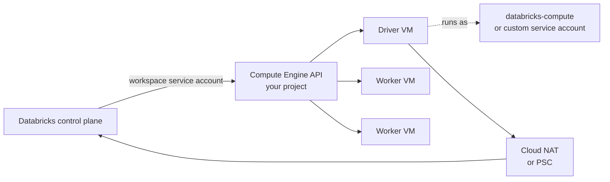

# Compute on Google Cloud

Mastery: `INPUT[inlineSelect(option(new), option(learning), option(solid)):mastery]`

> [!story] Context
> [[Account Setup on Google Cloud]] created a workspace in a Google Cloud project. When a classic cluster starts, Databricks creates virtual machines in that project. This note covers what those machines are, how their architecture changed since launch, and how to configure them.

> [!eli5] Summary
> A Databricks cluster on Google Cloud is a group of rented Google computers. Databricks starts them in your Google project when you need them and turns them off when you are done. You pick their size, and you can choose cheaper computers that Google may take back at short notice.

## Background

At launch in 2021, Databricks described Databricks on Google Cloud as built on **Google Kubernetes Engine (GKE)**, with each Databricks cluster running as containers (see [[Kubernetes]] and [[Container]]). Workspaces then included a GKE cluster in the customer project, and customer-managed VPCs needed secondary IP ranges for GKE pods and services.

Current Databricks documentation describes classic compute as **Compute Engine (GCE) VMs** created in each workspace's VPC in your project. The Terraform provider marks the GKE secondary range arguments of `gcp_managed_network_config` as deprecated and safe to remove. Databricks' knowledge base also documents operational differences after "migrating to GCE compute". The exact official cutover date was not found in the documentation; treat any date you hear as unconfirmed until you see it in Databricks release notes.

## Overview

| Topic | On Google Cloud |
|---|---|
| Node type | A Compute Engine machine type, for example `n2-standard-4` or `n2-highmem-4` |
| Where VMs run | Your workspace project, in the workspace VPC (Databricks-managed or customer-managed) |
| Identity of VMs | The `databricks-compute` service account by default, or a custom Google service account |
| Public IPs | None by default; clusters are created without public IPs |
| Purchase options | On-demand or preemptible, set with `gcp_attributes` |
| Local SSD | `local_ssd_count` per node (default 0); 375 GB each |
| Boot disk | `boot_disk_size` in GB |
| Serverless | Runs in Databricks' account, not your project |

### `gcp_attributes`

| Field | Values | Default |
|---|---|---|
| `availability` (`gcp_availability` in some APIs) | `ON_DEMAND_GCP`, `PREEMPTIBLE_GCP`, `PREEMPTIBLE_WITH_FALLBACK_GCP` | `ON_DEMAND_GCP` |
| `google_service_account` | Email of a registered service account | `databricks-compute` |
| `local_ssd_count` | Integer | 0 |
| `boot_disk_size` | GB (typically 100 to 1000) | Platform default |

`PREEMPTIBLE_WITH_FALLBACK_GCP` acquires preemptible VMs first and falls back to on-demand when preemptible capacity is unavailable. The field name differs between the cluster API (`availability`) and the instance pool API (`gcp_availability`); check the API you call.

## How it works



A job cluster with preemptible workers:

```json
{
  "spark_version": "<lts-runtime-version>",
  "node_type_id": "n2-standard-4",
  "autoscale": { "min_workers": 1, "max_workers": 8 },
  "gcp_attributes": {
    "availability": "PREEMPTIBLE_WITH_FALLBACK_GCP",
    "google_service_account": "etl-cluster@acme-databricks-prod.iam.gserviceaccount.com",
    "local_ssd_count": 1
  }
}
```

Inspect cluster VMs from the Google side:

```bash
gcloud compute instances list --project=acme-databricks-prod \
  --format="table(name,zone.basename(),machineType.basename(),status)"
```

## Small-business considerations

> [!smallbiz] Small-business considerations
> - Prefer serverless compute. It needs no VM, quota, or NAT planning in your project.
> - For classic jobs, start with a general-purpose `n2-standard` type, autoscaling, and auto-termination.
> - Use `PREEMPTIBLE_WITH_FALLBACK_GCP` for workers on jobs that can tolerate retries.
> - Check Compute Engine quotas (CPUs per region) in your project before scaling up. Quota errors are a common cause of failed cluster starts.

## Cloud differences

> [!azure]- Azure Databricks
> - Nodes are Azure VM sizes in the workspace's [[Managed Resource Group]]. Spot is set with `azure_attributes`.

> [!aws]- Databricks on AWS
> - Nodes are EC2 instance types, including Arm-based Graviton and fleet types. Spot is set with `aws_attributes`. See [[EC2 Instance Types and Graviton]].

> [!gcp]- Databricks on Google Cloud
> - This note. Compute Engine machine types and preemptible VMs, with `gcp_attributes`.

## Advanced topics

> [!deepdive]- Advanced topics (301–401)
> - **Cloud NAT ports.** Databricks' knowledge base reports that secret-fetch rates can drop after moving to GCE compute because Cloud NAT allocates ports differently for GCE VMs than it did for GKE nodes. The fix is to raise the NAT gateway's minimum ports per VM.
> - **Service account scope.** A custom service account must be registered and must be in the project required by the docs (the docs word this in two ways; check the current page). Users need **Can manage** on the cluster to attach it. See [[Google Service Accounts]].
> - **Policies.** Restrict machine types, availability, and service accounts with [[Compute Policies]] on `node_type_id` and `gcp_attributes.*`.
> - **Arm processors.** A 2026 Databricks blog post on the Google Cloud partnership mentions work on Google Axion (Arm) processor support. Check the compute documentation for current availability before planning around it.
> - **Workspaces without classic compute.** Serverless workspaces have no VMs in your project at all.

## Common misconceptions

> [!confusion] Preemptible is not the same as on-demand with a discount
> Preemptible VMs can be reclaimed by Google. Use fallback and keep critical jobs on-demand.

> [!confusion] You do not need to manage GKE
> Current classic compute uses Compute Engine VMs that Databricks manages. Older documents that mention GKE describe the earlier architecture.

## Recall

What runs classic clusters on Google Cloud today?::Compute Engine (GCE) VMs in your workspace project.
What did Databricks on Google Cloud use at its 2021 launch?::Google Kubernetes Engine (GKE).
Which three availability values exist in `gcp_attributes`?::`ON_DEMAND_GCP`, `PREEMPTIBLE_GCP`, and `PREEMPTIBLE_WITH_FALLBACK_GCP`.
What is the default availability?::`ON_DEMAND_GCP`.
Which service account do cluster VMs use by default?::`databricks-compute`.
How large is each local SSD?::375 GB.
Do classic clusters on Google Cloud get public IPs by default?::No.

## Next steps

> [!path] Learning path
> **Needs first:** [[Virtual Machine]], [[Compute Types]], [[Account Setup on Google Cloud]]
> **Unlocks next:** [[Customer-Managed VPC on Google Cloud]], [[Google Service Accounts]], [[Compute Policies]]

> [!nextup] Next
> [[Customer-Managed VPC on Google Cloud]] covers the network these VMs run in, and how to design it yourself.

> [!sources]- Sources (last verified: 2026-10-25)
> - [Compute configuration reference (GCP)](https://docs.databricks.com/gcp/en/compute/configure)
> - [High-level architecture (GCP)](https://docs.databricks.com/gcp/en/getting-started/high-level-architecture)
> - [Cluster API](https://docs.databricks.com/api/clusters/v2/cluster)
> - [Instance Pool API](https://docs.databricks.com/api/instance-pools/v2/instance-pool)
> - [Compute policy reference (GCP)](https://docs.databricks.com/gcp/en/admin/clusters/policy-definition)
> - [Configure a customer-managed VPC (GCP)](https://docs.databricks.com/gcp/en/security/network/classic/customer-managed-vpc)
> - [Enable Private Service Connect for your workspace (GCP)](https://docs.databricks.com/gcp/en/security/network/classic/private-service-connect)
> - [databricks_mws_networks (Terraform Registry)](https://registry.terraform.io/providers/databricks/databricks/1.112.0/docs/resources/mws_networks)
> - [Secret key rate drops after migrating to GCE compute cluster (Databricks Knowledge Base)](https://kb.databricks.com/en_US/cloud/secret-key-rate-drops-after-migrating-to-gce-compute-cluster)
> - [Announcing the launch of Databricks on Google Cloud (Databricks blog, 2021)](https://www.databricks.com/blog/2021/02/17/announcing-the-launch-of-databricks-on-google-cloud.html)
> - [Databricks on Google Cloud: Innovate faster. Smarter. Together. (Databricks blog)](https://www.databricks.com/blog/databricks-google-cloud-innovate-faster-smarter-together)
> - [Migrate from classic compute to serverless compute (GCP)](https://docs.databricks.com/gcp/en/compute/serverless/migration)
