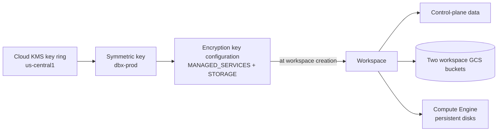

# Customer-Managed Keys on Google Cloud

Mastery: `INPUT[inlineSelect(option(new), option(learning), option(solid)):mastery]`

> [!story] Context
> [[Google Cloud Marketplace and Billing]] covered how a Google Cloud deployment is paid for. The last per-cloud topic is key control. Data is encrypted by default; customer-managed encryption keys (CMEK) let you supply Cloud KMS keys so you control, and can revoke, access to Databricks-held data.

> [!eli5] Summary
> Databricks already locks your data with keys. With customer-managed keys, the master key stays in your own Google key service. On Google Cloud you must decide this when you first create the workspace, because it cannot be added later.

## Background

The cross-cloud model is in [[Encryption]]. Google Cloud's key service is **Cloud KMS**, which organizes keys into **key rings** in a location. Databricks on Google Cloud supports CMEK on the **Enterprise** tier for two use cases:

| Use case | Protects |
|---|---|
| **Managed services** | Control-plane data: notebook source, secrets, Databricks SQL queries and query history. In serverless workspaces, also the workspace catalog and root storage (default storage) |
| **Workspace storage** | The two GCS buckets Databricks creates for the workspace (DBFS root and system data such as job results), and Compute Engine persistent disks of classic compute |

## Overview

Rules from the GCP docs:

- **Symmetric key in the workspace region.**
- **One key, two uses:** You can use the same Cloud KMS key for managed services and workspace storage.
- **Key configurations are account objects:** One configuration can be attached to one or more workspaces.
- **Creation time only (classic):** In a classic workspace, an encryption key configuration can be added only during workspace creation. In a serverless workspace, only the managed services key applies; you can add it at creation (through the API or Terraform only) or afterward from the account console with **Update workspace**.
- **Permissions:** The person registering the key needs `cloudkms.cryptoKeys.getIamPolicy` and `cloudkms.cryptoKeys.setIamPolicy` on it, so Databricks can grant its service agents access.
- **Status:** Customer-managed keys for managed services and workspace storage on Google Cloud are in **Public Preview** (as of October 2026).

## How it works



### Procedure

1. **Create the key ring and key** in the workspace region:

```bash
gcloud kms keyrings create dbx-keys --location=us-central1 --project=acme-security
gcloud kms keys create dbx-prod --keyring=dbx-keys --location=us-central1 \
  --purpose=encryption --project=acme-security
```

2. **Register the key configuration** (account console **Security**, **Encryption keys**, or the CLI):

```bash
databricks account encryption-keys create --json '{
  "gcp_key_info": {
    "kms_key_id": "projects/acme-security/locations/us-central1/keyRings/dbx-keys/cryptoKeys/dbx-prod"
  },
  "use_cases": ["MANAGED_SERVICES", "STORAGE"]
}'
```

3. **Create the workspace** with the configuration ID for managed services and storage (console **Advanced** options, the Account API, or Terraform `databricks_mws_workspaces`).
4. **Verify** that the workspace reaches a running state, clusters start, and notebooks open.

### Least-privilege variant

When you cannot let Databricks change the key's IAM policy, register the key with `manual: true` and grant the **Cloud KMS CryptoKey Encrypter/Decrypter** role yourself:

```bash
# Workspace storage: the Compute Engine and Cloud Storage service agents of the workspace project
gcloud kms keys add-iam-policy-binding dbx-prod --keyring=dbx-keys --location=us-central1 \
  --project=acme-security \
  --member="serviceAccount:<compute-engine-service-agent>" \
  --role=roles/cloudkms.cryptoKeyEncrypterDecrypter

# Managed services: the workspace service account, after the workspace is created
gcloud kms keys add-iam-policy-binding dbx-prod --keyring=dbx-keys --location=us-central1 \
  --project=acme-security \
  --member="serviceAccount:<workspace-service-account-email>" \
  --role=roles/cloudkms.cryptoKeyEncrypterDecrypter
```

## Small-business considerations

> [!smallbiz] Small-business considerations
> - Default encryption is enough for most small companies. CMEK needs the Enterprise tier.
> - On Google Cloud, the decision must be made **before** you create a classic workspace. If a customer contract might require key control later, decide now or plan to create a new workspace.
> - Losing or disabling the key makes workspace data unreadable. Restrict who can disable or destroy key versions.
> - Cloud KMS charges per key version and per operation on the Google Cloud bill.

## Cloud differences

> [!azure]- Azure Databricks
> - Managed services, managed disks, and DBFS root, with Azure Key Vault or Managed HSM keys, on the Premium plan. Managed services CMK cannot be disabled once enabled. See [[Customer-Managed Keys on Azure]].

> [!aws]- Databricks on AWS
> - Managed services and workspace storage (S3 bucket plus optional EBS), with AWS KMS keys on the Enterprise tier. Keys can be added to existing workspaces through the API. See [[Customer-Managed Keys on AWS]].

> [!gcp]- Databricks on Google Cloud
> - This note. Cloud KMS keys, Enterprise tier, set at workspace creation for classic workspaces.

## Advanced topics

> [!deepdive]- Advanced topics (301–401)
> - **No re-encryption of history:** As on other clouds, a managed services key protects future writes; existing data is not re-encrypted.
> - **Revocation:** Disabling the key or removing Databricks' access makes the workspace's protected data inaccessible, starting with control-plane data.
> - **SQL data:** Queries, query history, and query results are managed services data. A dedicated GCP page covers their encryption.
> - **Unity Catalog:** A separate GCP page covers customer-managed keys for Unity Catalog, configured per catalog so each catalog can use its own key. It also requires the Enterprise tier.
> - **Your own buckets:** Business-data buckets registered in Unity Catalog are encrypted by their own Cloud Storage settings, not by Databricks key configurations. See [[GCS Access via Unity Catalog]].
> - **Key location:** The key must be in the same region as the workspace. Choose the key ring location to match.

## Common misconceptions

> [!confusion] You cannot add CMEK to an existing classic workspace on Google Cloud
> Key configurations are attached at creation. Plan them before you create the workspace.

> [!confusion] Databricks CMEK does not encrypt your data lake
> It covers control-plane data, the two workspace buckets, and compute disks. Encrypt your own buckets in Cloud Storage.

## Recall

Which CMK use cases does Databricks support on Google Cloud?::Managed services and workspace storage.
What does workspace storage CMEK cover on Google Cloud?::The two workspace GCS buckets and Compute Engine persistent disks of classic compute.
When can you add a key configuration to a classic GCP workspace?::Only during workspace creation.
Can one Cloud KMS key serve both use cases?::Yes.
Which permissions do you need on the key to register it?::`cloudkms.cryptoKeys.getIamPolicy` and `cloudkms.cryptoKeys.setIamPolicy`.
Which role do you grant manually in a least-privilege setup?::Cloud KMS CryptoKey Encrypter/Decrypter.
Which tier is required?::Enterprise.

## Next steps

> [!path] Learning path
> **Needs first:** [[Encryption]], [[Encryption at Rest]], [[Account Setup on Google Cloud]]
> **Unlocks next:** [[Chapter 14 - Admin Security and Cost]], [[Compliance Security Profile]]

> [!nextup] Next
> [[Chapter 14 - Admin Security and Cost]] covers the administration tasks that apply on every cloud: identity, network security, encryption, compliance, and cost.

> [!sources]- Sources (last verified: 2026-10-25)
> - [Configure customer-managed keys for encryption (GCP)](https://docs.databricks.com/gcp/en/security/keys/configure-customer-managed-keys)
> - [Customer-managed keys for encryption (GCP)](https://docs.databricks.com/gcp/en/security/keys/customer-managed-keys)
> - [Data security and encryption (GCP)](https://docs.databricks.com/gcp/en/security/keys)
> - [Customer-managed keys for Unity Catalog (GCP)](https://docs.databricks.com/gcp/en/security/keys/cmek-unity-catalog)
> - [Encrypt queries, query history, and query results (GCP)](https://docs.databricks.com/gcp/en/security/keys/sql-encryption)
> - [account encryption-keys command group (GCP CLI)](https://docs.databricks.com/gcp/en/dev-tools/cli/reference/account-encryption-keys-commands)
> - [Create a least-privilege workspace (GCP)](https://docs.databricks.com/gcp/en/admin/workspace/create-least-privilege-workspace)
> - [Best practices for serverless workspaces (GCP)](https://docs.databricks.com/gcp/en/admin/workspace/serverless-workspaces-best-practices)
> - [Phase 5: Design storage architecture (GCP)](https://docs.databricks.com/gcp/en/lakehouse-architecture/deployment-guide/storage)
> - [Key configurations API](https://docs.databricks.com/api/account/encryptionkeys)
