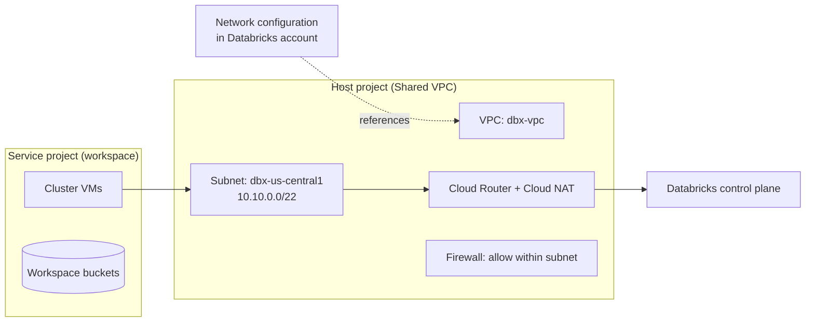

# Customer-Managed VPC on Google Cloud

Mastery: `INPUT[inlineSelect(option(new), option(learning), option(solid)):mastery]`

> [!story] Context
> [[Compute on Google Cloud]] showed that classic clusters are Compute Engine VMs in a VPC in your project. By default Databricks creates that VPC. A customer-managed VPC lets your network team choose the address ranges, use a Shared VPC, and control egress, and it is a prerequisite for [[Private Service Connect]].

> [!eli5] Summary
> Your Databricks computers on Google Cloud need a private network to live in. Instead of letting Databricks build it, your own team builds it and tells Databricks to use it. That way the company's network rules apply to Databricks too.

## Background

A Databricks-managed VPC is quick to start with, but you cannot pick its ranges, attach it to a company Shared VPC, or route traffic through your own egress controls. Databricks now recommends a customer-managed VPC for new classic workspaces on Google Cloud, and plans to deprecate classic workspace creation with a Databricks-managed VPC (timeline to be announced separately).

## Overview

### Requirements

| Item | Requirement |
|---|---|
| **Subnet** | One subnet for the workspace, in the **same region** as the workspace |
| **IP capacity** | Two IP addresses per node. The Account API does not size the range for you |
| **Subnet size** | Docs differ: the configuration page lists a valid range of `/29` to `/9`, the sizing page's table runs from `/25` to `/19`, and the deployment guide says at least `/26`. Check the current pages |
| **Firewall** | An ingress rule that allows traffic within the workspace subnet, with the subnet's primary CIDR as the source |
| **Egress** | Without PSC, the subnet needs outbound internet access, typically through Cloud NAT |
| **Shared VPC** | Supported. The host project holds the VPC and subnet; the service project holds workspace compute and storage |
| **Permissions** | Databricks recommends `roles/owner` on the workspace and VPC projects for the creator |
| **Immutability** | You cannot change which customer-managed VPC a workspace uses after creation |
| **Legacy** | Older configurations named secondary ranges for GKE pods and services. These are deprecated |

## How it works



### Procedure: create and register the network

1. Create the VPC, subnet, and firewall rule (in the host project for Shared VPC):

```bash
gcloud compute networks create dbx-vpc --project=acme-net-host --subnet-mode=custom

gcloud compute networks subnets create dbx-us-central1 --project=acme-net-host \
  --network=dbx-vpc --region=us-central1 --range=10.10.0.0/22 \
  --enable-private-ip-google-access

gcloud compute firewall-rules create dbx-allow-internal --project=acme-net-host \
  --network=dbx-vpc --direction=INGRESS --action=ALLOW --rules=all \
  --source-ranges=10.10.0.0/22
```

2. Add egress through Cloud NAT (skip if you use PSC with your own egress design):

```bash
gcloud compute routers create dbx-router --project=acme-net-host \
  --network=dbx-vpc --region=us-central1
gcloud compute routers nats create dbx-nat --project=acme-net-host \
  --router=dbx-router --region=us-central1 \
  --auto-allocate-nat-external-ips --nat-all-subnet-ip-ranges
```

3. Register the network configuration in the Databricks account (account console **Cloud resources**, or the CLI):

```bash
databricks account networks create --json '{
  "network_name": "prod-network",
  "gcp_network_info": {
    "network_project_id": "acme-net-host",
    "vpc_id": "dbx-vpc",
    "subnet_id": "dbx-us-central1",
    "subnet_region": "us-central1"
  }
}'
```

4. Create the workspace with the returned `network_id`. In Terraform, use `databricks_mws_networks` with a `gcp_network_info` block, then reference it from `databricks_mws_workspaces`.

`--enable-private-ip-google-access` lets VMs without public IPs reach Google APIs such as Cloud Storage.

## Small-business considerations

> [!smallbiz] Small-business considerations
> - If you only use serverless, you do not need a VPC.
> - For a classic workspace, a standalone customer-managed VPC with one subnet and Cloud NAT is a manageable setup, and it avoids the planned deprecation of Databricks-managed VPCs.
> - Size the subnet for growth. A workspace cannot move to a different VPC later.
> - Cloud NAT and egress traffic are billed by Google Cloud.

## Cloud differences

> [!azure]- Azure Databricks
> - [[VNet Injection]] uses two delegated subnets (host and container) in your VNet.

> [!aws]- Databricks on AWS
> - [[Customer-Managed VPC on AWS]] needs at least two subnets in different availability zones and one to five security groups.

> [!gcp]- Databricks on Google Cloud
> - This note. One subnet per workspace, Shared VPC support, and a firewall rule instead of security groups.

## Advanced topics

> [!deepdive]- Advanced topics (301–401)
> - **Sharing a VPC across workspaces.** Several workspaces can use subnets in one VPC. Plan IP space for peak concurrent nodes across all of them.
> - **Egress lockdown.** To restrict egress, deny `0.0.0.0/0` at the firewall and allow only the Databricks control plane, metastore, and package endpoints listed in the IP and domain reference, or use PSC plus a private mirror for packages.
> - **VPC Service Controls.** Optional perimeters can cover the compute and storage projects. If they block serverless access through Private Google Access, the docs suggest classic compute.
> - **Updating networks.** A separate page covers updating a workspace's network configuration (for example, adding PSC); it does not allow moving to a different VPC.
> - **Least-privilege creation.** With a creator service account and custom roles, you pre-create the network and grants yourself.

## Common misconceptions

> [!confusion] A customer-managed VPC is not Private Service Connect
> The VPC decides where compute runs. PSC is an add-on for private connectivity to the control plane, and it requires a customer-managed VPC.

> [!confusion] You no longer need GKE secondary ranges
> Pod and service secondary ranges were part of the earlier GKE-based design and are deprecated in current configurations.

## Recall

How many subnets does a GCP workspace need in a customer-managed VPC?::One, in the same region as the workspace.
How many IPs does each node use?::Two.
Which project holds the VPC in a Shared VPC setup?::The host project. The service project holds the workspace resources.
What firewall rule is required?::Ingress allowing traffic within the workspace subnet, with the subnet's primary CIDR as source.
Without PSC, how does the subnet reach the control plane?::Outbound internet access, typically through Cloud NAT.
Can a workspace change to a different customer-managed VPC later?::No.
Which Terraform resource registers the network?::`databricks_mws_networks` with `gcp_network_info`.

## Next steps

> [!path] Learning path
> **Needs first:** [[VPC and VNet]], [[Subnet]], [[Compute on Google Cloud]]
> **Unlocks next:** [[Private Service Connect]], [[Network Security Overview]]

> [!nextup] Next
> [[Private Service Connect]] adds private endpoints between this VPC (and your users' networks) and the Databricks control plane.

> [!sources]- Sources (last verified: 2026-10-25)
> - [Configure a customer-managed VPC (GCP)](https://docs.databricks.com/gcp/en/security/network/classic/customer-managed-vpc)
> - [Subnet sizing for a new workspace (GCP)](https://docs.databricks.com/gcp/en/admin/cloud-configurations/gcp/network-sizing)
> - [Phase 4: Design network architecture (GCP)](https://docs.databricks.com/gcp/en/lakehouse-architecture/deployment-guide/network)
> - [Limit network egress for your workspace using a firewall (GCP)](https://docs.databricks.com/gcp/en/security/network/classic/firewall)
> - [Enable Private Service Connect for your workspace (GCP)](https://docs.databricks.com/gcp/en/security/network/classic/private-service-connect)
> - [Update workspace network configuration (GCP)](https://docs.databricks.com/gcp/en/security/network/classic/update-workspaces)
> - [Required permissions for workspace creation (GCP)](https://docs.databricks.com/gcp/en/admin/cloud-configurations/gcp/permissions)
> - [Create a classic workspace (GCP)](https://docs.databricks.com/gcp/en/admin/workspace/create-workspace)
> - [What's coming? (GCP)](https://docs.databricks.com/gcp/en/release-notes/whats-coming)
> - [IP addresses and domains for Databricks services and assets (GCP)](https://docs.databricks.com/gcp/en/resources/ip-domain-region)
> - [Network API](https://docs.databricks.com/api/networking/v1/network)
> - [databricks_mws_networks (Terraform Registry)](https://registry.terraform.io/providers/databricks/databricks/1.112.0/docs/resources/mws_networks)
> - [Serverless compute plane networking (GCP)](https://docs.databricks.com/gcp/en/security/network/serverless-network-security)
