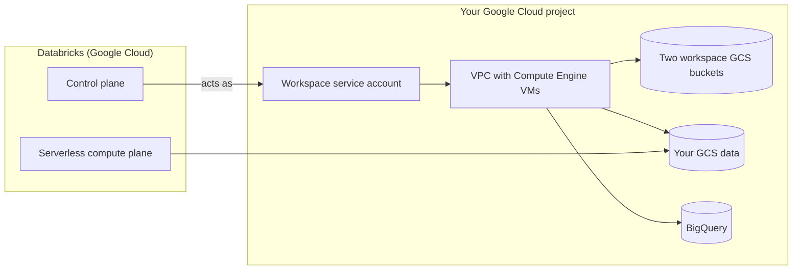

# Databricks on Google Cloud Overview

Mastery: `INPUT[inlineSelect(option(new), option(learning), option(solid)):mastery]`

> [!story] Context
> [[Chapter 13 - Databricks on Google Cloud]] covers the third cloud. On AWS ([[Chapter 12 - Databricks on AWS|chapter 12]]), Databricks reaches your account through [[IAM]] roles. On Google Cloud, it reaches your project through [[Google Service Accounts|Google service accounts]], and you buy it through Google Cloud Marketplace.

> [!eli5] Summary
> Databricks on Google Cloud is the Databricks platform running on Google's cloud. You sign up through Google's app store for business software, and the cost appears on your Google Cloud bill. Your data stays in your own Google storage.

## Background

Databricks launched on Google Cloud in February 2021, the newest of its three clouds (see [[The Founding of Databricks]]). The launch was built with Google, and at launch Databricks described it as built on Google [[Kubernetes]] Engine (GKE). Current documentation describes classic compute as Compute Engine VMs (Google Cloud [[Virtual Machine|virtual machines]]); see [[Compute on Google Cloud]].

Three things make Google Cloud different:

- **Purchase and billing** go through **Google Cloud Marketplace** to a Google Cloud billing account.
- **Cloud identity** for Databricks in your project is a set of **Google service accounts**, not IAM roles or [[Managed Identity|managed identities]].
- **Google services** such as [[Google BigQuery|BigQuery]] are first-class integration targets.

## Overview

Databricks on Google Cloud is the Databricks platform deployed on Google Cloud, purchased through Google Cloud Marketplace and connected to your project through Google service accounts.

| Area | On Google Cloud | Note |
|---|---|---|
| Sign-up | Google Cloud Marketplace subscription, linked to a billing account | [[Account Setup on Google Cloud]] |
| Account console | `https://accounts.gcp.databricks.com` | [[Account Console]] |
| Workspace types | **Serverless** (Databricks-managed default storage) or **classic** (compute in your project) | [[Accounts and Workspaces]] |
| Classic compute | Compute Engine VMs in your project | [[Compute on Google Cloud]] |
| Cloud identity | Workspace service account, `databricks-compute` service account, optional custom service accounts | [[Google Service Accounts]] |
| Workspace system data | Two [[Google Cloud Storage\|Cloud Storage (GCS)]] buckets in your project (classic), plus a third for the workspace catalog if Unity Catalog was enabled automatically | [[Workspace Storage Bucket]] covers the AWS equivalent |
| Network | Databricks-managed [[VPC and VNet\|VPC]] or [[Customer-Managed VPC on Google Cloud]] (recommended for new workspaces) | |
| Private connectivity | [[Private Service Connect]] | |
| Data access | Unity Catalog storage credentials backed by Databricks-generated service accounts | [[GCS Access via Unity Catalog]] |
| BigQuery | Spark connector and Lakehouse Federation | [[BigQuery Integration]] |
| Keys | Cloud KMS (Key Management Service), added at workspace creation | [[Customer-Managed Keys on Google Cloud]] |
| Billing | Google Cloud bill | [[Google Cloud Marketplace and Billing]] |

## How it works



1. The **control plane** runs in Databricks' Google Cloud environment.
2. **Serverless compute** runs in Databricks' account in the same region as your workspace. It reaches Cloud Storage and BigQuery through Private Google Access (private routing to Google services), not Private Service Connect.
3. **Classic compute** runs as Compute Engine VMs inside a VPC in your project. Databricks manages it through a workspace service account created in your project.
4. **Unity Catalog** governs data in your buckets through storage credentials.

Check which projects and workspaces exist from the CLI:

```bash
gcloud config set project acme-databricks-prod
gcloud storage buckets list --filter="name~databricks"
databricks account workspaces list
```

## Small-business considerations

> [!smallbiz] Small-business considerations
> - If your company already runs on Google Cloud and BigQuery, Databricks on Google Cloud keeps billing and data in one place.
> - Start with a **serverless workspace**. Trial credits cover Databricks usage only, and a classic workspace creates billable Google Cloud resources in your project from day one.
> - Sign up with a business email; trial limits apply to personal email accounts.
> - See the [Databricks Google Cloud pricing page](https://www.databricks.com/product/gcp-pricing) for DBU rates.

## Cloud differences

> [!azure]- Azure Databricks
> - A first-party Microsoft service created in the Azure portal and billed by Microsoft. See [[Azure Databricks Overview]].

> [!aws]- Databricks on AWS
> - Sold directly or through AWS Marketplace. The control plane reaches your account through a cross-account IAM role. See [[Databricks on AWS Overview]].

> [!gcp]- Databricks on Google Cloud
> - This note. Marketplace subscription, Google service accounts, Compute Engine VMs, and BigQuery integration.

## Advanced topics

> [!deepdive]- Advanced topics (301–401)
> - **Managed VPC deprecation.** Databricks plans to deprecate classic workspace creation with a Databricks-managed VPC on Google Cloud and recommends a customer-managed VPC for new workspaces. A migration timeline will be communicated separately.
> - **Standard tier end of life.** The legacy-features migration page lists the end of life of Standard tier workspaces on Google Cloud as a required migration.
> - **Serverless limits.** Some workloads, such as those depending on R or Scala notebooks, still require classic compute.
> - **Regional availability.** Serverless workspaces and default storage are not available in every region where serverless compute runs (for example, `us-west4` has serverless compute but not serverless workspaces). Check the regional table.
> - **Cross-cloud reads.** Databricks on Google Cloud can define read-only external locations on AWS S3.

## Common misconceptions

> [!confusion] Google Cloud Marketplace is not Databricks Marketplace
> Google Cloud Marketplace is where you subscribe to Databricks. [[Databricks Marketplace]] is a data and AI product exchange inside Databricks.

> [!confusion] Classic compute on Google Cloud is not a GKE cluster you manage
> Databricks manages the Compute Engine VMs for classic compute. You do not operate a Kubernetes cluster.

## Recall

How do you buy Databricks on Google Cloud?::Through a Google Cloud Marketplace subscription linked to a billing account.
What is the Google Cloud account console URL?::`https://accounts.gcp.databricks.com`.
What runs classic compute on Google Cloud?::Compute Engine VMs in your project.
How does Databricks act in your project?::Through Google service accounts, including a workspace service account.
How does serverless compute reach Cloud Storage and BigQuery?::Through Private Google Access.
When did Databricks launch on Google Cloud?::February 2021.
Which VPC type does Databricks recommend for new GCP classic workspaces?::A customer-managed VPC.

## Next steps

> [!path] Learning path
> **Needs first:** [[Control Plane and Compute Plane]], [[Accounts and Workspaces]]
> **Unlocks next:** [[Account Setup on Google Cloud]], [[Compute on Google Cloud]], [[Google Service Accounts]]

> [!nextup] Next
> [[Account Setup on Google Cloud]] walks through the Marketplace subscription and the first workspace.

> [!sources]- Sources (last verified: 2026-10-25)
> - [Databricks architecture overview: workspace storage (GCP)](https://docs.databricks.com/gcp/en/getting-started/overview)
> - [High-level architecture (GCP)](https://docs.databricks.com/gcp/en/getting-started/high-level-architecture)
> - [Create a classic workspace (GCP)](https://docs.databricks.com/gcp/en/admin/workspace/create-workspace)
> - [Create a serverless workspace (GCP)](https://docs.databricks.com/gcp/en/admin/workspace/serverless-workspaces)
> - [Features with limited regional availability (GCP)](https://docs.databricks.com/gcp/en/resources/feature-region-support)
> - [What's coming? (GCP)](https://docs.databricks.com/gcp/en/release-notes/whats-coming)
> - [Migrate from legacy features (GCP)](https://docs.databricks.com/gcp/en/release-notes/migrations)
> - [Migrate from classic compute to serverless compute (GCP)](https://docs.databricks.com/gcp/en/compute/serverless/migration)
> - [Start a Databricks free trial on Google Cloud](https://docs.databricks.com/gcp/en/admin/account-settings-gcp/create-subscription)
> - [Serverless compute plane networking (GCP)](https://docs.databricks.com/gcp/en/security/network/serverless-network-security)
> - [Announcing the launch of Databricks on Google Cloud (Databricks blog, 2021)](https://www.databricks.com/blog/2021/02/17/announcing-the-launch-of-databricks-on-google-cloud.html)
> - [Databricks on Google Cloud pricing](https://www.databricks.com/product/gcp-pricing)
> - [Connect to an AWS S3 external location, read-only (GCP)](https://docs.databricks.com/gcp/en/connect/unity-catalog/cloud-storage/s3/s3-external-location-manual)
