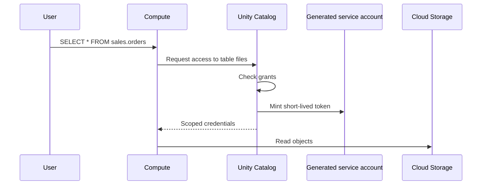

# GCS Access via Unity Catalog

Mastery: `INPUT[inlineSelect(option(new), option(learning), option(solid)):mastery]`

> [!story] Context
> [[Google Service Accounts]] showed that a custom service account on a cluster gives every user of that cluster the same Cloud Storage access. Unity Catalog replaces that with a storage credential: a service account that only Unity Catalog uses, plus per-user grants on paths and tables.

> [!eli5] Summary
> Databricks creates its own login for reading your Google storage. You give that login access to your bucket. After that, Databricks decides which people may use which folders and tables, and hands out short-lived access only to people who are allowed.

## Background

Google Cloud Storage (GCS) grants access to Google identities, not to Databricks users. [[Unity Catalog]] bridges the two. On Google Cloud, you do not create the identity yourself: when you create a storage credential, **Databricks generates a Google service account** in its control plane. You grant that account roles on your bucket, and Unity Catalog uses it on behalf of authorized users.

## Overview

| Step | Where | Who | Privilege |
|---|---|---|---|
| Create storage credential (type **GCP Service Account**) | Databricks | Metastore or account admin | `CREATE STORAGE CREDENTIAL` on the metastore |
| Grant bucket roles to the generated service account | Google Cloud | Bucket admin | Storage IAM admin |
| Create external location (`gs://` path + credential) | Databricks | Admin | `CREATE EXTERNAL LOCATION` on the metastore and the credential |
| Grant access to groups | Databricks | Owner | `GRANT` |

**Roles on the bucket.** The docs list **Storage Legacy Bucket Reader** and **Storage Object Admin** for read and write. For one-direction access, the docs show narrower examples such as **Storage Object Viewer** (read) and **Storage Object Creator** (write).

**Region.** Keep the bucket in the same region as the workspace to avoid egress charges.

## How it works



### Procedure

1. **Create the storage credential.** In Catalog Explorer: **Catalog**, **External data**, **Credentials**, **Create credential**, type **GCP Service Account**, name `sales_bucket_cred`. Or:

```bash
databricks storage-credentials create --json '{
  "name": "sales_bucket_cred",
  "databricks_gcp_service_account": {}
}'
```

2. **Copy the service account email** shown on the credential.
3. **Grant roles on the bucket:**

```bash
SA="<generated-service-account-email>"
gcloud storage buckets add-iam-policy-binding gs://acme-sales \
  --member="serviceAccount:${SA}" --role=roles/storage.legacyBucketReader
gcloud storage buckets add-iam-policy-binding gs://acme-sales \
  --member="serviceAccount:${SA}" --role=roles/storage.objectAdmin
```

4. **Create the external location and grant access:**

```sql
CREATE EXTERNAL LOCATION IF NOT EXISTS sales_raw
  URL 'gs://acme-sales/raw'
  WITH (STORAGE CREDENTIAL sales_bucket_cred)
  COMMENT 'Landing zone for sales files';

GRANT READ FILES, CREATE EXTERNAL TABLE ON EXTERNAL LOCATION sales_raw TO `data_engineers`;

LIST 'gs://acme-sales/raw';
```

## Small-business considerations

> [!smallbiz] Small-business considerations
> - One bucket for business data and one storage credential is enough to start.
> - Grant external location privileges to engineers. Analysts should query tables, not raw paths.
> - Keep the bucket in the workspace's region.
> - Retire custom cluster service accounts once Unity Catalog covers the same buckets.

## Cloud differences

> [!azure]- Azure Databricks
> - You create an Access Connector with a managed identity and grant it *Storage Blob Data Contributor*. Paths use `abfss://`. See [[ADLS and Access Connectors]].

> [!aws]- Databricks on AWS
> - You create a self-assuming IAM role and paste its ARN; Databricks gives you an external ID for the trust policy. Paths use `s3://`. See [[S3 Access via Unity Catalog]].

> [!gcp]- Databricks on Google Cloud
> - This note. Databricks generates the service account; you only grant it bucket roles. Paths use `gs://`. Read-only external locations on AWS S3 are also supported from Google Cloud.

## Advanced topics

> [!deepdive]- Advanced topics (301–401)
> - **Read-only credentials.** Marking a storage credential read-only makes every external location that uses it read-only.
> - **File events.** For managed file events and [[Auto Loader]] notifications, the service account needs additional access, and the Cloud Storage service agent needs the Pub/Sub Publisher role. The docs route you back to the credential setup steps if it is missing.
> - **Managed storage per catalog.** Assign an external location as a catalog's or schema's managed storage to keep each business unit's managed tables in its own bucket.
> - **Your bucket's encryption is yours.** Databricks CMK settings cover the workspace buckets, not buckets you register in Unity Catalog. Configure encryption for business-data buckets in Cloud Storage. See [[Customer-Managed Keys on Google Cloud]].
> - **Workspace buckets are separate.** The two workspace buckets Databricks creates are for system data, not for Unity Catalog business data.

## Common misconceptions

> [!confusion] You do not create the storage credential's service account
> Databricks generates it. You grant it roles on your buckets.

> [!confusion] A storage credential is not a table permission
> It lets Unity Catalog reach the bucket. Users still need grants on the external location, table, or volume.

## Recall

What does Databricks create when you make a GCS storage credential?::A Google service account in the control plane.
Which bucket roles do the docs list for the generated service account?::Storage Legacy Bucket Reader and Storage Object Admin.
Which privilege creates a storage credential?::`CREATE STORAGE CREDENTIAL` on the metastore.
What URL scheme does a GCS external location use?::`gs://`.
Why keep the bucket in the workspace region?::To avoid egress charges.
What does a read-only storage credential do?::Makes every external location using it read-only.
Can Databricks on Google Cloud read from S3 through Unity Catalog?::Yes, through read-only external locations with an IAM role credential.

## Next steps

> [!path] Learning path
> **Needs first:** [[Storage Credentials and External Locations]], [[Google Service Accounts]], [[Google Cloud Storage]]
> **Unlocks next:** [[BigQuery Integration]], [[Managed vs External Tables]], [[Volumes]]

> [!nextup] Next
> [[BigQuery Integration]] covers the other main Google data source: reading, writing, and federating BigQuery.

> [!sources]- Sources (last verified: 2026-10-25)
> - [Connect to a Google Cloud Storage (GCS) external location (GCP)](https://docs.databricks.com/gcp/en/connect/unity-catalog/cloud-storage/external-locations-gcs)
> - [Connect to cloud object storage using Unity Catalog (GCP)](https://docs.databricks.com/gcp/en/connect/unity-catalog/cloud-storage/)
> - [Manage storage credentials (GCP)](https://docs.databricks.com/gcp/en/connect/unity-catalog/cloud-storage/manage-storage-credentials)
> - [Manage external locations (GCP)](https://docs.databricks.com/gcp/en/connect/unity-catalog/cloud-storage/manage-external-locations)
> - [Credentials SQL reference (GCP)](https://docs.databricks.com/gcp/en/sql/language-manual/sql-ref-storage-credentials)
> - [Unity Catalog privileges reference (GCP)](https://docs.databricks.com/gcp/en/data-governance/unity-catalog/manage-privileges/privileges)
> - [Phase 5: Design storage architecture (GCP)](https://docs.databricks.com/gcp/en/lakehouse-architecture/deployment-guide/storage)
> - [Connect to an AWS S3 external location, read-only (GCP)](https://docs.databricks.com/gcp/en/connect/unity-catalog/cloud-storage/s3/s3-external-location-manual)
> - [High-level architecture (GCP)](https://docs.databricks.com/gcp/en/getting-started/high-level-architecture)
