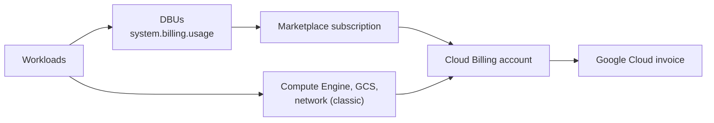

# Google Cloud Marketplace and Billing

Mastery: `INPUT[inlineSelect(option(new), option(learning), option(solid)):mastery]`

> [!story] Context
> [[BigQuery Integration]] finished the data topics for Google Cloud. All of those workloads are paid for through the Google Cloud Marketplace subscription created in [[Account Setup on Google Cloud]], plus the Google Cloud resources that classic compute uses.

> [!eli5] Summary
> On Google Cloud, Databricks shows up on your normal Google Cloud bill. One line is for Databricks itself. Other lines are for the Google computers and storage your workspace uses. You see and pay both in the Google Cloud console.

## Background

Databricks on Google Cloud is sold through **Google Cloud Marketplace**. The subscription links your Databricks account to one **Cloud Billing account**; you can have only one Databricks account per billing account. Databricks meters usage in [[DBUs]], and the number of DBUs a workload consumes depends on the compute type (for example all-purpose or jobs) and the Compute Engine machine type.

## Overview

| Cost | Who bills it | Where you see it |
|---|---|---|
| Databricks usage (DBUs) | Google Cloud, through the Marketplace subscription | Google Cloud billing reports (Databricks line); `system.billing.usage` |
| Compute Engine VMs and disks (classic) | Google Cloud | Google Cloud billing reports |
| Cloud Storage (workspace buckets, your data) | Google Cloud | Google Cloud billing reports |
| Networking (Cloud NAT, PSC, egress) | Google Cloud | Google Cloud billing reports |
| Serverless compute and default storage | Through the Databricks charge | Google Cloud billing reports (Databricks line); `system.billing.usage` |

Points from the docs:

- **After the trial,** Databricks usage is billed pay-as-you-go to the billing account chosen at subscription. Billing is managed in the Google Cloud console.
- **Marketplace listing prices exclude Google Cloud resources** such as compute instances.
- **Cloud credits and discounts** do not apply to serverless compute and default storage, because those are not deployed in your cloud account.
- **Contracts and private offers** go through your Databricks account team.

For DBU rates, see the [Databricks Google Cloud pricing page](https://www.databricks.com/product/gcp-pricing). For Compute Engine rates, see Google Cloud pricing.

## How it works



### Find your order

1. In the Databricks account console, open **Settings**, **Subscription & billing**. Note the Google order number under **Billing**.
2. In Google Cloud Marketplace, open the Databricks listing and click **Manage orders**. The orders for the billing account used by the subscription are listed there.

### Query Databricks usage

```sql
SELECT usage_date,
       billing_origin_product,
       SUM(usage_quantity) AS dbus
FROM system.billing.usage
WHERE usage_date >= current_date() - INTERVAL 30 DAYS
GROUP BY ALL
ORDER BY usage_date, dbus DESC;
```

### See Google Cloud resource costs

Export Cloud Billing data to BigQuery, then filter by the labels on Databricks VMs (Databricks applies default tags such as `ClusterId` and `Creator`, plus your custom tags). You can also check active subscriptions from the CLI:

```bash
gcloud billing accounts list
gcloud billing projects describe acme-databricks-prod
```

## Small-business considerations

> [!smallbiz] Small-business considerations
> - Everything lands on one Google Cloud invoice, which keeps finance simple.
> - Serverless puts compute cost into the Databricks line, so fewer separate charges to reconcile.
> - Remember that Google Cloud credits (for example startup credits) do not cover serverless compute and default storage.
> - Set a Databricks budget in the account console and a Google Cloud budget on the billing account. See [[Budgets and Usage Dashboards]].

## Cloud differences

> [!azure]- Azure Databricks
> - Billed by Microsoft on the Azure invoice, with optional Databricks commit unit (DBCU) prepurchase. See [[Azure Billing and Commit Units]].

> [!aws]- Databricks on AWS
> - Billed by Databricks directly (card or contract) or through AWS Marketplace. EC2 and S3 are on the AWS bill. See [[AWS Marketplace and Billing]].

> [!gcp]- Databricks on Google Cloud
> - This note. Always through Google Cloud Marketplace and a Cloud Billing account, one Databricks account per billing account.

## Advanced topics

> [!deepdive]- Advanced topics (301–401)
> - **Pay-as-you-go invoicing.** For pay-as-you-go accounts, the docs describe monthly billing based on usage, with an invoice reflecting the charges.
> - **Commit drawdown.** Whether Databricks purchases on Google Cloud Marketplace count toward a Google Cloud commitment depends on your agreements; current Databricks docs do not state it. Confirm with Google and Databricks.
> - **Databricks commits on partner products.** Since June 2026, up to 10% of a Databricks Universal Commit can be used for eligible third-party partner products in [[Databricks Marketplace]].
> - **Standard tier.** The legacy-features page lists end of life for Standard tier workspaces on Google Cloud as a required migration.
> - **Chargeback.** Use compute tags and serverless usage policies to attribute DBUs; see [[Tagging for Chargeback]].

## Common misconceptions

> [!confusion] The Marketplace price is not the whole cost
> Marketplace listing prices cover Databricks usage only. Classic compute, storage, and networking are separate Google Cloud charges.

> [!confusion] Cloud credits do not cover everything
> Google Cloud credits and discounts do not apply to Databricks serverless compute and default storage.

## Recall

How is Databricks on Google Cloud billed?::Through a Google Cloud Marketplace subscription on a Cloud Billing account.
How many Databricks accounts can one billing account have?::One.
Do Marketplace prices include Compute Engine?::No. Compute Engine and other resources are separate Google Cloud charges.
Do Google Cloud credits apply to serverless compute?::No.
Where do you find the Google order number?::Account console, **Settings**, **Subscription & billing**, under **Billing**.
What decides how many DBUs a classic workload uses?::The compute type and the Compute Engine machine type, among other factors.
Who handles contracts and private offers?::The Databricks account team.

## Next steps

> [!path] Learning path
> **Needs first:** [[DBUs]], [[How Databricks Pricing Works]], [[Account Setup on Google Cloud]]
> **Unlocks next:** [[Cost Management Basics]], [[Budgets and Usage Dashboards]]

> [!nextup] Next
> [[Customer-Managed Keys on Google Cloud]] covers encrypting control-plane data and workspace storage with Cloud KMS keys you control.

> [!sources]- Sources (last verified: 2026-10-25)
> - [Start a Databricks free trial on Google Cloud](https://docs.databricks.com/gcp/en/admin/account-settings-gcp/create-subscription)
> - [Manage your subscription (GCP)](https://docs.databricks.com/gcp/en/admin/account-settings/account)
> - [Databricks pricing (GCP docs)](https://docs.databricks.com/gcp/en/resources/pricing)
> - [Databricks on Google Cloud pricing](https://www.databricks.com/product/gcp-pricing)
> - [Billable usage system table reference (GCP)](https://docs.databricks.com/gcp/en/admin/system-tables/billing)
> - [Monitor costs using system tables (GCP)](https://docs.databricks.com/gcp/en/admin/usage/system-tables)
> - [Monitor the cost of serverless compute (GCP)](https://docs.databricks.com/gcp/en/admin/system-tables/serverless-billing)
> - [Create a serverless workspace (GCP)](https://docs.databricks.com/gcp/en/admin/workspace/serverless-workspaces)
> - [Migrate from legacy features (GCP)](https://docs.databricks.com/gcp/en/release-notes/migrations)
> - [Databricks (Google Cloud Marketplace listing)](https://console.cloud.google.com/marketplace/product/databricks-prod/databricks)
> - [Accept a private offer from a vendor (Google Cloud)](https://docs.cloud.google.com/marketplace/docs/offers/accepting-private-offer)
> - [Additional Billing and Commitment Terms (Databricks)](https://www.databricks.com/legal/additional-billing-and-commitment-terms)
