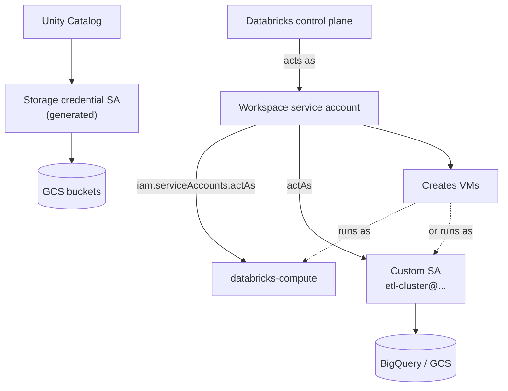

# Google Service Accounts

Mastery: `INPUT[inlineSelect(option(new), option(learning), option(solid)):mastery]`

> [!story] Context
> [[Private Service Connect]] completes the network layer. The identity layer on Google Cloud is made of **service accounts**: Google identities for software rather than people. Databricks uses several of them, each with a different job.

> [!eli5] Summary
> A service account is a login for a program instead of a person. Databricks uses a few of them in your Google project: one to start and stop computers, one that the computers run as, and others that can read your storage. Giving each one only the permissions it needs keeps your project safe.

## Background

On AWS, Databricks assumes IAM roles; on Azure, it uses managed identities. On Google Cloud, both jobs fall to **Google service accounts**, identified by an email such as `name@project-id.iam.gserviceaccount.com`. Access is granted by binding IAM roles to the service account on a project, bucket, or other resource. A service account you create does not inherit your roles.

Do not confuse these with Databricks **service principals**, which are Databricks identities for automation (see [[Users Groups and Service Principals]]).

## Overview

| Service account | Created by | Used for | Permissions |
|---|---|---|---|
| **Workspace service account** | Databricks, at workspace creation | Managing Compute Engine resources for classic compute | Two custom roles at project level: a project role (instances, disks, service accounts) and a resource role scoped by an IAM condition on the workspace ID |
| **`databricks-compute`** | Databricks | Default identity of cluster VMs | Logging and metrics only |
| **Custom cluster service account** | You | Cluster VMs that need Google Cloud access (legacy GCS, BigQuery) | What you grant, ideally least privilege |
| **Unity Catalog storage credential account** | Databricks, in the control plane, when you create a storage credential | Governed GCS access | Roles you grant on buckets |
| **Creator service account** (optional) | You | Least-privilege workspace creation through the Account API | Custom roles you define |

## How it works



### Procedure: attach a custom service account to a cluster

1. Create the service account in the workspace project:

```bash
gcloud iam service-accounts create etl-cluster --project=acme-databricks-prod \
  --display-name="Databricks ETL cluster"
```

2. Grant it the least privileges it needs, for example read access to one bucket:

```bash
gcloud storage buckets add-iam-policy-binding gs://acme-landing \
  --member=serviceAccount:etl-cluster@acme-databricks-prod.iam.gserviceaccount.com \
  --role=roles/storage.objectViewer
```

3. Let the workspace service account act as it (unless `actAs` is already granted at project level):

```bash
gcloud iam service-accounts add-iam-policy-binding \
  etl-cluster@acme-databricks-prod.iam.gserviceaccount.com \
  --member=serviceAccount:<workspace-service-account-email> \
  --role=roles/iam.serviceAccountUser
```

4. In the cluster settings, open **Advanced** and enter the email in **Google Service Account**, or set `gcp_attributes.google_service_account` in the cluster JSON. You need **Can manage** on the cluster.

For governed data, prefer Unity Catalog storage credentials over cluster service accounts. See [[GCS Access via Unity Catalog]].

## Small-business considerations

> [!smallbiz] Small-business considerations
> - Leave the workspace service account and `databricks-compute` as Databricks configures them. Do not grant them broad roles such as Editor.
> - Use Unity Catalog storage credentials for data access instead of custom cluster service accounts. They give per-user permissions and audit.
> - If you must use a custom service account (for example, for the BigQuery connector), create one per purpose and grant only the roles that purpose needs.
> - Avoid service account key files. Use service account email authentication where the docs offer it.

## Cloud differences

> [!azure]- Azure Databricks
> - Storage access uses an Access Connector's [[Managed Identity|managed identity]] (see [[ADLS and Access Connectors]]). Compute is managed through the [[Managed Resource Group]] by the Azure Databricks resource provider.

> [!aws]- Databricks on AWS
> - The [[Cross-Account IAM Role]] plays the workspace service account's part. Legacy [[Instance Profiles]] play the custom cluster service account's part. Unity Catalog storage credentials use self-assuming IAM roles.

> [!gcp]- Databricks on Google Cloud
> - This note. All Google Cloud access goes through service accounts.

## Advanced topics

> [!deepdive]- Advanced topics (301–401)
> - **Project constraint.** A custom cluster service account must be in the project the docs specify. One page says the workspace setup project; another says the same project as the account's service account. Check the current compute configuration page.
> - **Scoped custom roles.** The workspace service account's resource role uses an IAM condition on the workspace ID, which limits that role to the workspace's own Compute Engine resources.
> - **Least-privilege workspaces.** With a creator service account and custom roles, you control every grant. The creator needs only read-level permissions to validate settings.
> - **Google ID authentication.** Google Cloud service accounts can authenticate to the Databricks REST API with Google ID tokens instead of Databricks tokens. See [[Authentication - Tokens and OAuth]].
> - **Serverless.** Custom cluster service accounts are a classic compute setting. For serverless workloads, grant data access through Unity Catalog storage and service credentials.
> - **Customer-managed keys.** For managed services CMK in least-privilege setups, you grant the Cloud KMS CryptoKey Encrypter/Decrypter role to the workspace service account after creation. See [[Customer-Managed Keys on Google Cloud]].

## Common misconceptions

> [!confusion] A Google service account is not a Databricks service principal
> A service account is a Google identity for reaching Google Cloud. A service principal is a Databricks identity for running jobs and calling Databricks APIs.

> [!confusion] Cluster service accounts are not per-user
> Every user of a cluster gets the attached service account's Google permissions, just like an AWS instance profile.

## Recall

What does the workspace service account do?::Manages Compute Engine resources for the workspace's classic compute.
What does the `databricks-compute` service account have permission to do?::Only logging and metrics.
Which permission must the workspace service account have on a custom cluster service account?::`iam.serviceAccounts.actAs`.
Where do you set a custom service account on a cluster?::**Advanced**, **Google Service Account** (`gcp_attributes.google_service_account`).
Who creates the service account behind a Unity Catalog storage credential?::Databricks, in the control plane.
What is the AWS equivalent of a custom cluster service account?::An instance profile.
Does a new service account inherit its creator's roles?::No.

## Next steps

> [!path] Learning path
> **Needs first:** [[IAM]], [[Account Setup on Google Cloud]], [[Compute on Google Cloud]]
> **Unlocks next:** [[GCS Access via Unity Catalog]], [[BigQuery Integration]]

> [!nextup] Next
> [[GCS Access via Unity Catalog]] uses a Databricks-generated service account to give governed, per-user access to Cloud Storage.

> [!sources]- Sources (last verified: 2026-10-25)
> - [Required permissions for the workspace service account (GCP)](https://docs.databricks.com/gcp/en/admin/cloud-configurations/gcp/sa-permissions)
> - [Required permissions for workspace creation (GCP)](https://docs.databricks.com/gcp/en/admin/cloud-configurations/gcp/permissions)
> - [Create a least-privilege workspace (GCP)](https://docs.databricks.com/gcp/en/admin/workspace/create-least-privilege-workspace)
> - [Compute configuration reference (GCP)](https://docs.databricks.com/gcp/en/compute/configure)
> - [Connect to Google Cloud Storage (GCP)](https://docs.databricks.com/gcp/en/connect/storage/gcs)
> - [Cluster API](https://docs.databricks.com/api/clusters/v2/cluster)
> - [Google Cloud ID authentication (GCP)](https://docs.databricks.com/gcp/en/dev-tools/auth/gcp-id)
> - [High-level architecture (GCP)](https://docs.databricks.com/gcp/en/getting-started/high-level-architecture)
> - [Connect to a GCS external location (GCP)](https://docs.databricks.com/gcp/en/connect/unity-catalog/cloud-storage/external-locations-gcs)
> - [Configure customer-managed keys for encryption (GCP)](https://docs.databricks.com/gcp/en/security/keys/configure-customer-managed-keys)
