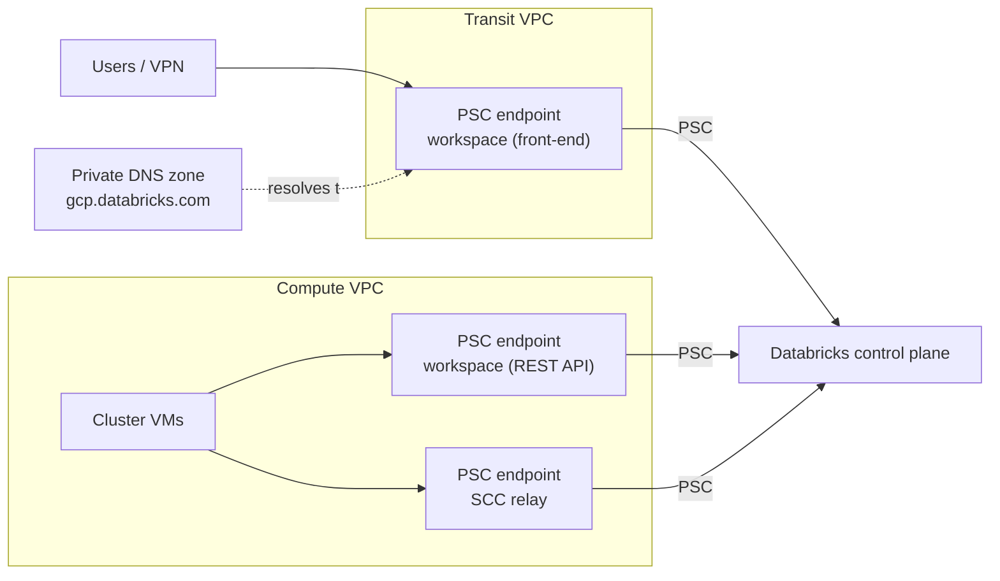

# Private Service Connect

Mastery: `INPUT[inlineSelect(option(new), option(learning), option(solid)):mastery]`

> [!story] Context
> A [[Customer-Managed VPC on Google Cloud]] puts classic compute in your network, but traffic to the Databricks control plane still uses public endpoints through Cloud NAT. Private Service Connect (PSC) replaces those paths with private endpoints in your VPCs.

> [!eli5] Summary
> Normally your computers and people reach Databricks over the internet, protected by encryption. Private Service Connect builds a private entrance inside your own Google network, so the traffic stays on Google's network. You can then block the public entrance.

## Background

Private Service Connect is Google Cloud's mechanism for consuming a producer's service through an endpoint (an internal IP address) in the consumer's VPC. Databricks publishes PSC **service attachments** per region. You create endpoints that point to them, register the endpoints with Databricks, and change DNS so Databricks hostnames resolve to the private IPs.

## Overview

| Path | From | Endpoint (service attachment suffix) | Purpose |
|---|---|---|---|
| **Inbound (front-end)** | A *transit VPC* where users, VPN, or interconnect traffic arrive | Workspace: `plproxy-psc-endpoint-all-ports` | Web app and REST APIs |
| **Classic (back-end)** | The workspace (compute) VPC | Workspace: `plproxy-psc-endpoint-all-ports` | REST APIs from clusters |
| **Classic (back-end)** | The workspace (compute) VPC | SCC relay: `ngrok-psc-endpoint` | [[Secure Cluster Connectivity]] relay |

**Requirements:**

- **Enterprise** plan.
- A **customer-managed VPC**. PSC cannot be used with a Databricks-managed VPC.
- All PSC components (VPCs, subnets, endpoints, endpoint subnets) in the **same region** as the workspace.
- Quota: up to **10 endpoints of each type per region per host project** (20 total).
- A transit VPC cannot mix workspaces that use inbound PSC with workspaces that do not.

### Public access

For PSC workspaces, public access is allowed by default. Restrict it with private access settings (which registered endpoints may reach each workspace) and an [[IP Access Lists|IP access list]] rule, or the PSC access level settings.

## How it works



### Procedure: classic (back-end) PSC

1. Look up the regional service attachment URIs and project numbers in the Databricks **IP addresses and domains** reference.
2. Reserve internal IPs and create the two endpoints in the compute VPC:

```bash
gcloud compute addresses create dbx-ws-psc-ip --project=acme-net-host \
  --region=us-central1 --subnet=dbx-psc-subnet
gcloud compute forwarding-rules create dbx-ws-psc --project=acme-net-host \
  --region=us-central1 --network=dbx-vpc --address=dbx-ws-psc-ip \
  --target-service-attachment=<workspace-plproxy-attachment-uri>

gcloud compute addresses create dbx-relay-psc-ip --project=acme-net-host \
  --region=us-central1 --subnet=dbx-psc-subnet
gcloud compute forwarding-rules create dbx-relay-psc --project=acme-net-host \
  --region=us-central1 --network=dbx-vpc --address=dbx-relay-psc-ip \
  --target-service-attachment=<ngrok-relay-attachment-uri>
```

3. Register both endpoints as VPC endpoints in the Databricks account:

```bash
databricks account vpc-endpoints create --json '{
  "vpc_endpoint_name": "prod-ws-psc",
  "gcp_vpc_endpoint_info": {
    "project_id": "acme-net-host",
    "psc_endpoint_name": "dbx-ws-psc",
    "endpoint_region": "us-central1"
  }
}'
```

4. Create the network configuration with `vpc_endpoints.rest_api` set to the workspace endpoint ID and `vpc_endpoints.dataplane_relay` set to the relay endpoint ID.
5. Create private access settings and the workspace with this network configuration.
6. Add private DNS records: the workspace hostname to the workspace endpoint IP, and `tunnel.<region>.gcp.databricks.com` to the relay endpoint IP.

### Procedure: inbound (front-end) PSC

1. In the transit VPC, create an endpoint to the workspace (`plproxy-psc-endpoint-all-ports`) service attachment.
2. Register it as a VPC endpoint and allow it in the workspace's private access settings.
3. Configure DNS for the workspace URL in the transit network, following the PSC DNS guide.
4. Restrict public access with an IP access list or PSC access level settings once private access works.

In Terraform, the resources are `databricks_mws_vpc_endpoint`, `databricks_mws_private_access_settings`, and `databricks_mws_networks` with a `vpc_endpoints` block. An official provider guide covers a full PSC workspace.

## Small-business considerations

> [!smallbiz] Small-business considerations
> - PSC requires the Enterprise plan, a customer-managed VPC, and DNS work. Most small companies do not need it.
> - SSO with MFA and IP access lists usually meet small-business requirements.
> - PSC endpoints and their data processing are billed by Google Cloud.

## Cloud differences

> [!azure]- Azure Databricks
> - [[Azure Private Link]] uses Azure private endpoints. Public access is turned off with the workspace's *Allow Public Network Access* setting.

> [!aws]- Databricks on AWS
> - [[AWS PrivateLink]] uses VPC interface endpoints with the same split: an SCC relay endpoint and a REST API endpoint for back-end, plus a front-end endpoint. Private access settings include a *public access enabled* flag (default `false`).

> [!gcp]- Databricks on Google Cloud
> - This note. Public access remains allowed by default on PSC workspaces until you restrict it.

## Advanced topics

> [!deepdive]- Advanced topics (301–401)
> - **Endpoint sharing:** Share one workspace (General Access) endpoint across all workspaces that use a VPC, and one SCC relay endpoint for all classic compute from that VPC.
> - **DNS consistency:** The workspace and data-plane hostnames must resolve to the same PSC endpoint. A mismatch can conflict with the private access settings policy and make cluster startup fail.
> - **No internet by default:** With PSC, the compute VPC has no default path to the internet. If you control egress with a firewall, allow the URLs Databricks needs, or provide Cloud NAT or a private mirror for package repositories and the metastore.
> - **Serverless:** Serverless compute does not use PSC to reach Google-managed services; it reaches Cloud Storage and BigQuery through Private Google Access. Outbound PSC from serverless (through network connectivity configurations) reaches your own resources behind an internal load balancer. See [[Serverless Network Security]].
> - **Service Direct:** A separate inbound option exists for performance-intensive services, with its own setup guide.
> - **Adding PSC later:** Use the update-workspace network configuration process; plan a maintenance window for DNS changes.

## Common misconceptions

> [!confusion] PSC does not block the public internet by default
> Public access stays allowed on PSC workspaces until you restrict it.

> [!confusion] One endpoint does not cover classic compute
> Classic PSC needs both the workspace endpoint and the SCC relay endpoint.

## Recall

Which two endpoints does back-end PSC need?::A workspace (`plproxy-psc-endpoint-all-ports`) endpoint and an SCC relay (`ngrok-psc-endpoint`) endpoint.
Which plan does PSC require?::Enterprise.
Can PSC be used with a Databricks-managed VPC?::No. It requires a customer-managed VPC.
How many PSC endpoints of each type can you create per region per host project?::Ten (20 total).
What is the SCC relay hostname format?::`tunnel.<region>.gcp.databricks.com`.
Is public access blocked by default on PSC workspaces?::No. Restrict it with IP access lists or PSC access level settings.
How does serverless reach Cloud Storage on GCP?::Through Private Google Access, not PSC.
Which network configuration fields hold the endpoint IDs?::`rest_api` and `dataplane_relay`.

## Next steps

> [!path] Learning path
> **Needs first:** [[Customer-Managed VPC on Google Cloud]], [[Network Security Overview]], [[Public vs Private IP]]
> **Unlocks next:** [[Serverless Network Security]], [[Google Service Accounts]]

> [!nextup] Next
> [[Google Service Accounts]] covers the identities Databricks and clusters use inside your Google Cloud project.

> [!sources]- Sources (last verified: 2026-10-25)
> - [Enable Private Service Connect for your workspace (GCP)](https://docs.databricks.com/gcp/en/security/network/classic/private-service-connect)
> - [Configure Inbound Private Service Connect (GCP)](https://docs.databricks.com/gcp/en/security/network/front-end/front-end-private-connect)
> - [Private Service Connect concepts (GCP)](https://docs.databricks.com/gcp/en/security/network/concepts/privatelink-concepts)
> - [Configure DNS for Google Cloud inbound Private Service Connect (GCP)](https://docs.databricks.com/gcp/en/security/network/classic/psc-dns)
> - [IP addresses and domains for Databricks services and assets (GCP)](https://docs.databricks.com/gcp/en/resources/ip-domain-region)
> - [Configure inbound Private Service Connect for performance-intensive services (GCP)](https://docs.databricks.com/gcp/en/security/network/front-end/service-direct-privatelink)
> - [Configure private connectivity to resources in your VPC (GCP)](https://docs.databricks.com/gcp/en/security/network/serverless-network-security/pl-to-internal-network)
> - [Update workspace network configuration (GCP)](https://docs.databricks.com/gcp/en/security/network/classic/update-workspaces)
> - [Configure IP access lists for workspaces (GCP)](https://docs.databricks.com/gcp/en/security/network/front-end/ip-access-list-workspace)
> - [Configure a customer-managed VPC (GCP)](https://docs.databricks.com/gcp/en/security/network/classic/customer-managed-vpc)
> - [Provisioning Databricks on Google Cloud with Private Service Connect (Terraform Registry)](https://registry.terraform.io/providers/databricks/databricks/1.57.0/docs/guides/gcp-private-service-connect-workspace)
> - [Networking (GCP)](https://docs.databricks.com/gcp/en/security/network)
