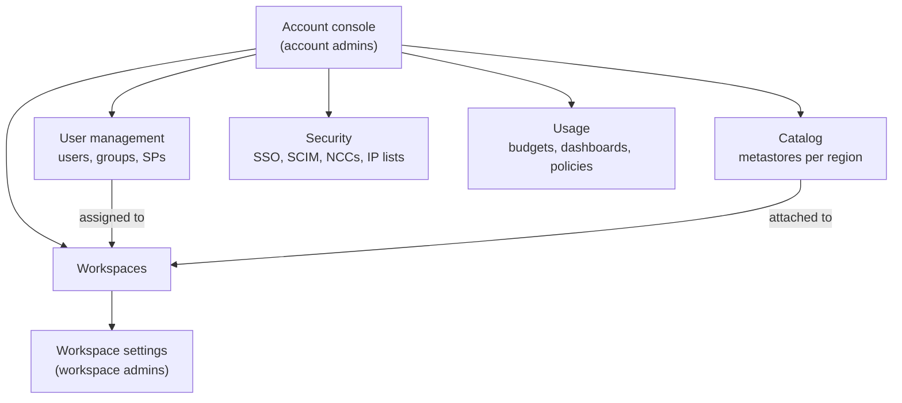

# Account Console

Mastery: `INPUT[inlineSelect(option(new), option(learning), option(solid)):mastery]`

> [!story] Context
> [[Customer-Managed Keys on Google Cloud]] completed the per-cloud chapters. The settings in this chapter apply to the whole Databricks account rather than one workspace, and most of them are configured in the account console.

> [!eli5] Summary
> The account console is the administration site for a company's whole Databricks account. Administrators use it to create workspaces, manage who has access, connect data catalogs, configure security, and track usage and spend.

## Background

Before Unity Catalog, Databricks administration was workspace-scoped. Each workspace had its own users, groups, [[Hive Metastore]], and settings, so an organization with dev, test, and prod workspaces maintained three copies of its identity and access configuration.

[[Unity Catalog]] moved governance to the account level, and identity, security, and billing settings moved with it. The account console is the interface for that account layer. Use it for settings that must apply to every workspace.

## Overview

The account console is a separate web site, used by **account admins**, for managing the whole Databricks account. The Databricks administration overview splits admin work into two levels: account-level work happens here, and workspace-level work happens in each workspace's settings page.

| Console section | What you do there | Deeper note |
|---|---|---|
| **Workspaces** | List all workspaces. Create new ones (AWS, GCP). Assign users and groups to a workspace and set their permissions. | [[Accounts and Workspaces]] |
| **Catalog** | Create Unity Catalog metastores and assign them to workspaces. | [[Metastore]] |
| **User management** | Add users, groups, and service principals. Grant account roles on each identity's *Roles* tab. | [[Users Groups and Service Principals]], [[Admin Roles]] |
| **Security** | Identity provider setup (SSO, SCIM token), network connectivity configurations, network policies, IP access lists for the console. | [[Single Sign-On]], [[SCIM Provisioning]], [[Serverless Network Security]] |
| **Usage** | Budgets, usage dashboards, serverless usage policies. | [[Budgets and Usage Dashboards]], [[Tagging for Chargeback]] |
| **Settings** | Account-wide feature settings, the Token report for personal access tokens, Previews. | [[Authentication - Tokens and OAuth]] |

You reach it at the account URL for your cloud, or from inside a workspace through the workspace switcher's **Manage account** link. Only account admins see most of it.

Two behaviors to note:

- **Only account admins can create workspaces.** A workspace admin runs one workspace. They cannot create a new one.
- **Removing a user from the account removes them from every workspace.** For that reason the docs suggest *deactivating* users in most cases. Deactivation is not a console button: you do it through the Account Users API (or the [[Databricks CLI]]).

## How it works



The flow for a new team member is always the same, whatever the cloud:

1. The identity arrives in the account, ideally from your [[Identity Provider|identity provider]] through [[SCIM Provisioning]] or automatic identity management.
2. An account admin (or a workspace admin, for their own workspace) assigns that user's **group** to a workspace.
3. Inside the workspace, entitlements and object permissions decide what they can do.
4. Inside [[Unity Catalog]], [[Privileges and Grants|grants]] decide which data they can see.

Everything you can click in the console you can also script. The [[Databricks CLI]] has an `account` command group that covers identity, Unity Catalog, settings, provisioning, billing, and OAuth at the account level:

```bash
# Configure a profile that points at the account, not a workspace
databricks auth login --host https://accounts.cloud.databricks.com --account-id <account-id>

# List workspaces and account groups
databricks account workspaces list
databricks account groups list
```

To deactivate a leaver (rather than delete them), call the Account Users API and set the user's `active` field to `false`. The `databricks account users` commands wrap the same API.

For anything you set up more than once, use the [[Terraform Provider]] instead of clicking.

## Small-business considerations

> [!smallbiz] Small-business considerations
> 1. Assign the account admin role to at least two people, so access does not depend on one person.
> 2. Create account groups (for example `admins`, `engineers`, `analysts`) and assign groups, not individual users, to workspaces.
> 3. Create a budget with an email alert on the **Usage** page before production workloads start. See [[Budgets and Usage Dashboards]].
> 4. Configure SSO if the company already uses Microsoft 365 or Google Workspace sign-in. See [[Single Sign-On]].
>
> The account console has no separate charge. Costs come from compute in workspaces. See [[How Databricks Pricing Works]].

## Cloud differences

The sections are the same everywhere. What differs is where the account lives, who the first admin is, and where workspaces and bills are created.

> [!azure]- Azure Databricks
> - The console is at `https://accounts.azuredatabricks.net`. Sign in with a Microsoft Entra ID work account from the right tenant, not a personal Microsoft account.
> - **The first account admin must be an Entra ID Global Administrator** at first login, and the tenant must already have at least one Azure Databricks workspace. On that first sign-in Azure Databricks makes them account admin. They can then grant the role to others, and after that the Global Administrator role is not needed. Being a Global Admin later does not automatically grant access.
> - **Workspaces are created in the Azure portal** (or ARM, Bicep, Terraform `azurerm`), not in the account console. Billing also runs through your Azure subscription. See [[Creating an Azure Databricks Workspace]] and [[Azure Billing and Commit Units]].
> - If your account spans several Entra tenants, open the console from a workspace in the correct tenant via **Manage account**, because the direct URL may land in your default tenant.

> [!aws]- Databricks on AWS
> - The console is at `https://accounts.cloud.databricks.com`.
> - **Workspaces are created in the account console** (Workspaces, then Create Workspace) or with the Account API. A classic workspace needs a *credential configuration* (a [[Cross-Account IAM Role]]), a *storage configuration* (the [[Workspace Storage Bucket|S3 bucket]] plus an IAM role), and, for a [[Customer-Managed VPC on AWS|customer-managed VPC]], a *network configuration*.
> - Billing is either direct with Databricks or through [[AWS Marketplace and Billing|AWS Marketplace]]. See [[Account Setup on AWS]].

> [!gcp]- Databricks on Google Cloud
> - The console is at `https://accounts.gcp.databricks.com`.
> - The account is tied to a Google Cloud Marketplace subscription, and billing runs through Google Cloud. See [[Account Setup on Google Cloud]] and [[Google Cloud Marketplace and Billing]].
> - Sign-in uses Google Cloud Identity by default, with the option to bring another identity provider. See [[Single Sign-On]].

## Advanced topics

> [!deepdive]- Advanced topics (301–401)
> - **Account vs workspace APIs.** Every REST API is either account-level (host is the accounts URL, path includes `/accounts/<account-id>/`) or workspace-level (host is the workspace URL). Tools such as Terraform need a separate provider configuration for each. Mixing them is the most common automation error. See [[Terraform Provider]].
> - **Workspace assignment API.** Assigning a principal to a workspace, and setting whether it is a workspace user or admin there, is done with the Workspace Assignment API from the account level.
> - **Multiple accounts.** Large companies sometimes run one account per cloud or per legal entity. Identities, metastores, and budgets do not cross accounts, so sharing between them uses [[OpenSharing]].
> - **Console IP access lists** protect the account console and account APIs separately from workspace IP lists. On Azure, account-console IP lists were labeled Public Preview in the docs as of October 2026. See [[IP Access Lists]].
> - **Audit.** Account-level actions (creating workspaces, changing SSO, granting admin) land in the [[Audit Logs|audit log]] system table, `system.access.audit`, with account-level service names.

## Common misconceptions

> [!confusion] The account console is not the workspace "Settings" page
> Workspace settings (the gear inside a workspace) control one workspace: its users' entitlements, compute settings, token policy. The account console controls the whole account. Workspace admins usually cannot open most of the account console.

> [!confusion] "Account" here is not your cloud account
> Your Databricks account is not your AWS account, Azure subscription, or Google Cloud project. One Databricks account can hold workspaces that sit in many cloud accounts or subscriptions.

## Recall

What is the account console?::The web site where account admins manage the whole Databricks account: workspaces, identities, metastores, security settings, and usage.
Who can create new workspaces?::Only account admins (on Azure, workspaces are created through the Azure portal or Azure tooling instead).
What happens to a user removed from the account?::They are removed from every workspace too, so deactivation is usually the safer choice.
How do you deactivate an account user?::Through the Account Users API (or the CLI wrapper), not a console button.
What is the account console URL on AWS, Azure, and GCP?::`accounts.cloud.databricks.com`, `accounts.azuredatabricks.net`, and `accounts.gcp.databricks.com`.
Who must be the first account admin on Azure Databricks?::A Microsoft Entra ID Global Administrator, at their first sign-in to the account console.
Which three configuration objects make up a classic AWS workspace?::A credential configuration, a storage configuration, and (for a customer-managed VPC) a network configuration.
Which CLI command group works at the account level?::`databricks account`.

## Next steps

> [!path] Learning path
> **Needs first:** [[Accounts and Workspaces]], [[Unity Catalog]]
> **Unlocks next:** [[Users Groups and Service Principals]], [[Admin Roles]], [[Budgets and Usage Dashboards]]

> [!nextup] Next
> [[Users Groups and Service Principals]] covers the identity types managed on the console's User management page.

> [!sources]- Sources (last verified: 2026-10-25)
> - [Databricks administration overview (AWS)](https://docs.databricks.com/aws/en/admin/admin-concepts)
> - [Databricks administration overview (GCP)](https://docs.databricks.com/gcp/en/admin/admin-concepts)
> - [Databricks administration overview (Azure)](https://learn.microsoft.com/en-us/azure/databricks/admin/admin-concepts)
> - [Manage your Azure Databricks account](https://learn.microsoft.com/en-us/azure/databricks/admin/account-settings/)
> - [Manage users (AWS)](https://docs.databricks.com/aws/en/admin/users-groups/users)
> - [Manage users (Azure)](https://learn.microsoft.com/en-us/azure/databricks/admin/users-groups/users)
> - [account command group (CLI)](https://docs.databricks.com/aws/en/dev-tools/cli/reference/account-commands)
> - [Create a classic workspace (AWS)](https://docs.databricks.com/aws/en/admin/workspace/create-workspace)
> - [Create a workspace using the Account API (AWS)](https://docs.databricks.com/aws/en/admin/workspace/create-workspace-api)
> - [Phase 1: Design account and identity strategy (Azure)](https://learn.microsoft.com/en-us/azure/databricks/lakehouse-architecture/deployment-guide/account-setup)
> - [Set up and use Google Cloud ID authentication (GCP)](https://docs.databricks.com/gcp/en/dev-tools/auth/google-id-auth)
