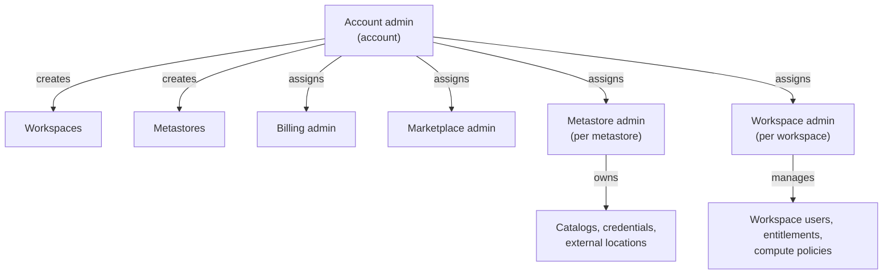

# Admin Roles

Mastery: `INPUT[inlineSelect(option(new), option(learning), option(solid)):mastery]`

> [!story] Context
> [[Authentication - Tokens and OAuth]] covers how identities authenticate. This note covers the administrative roles that determine which identities can change account, workspace, and metastore settings.

> [!eli5] Summary
> Databricks has several administrator roles with different scopes: the whole account, a single workspace, or the shared data catalog. Most users should hold no admin role, and each role should be held by a small group.

## Background

Administrator roles can grant data access, change network and security settings, and create billable resources. If every user is an admin, there is no effective access control; if only one person is an admin, the organization depends on that person. Separate roles with narrow scopes support [[Least Privilege|least privilege]]: each identity holds only the permissions its job requires.

## Overview

| Role | Scope | Can do | Assigned by |
|---|---|---|---|
| **Account admin** | Whole account | Create workspaces and metastores, link them, manage account users and groups, configure SSO and network settings, assign other admin roles, see usage | Another account admin (Roles tab in the console) |
| **Workspace admin** | One workspace | Add users and groups to the workspace, set entitlements, manage compute policies and workspace settings, manage job ownership and workspace objects | Account admin, or another workspace admin of that workspace |
| **Metastore admin** | One Unity Catalog metastore | Top-level control of data: create catalogs, manage storage credentials and external locations, change owners of any object | Account admin. Optional. |
| **Billing admin** | Whole account | View budgets and manage serverless usage policies | Account admin |
| **Marketplace admin** | Whole account | Manage the provider profile and listings in [[Databricks Marketplace]] | Account admin |

The docs describe account admins and workspace admins as the two main levels, with the rest as narrower roles. The Azure deployment guide lists all five.

Two defaults apply:

- **The account admin who creates a workspace becomes a workspace admin there** automatically.
- **Workspace admins get many metastore-level rights by default** in workspaces enabled for Unity Catalog automatically (from November 2023; the AWS and Azure docs differ on whether the date is 8 or 9 November). A metastore admin is still needed for some actions, such as changing ownership of objects you do not own.

## How it works



Granting roles in practice:

- **Account admin, billing admin, marketplace admin:** account console, User management, select the user, group, or service principal, then the **Roles** tab.
- **Workspace admin:** add the principal to the workspace's `admins` group, or set *Admin* in the workspace assignment from the account console.
- **Metastore admin:** account console, Catalog, select the metastore, and change the metastore admin. Databricks recommends making it a group.

Ownership also confers control. In [[Unity Catalog]], the owner of an object has full control of it, and the metastore admin can change any owner. Assign ownership to groups:

```sql
-- Make a group, not a person, own each top-level catalog
ALTER CATALOG analytics OWNER TO `data-platform-admins`;

-- Delegate creating schemas without making anyone an admin
GRANT CREATE SCHEMA ON CATALOG analytics TO `data-engineers`;
```

## Small-business considerations

> [!smallbiz] Small-business considerations
> - Assign the account admin role to two people (for example the owner and the data lead).
> - Create a `platform-admins` account group and make it workspace admin in each workspace and metastore admin. Change membership of the group rather than individual role assignments.
> - Assign the billing admin role to a bookkeeper who needs to view budgets.
> - Give all other users standard access through group grants.
>
> Review admin assignments quarterly. Role changes are recorded in the [[Audit Logs|audit log]].

## Cloud differences

The Databricks roles are identical on every cloud. What differs is how cloud-level admin rights relate to them.

> [!azure]- Azure Databricks
> - The **first account admin** must be an Entra ID Global Administrator at first login. After that, being a Global Administrator does not grant account access by itself.
> - Azure roles work as a side door. Users with the built-in **Contributor** or **Owner** role (or a custom role with the required Azure Databricks permissions) are automatically made workspace admins when they click **Launch Workspace** in the Azure portal. Treat those Azure roles as admin-equivalent and keep them tight. It does not make them account admins.
> - The Azure deployment guide lists five roles: account admin, workspace admin, metastore admin, marketplace admin, and billing admin, and says account and workspace admins are required for all deployments.

> [!aws]- Databricks on AWS
> - Account admins are granted only in the Databricks account console. AWS IAM permissions in the AWS account where the workspace runs control cloud resources, not Databricks roles.

> [!gcp]- Databricks on Google Cloud
> - The account is set up through Google Cloud Marketplace. See [[Account Setup on Google Cloud]].
> - Google Cloud IAM roles on the project (Owner, Editor) control the cloud resources Databricks uses, not Databricks itself. Keep them separate from Databricks admin roles.

## Advanced topics

> [!deepdive]- Advanced topics (301–401)
> - **Service principals as admins:** Account-level automation (Terraform for workspaces, users, metastores) needs a service principal with the account admin role. Protect its credentials as carefully as a human admin's, and prefer token federation. See [[Authentication - Tokens and OAuth]].
> - **Workspace admins and data:** Being a workspace admin does not give you `SELECT` on every table. Data access is still governed by [[Privileges and Grants|Unity Catalog grants]]. But workspace admins can change workspace settings that affect security (token policy, compute policies), so they are still privileged.
> - **Metastore admin is optional:** Many teams never assign one and rely on workspace-admin defaults plus catalog owners. Assign one (a group) once you have several workspaces or need to fix ownership.
> - **Feature-specific admin roles** appear over time (for example for Marketplace or billing). Check the Roles tab for the current list rather than relying on memory.
> - **Audit:** Query role changes in `system.access.audit`, filtering on account-level service names and actions that change roles or group membership.

## Common misconceptions

> [!confusion] Workspace admin is not account admin
> A workspace admin runs one workspace. They cannot create workspaces, change SSO, or see the account console's usage pages. An account admin can do all of that, but is only a workspace admin in workspaces they created or were added to as admin.

> [!confusion] Cloud admin is not Databricks admin
> Owning the AWS account, Azure subscription, or Google Cloud project does not make you a Databricks account admin. The two sets of rights are managed separately, with one exception: the first Azure account admin comes from Entra ID's Global Administrator role.

## Recall

Which role can create workspaces and metastores?::Account admin.
What scope does a workspace admin have?::One workspace: its users, entitlements, compute policies, settings, and objects.
What does a metastore admin control?::Top-level Unity Catalog administration for one metastore, including changing ownership of any object.
Is a metastore admin required?::No, it is optional. Databricks recommends assigning it to a group if you use it.
Which role can view budgets and manage serverless usage policies without being account admin?::Billing admin.
Where do account admins grant account roles?::On the Roles tab of a user, group, or service principal in the account console.
Who becomes workspace admin automatically when a workspace is created?::The account admin who created it.
Does being a workspace admin let you read every table?::No. Data access still needs Unity Catalog grants.

## Next steps

> [!path] Learning path
> **Needs first:** [[Users Groups and Service Principals]], [[Account Console]]
> **Unlocks next:** [[Compute Policies]], [[Privileges and Grants]], [[Budgets and Usage Dashboards]]

> [!nextup] Next
> [[Compute Policies]] covers the guardrails workspace admins set on the compute that users can create.

> [!sources]- Sources (last verified: 2026-10-25)
> - [Databricks administration overview (AWS)](https://docs.databricks.com/aws/en/admin/admin-concepts)
> - [Databricks administration overview (Azure)](https://learn.microsoft.com/en-us/azure/databricks/admin/admin-concepts)
> - [Admin privileges in Unity Catalog (AWS)](https://docs.databricks.com/aws/en/data-governance/unity-catalog/manage-privileges/admin-privileges)
> - [Admin privileges in Unity Catalog (Azure)](https://learn.microsoft.com/en-us/azure/databricks/data-governance/unity-catalog/manage-privileges/admin-privileges)
> - [Phase 1: Design account and identity strategy (AWS)](https://docs.databricks.com/aws/en/lakehouse-architecture/deployment-guide/account-setup)
> - [Phase 1: Design account and identity strategy (Azure)](https://learn.microsoft.com/en-us/azure/databricks/lakehouse-architecture/deployment-guide/account-setup)
> - [Manage users (AWS)](https://docs.databricks.com/aws/en/admin/users-groups/users)
> - [Manage users (Azure)](https://learn.microsoft.com/en-us/azure/databricks/admin/users-groups/users)
> - [Create a workspace (Azure)](https://learn.microsoft.com/en-us/azure/databricks/admin/workspace/)
