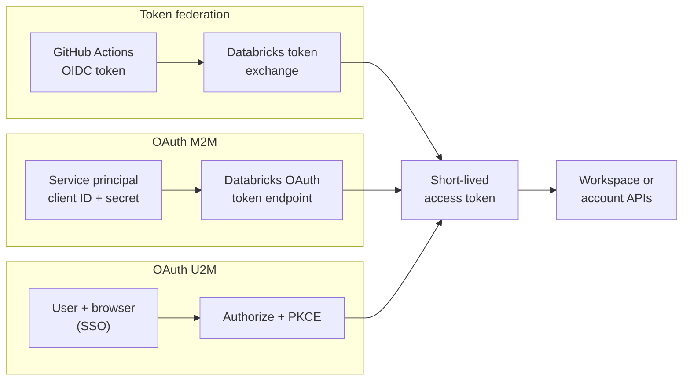

# Authentication: Tokens and OAuth

Mastery: `INPUT[inlineSelect(option(new), option(learning), option(solid)):mastery]`

> [!story] Context
> [[Single Sign-On]] covers interactive sign-in through a browser. The CLI, SDKs, BI tools, and CI/CD pipelines also call Databricks APIs and need their own authentication method. Personal access tokens were the original method; OAuth is the recommended replacement.

> [!eli5] Summary
> Programs that call Databricks need a credential. A personal access token is a long-lived password-like string. OAuth issues short-lived tokens on demand, and token federation lets automation authenticate with an identity it already has, without storing any Databricks secret.

## Background

A personal access token (PAT) is a bearer credential: anyone who holds it can act as its owner until it expires or is revoked. The default maximum lifetime for new PATs is 730 days. PATs are often copied into notebooks, `.env` files, and CI variables, and they tie automation to an individual user.

OAuth addresses these issues. Access tokens are short-lived (about one hour) and refresh automatically, they can belong to a service principal, and with token federation no long-lived Databricks secret is stored.

## Overview

Databricks' authorization docs list these methods, roughly in order of preference:

| Method | Who | Secret you store | Token life | Use for |
|---|---|---|---|---|
| **OAuth token federation** (recommended) | Users or service principals | None. Your IdP or CI platform issues a JWT that Databricks exchanges. | Short | CI/CD (GitHub Actions, Azure DevOps), workloads on cloud identities |
| **OAuth M2M** | Service principals | OAuth client ID + client secret | About 1 hour, auto-refresh | Jobs, schedulers, apps, BI service accounts |
| **OAuth U2M** | Users | None. Browser login through SSO. | 1 hour default, auto-refresh | CLI, SDKs, IDEs, JDBC/ODBC on a person's machine |
| **Personal access token** (legacy) | Users or service principals | The token itself | Up to the workspace maximum (default cap 730 days) | Old tools that support nothing else |

Two rules apply to all OAuth methods. First, the identity needs the **CAN USE** permission on the features its code touches. Second, revoking a user's consent does not kill existing tokens immediately; refresh tokens keep working until they expire.

The CLI, SDKs, and JDBC/ODBC drivers share **unified authentication**: set a few environment variables or a profile in `~/.databrickscfg`, and the tool picks the method.

## How it works



**U2M on a laptop:**

```bash
# Opens a browser, signs in through SSO, caches a refreshable token
databricks auth login --host https://<workspace-url>
databricks clusters list
```

**M2M for a scheduler** (environment variables read by the CLI and SDKs):

```bash
export DATABRICKS_HOST="https://<workspace-url>"
export DATABRICKS_CLIENT_ID="<service-principal-application-id>"
export DATABRICKS_CLIENT_SECRET="<oauth-secret>"   # keep this in a vault, not in code
databricks jobs list
```

**Token federation from GitHub Actions** (no secret at all). First create a federation policy on the service principal, with GitHub's issuer, your account ID as the audience, and a subject that matches GitHub's `sub` claim. Databricks recommends the `environment` subject type. Then:

```yaml
# .github/workflows/deploy.yml
permissions:
  id-token: write          # lets the job request a GitHub OIDC token
  contents: read
jobs:
  deploy:
    runs-on: ubuntu-latest
    environment: prod      # must match the policy's subject
    env:
      DATABRICKS_AUTH_TYPE: github-oidc
      DATABRICKS_HOST: https://<workspace-url>
      DATABRICKS_CLIENT_ID: <service-principal-application-id>
    steps:
      - uses: actions/checkout@v4
      # install the Databricks CLI here (see the GitHub Actions doc)
      - run: databricks bundle deploy -t prod
```

### Governing PATs

If you still allow PATs, an admin can:

- **Disable PATs** for a workspace. This blocks their use but does not delete them; unexpired tokens work again if re-enabled.
- **Limit who can create or use them** with token permissions.
- **Set a maximum lifetime** for new tokens (`maxTokenLifetimeDays` via the CLI or workspace configuration API). The Azure docs recommend under 90 days.
- **Rely on auto-revocation**: tokens unused for 90 days or more are revoked automatically.
- **Review and revoke** across all workspaces in the account console's **Token report**, which filters by owner, workspace, and date, and exports to CSV. From the CLI: `databricks token-management delete <token-id>`.

## Small-business considerations

> [!smallbiz] Small-business considerations
> - **People:** authenticate with `databricks auth login` (OAuth U2M). Personal laptops do not need PATs.
> - **BI tools and schedulers:** create one service principal per tool with an OAuth secret (M2M). Store the secret in the tool's credential store or a [[Secrets Management|secret scope]].
> - **GitHub Actions:** use token federation, which stores no secret.
> - **PAT policy:** set a maximum PAT lifetime of 90 days or less, or disable PATs if no tool requires them.
>
> These methods have no additional charge.

## Cloud differences

> [!azure]- Azure Databricks
> - Besides Databricks OAuth, Azure Databricks accepts **Microsoft Entra ID tokens** for users and for Entra ID service principals. Entra access tokens last 60–90 minutes by default.
> - The docs recommend **Databricks-managed service principals with OAuth M2M** for most cases. Use an **Entra ID service principal** only when one identity must reach Azure Databricks and other Azure resources at the same time. Some JDBC/ODBC paths accept only Databricks OAuth secrets for M2M, so check each tool.
> - **Azure managed identities** can authenticate (for example, from an Azure VM or Azure DevOps), and the Terraform provider supports `azure_use_msi`. Federation from GitHub Actions is also documented.

> [!aws]- Databricks on AWS
> - Use Databricks OAuth (U2M, M2M) and token federation. GitHub Actions federation is documented with `DATABRICKS_AUTH_TYPE: github-oidc`.
> - AWS IAM credentials do not log in to Databricks APIs. IAM roles are for Databricks reaching AWS, not the reverse.

> [!gcp]- Databricks on Google Cloud
> - Besides Databricks OAuth, a **Google service account** can authenticate with **Google ID tokens**. This path is not available if you bring your own IdP for SSO. See [[Google Service Accounts]].

## Advanced topics

> [!deepdive]- Advanced topics (301–401)
> - **Account vs workspace tokens.** OAuth tokens are issued by either the account (`accounts.*` host) or a workspace. Account-level automation (Terraform for workspaces, users, metastores) needs an account-level token, which means a service principal with an admin role at the account.
> - **GitHub subject format.** GitHub repositories created, renamed, or transferred on or after 15 July 2026 include numeric organisation and repository IDs in the `sub` claim. Older ones use the name-only format unless they opt in. Your federation policy subject must match exactly.
> - **Reusable workflows.** To federate as a reusable workflow rather than the calling repository, set the policy's subject claim to `job_workflow_ref`.
> - **Bundles.** For unattended [[Declarative Automation Bundles]] deployment, the docs prefer OAuth M2M for a service principal, then a PAT owned by a service principal.
> - **Inactive PATs.** The Token report can filter to inactive principals. Removing a user's CAN USE permission stops their tokens working without revoking them.
> - **OAuth secrets.** Account and workspace admins can create secrets for a service principal. A service principal can hold up to five secrets, each valid for at most two years, optionally scoped to specific APIs (scopes cannot be changed later). The secret is shown only once. Rotate secrets on a schedule, and prefer federation where your platform supports it.
> - **Wrong token endpoint.** A 401 on M2M often means the request went to an identity provider or cloud token endpoint instead of the Databricks OAuth token endpoint.

## Common misconceptions

> [!confusion] OAuth tokens are still tokens
> OAuth does not remove tokens. It makes them short-lived, refreshable, and (with federation) issued without a stored secret. A leaked OAuth access token remains valid for its lifetime, about one hour, compared with up to two years for a PAT.

> [!confusion] A service principal PAT is not M2M OAuth
> A PAT created for a service principal is still a long-lived bearer string. M2M OAuth uses a client secret to get short-lived tokens. Prefer M2M.

## Recall

Which Databricks authentication method do the docs mark as recommended?::OAuth token federation.
What is OAuth U2M for?::Attended, interactive authentication by a user through the browser (CLI, SDKs, IDEs).
What is OAuth M2M for?::Unattended automation by a service principal using a client ID and client secret.
What is the default lifetime of a U2M OAuth access token?::One hour, refreshed automatically.
What is the default maximum lifetime for new PATs?::730 days.
What happens to PATs unused for 90 days or more?::They are automatically revoked.
Where can account admins review all PATs?::The Token report in the account console.
Which environment variable selects GitHub token federation in Databricks tools?::`DATABRICKS_AUTH_TYPE=github-oidc`.
On Azure, when should you use an Entra ID service principal instead of a Databricks-managed one?::When the same identity must reach Azure Databricks and other Azure resources at the same time.

## Next steps

> [!path] Learning path
> **Needs first:** [[Single Sign-On]], [[Users Groups and Service Principals]], [[OAuth]]
> **Unlocks next:** [[Terraform Provider]], [[CI-CD for Data Pipelines]], [[Databricks SDKs and REST API]]

> [!nextup] Next
> [[Admin Roles]] covers which identities can change account and workspace settings.

> [!sources]- Sources (last verified: 2026-10-25)
> - [Authorize access to Databricks resources (AWS)](https://docs.databricks.com/aws/en/dev-tools/auth/)
> - [Authorize access to Azure Databricks resources](https://learn.microsoft.com/en-us/azure/databricks/dev-tools/auth/)
> - [Authorize access to Databricks resources (GCP)](https://docs.databricks.com/gcp/en/dev-tools/auth/)
> - [Authorize user access to Databricks with OAuth (AWS)](https://docs.databricks.com/aws/en/dev-tools/auth/oauth-u2m)
> - [Authorize service principal access to Databricks with OAuth (AWS)](https://docs.databricks.com/aws/en/dev-tools/auth/oauth-m2m)
> - [Authenticate access to Databricks using OAuth token federation (AWS)](https://docs.databricks.com/aws/en/dev-tools/auth/oauth-federation)
> - [Configure a federation policy (AWS)](https://docs.databricks.com/aws/en/dev-tools/auth/oauth-federation-policy)
> - [Enable workload identity federation for GitHub Actions (AWS)](https://docs.databricks.com/aws/en/dev-tools/auth/provider-github)
> - [Enable workload identity federation for GitHub Actions (Azure)](https://learn.microsoft.com/en-us/azure/databricks/dev-tools/auth/provider-github)
> - [Authentication for Declarative Automation Bundles (AWS)](https://docs.databricks.com/aws/en/dev-tools/bundles/authentication)
> - [Monitor and revoke personal access tokens (AWS)](https://docs.databricks.com/aws/en/admin/access-control/tokens)
> - [Monitor and revoke personal access tokens (Azure)](https://learn.microsoft.com/en-us/azure/databricks/admin/access-control/tokens)
> - [Manage personal access token permissions (AWS)](https://docs.databricks.com/aws/en/security/auth/api-access-permissions)
> - [Authenticate with Microsoft Entra service principals (Azure)](https://learn.microsoft.com/en-us/azure/databricks/dev-tools/auth/azure-sp)
> - [Authenticate with Azure managed identities (Azure)](https://learn.microsoft.com/en-us/azure/databricks/dev-tools/auth/azure-mi)
> - [Set up and use Google Cloud ID authentication (GCP)](https://docs.databricks.com/gcp/en/dev-tools/auth/google-id-auth)
