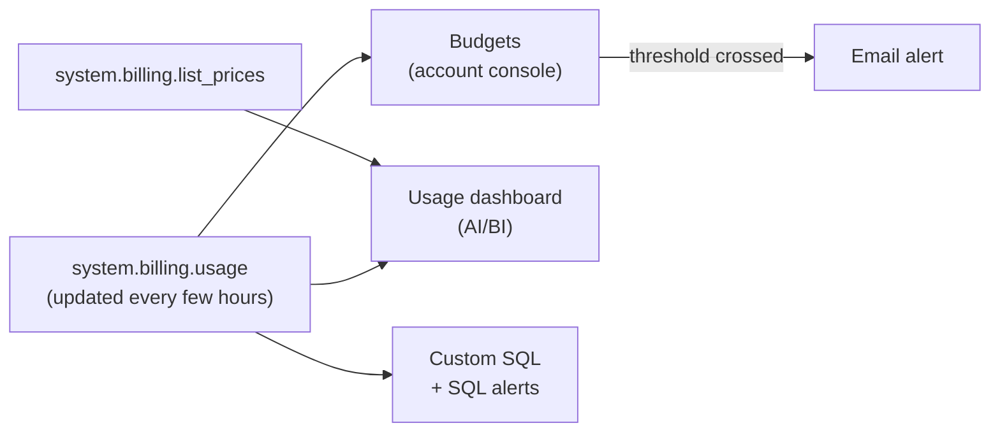

# Budgets and Usage Dashboards

Mastery: `INPUT[inlineSelect(option(new), option(learning), option(solid)):mastery]`

> [!story] Context
> [[Cost Management Basics]] described the meter and the `system.billing.usage` table. This note covers the tools built on that data: budgets that send alerts when spend crosses a threshold, and dashboards that show where spend comes from.

> [!eli5] Summary
> A budget is a spending limit with an email warning: when spending passes the amount you set, the people you named get an email. A usage dashboard is a set of charts showing what you spent, on what, and by which team.

## Background

Consumption billing makes spend visible only after it happens. Without monitoring, the first sign of a problem is the monthly invoice. Budgets give early warning, and dashboards give the breakdown needed to act. Both read the same billing data, so they agree with each other and with SQL queries on the system tables.

## Overview

| Tool | Where | Who | What it does |
|---|---|---|---|
| **Budgets** | Account console, **Usage**, **Budgets** tab | Account admins (billing admins can view) | Track spend for the account, or a subset filtered by workspace, product, or tags; email alerts when a threshold is crossed |
| **Usage dashboards** | Imported into a Unity Catalog-enabled workspace as an [[AI-BI Dashboards\|AI/BI dashboard]] | Account admins import; viewers need `SELECT` on the billing tables | Spend by product, workspace, SKU, tag, and object, with drill-down |
| **System tables** | `system.billing.usage`, `system.billing.list_prices` | Anyone granted `SELECT` | Raw usage records and list prices for custom queries and alerts |
| **Governance Hub Cost page** | Account console | Account admins; workspace admins for their workspaces | Spend summaries, tagged-spend percentage, Explorer drill-down at list price. Beta as of October 2026. |

**Budget facts from the docs:**

- A budget can cover the whole account or be narrowed by workspace, product, or custom tags (including serverless usage policy tags).
- Alerts go to the email addresses you enter when spend exceeds the threshold.
- The budget details page shows the current month's spend and the remaining budget.
- An account can have up to **1,000 budgets**.
- Budgets **alert; they do not stop** workloads.
- The budget page refreshes more often than `system.billing.usage`, which updates every few hours. A query run right after an alert may show lower spend.

**Usage dashboard facts:**

- On AWS and Azure, account admins can import a customizable usage dashboard into any Unity Catalog-enabled workspace in which they are also a user.
- Viewers need `SELECT` on `system.billing.usage` and `system.billing.list_prices`.
- Version 2.0 of the dashboard (Preview as of October 2026) adds cost forecasting and object-level cost drill-down.

## How it works



### Procedure: create a budget

1. In the [[Account Console]], open **Usage**, then the **Budgets** tab, and create a budget.
2. Choose the scope: all usage, or filter by workspace, product, or tag (for example `team = analytics`).
3. Enter the monthly amount and one or more alert thresholds.
4. Add the email addresses that receive alerts.

### Queries on the billing tables

Cost per day at list price, last 30 days:

```sql
SELECT u.usage_date,
       SUM(u.usage_quantity * p.pricing.default) AS list_cost
FROM system.billing.usage u
JOIN system.billing.list_prices p
  ON  u.cloud = p.cloud
  AND u.sku_name = p.sku_name
  AND u.usage_start_time >= p.price_start_time
  AND (u.usage_end_time <= p.price_end_time OR p.price_end_time IS NULL)
WHERE u.usage_date >= current_date() - INTERVAL 30 DAYS
GROUP BY u.usage_date
ORDER BY u.usage_date;
```

Most expensive jobs over the last 30 days, following the pattern in the job cost documentation:

```sql
WITH job_cost AS (
  SELECT u.workspace_id,
         u.usage_metadata.job_id AS job_id,
         SUM(u.usage_quantity * p.pricing.default) AS list_cost
  FROM system.billing.usage u
  JOIN system.billing.list_prices p
    ON  u.cloud = p.cloud
    AND u.sku_name = p.sku_name
    AND u.usage_start_time >= p.price_start_time
    AND (u.usage_end_time <= p.price_end_time OR p.price_end_time IS NULL)
  WHERE u.billing_origin_product = 'JOBS'
    AND u.usage_date >= current_date() - INTERVAL 30 DAYS
  GROUP BY ALL
)
SELECT c.workspace_id, c.job_id, j.name, c.list_cost
FROM job_cost c
LEFT JOIN (
  SELECT workspace_id, job_id, name,
         ROW_NUMBER() OVER (PARTITION BY workspace_id, job_id ORDER BY change_time DESC) AS rn
  FROM system.lakeflow.jobs
) j ON c.workspace_id = j.workspace_id AND c.job_id = j.job_id AND j.rn = 1
ORDER BY c.list_cost DESC
LIMIT 20;
```

To be notified of a daily spike, schedule a [[SQL Alerts|SQL alert]] on the daily cost query.

## Small-business considerations

> [!smallbiz] Small-business considerations
> - Create two budgets on day one: one for the whole account, and one for the busiest workspace or team tag.
> - Send alerts to a shared mailbox read by the owner and the data lead, not to one person.
> - Import the usage dashboard and review it weekly for the first month, then monthly.
> - Budgets do not cap spend. To limit spend, use [[Compute Policies|compute policies]], auto-termination, and warehouse sizes.

## Cloud differences

> [!azure]- Azure Databricks
> - Databricks charges also appear in **Azure Cost Management**, where Azure Databricks resource tags are available. Azure Cost Management shows billed amounts; Databricks budgets and dashboards use list prices, so totals differ. See [[Azure Billing and Commit Units]].
> - Usage dashboards are imported by account admins, as on AWS.

> [!aws]- Databricks on AWS
> - Account admins import the usage dashboard into a Unity Catalog-enabled workspace from the account console.
> - EC2 and EBS costs for classic compute are on the AWS bill. Default tags on those resources support AWS cost analysis.

> [!gcp]- Databricks on Google Cloud
> - The GCP docs describe a different import flow: download the dashboard JSON file from the **Usage** tab and import it into a workspace.
> - Google Cloud charges for classic compute appear in Google Cloud Billing.

## Advanced topics

> [!deepdive]- Advanced topics (301–401)
> - **Job cost accuracy:** `usage_metadata.job_id` is populated for jobs on job compute and serverless, not for jobs on all-purpose compute. Databricks recommends job compute or serverless for accurate per-job cost. Usage from `WORKFLOW_RUN` tasks is attributed to the parent notebook.
> - **Price field:** Some doc examples use `pricing.default`, others `pricing.effective_list.default`. Check the pricing table reference for the field your account exposes.
> - **Genie budgets** use a per-user threshold model and a separate resource type.
> - **Governance Hub Explorer** groups spend by product, resource, workspace, or tag, and has a **View untagged spend** shortcut for finding resources that need tags.
> - **Job names:** `system.lakeflow.jobs` is a slowly changing dimension (SCD2) table with one row per change. Take the latest row per `workspace_id` and `job_id` by `change_time`, as in the query above, to get the current name.

## Common misconceptions

> [!confusion] A budget does not stop spending
> Budgets send alerts. Workloads keep running after a threshold is crossed. Limits come from compute policies, warehouse settings, and permissions.

> [!confusion] Dashboard totals will not match the invoice exactly
> Dashboards and system-table queries use list prices and exclude cloud provider charges for classic compute. The invoice reflects contract pricing.

## Recall

Where do account admins create budgets?::Account console, Usage, Budgets tab.
What can a budget be filtered by?::Workspace, product, and custom tags (including serverless usage policy tags).
Does crossing a budget threshold stop workloads?::No. It sends email alerts.
How many budgets can an account have?::Up to 1,000.
How often does `system.billing.usage` update?::Every few hours.
Which privileges do usage dashboard viewers need?::`SELECT` on `system.billing.usage` and `system.billing.list_prices`.
Which field identifies the job for job compute and serverless usage?::`usage_metadata.job_id`.
How do you convert DBUs to list cost in SQL?::Join `system.billing.usage` to `system.billing.list_prices` on cloud, SKU, and price validity window, and multiply `usage_quantity` by the price.

## Next steps

> [!path] Learning path
> **Needs first:** [[Cost Management Basics]], [[System Tables]]
> **Unlocks next:** [[Tagging for Chargeback]], [[Cost Optimization Checklist]]

> [!nextup] Next
> [[Tagging for Chargeback]] covers the tags that let budgets and dashboards attribute spend to teams and projects.

> [!sources]- Sources (last verified: 2026-10-25)
> - [Create and monitor budgets (AWS)](https://docs.databricks.com/aws/en/admin/account-settings/budgets)
> - [Create and monitor budgets (Azure)](https://learn.microsoft.com/en-us/azure/databricks/admin/account-settings/budgets)
> - [Usage dashboards (AWS)](https://docs.databricks.com/aws/en/admin/account-settings/usage)
> - [Usage dashboards (GCP)](https://docs.databricks.com/gcp/en/admin/account-settings/usage)
> - [Cost management tools on Databricks (AWS)](https://docs.databricks.com/aws/en/admin/usage/)
> - [Monitor costs using system tables (AWS)](https://docs.databricks.com/aws/en/admin/usage/system-tables)
> - [Billable usage system table reference (AWS)](https://docs.databricks.com/aws/en/admin/system-tables/billing)
> - [Monitor job costs and performance with system tables (AWS)](https://docs.databricks.com/aws/en/admin/system-tables/jobs-cost)
> - [Jobs system table reference (AWS)](https://docs.databricks.com/aws/en/admin/system-tables/jobs)
> - [Monitor the cost of serverless compute (AWS)](https://docs.databricks.com/aws/en/admin/system-tables/serverless-billing)
> - [Cost overview, Governance Hub (Azure)](https://learn.microsoft.com/en-us/azure/databricks/admin/governance-hub/cost)
> - [Manage budgets and cost controls for Genie (AWS)](https://docs.databricks.com/aws/en/genie/budgets)
