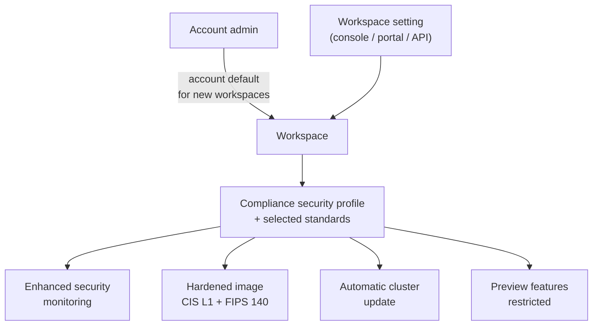

# Compliance Security Profile

Mastery: `INPUT[inlineSelect(option(new), option(learning), option(solid)):mastery]`

> [!story] Context
> [[Encryption]] and the network controls in this chapter are individual settings. Regulated workloads require a specific, auditable combination of them. The compliance security profile applies that combination to a workspace in one step.

> [!eli5] Summary
> Some data, such as patient records or card payments, is covered by strict laws and industry rules. The compliance security profile is a switch that puts a Databricks workspace into a stricter mode those rules require: more locked-down computers, extra monitoring, and automatic security updates.

## Background

Standards such as [[HIPAA]], PCI-DSS, and FedRAMP require technical controls (hardened operating systems, FIPS-validated cryptography, monitoring, timely patching) in addition to contracts and processes. Configuring each control separately is error-prone and hard to prove to an auditor. Databricks packages the required controls as the **compliance security profile**. The Azure docs state that it requires the **Enhanced Security and Compliance add-on**.

## Overview

Enabling the profile on a workspace applies these controls:

| Control | What it does |
|---|---|
| **Enhanced security monitoring** | Monitoring agents on classic compute generate reviewable logs. Applies to classic compute (clusters and non-serverless SQL warehouses) only. |
| **Hardened compute image** | CIS Level 1 hardened OS image with FIPS 140 validated encryption modules. |
| **Automatic cluster update** | Clusters receive updated host images during a configurable maintenance window. Permanently enabled when the profile is on (Azure). |
| **Nitro instances (AWS)** | Enforces AWS Nitro instance types for clusters and SQL warehouses, which encrypt traffic between instances. |
| **Restricted preview features** | Only listed preview features may process regulated data. |

### Standards

The AWS docs state that the profile is **required** to process data regulated under these standards: C5, CCCS Medium, DoD IL5, FedRAMP High and Moderate, HIPAA, HITRUST, IRAP, ISMAP, K-FSI, PCI-DSS, TISAX, and UK Cyber Essentials Plus. You can also enable it with no standard selected, for its security features alone. Support varies by cloud and region:

| Standard | Notes from the docs |
|---|---|
| HIPAA | Requires a signed Business Associate Agreement (BAA) with Databricks before processing PHI. AWS: all regions. GCP: per-region feature table. |
| PCI-DSS | AWS: PCI DSS v4.0 controls in `us-east-1` and `ap-southeast-2`. Also listed on GCP. |
| FedRAMP Moderate | AWS: FedRAMP Authorized at Moderate in `us-east-1`. |
| FedRAMP High | Supported in [[Databricks on AWS GovCloud]], where the profile is enabled on all workspaces by default. |
| IRAP | AWS: `ap-southeast-2`. |
| C5, HITRUST, TISAX | Listed on AWS and GCP. |

The GCP compliance page lists C5, HIPAA, HITRUST, PCI-DSS, and TISAX. Check the regional support table for your cloud before choosing a region.

### Responsibility

Databricks states that customers are solely responsible for their own compliance with applicable laws and regulations. The profile provides controls; it does not make a workload compliant by itself.

## How it works

### Enabling the profile

- **Account default (AWS, GCP):** account admins can configure the profile (with standards) or enhanced security monitoring as an account-level setting that applies to all new workspaces.
- **Per workspace:** enable in the workspace's security and compliance settings, choose standards, and set the automatic cluster update maintenance window. Choose a region that supports your standard when creating the workspace.
- **Azure:** in the Azure portal, open the workspace, **Settings**, **Security & compliance**, and select the compliance security profile, enhanced security monitoring, and automatic cluster update. Azure CLI, PowerShell, ARM, and Terraform are also supported.

Enabling the profile, or adding standards, is intended to be **permanent**. On Azure, once a workspace has processed regulated data, removing the profile requires a new workspace.

## Small-business considerations

> [!smallbiz] Small-business considerations
> - A small company needs the profile only when it processes regulated data: for example a clinic or health-tech startup with PHI (HIPAA), or a business handling cardholder data in scope for PCI-DSS.
> - The profile can require a paid add-on (on Azure, the Enhanced Security and Compliance add-on) and adds restrictions, such as limited preview features and fixed maintenance windows. Do not enable it for general hardening alone without reviewing those restrictions.
> - For HIPAA, sign the BAA with Databricks before loading PHI, and keep regulated data in a dedicated workspace with the profile enabled.
> - Many small businesses reduce scope instead: keep card data in the payment provider and load only tokenised or aggregated data into Databricks.

## Cloud differences

> [!azure]- Azure Databricks
> - Requires the **Premium** tier and the **Enhanced Security and Compliance add-on**.
> - Prerequisite: **Azure Virtual Network encryption** must be enabled on the workspace, with VM types that support it; otherwise clusters may fail to start. The Azure docs state that enforcement of these VNet encryption requirements begins on 1 February 2027.
> - Automatic cluster update is permanently enabled when the profile is on.
> - Enabled from the Azure portal (**Settings**, **Security & compliance**) or ARM, CLI, PowerShell, Terraform.

> [!aws]- Databricks on AWS
> - Largest standards list, including FedRAMP Moderate (`us-east-1`), PCI-DSS v4.0 (`us-east-1`, `ap-southeast-2`), and IRAP (`ap-southeast-2`).
> - Enforces AWS Nitro instance types for clusters and SQL warehouses.
> - [[Databricks on AWS GovCloud]] supports the FedRAMP High baseline, and the profile is on by default there.

> [!gcp]- Databricks on Google Cloud
> - The compliance page lists C5, HIPAA, HITRUST, PCI-DSS, and TISAX.
> - HIPAA support is listed per region and per feature in a regional table (for example, Clean Rooms appears only in `us-central1` and `us-east1` in that table). Check each feature you plan to use.
> - Only listed preview features may be used with PHI on GCP.

## Advanced topics

> [!deepdive]- Advanced topics (401)
> - **Serverless coverage:** Enhanced security monitoring applies only to classic compute; serverless resources receive no additional monitoring. Serverless support under each standard is listed per feature and region. Check the regional feature tables before relying on serverless SQL, jobs, or model serving for regulated data.
> - **Model serving:** For [[Foundation Model APIs]], provisioned throughput workloads support HIPAA in all regions. Pay-per-token workloads are available with the profile when the HIPAA standard or no standard is selected.
> - **Patching without the profile:** Without automatic cluster update, you must restart long-running clusters yourself to pick up patched host images.
> - **Separate workspaces:** Because the profile is permanent and restricts features, a common design is one workspace with the profile for regulated data and another without it for general analytics, sharing governance through one Unity Catalog metastore.
> - **Evidence for auditors:** Combine the profile with [[Audit Logs]] (`system.access.audit`), network access logs, customer-managed keys, and private connectivity. The profile alone does not cover network isolation or key control.

## Common misconceptions

> [!confusion] The profile does not make you compliant
> It applies technical controls that a standard requires. Contracts (such as a BAA), processes, and your own configuration remain your responsibility.

> [!confusion] Not every standard requires the profile
> The docs list the standards that require it. For obligations not on that list, such as [[GDPR]], or for attestations such as [[SOC 2]], check the compliance page for your cloud; the profile may be optional or irrelevant.

## Recall

What is the compliance security profile?::A workspace setting that applies hardened images, enhanced security monitoring, automatic cluster updates, and other controls required by regulated standards.
Which add-on does Azure Databricks require for the compliance security profile?::The Enhanced Security and Compliance add-on.
What does the hardened compute image include?::A CIS Level 1 hardened image with FIPS 140 validated encryption modules.
Does enhanced security monitoring cover serverless compute?::No. It applies to classic compute only.
What must you sign before processing PHI under HIPAA?::A Business Associate Agreement (BAA) with Databricks.
Where is FedRAMP High supported on Databricks?::Databricks on AWS GovCloud, where the profile is on by default.
What is the Azure networking prerequisite for the profile?::Azure Virtual Network encryption enabled on the workspace, with supported VM types.
Can you turn the profile off after processing regulated data?::It is intended to be permanent; on Azure, removing it requires a new workspace.
Which AWS instance types does the profile enforce?::AWS Nitro instance types.

## Next steps

> [!path] Learning path
> **Needs first:** [[Encryption]], [[Network Security Overview]], [[HIPAA]]
> **Unlocks next:** [[Databricks on AWS GovCloud]], [[Audit Logs]]

> [!nextup] Next
> [[Cost Management Basics]] begins the cost part of the chapter: where Databricks spend comes from and which controls to set first.

> [!sources]- Sources (last verified: 2026-10-25)
> - [Compliance security profile (AWS)](https://docs.databricks.com/aws/en/security/privacy/security-profile)
> - [Compliance security profile (Azure)](https://learn.microsoft.com/en-us/azure/databricks/security/privacy/security-profile)
> - [Compliance security profile (GCP)](https://docs.databricks.com/gcp/en/security/privacy/security-profile)
> - [Compliance (Azure)](https://learn.microsoft.com/en-us/azure/databricks/security/privacy/)
> - [Compliance (GCP)](https://docs.databricks.com/gcp/en/security/privacy/)
> - [Configure enhanced security and compliance settings (AWS)](https://docs.databricks.com/aws/en/security/privacy/enhanced-security-compliance)
> - [Configure enhanced security and compliance settings (Azure)](https://learn.microsoft.com/en-us/azure/databricks/security/privacy/enhanced-security-compliance)
> - [Enhanced security monitoring (Azure)](https://learn.microsoft.com/en-us/azure/databricks/security/privacy/enhanced-security-monitoring)
> - [HIPAA (GCP)](https://docs.databricks.com/gcp/en/security/privacy/hipaa)
> - [HITRUST (AWS)](https://docs.databricks.com/aws/en/security/privacy/hitrust)
> - [TISAX (AWS)](https://docs.databricks.com/aws/en/security/privacy/tisax)
> - [Databricks on AWS GovCloud](https://docs.databricks.com/aws/en/security/privacy/gov-cloud)
> - [Foundation Model APIs compliance and security (AWS)](https://docs.databricks.com/aws/en/machine-learning/foundation-model-apis/compliance)
