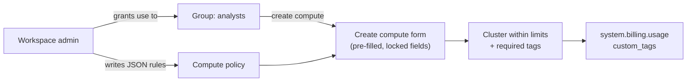

# Compute Policies

Mastery: `INPUT[inlineSelect(option(new), option(learning), option(solid)):mastery]`

> [!story] Context
> [[Admin Roles]] defines who administers the platform. A common first administrative task is limiting how users configure classic compute, since cluster size and idle time drive cost.

> [!eli5] Summary
> A compute policy is a template of rules for creating clusters. It fixes some settings, limits others to approved values, and hides the rest, so users can create their own compute within limits the company sets.

> [!renamed] Renamed
> **Cluster policies** are now called **compute policies** in the Databricks docs and UI. The Terraform resource (`databricks_cluster_policy`) and parts of the API still use the old "cluster" wording. I could not find an official date for the rename.

## Background

Classic compute is billed in [[DBUs]] plus the cloud provider's VM charges for as long as it runs. Without restrictions, common problems include:

1. **Oversized clusters:** More workers or larger instance types than the workload needs.
2. **Idle clusters:** [[Auto Termination|Auto-termination]] disabled, so clusters run when nobody uses them.
3. **Unattributed spend:** Missing tags, so spend cannot be assigned to a team.

Policies also enforce configuration standards such as the [[Databricks Runtime]] version, access mode, and init scripts.

## Overview

A compute policy is a named JSON document of rules, owned by a workspace. Workspace admins have access to every policy. Non-admins must be granted permission on a policy before they can use it, and then they can create compute only through policies they are allowed to use. A policy can also set a **maximum number of compute resources per user**.

Each rule targets one compute attribute and has a type:

| Rule type | What it does | Example |
|---|---|---|
| `fixed` | Locks a value. Add `"hidden": true` to hide it in the UI. | Auto-termination always 30 minutes |
| `forbidden` | Prevents the attribute from being set | No init scripts |
| `allowlist` | User picks from a list. With no default, the UI pre-selects the first entry. | Only two node types |
| `blocklist` | Anything except these values | Not GPU node types |
| `regex` | Value must match a pattern | Runtime must be an LTS |
| `range` | Numeric bounds with `minValue` and `maxValue` (either can be omitted) | 1 to 8 workers |
| `unlimited` | No limit, but can set a default or make it required (`isOptional: false`) | Require a `team` tag |

The docs group these into **fixed** and **limiting** policy types. A useful virtual attribute is `dbus_per_hour`, which caps the DBU rate of the whole cluster. The UI form only supports it as a range with a `maxValue`.

**Policy families** are Databricks-provided templates. The Azure docs list four default policies for four use cases, such as **Personal Compute** (a single-user, single-node machine for one person) and **Job Compute**. You can create a policy from a family and override parts of it.

## How it works



A practical policy for analysts' interactive work:

```json
{
  "cluster_type": { "type": "fixed", "value": "all-purpose" },
  "spark_version": { "type": "regex", "pattern": ".*-lts.*|auto:latest-lts", "defaultValue": "auto:latest-lts" },
  "autotermination_minutes": { "type": "fixed", "value": 30, "hidden": true },
  "num_workers": { "type": "range", "minValue": 0, "maxValue": 4, "defaultValue": 1 },
  "dbus_per_hour": { "type": "range", "maxValue": 10 },
  "data_security_mode": { "type": "allowlist", "values": ["USER_ISOLATION", "SINGLE_USER"] },
  "custom_tags.team": { "type": "unlimited", "isOptional": false },
  "custom_tags.cost_center": { "type": "fixed", "value": "analytics" },
  "init_scripts.*.workspace.destination": { "type": "forbidden" }
}
```

A job-only policy, close to the pattern in the official reference, pins `cluster_type` to `job`, caps `dbus_per_hour`, and defaults `spark_version` to `auto:latest-lts`:

```json
{
  "cluster_type": { "type": "fixed", "value": "job" },
  "dbus_per_hour": { "type": "range", "maxValue": 50 },
  "num_workers": { "type": "range", "minValue": 1 },
  "spark_version": { "type": "unlimited", "defaultValue": "auto:latest-lts" }
}
```

Creating and sharing it with Terraform:

```hcl
resource "databricks_cluster_policy" "analysts" {
  name       = "Analysts - small interactive"
  definition = file("${path.module}/policies/analysts.json")
}

resource "databricks_permissions" "analysts_policy" {
  cluster_policy_id = databricks_cluster_policy.analysts.id
  access_control {
    group_name       = "analysts"
    permission_level = "CAN_USE"
  }
}
```

In the UI, set **Max compute resources per user** under the policy's Advanced options to stop one person starting several clusters. Finally, make sure ordinary users do not have the *Allow unrestricted cluster creation* entitlement (it is not granted by default), so policies are the only way in.

## Small-business considerations

> [!smallbiz] Small-business considerations
> 1. Restrict the **Personal Compute** policy to named users, or remove access to it.
> 2. Create one "small interactive" policy like the example above: auto-termination of 30 minutes or less, a low worker cap, and a required `team` tag.
> 3. Run jobs on serverless where possible. Compute policies govern classic compute only; serverless uses [[Tagging for Chargeback|serverless usage policies]] and budgets.
>
> Compute policies have no separate charge.

## Cloud differences

The policy language and rule types are the same everywhere. Attribute names that touch cloud machines differ.

> [!azure]- Azure Databricks
> - Spot settings live under `azure_attributes`, for example `azure_attributes.availability` (`ON_DEMAND_AZURE`, `SPOT_AZURE`, `SPOT_WITH_FALLBACK_AZURE`) and `azure_attributes.spot_bid_max_price`.
> - Node types are Azure VM sizes such as `Standard_D4ds_v5`. Use an `allowlist` or `regex` on `node_type_id` to limit VM families.

> [!aws]- Databricks on AWS
> - Spot and zone settings live under `aws_attributes`, for example `aws_attributes.availability` (`SPOT`, `ON_DEMAND`, `SPOT_WITH_FALLBACK`), `aws_attributes.first_on_demand`, and `aws_attributes.zone_id`.
> - `aws_attributes.instance_profile_arn` can be fixed to force a specific [[Instance Profiles|instance profile]], although Unity Catalog storage credentials are now the preferred route to S3.
> - Node types are EC2 types such as `m7gd.xlarge`. See [[EC2 Instance Types and Graviton]].

> [!gcp]- Databricks on Google Cloud
> - Preemptible and zone settings live under `gcp_attributes`, for example `gcp_attributes.availability` (`PREEMPTIBLE_GCP`, `ON_DEMAND_GCP`, `PREEMPTIBLE_WITH_FALLBACK_GCP`) and `gcp_attributes.google_service_account`.
> - Node types are GCE machine types such as `n2-highmem-4`. See [[Compute on Google Cloud]].

## Advanced topics

> [!deepdive]- Advanced topics (301–401)
> - **Policies cannot grant permissions:** They limit what a user may create. Who can attach to or restart a cluster is set separately with compute permissions (CAN ATTACH TO, CAN RESTART, CAN MANAGE).
> - **Tag conflicts:** On AWS and Azure, a custom tag added through a compute policy that clashes with a default tag key makes the cluster fail with an invalid settings error, instead of being renamed with `x_` as other custom tags are.
> - **Pipelines:** Lakeflow pipeline compute shuts down on its own. A policy that sets `autotermination_minutes` causes an error for pipelines, so keep pipeline policies separate.
> - **Deleting a policy:** Compute governed by a deleted policy can still run, but it cannot be edited unless the user has unrestricted cluster creation permission.
> - **Access mode:** `data_security_mode` sets the access mode. Unity Catalog needs `SINGLE_USER` (dedicated) or `USER_ISOLATION` (standard); `NONE` turns security features off, so forbid it.
> - **SQL warehouses and serverless** are not governed by compute policies. Control warehouses with permissions and sizes, and serverless with usage policies, budgets, and network policies.

## Common misconceptions

> [!confusion] Compute policies and cluster policies are the same thing
> The UI and docs say "compute policies". The API, JSON reference, and Terraform still say "cluster". Same feature.

> [!confusion] A policy does not stop running compute
> A policy shapes compute when it is created or edited. To stop idle compute, set `autotermination_minutes` in the policy, and use budgets to spot spend after the fact.

## Recall

What is a compute policy?::A JSON set of rules that limits how users can configure classic compute, and who can use that configuration.
What was a compute policy called before?::A cluster policy.
Name four policy rule types.::Any of: fixed, forbidden, allowlist, blocklist, regex, range, unlimited.
How do you lock a value and hide it in the UI?::A `fixed` rule with `"hidden": true`.
Which virtual attribute caps a cluster's total DBU rate?::`dbus_per_hour`.
What are policy families?::Databricks-provided policy templates for common uses, such as Personal Compute and Job Compute.
Do compute policies apply to serverless compute?::No. They govern classic compute only.
How do you require a cost tag on every cluster?::Add `custom_tags.<key>` with `"type": "unlimited", "isOptional": false` (or a fixed value).
What permission level lets a group use a policy?::CAN_USE.

## Next steps

> [!path] Learning path
> **Needs first:** [[Compute Types]], [[Admin Roles]]
> **Unlocks next:** [[Tagging for Chargeback]], [[Cost Optimization Checklist]], [[Terraform Provider]]

> [!nextup] Next
> [[Secrets Management]] covers storing credentials outside notebooks and code.

> [!sources]- Sources (last verified: 2026-10-25)
> - [Create and manage compute policies (AWS)](https://docs.databricks.com/aws/en/admin/clusters/policies)
> - [Compute policy reference (AWS)](https://docs.databricks.com/aws/en/admin/clusters/policy-definition)
> - [Compute policy reference (Azure)](https://learn.microsoft.com/en-us/azure/databricks/admin/clusters/policy-definition)
> - [Compute policy reference (GCP)](https://docs.databricks.com/gcp/en/admin/clusters/policy-definition)
> - [Default policies and policy families (AWS)](https://docs.databricks.com/aws/en/admin/clusters/policy-families)
> - [Default policies and policy families (Azure)](https://learn.microsoft.com/en-us/azure/databricks/admin/clusters/policy-families)
> - [Manage the Personal Compute policy (AWS)](https://docs.databricks.com/aws/en/admin/clusters/personal-compute)
> - [Manage classic compute (AWS)](https://docs.databricks.com/aws/en/compute/clusters-manage)
> - [Configure classic compute for pipelines (GCP)](https://docs.databricks.com/gcp/en/ldp/configure-compute)
> - [Use tags to attribute and track usage (AWS)](https://docs.databricks.com/aws/en/admin/account-settings/usage-detail-tags)
> - [Manage Databricks workspaces using Terraform (AWS)](https://docs.databricks.com/aws/en/dev-tools/terraform/workspace-management)
