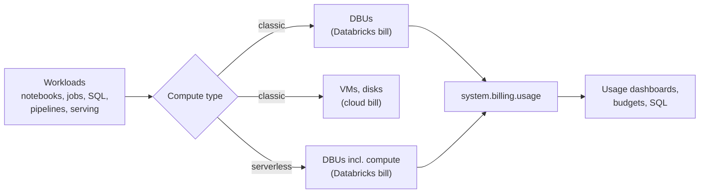

# Cost Management Basics

Mastery: `INPUT[inlineSelect(option(new), option(learning), option(solid)):mastery]`

> [!story] Context
> The earlier notes in this chapter covered security: identity, networks, encryption, and compliance. The remaining notes cover cost. Databricks is billed by usage, so spend depends on how compute is configured and how long it runs. This note explains the meter and the first controls to set.

> [!eli5] Summary
> Databricks charges for the computing power you use, measured by the second, much like an electricity meter. Some of the bill comes from Databricks and some from your cloud provider. Most surprise bills come from machines left running or sized too large, and a few settings prevent that.

## Background

Traditional databases and warehouses were often bought as fixed licences or appliances. Databricks uses consumption pricing: you pay for what runs. This removes up-front cost, but it also means an idle cluster, an oversized warehouse, or a runaway job adds cost until someone notices.

## Overview

Cost management on Databricks consists of measuring usage, attributing it to owners, setting limits, and tuning workloads.

**The meter.** Databricks usage is measured in [[DBUs|Databricks Units (DBUs)]], a normalized unit of processing capacity. Pay-as-you-go accounts pay per DBU at per-second granularity, with no up-front cost.

The DBU rate depends on the product (for example jobs, SQL, model serving), the compute type, the plan, and the cloud and region. Current rates are on the [Databricks pricing page](https://www.databricks.com/product/pricing). This vault does not state prices.

**Two bills for classic compute, one for serverless.**

| Compute | Databricks charge | Cloud provider charge |
|---|---|---|
| **Classic** (all-purpose, jobs, classic SQL warehouses) | DBUs | [[Virtual Machine\|VMs]], disks, networking, and storage, billed by the cloud provider in your account |
| **Serverless** (serverless SQL, jobs, notebooks, pipelines) | DBUs at a rate that includes the underlying compute | No VM charge; storage and some networking still apply |

The serverless DBU rate is higher than the classic rate for the same product, because it includes the infrastructure. Compare **total** cost, not DBU rate alone. See [[How Databricks Pricing Works]].

**Where the money goes.** In most accounts, spend concentrates in a few categories:

1. **Interactive clusters** ([[All-Purpose Compute]]) left running between uses.
2. **SQL warehouses** sized larger than needed, or with long auto-stop times.
3. **Scheduled jobs** that run more often, or on bigger compute, than required.
4. **Model serving and AI features**, which have their own SKUs (billing product codes).
5. **Storage and [[Egress|egress]]** on the cloud bill: [[Object Storage|object storage]], and data transferred across regions or to the internet.

**Plan tier.** The Standard tier has reached end of life. On AWS and Google Cloud, remaining Standard tier workspaces were upgraded automatically to Premium on October 1, 2025. On Azure, new workspaces must use Premium from April 1, 2026, and remaining Standard tier workspaces are upgraded automatically to Premium in a phased rollout that starts October 1, 2026.

## How it works



All Databricks usage is recorded in the [[System Tables|system table]] `system.billing.usage`, with one row per usage record, and list prices in `system.billing.list_prices`. A first query, run in the SQL editor:

```sql
-- DBUs by product for the last 30 days
SELECT billing_origin_product,
       sku_name,
       SUM(usage_quantity) AS dbus
FROM system.billing.usage
WHERE usage_date >= current_date() - INTERVAL 30 DAYS
GROUP BY billing_origin_product, sku_name
ORDER BY dbus DESC;
```

Cloud provider charges for classic compute do not appear in this table. Review them in your cloud provider's cost tools.

### The first five controls

1. **Set [[Auto Termination|auto-termination]] on every interactive cluster**, ideally enforced with a [[Compute Policies|compute policy]]. Databricks' cost guidance uses one hour as an example idle time; shorter is common for small teams.
2. **Use serverless** for SQL warehouses and jobs where available. It stops when idle and requires no sizing of VMs.
3. **Create a budget** with email alerts in the account console. See [[Budgets and Usage Dashboards]].
4. **Tag compute and serverless usage** with a team or project key. See [[Tagging for Chargeback]].
5. **Import the usage dashboard** and review it weekly for the first month.

The full list is in the [[Cost Optimization Checklist]].

## Small-business considerations

> [!smallbiz] Small-business considerations
> - Start with serverless SQL and serverless jobs. You avoid sizing VMs and you receive one bill for compute.
> - Set a monthly budget alert at a value you would want to be warned about, plus a second alert at a lower value.
> - Restrict who can create clusters. In a small team, one or two shared, policy-governed clusters are usually enough.
> - Check `system.billing.usage` weekly for the first month. Most surprises appear in the first few weeks.
> - For a worked estimate, see [[Estimating Costs for a Small Business]].

## Cloud differences

> [!azure]- Azure Databricks
> - Azure Databricks is billed through your Azure subscription. DBU and VM charges both appear in Azure Cost Management, where Azure Databricks resource tags are available for analysis. See [[Azure Billing and Commit Units]].
> - Azure publishes a serverless DBU consumption by SKU reference page.
> - Azure Cost Management shows billed amounts, while Databricks usage tools show list prices, so totals differ.

> [!aws]- Databricks on AWS
> - The Databricks bill comes from Databricks directly or through AWS Marketplace. EC2, EBS, S3, and data transfer charges for classic compute appear on the AWS bill. See [[AWS Marketplace and Billing]].

> [!gcp]- Databricks on Google Cloud
> - Databricks is billed through Google Cloud Marketplace on your Google Cloud bill. Compute Engine, storage, and networking for classic compute appear as Google Cloud charges. See [[Google Cloud Marketplace and Billing]].

## Advanced topics

> [!deepdive]- Advanced topics (301–401)
> - **List price vs contract price.** `system.billing.list_prices` holds list prices. Committed-use or negotiated discounts are not reflected there, so system-table cost figures are list-price estimates.
> - **Billing lag.** `system.billing.usage` updates every few hours, so very recent usage may be missing.
> - **Serverless attribution.** Serverless usage is attributed with serverless usage policies, which add tags to usage records. See [[Tagging for Chargeback]].
> - **Governance Hub.** The account-level Governance Hub includes a Cost page with spend by product, workspace, and tag, at list price. It was in Beta as of October 2026 and is enabled from the account console Previews page.
> - **Total cost of ownership.** Compare Databricks spend against the cost of the systems it replaces, including staff time. See [[Total Cost of Ownership]].

## Common misconceptions

> [!confusion] The Databricks invoice is not the whole cost
> For classic compute, VMs, disks, and networking are billed by your cloud provider. Serverless includes compute in the DBU rate, but storage remains on the cloud bill.

> [!confusion] A higher serverless DBU rate does not mean higher cost
> Serverless rates include infrastructure and serverless compute stops when idle. Compare total cost per workload.

## Recall

What unit does Databricks use to meter usage?::The Databricks Unit (DBU).
At what granularity is pay-as-you-go usage billed?::Per second.
For classic compute, which costs are billed by the cloud provider?::VMs, disks, networking, and storage.
What does the serverless DBU rate include?::The underlying compute infrastructure as well as the Databricks charge.
Which system table records all billable usage?::`system.billing.usage`.
Which system table holds list prices?::`system.billing.list_prices`.
Name three of the first five cost controls.::Any of: auto-termination, serverless, budgets with alerts, tagging, the usage dashboard.
Do system-table cost figures include negotiated discounts?::No. They use list prices.

## Next steps

> [!path] Learning path
> **Needs first:** [[DBUs]], [[How Databricks Pricing Works]], [[Compute Types]]
> **Unlocks next:** [[Budgets and Usage Dashboards]], [[Tagging for Chargeback]], [[Cost Optimization Checklist]]

> [!nextup] Next
> [[Budgets and Usage Dashboards]] covers budget alerts and the built-in dashboards that read `system.billing.usage`.

> [!sources]- Sources (last verified: 2026-10-25)
> - [Databricks pricing](https://www.databricks.com/product/pricing)
> - [Manage your subscription: Standard tier end of life (AWS)](https://docs.databricks.com/aws/en/admin/account-settings/account)
> - [Manage your subscription: Standard tier end of life (GCP)](https://docs.databricks.com/gcp/en/admin/account-settings/account)
> - [End of life for Standard tier workspaces (Azure)](https://learn.microsoft.com/en-us/azure/databricks/admin/account-settings/standard-tier)
> - [Cost management tools on Databricks (AWS)](https://docs.databricks.com/aws/en/admin/usage/)
> - [Cost management tools on Databricks (Azure)](https://learn.microsoft.com/en-us/azure/databricks/admin/usage/)
> - [Monitor costs using system tables (AWS)](https://docs.databricks.com/aws/en/admin/usage/system-tables)
> - [Monitor costs using system tables (Azure)](https://learn.microsoft.com/en-us/azure/databricks/admin/usage/system-tables)
> - [Billable usage system table reference (AWS)](https://docs.databricks.com/aws/en/admin/system-tables/billing)
> - [Pricing system table reference (Azure)](https://learn.microsoft.com/en-us/azure/databricks/admin/system-tables/pricing)
> - [Serverless DBU consumption by SKU (Azure)](https://learn.microsoft.com/en-us/azure/databricks/resources/pricing)
> - [Best practices for cost optimization (AWS)](https://docs.databricks.com/aws/en/lakehouse-architecture/cost-optimization/best-practices)
> - [Best practices for cost optimization (Azure)](https://learn.microsoft.com/en-us/azure/databricks/lakehouse-architecture/cost-optimization/best-practices)
> - [Cost overview, Governance Hub (AWS)](https://docs.databricks.com/aws/en/admin/governance-hub/cost)
