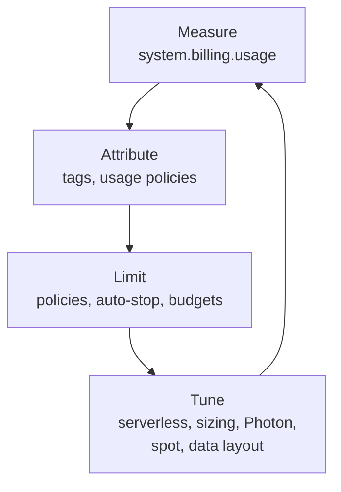

# Cost Optimization Checklist

Mastery: `INPUT[inlineSelect(option(new), option(learning), option(solid)):mastery]`

> [!story] Context
> [[Tagging for Chargeback]] attributes spend to teams. With spend measured and attributed, this checklist lists the changes that reduce it, ordered from highest impact and lowest effort to more specialised tuning.

> [!eli5] Summary
> Most wasted money on Databricks comes from machines that run when nobody is using them, machines that are bigger than the job needs, and jobs that do more work than necessary. This checklist goes through the settings that fix each of those.

## Background

The Databricks Well-Architected cost optimization guidance recommends choosing the right compute, scaling dynamically, monitoring usage, and designing workloads to be cost-effective. This note turns that guidance into a checklist with the specific settings involved.

## Overview

| # | Check | Setting or action | Applies to |
|---|---|---|---|
| 1 | Idle interactive compute stops | `autotermination_minutes` on all-purpose compute, enforced by policy | Classic |
| 2 | Serverless is the default | Serverless SQL warehouses, serverless jobs, serverless notebooks | Serverless |
| 3 | Scheduled work runs on job compute, not all-purpose | Job clusters or serverless jobs | Classic, serverless |
| 4 | Compute is sized from metrics | Review CPU, memory, and I/O; cap workers in policies | Classic |
| 5 | Autoscaling is on where load varies | Min and max workers; warehouse scaling limits | Classic, SQL |
| 6 | Spot capacity for fault-tolerant work | Spot or preemptible workers with an on-demand driver | Classic |
| 7 | Photon where it helps | Photon on for SQL and DataFrame-heavy work | Classic, SQL |
| 8 | Pools for frequent short jobs | Instance pools with idle instance limits | Classic |
| 9 | SQL warehouses stop when idle | Auto-stop time; right size; serverless type | SQL |
| 10 | Data layout is maintained | [[Liquid Clustering]], [[OPTIMIZE and VACUUM]], predictive optimization | Storage, all compute |
| 11 | Jobs run only as often as needed | Review schedules and triggers | Jobs |
| 12 | Spend is reviewed | Budgets, usage dashboard, untagged spend | All |

### Notes on each check

1. **Auto-termination:** Configure it for all interactive compute. The docs use one hour as an example; outside policies the allowed range is 10 to 10,000 minutes. `0` disables it, so forbid `0` in policies.
2. **Serverless:** Databricks recommends serverless compute as the primary option. It requires no configuration, scales in seconds, and stops when idle. Serverless jobs enable Photon and autoscaling automatically, and the **standard performance mode** uses fewer DBUs than performance-optimized mode for jobs that tolerate slower start-up.
3. **Job compute:** Job compute has a lower list DBU rate than all-purpose compute (see the [pricing page](https://www.databricks.com/product/pricing)) and terminates when the job ends. It also gives accurate per-job cost in `system.billing.usage`.
4. **Right-sizing:** Start from a baseline, then adjust using utilization metrics. Use policies to offer fixed sizes ("small", "medium") and cap worker counts.
5. **Autoscaling:** Lets classic compute add and remove workers with load. See [[Autoscaling]].
6. **Spot instances:** Use [[Spot Instances|spot capacity]] only for work that tolerates eviction. The driver should always be on-demand. Reclaimed spot instances can lengthen run time.
7. **Photon:** Photon is enabled by default on SQL warehouses. On classic compute, test whether a workload benefits: Photon has a different DBU rate, so it saves money only when the speed-up outweighs it. See [[Photon]].
8. **Pools:** Databricks does not charge DBUs for idle instances in a pool, but the cloud provider still bills for them. Keep minimum idle instances low.
9. **SQL warehouses:** Set a short auto-stop, start with a small size, and scale up only when queries queue. See [[SQL Warehouses]].
10. **Data layout:** Well-clustered, compacted tables scan less data, which reduces compute time for every query.
11. **Schedules:** A pipeline that runs hourly but is read daily costs roughly 24 times more than needed.
12. **Review:** Use [[Budgets and Usage Dashboards]] and the untagged-spend view.

## How it works



### Queries that find waste

All-purpose compute usage by cluster, last 30 days (candidates for auto-termination or job compute):

```sql
SELECT usage_metadata.cluster_id AS cluster_id,
       SUM(usage_quantity)       AS dbus
FROM system.billing.usage
WHERE sku_name LIKE '%ALL_PURPOSE%'
  AND usage_date >= current_date() - INTERVAL 30 DAYS
GROUP BY ALL
ORDER BY dbus DESC
LIMIT 20;
```

Clusters with auto-termination disabled (current configuration):

```sql
SELECT workspace_id, cluster_id, cluster_name, owned_by, auto_termination_minutes
FROM system.compute.clusters
QUALIFY ROW_NUMBER() OVER (PARTITION BY workspace_id, cluster_id ORDER BY change_time DESC) = 1
   AND COALESCE(auto_termination_minutes, 0) = 0;
```

`system.compute.clusters` is a slowly changing dimension table with the full configuration history of each cluster; the `QUALIFY` clause keeps the latest row. The results include deleted clusters; filter them in your workspace as needed.

## Small-business considerations

> [!smallbiz] Small-business considerations
> For a small team, checks 1, 2, 3, 9, and 12 deliver most of the savings:
> - Use serverless SQL and serverless jobs by default.
> - Keep one shared all-purpose cluster with a short auto-termination for notebook work, governed by a policy.
> - Run every scheduled pipeline as a job, never on the all-purpose cluster.
> - Set a budget alert and check the usage dashboard weekly.
>
> Spot instances, pools, and Photon tuning matter mainly when classic compute spend is large.

## Cloud differences

> [!azure]- Azure Databricks
> - Spot VMs are set with `azure_attributes.availability` (`SPOT_AZURE`, `SPOT_WITH_FALLBACK_AZURE`) and `azure_attributes.spot_bid_max_price`.
> - For pre-purchase and commitment options on Azure, see [[Azure Billing and Commit Units]].
> - Azure Cost Management can analyse VM and Databricks charges by tag.

> [!aws]- Databricks on AWS
> - Spot instances are set with `aws_attributes.availability` (`SPOT`, `SPOT_WITH_FALLBACK`) and `aws_attributes.first_on_demand` (keep at least 1 so the driver is on-demand).
> - For instance family choices, including Graviton, see [[EC2 Instance Types and Graviton]].

> [!gcp]- Databricks on Google Cloud
> - Preemptible VMs are set with `gcp_attributes.availability` (`PREEMPTIBLE_GCP`, `PREEMPTIBLE_WITH_FALLBACK_GCP`).
> - Choose GCE machine families to match the workload. See [[Compute on Google Cloud]].

## Advanced topics

> [!deepdive]- Advanced topics (301–401)
> - **Total cost, not DBU rate:** Serverless and Photon have different DBU rates. Compare total cost per workload, including cloud VM time for classic compute.
> - **Shuffle and skew:** Data skew and large shuffles extend run time on every compute type. See [[Query Performance and Caching]].
> - **Predictive optimization** runs maintenance (such as `OPTIMIZE` and `VACUUM`) on Unity Catalog managed tables automatically and is billed as a managed service.
> - **Egress:** Cross-region reads and internet egress appear on the cloud bill. Keep compute, storage, and the metastore in the same region.
> - **Commitments:** Committed-use contracts lower unit rates but do not reduce consumption. Optimise usage first, then size the commitment.

## Common misconceptions

> [!confusion] Bigger clusters are not always more expensive
> A larger cluster that finishes in a quarter of the time can cost the same or less. Measure total DBUs and VM hours per run.

> [!confusion] Spot is not suitable for every workload
> Spot or preemptible capacity can be reclaimed. Use it for fault-tolerant batch workers, never for the driver.

## Recall

What auto-termination value disables auto-stop?::`0`.
What is the allowed auto-termination range outside policies?::10 to 10,000 minutes.
What compute does Databricks recommend as the primary option?::Serverless compute.
Why run scheduled work on job compute instead of all-purpose compute?::Lower DBU rate, automatic termination, and accurate per-job cost attribution.
Which node should never run on spot capacity?::The driver.
Does Databricks charge DBUs for idle pool instances?::No, but the cloud provider still bills for them.
Is Photon enabled by default on SQL warehouses?::Yes.
Which serverless jobs mode uses fewer DBUs?::Standard performance mode.

## Next steps

> [!path] Learning path
> **Needs first:** [[Cost Management Basics]], [[Compute Types]]
> **Unlocks next:** [[Terraform Provider]], [[Query Performance and Caching]]

> [!nextup] Next
> [[Terraform Provider]] covers managing accounts, workspaces, policies, and permissions as code, so these settings stay consistent across workspaces.

> [!sources]- Sources (last verified: 2026-10-25)
> - [Best practices for cost optimization (AWS)](https://docs.databricks.com/aws/en/lakehouse-architecture/cost-optimization/best-practices)
> - [Best practices for cost optimization (GCP)](https://docs.databricks.com/gcp/en/lakehouse-architecture/cost-optimization/best-practices)
> - [Best practices for cost optimization (Azure)](https://learn.microsoft.com/en-us/azure/databricks/lakehouse-architecture/cost-optimization/best-practices)
> - [Phase 8: Design compute configuration (AWS)](https://docs.databricks.com/aws/en/lakehouse-architecture/deployment-guide/compute)
> - [Run your Lakeflow Jobs with serverless compute for workflows (AWS)](https://docs.databricks.com/aws/en/jobs/run-serverless-jobs)
> - [Best practices for serverless compute (AWS)](https://docs.databricks.com/aws/en/compute/serverless/best-practices)
> - [Manage classic compute (AWS)](https://docs.databricks.com/aws/en/compute/clusters-manage)
> - [Compute configuration reference (Azure)](https://learn.microsoft.com/en-us/azure/databricks/compute/configure)
> - [Compute policy reference (AWS)](https://docs.databricks.com/aws/en/admin/clusters/policy-definition)
> - [Compute system tables reference (AWS)](https://docs.databricks.com/aws/en/admin/system-tables/compute)
> - [Billable usage system table reference (AWS)](https://docs.databricks.com/aws/en/admin/system-tables/billing)
> - [Databricks pricing](https://www.databricks.com/product/pricing)
