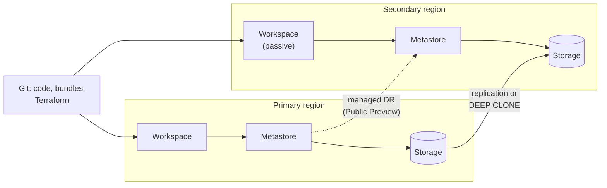

# Disaster Recovery

Mastery: `INPUT[inlineSelect(option(new), option(learning), option(solid)):mastery]`

> [!story] Context
> The [[Terraform Provider]] makes the platform configuration reproducible. Disaster recovery (DR) extends that to data and workloads: restoring service after a regional outage, accidental deletion, or corruption, within a defined time and with a defined amount of data loss.

> [!eli5] Summary
> Disaster recovery is the plan for keeping the business running if a whole data center region goes down or important data is deleted. It answers two questions: how long can you be without the system, and how much recent work can you afford to lose.

## Background

Cloud regions are highly available, but regional outages, misconfigurations, and accidental deletes still happen. Two measures define a DR requirement:

| Measure | Meaning |
|---|---|
| **RPO** (recovery point objective) | The maximum acceptable data loss, measured in time. An RPO of 15 minutes means losing at most the last 15 minutes of changes. |
| **RTO** (recovery time objective) | The maximum acceptable time to restore service. |

Databricks' HA/DR design guide gives example targets: **critical** workloads with RTO under 1 hour and RPO under 15 minutes; **important** workloads with RTO under 4 hours and RPO under 1 hour using hourly replication. These are planning examples, not guarantees.

## Overview

**Shared responsibility.** Databricks does not hold your primary data. Tables and files live in cloud storage that you control, so you define and implement the RPO for that data. Databricks operates the control plane, which holds workspace objects such as notebooks, job definitions, and cluster configurations.

| Asset | Where it lives | Who protects it |
|---|---|---|
| Tables, volumes, files | Your cloud storage (or Databricks-managed default storage) | You: storage replication, Delta history, cross-region copies |
| Unity Catalog metadata | Metastore (regional) | Managed DR, or your own scripts |
| Notebooks, jobs, cluster configs, dashboards | Control plane | Databricks backs up control-plane databases; cross-region recovery is your design (Git, bundles, Terraform) or managed DR |
| Secrets, external locations, storage credentials | Workspace and metastore | You recreate them in the secondary region |

The Azure docs state that workspace-level backup and restore is not directly available, so plan to recreate workspaces from your own synchronization processes.

**DR strategies.**

| Strategy | Description | RTO and RPO | Cost |
|---|---|---|---|
| **Backup and rebuild** | Infrastructure as code plus storage replication; rebuild in another region when needed | Hours or more | Lowest |
| **Active-passive** | A secondary deployment in another region kept in sync; becomes active only when the primary fails | Lower | Medium |
| **Active-active** | Workloads run in both regions | Lowest | Highest: jobs run twice |

**Managed disaster recovery.** Databricks offers managed DR for cross-region recovery on AWS and Azure, and the docs recommend it for that purpose. It was in **Public Preview** as of October 2026.

- Replicates Unity Catalog metadata and managed table data, workspace assets, or both, to a secondary region.
- Failover is triggered from the account console, and planned failovers can be used to test the setup.
- An optional stable URL keeps clients working after failover.
- Requirements: Enterprise plan in both regions on AWS; on Azure, the Premium plan plus the Mission Critical add-on. A secondary workspace and metastore in the same account and cloud.
- Not replicated: materialized views, streaming tables, Lakeflow pipelines, managed volumes, secrets, ML models, model serving endpoints, vector search indexes, and Delta shares. External locations and storage credentials must be created in the secondary region.
- Compute cannot run on the secondary workspace while managed DR is enabled.
- Failover actions are recorded in the audit log under a `disasterRecovery` service.

## How it works



### Do-it-yourself active-passive, outline

1. **Infrastructure.** Define both workspaces, networking, metastores, external locations, and policies in Terraform. Apply to both regions.
2. **Code and jobs.** Keep notebooks, jobs, and pipelines in Git and deploy them to both regions with [[Declarative Automation Bundles]], with schedules paused in the secondary.
3. **Identities.** Sync users and groups from the identity provider to the account; account-level identities are shared by both workspaces.
4. **Data.** Copy Delta tables to the secondary region on a schedule that meets the RPO, for example with `DEEP CLONE`:

```sql
-- Incremental copy of a table into the DR catalog (run on a schedule)
CREATE OR REPLACE TABLE dr_sales.orders.daily_totals
  DEEP CLONE sales.orders.daily_totals;
```

   Re-running a clone into an existing Delta table creates an incremental commit with only the new data and metadata since the last clone. Deep clones also copy stream metadata, so a stream writing to the source can continue on the clone target from where it stopped. You can also share tables to the secondary region with [[OpenSharing]].
5. **Secrets.** Recreate secret scopes and secrets in the secondary workspace from your secret source of record.
6. **Failover runbook.** Document who decides to fail over, how DNS or client connections change, how schedules are enabled, and how to fail back. Test it at least yearly.

### Recovery from accidental change

Not every incident is regional. For deleted or corrupted data within a region:

- Delta [[Time Travel]] restores a table to an earlier version: `RESTORE TABLE sales.orders.daily_totals TO VERSION AS OF 42;`. History is limited by retention settings and `VACUUM`.
- `UNDROP TABLE` recovers a dropped Unity Catalog table within the recovery window, 7 days by default. Configuring the window (0 hours, or 7 to 30 days, at catalog or schema level) was in Public Preview as of October 2026.
- Cloud storage versioning or soft delete protects files in your buckets and storage accounts.

## Small-business considerations

> [!smallbiz] Small-business considerations
> - Most small companies do not need multi-region DR. Start with in-region protection: Delta time travel, storage soft delete or versioning, and all code in Git.
> - Define your RPO and RTO in business terms. If dashboards can be a day late, an RPO of 24 hours and a rebuild from code may be sufficient.
> - Keep workspace configuration in Terraform or at least documented, so a workspace can be recreated.
> - Multi-region DR roughly doubles storage and adds compute for replication. Managed DR also has plan and add-on requirements.

## Cloud differences

> [!azure]- Azure Databricks
> - Managed DR requires the Premium plan plus the **Mission Critical add-on** (Public Preview as of October 2026).
> - Azure Databricks backs up control-plane databases (notebooks, job definitions, cluster configurations), but workspace-level backup and restore is not directly available.
> - Databricks advises against relying on geo-redundant storage to duplicate workspace root storage across regions. Microsoft publishes a separate reliability guide for Azure Databricks.

> [!aws]- Databricks on AWS
> - Managed DR requires the Enterprise plan in both regions (Public Preview as of October 2026).
> - For table data, the DIY guidance uses Delta deep clone on a schedule. Validate copied tables in the secondary with `DESCRIBE HISTORY`.

> [!gcp]- Databricks on Google Cloud
> - The GCP disaster recovery guide covers do-it-yourself strategies (active-passive, active-active). I found no statement that managed DR is available on GCP as of October 2026.

## Advanced topics

> [!deepdive]- Advanced topics (401)
> - **Metastores are regional.** A workspace cannot attach to a metastore in another region. The secondary region needs its own metastore, and catalogs, grants, and external locations must be recreated or replicated there.
> - **Corruption replicates.** DR does not protect against data corruption: corrupted data in the primary is replicated to the secondary. Use Delta time travel or backups for that case.
> - **Managed DR secondary.** During replication, in-scope catalogs in the secondary are read-only and compute is unavailable in the secondary workspace.
> - **Failback.** The docs suggest using audit trails of logs and Delta tables to confirm no data loss during failback.
> - **Streaming.** Stream metadata is carried by deep clones. Beyond that, plan and test how each stream restarts in the secondary region; the docs do not give a general procedure.
> - **Lakebase.** Lakebase DR is documented separately, was in Private Preview, and does not replicate Delta tables.
> - **Exporter.** The Terraform provider's experimental exporter can generate code from an existing workspace, which helps capture configuration that was created by hand.
> - **Testing.** A DR plan that has not been tested has unknown RTO. Run planned failovers (managed DR supports them) and record the actual time.

## Common misconceptions

> [!confusion] Databricks does not back up your data
> Your tables live in your cloud storage. Databricks protects its control plane. Replicating and backing up data is your responsibility, or managed DR's, if you enable it.

> [!confusion] Time travel is not disaster recovery
> Time travel recovers from mistakes within the same table and region. It does not protect against the loss of a region or a storage account.

## Recall

What does RPO measure?::The maximum acceptable data loss, measured in time.
What does RTO measure?::The maximum acceptable time to restore service.
Who is responsible for backing up table data on Databricks?::The customer, because data lives in the customer's cloud storage.
What does managed disaster recovery replicate?::Unity Catalog metadata and managed table data, workspace assets, or both.
What is the release status of managed DR as of October 2026?::Public Preview.
What does managed DR require on Azure?::The Premium plan plus the Mission Critical add-on.
Name three asset types managed DR does not replicate.::Any of: materialized views, streaming tables, Lakeflow pipelines, managed volumes, secrets, ML models, serving endpoints, vector search indexes, Delta shares.
Which SQL command copies a Delta table incrementally to another location?::`DEEP CLONE`.
What is the trade-off of active-active DR?::Lowest RTO and RPO, but highest cost because workloads run in both regions.

## Next steps

> [!path] Learning path
> **Needs first:** [[Control Plane and Compute Plane]], [[Terraform Provider]], [[Region]]
> **Unlocks next:** [[Chapter 15 - Migrating to Databricks]], [[Running Old and New in Parallel]]

> [!nextup] Next
> [[Chapter 15 - Migrating to Databricks]] covers moving existing systems and data onto a platform configured as described in this chapter.

> [!sources]- Sources (last verified: 2026-10-25)
> - [Disaster recovery (AWS)](https://docs.databricks.com/aws/en/admin/disaster-recovery)
> - [Disaster recovery (Azure)](https://learn.microsoft.com/en-us/azure/databricks/admin/disaster-recovery)
> - [Disaster recovery (GCP)](https://docs.databricks.com/gcp/en/admin/disaster-recovery)
> - [Managed disaster recovery (AWS)](https://docs.databricks.com/aws/en/admin/managed-disaster-recovery)
> - [Managed disaster recovery (Azure)](https://learn.microsoft.com/en-us/azure/databricks/admin/managed-disaster-recovery)
> - [Phase 10: Design high availability and disaster recovery (AWS)](https://docs.databricks.com/aws/en/lakehouse-architecture/deployment-guide/ha-dr)
> - [Phase 10: Design high availability and disaster recovery (Azure)](https://learn.microsoft.com/en-us/azure/databricks/lakehouse-architecture/deployment-guide/ha-dr)
> - [Best practices for reliability (AWS)](https://docs.databricks.com/aws/en/lakehouse-architecture/reliability/best-practices)
> - [Reliability in Azure Databricks (Microsoft)](https://learn.microsoft.com/en-us/azure/reliability/reliability-databricks)
> - [Lakebase Disaster Recovery (AWS)](https://docs.databricks.com/aws/en/oltp/projects/disaster-recovery)
> - [Clone a table on Databricks (AWS)](https://docs.databricks.com/aws/en/delta/clone)
> - [UNDROP (Azure)](https://learn.microsoft.com/en-us/azure/databricks/sql/language-manual/sql-ref-syntax-ddl-undrop-table)
> - [DROP TABLE (AWS)](https://docs.databricks.com/aws/en/sql/language-manual/sql-ref-syntax-ddl-drop-table)
> - [Databricks platform release notes (AWS)](https://docs.databricks.com/aws/en/release-notes/product)
> - [Diagnostic log reference (Azure)](https://learn.microsoft.com/en-gb/azure/databricks/admin/account-settings/audit-logs)
